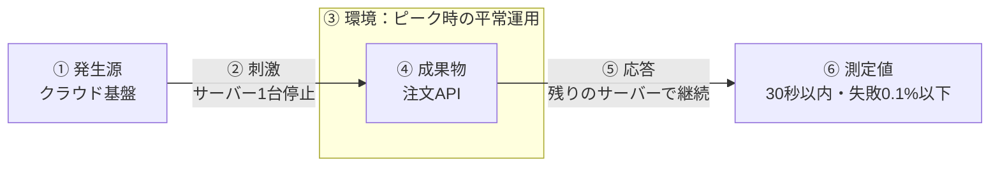
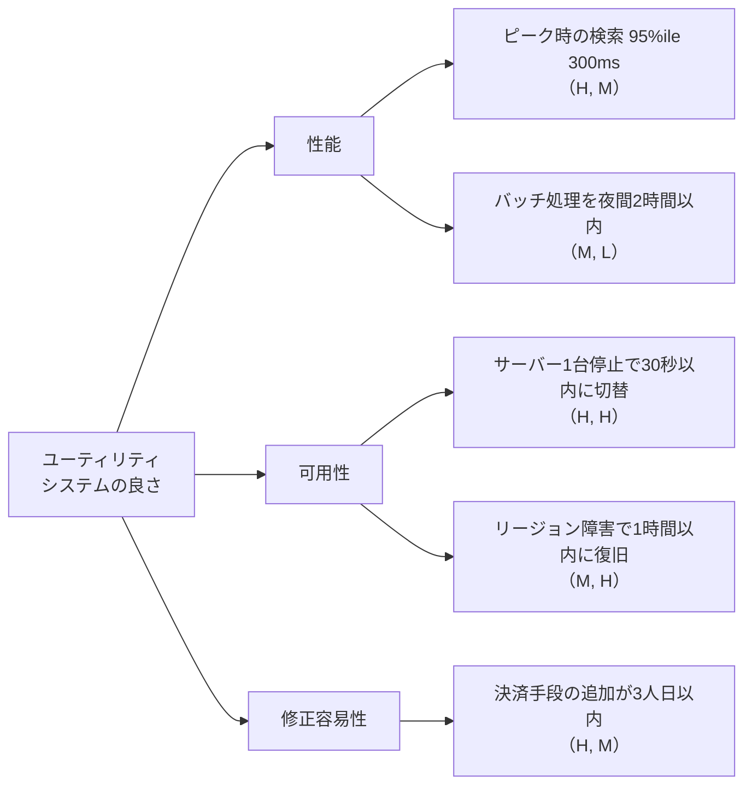
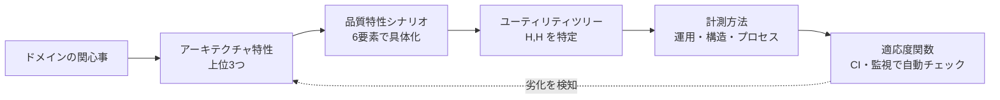

# 品質特性シナリオと計測

## この教材の目的

[[01品質属性]] では「品質属性は測れるべき」と学び、[[04_アーキテクチャ特性の見つけ方と分類]] では重要な特性を見つけて絞り込む方法を学びました。
しかし「可用性が大事」と決めただけでは、

- どのくらいの可用性なら合格なのか
- 設計がそれを満たしているか、どう確かめるのか
- 運用中に劣化していないか、どう気づくのか

が分かりません。この教材では、特性を **具体的で、検証できる形** に書き下す方法として、

- SEI（カーネギーメロン大学ソフトウェア工学研究所）の **品質特性シナリオ（6要素）**
- シナリオを優先順位づけする **ユーティリティツリー**（ATAM）
- 『ソフトウェアアーキテクチャの基礎』の **3種類の計測**（運用・構造・プロセス）
- 計測を自動で守り続ける **適応度関数** への橋渡し

を解説します。

---

## 1. なぜ「シナリオ」で書くのか

「システムは高い可用性を持つこと」という要件には、次の問題があります。

| 問題 | 例 |
|---|---|
| **何が起きたときの話か分からない** | サーバーが1台落ちたとき？ データセンター全体が落ちたとき？ |
| **どこの話か分からない** | 注文 API？ 管理画面？ バッチ処理？ |
| **合格ラインが分からない** | 99%？ 99.99%？ 30秒で復旧？ 1時間で復旧？ |

そこで、**「いつ・何が起きて・どこに・どう反応し・どの程度なら合格か」** を1文で書きます。これが **品質特性シナリオ** です。

---

## 2. 品質特性シナリオの6要素

SEI が提唱した形式では、シナリオを次の6つの要素で書きます。

| 要素 | 意味 | 可用性の例 |
|---|---|---|
| **① 刺激の発生源**（Source） | 刺激を引き起こすもの（人・システム・環境） | クラウド基盤 |
| **② 刺激**（Stimulus） | システムに届く出来事 | アプリサーバー1台が突然停止する |
| **③ 環境**（Environment） | そのときのシステムの状態 | 平常運用中（ピーク時間帯） |
| **④ 成果物**（Artifact） | 刺激を受ける部分 | 注文 API |
| **⑤ 応答**（Response） | システムがどう反応するか | ロードバランサーが故障を検知し、残りのサーバーに振り分ける |
| **⑥ 応答の測定値**（Response Measure） | 応答が合格かどうかを判定する数値 | 30秒以内に切り替わり、失敗する注文は 0.1% 以下 |

1文にまとめると：

> **ピーク時間帯の平常運用中に**、クラウド基盤の障害で**アプリサーバー1台が停止した**とき、**注文 API は**残りのサーバーで処理を継続し、**30秒以内に切り替わり、失敗する注文は 0.1% 以下**である。

### 2.1 特性ごとのシナリオ例

| 特性 | シナリオ（6要素を含む1文） |
|---|---|
| **性能** | 年末セールのピーク時に、**利用者が毎秒 1,000 件の商品検索を送ったとき**、検索 API は **95パーセンタイルで 300ms 以内** に結果を返す |
| **スケーラビリティ / 弾力性** | チケット発売開始の瞬間に、**アクセスが平常時の 50 倍に急増したとき**、受付システムは **5分以内に自動でスケールアウトし**、エラー率 1% 以下を保つ |
| **修正容易性（保守性）** | **開発者が新しい決済手段を追加するとき**、通常の開発期間中に、**決済モジュールだけを変更し**、他モジュールの変更なしで **3人日以内** に本番リリースできる |
| **セキュリティ** | **外部の攻撃者が**、平常運用中に、**ログイン API に総当たり攻撃を仕掛けたとき**、システムは **同一アカウントへの試行を5回で一時ロックし**、管理者に **1分以内に通知** する |
| **テスト容易性** | **開発者が**、開発中に、**注文ドメインのロジックを変更したとき**、DB や外部 API なしで **単体テストを 1 分以内に実行** できる |
| **デプロイ容易性** | **開発チームが**、平日の業務時間中に、**在庫サービスの新バージョンをデプロイするとき**、**利用者に停止を見せずに** 15分以内に完了し、問題があれば **5分以内にロールバック** できる |

ポイントは、**保守性やテスト容易性のような「構造特性」もシナリオで書ける** ことです。「保守しやすいこと」は検証できませんが、「新しい決済手段を他モジュールの変更なしで追加できる」は設計レビューで検証できます。

---

## 3. ユーティリティツリーで優先順位をつける

シナリオを書き出すと、数十個になることもあります。全部を同じ重みで扱うことはできません（[[02トレードオフ]]）。
SEI の評価手法 **ATAM**（Architecture Tradeoff Analysis Method）では、**ユーティリティツリー** でシナリオを整理し、優先順位をつけます。

各シナリオに2つの評価（H＝高・M＝中・L＝低）を付けます。

| 評価軸 | 問い |
|---|---|
| **ビジネス上の重要度** | 満たせないと事業にどれだけ影響するか |
| **アーキテクチャ上の難しさ** | 実現するのがどれだけ難しいか・リスクが高いか |

**（H, H）のシナリオ** が、アーキテクチャで最も注意して扱うべきものです。上の例なら「サーバー1台停止で30秒以内に切替」がそれにあたり、ここに設計の工数とレビューを集中させます。

> ATAM 自体は、ステークホルダーを集めて数日かけて行う本格的な評価手法です。小さなチームでは、**ユーティリティツリーの考え方だけを借りて、30分のワークショップで上位シナリオを決める** だけでも十分効果があります。

---

## 4. 『ソフトウェアアーキテクチャの基礎』の3種類の計測

『基礎』では、アーキテクチャ特性の計測を3種類に分けています。

### 4.1 運用の計測（Operational measures）

本番環境での振る舞いを測ります。性能・可用性・スケーラビリティなどの運用特性が対象です。

| 指標 | 注意点 |
|---|---|
| 応答時間 | **平均だけ見ない**。平均は少数の極端に遅いリクエストを隠す。**パーセンタイル（p95・p99）** で見る |
| スループット | 単位時間あたりの処理件数 |
| エラー率 | 失敗したリクエストの割合 |
| 稼働率 | 99.9% なら月に約 43 分、99.99% なら月に約 4 分の停止が許される |

運用の計測は **SRE の SLI / SLO** とほぼ同じ考え方です。

| 用語 | 意味 | 例 |
|---|---|---|
| **SLI**（サービスレベル指標） | 何を測るか | 300ms 以内に返ったリクエストの割合 |
| **SLO**（サービスレベル目標） | どこを目標にするか | 30日間で 99% のリクエストが 300ms 以内 |
| **SLA**（サービスレベル合意） | 顧客との約束と、破ったときの補償 | 稼働率 99.9% を下回ったら返金 |
| **エラーバジェット** | 100% − SLO。許容される失敗の量 | SLO 99.99%（30日）なら約 4 分の停止まで許容 |

品質特性シナリオの「⑥ 応答の測定値」は、運用中は SLO として監視されます。SLI・SLO の設計の詳細は [[01_SLI・SLOの設計]]（65_可観測性）を参照してください。

### 4.2 構造の計測（Structural measures）

コードの構造を測ります。保守性・テスト容易性などの構造特性が対象です。

| 指標 | 何を測るか | 目安 |
|---|---|---|
| **循環的複雑度**（Cyclomatic Complexity） | 関数の中の分岐（if・for・case）の多さ。McCabe が提唱 | 1関数あたり 10 以下が一般的な目安。5 以下が望ましいとする意見も多い |
| **凝集度の欠如**（LCOM） | クラス内のメソッドが同じフィールドを共有していない度合い | 高いほど、クラスを分割すべきサイン |
| **結合度**（求心性・遠心性） | モジュール間の依存の数 | → [[02_結合の指標_求心性遠心性と主系列からの距離]] |
| **循環依存の有無** | モジュール間の依存がループしていないか | 0 であるべき |

ただし、構造の計測は **それだけで「良い設計」を保証しません**。数値は「問題がありそうな場所」を見つける道具であり、最終的な判断は人が行います。

### 4.3 プロセスの計測（Process measures）

開発プロセスを通して測ります。アジリティ・テスト容易性・デプロイ容易性などが対象です。

| 指標 | 例 |
|---|---|
| テストカバレッジ | 自動テストがコードのどれだけを通っているか |
| デプロイ頻度 | 1日に何回本番デプロイできるか |
| 変更のリードタイム | コミットから本番反映までの時間 |
| 変更失敗率 | デプロイが障害につながった割合 |
| 復旧時間 | 障害から復旧するまでの時間 |

下の4つは、DevOps の研究（DORA）で使われる **Four Keys** と同じものです。「アジリティ」のような複合特性は、このプロセスの計測で間接的に測ります。

---

## 5. 計測から適応度関数へ

シナリオを書き、計測方法を決めたら、最後は **それを自動で守り続ける** 仕組みにします。これが **アーキテクチャ適応度関数**（Fitness Function）です（『進化的アーキテクチャ』、→ 70_進化と組織）。

| シナリオ（品質目標） | 適応度関数（自動チェック） | 種類 |
|---|---|---|
| 検索 API は p95 で 300ms 以内 | 本番監視で SLO を常時計測し、違反したらアラート | 継続型 |
| 注文ドメインは DB に依存しない | アーキテクチャテスト（ArchUnit など）を CI で実行 | トリガー型 |
| モジュール間の循環依存ゼロ | 静的解析を CI で実行し、検出したらビルド失敗 | トリガー型 |
| 関数の循環的複雑度 10 以下 | Lint ルールで検査 | トリガー型 |
| サーバー1台停止で30秒以内に切替 | カオスエンジニアリング（意図的に障害を起こすテスト）を定期実行 | 継続型 |

流れをまとめると次のようになります。

---

## 6. ありがちな誤解

### 6.1 「数値目標は高いほど良い」

**誤りです。** 99.9% と 99.99% では、許される停止時間が月 43 分と月 4 分で約10倍違い、必要な構成とコストも大きく変わります。**ビジネス上必要な水準** に合わせます（[[01品質属性]] の「過剰品質」）。

### 6.2 「平均応答時間を見れば性能が分かる」

**誤りです。** 平均は少数の非常に遅いリクエストを隠します。利用者の体感に近いのは **p95・p99** です。

### 6.3 「保守性やテスト容易性は測れない」

**誤りです。** 「新機能の追加が他モジュールの変更なしでできる」のような **シナリオ** で書けば、設計レビューや変更履歴で検証できます。構造の計測（循環的複雑度・結合度）やプロセスの計測（リードタイム）も補助になります。

---

## 7. まとめ

- 品質特性は **シナリオ** で書くと、具体的で検証できる要求になる
- シナリオの6要素：**① 発生源 ② 刺激 ③ 環境 ④ 成果物 ⑤ 応答 ⑥ 応答の測定値**
- **ユーティリティツリー** で「ビジネス上の重要度 × アーキテクチャ上の難しさ」を評価し、**（H, H）** に集中する
- 計測には **運用（p95・稼働率・SLO）／構造（循環的複雑度・結合度）／プロセス（デプロイ頻度・リードタイム）** の3種類がある
- 計測を CI や監視で自動化したものが **適応度関数**。特性を「決める」から「守り続ける」へ進める

次は 13_モジュール性・結合 の [[01モジュール性]] と [[02_結合の指標_求心性遠心性と主系列からの距離]] で、構造の計測をより詳しく学びます。

---

## 参考資料

- Len Bass, Paul Clements, Rick Kazman『実践ソフトウェアアーキテクチャ』（*Software Architecture in Practice*）— 品質特性シナリオの原典
- Mark Richards, Neal Ford『ソフトウェアアーキテクチャの基礎』第6章（アーキテクチャ特性の計測と統制）
- [Quality Attribute Scenario — an overview（ScienceDirect Topics）](https://www.sciencedirect.com/topics/computer-science/quality-attribute-scenario)
- [Toward Agile Architecture: Insights from 15 Years of ATAM Data（InfoQ）](https://www.infoq.com/articles/atam-quality-attributes/)
- [Quality Attribute Scenario — A way to define Software Quality Requirements（Medium）](https://medium.com/@anil.goyal0057/quality-attribute-scenario-a-way-to-define-software-quality-requirements-71dd82f4be1b)
- [SRE Fundamentals: SLA vs SLO vs SLI（Chronosphere）](https://chronosphere.io/learn/know-the-sre-fundamentals-differences-between-sli-vs-slo-vs-sla/)
- [Fitness Functions for Your Architecture（InfoQ）](https://www.infoq.com/articles/fitness-functions-architecture/)
