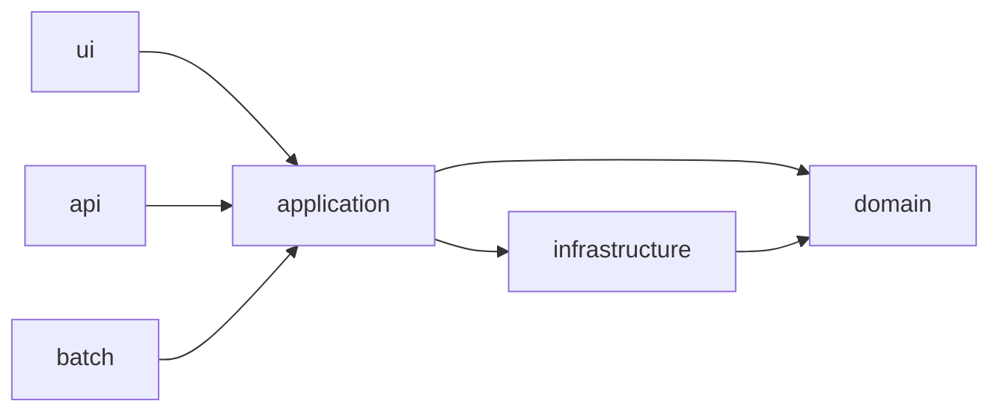

# 結合の指標 — 求心性・遠心性と主系列からの距離

## この教材の目的

[[03_疎結合と高凝集]] では「疎結合・高凝集が良い」ことを学びました。しかし「このモジュールは結合が強すぎるか？」を **感覚ではなく数値で** 判断できると、レビューや改善の優先順位づけがしやすくなります。

この教材では、『ソフトウェアアーキテクチャの基礎』第3章で紹介されている **モジュール性の計測指標** を解説します。

- 凝集度を測る **LCOM**
- 結合度を測る **求心性結合（Ca）・遠心性結合（Ce）**
- そこから計算する **抽象度（A）・不安定度（I）・主系列からの距離（D）**
- **苦痛ゾーン・無駄ゾーン** の読み方

これらの指標は Robert C. Martin（『Clean Architecture』の著者）が 1990 年代に提唱したものです。パッケージ設計の原則（SDP・SAP）としての詳細は 43_モジュール設計 の [[01_パッケージ設計の原則]] にあり、このノートでは **アーキテクチャを評価する物差しとしての使い方** に焦点を当てます。

---

## 1. 凝集度を測る — LCOM

### 1.1 LCOM とは

**LCOM**（Lack of Cohesion in Methods：メソッドの凝集の欠如）は、Chidamber と Kemerer が 1994 年に発表したオブジェクト指向メトリクス群（CK メトリクス）の1つです。
名前のとおり **凝集の「欠如」** を測るので、**値が大きいほど凝集度が低い**（＝分割を検討すべき）という意味になります。

### 1.2 考え方

「同じフィールドを使うメソッド同士は関係が深い」と考えます。

```text
class OrderService {
    orders      // フィールドA
    mailer      // フィールドB

    placeOrder()    → orders を使う
    cancelOrder()   → orders を使う
    sendNewsletter() → mailer を使う    ← 他のメソッドと共有するフィールドがない
}
```

- `placeOrder` と `cancelOrder` は `orders` を共有している → 関係が深い
- `sendNewsletter` は他と何も共有していない → **このクラスにいる理由がない**

LCOM は、こうした「フィールドを共有していないメソッドの組」がどれだけ多いかを数えます。上の例では `sendNewsletter` を別のクラスに移すべき、というサインになります。

### 1.3 注意点

- LCOM には定義のバリエーションが多く（LCOM1〜LCOM4 など）、ツールによって値の意味が違う
- 『基礎』でも、LCOM は **構造的な凝集しか測れない**（メソッドが論理的に一緒にあるべきかは分からない）と注意しています
- **「分割を検討すべき場所」を見つける道具** として使い、最終判断は人が行う

---

## 2. 結合度を測る — 求心性と遠心性

### 2.1 2つの向きの結合

モジュール（パッケージ・コンポーネント）の依存には **2つの向き** があります。

| 指標 | 英語 | 数えるもの | 直感的な意味 |
|---|---|---|---|
| **求心性結合**（Ca） | Afferent Coupling | **外から自分へ** 入ってくる依存の数 | どれだけ **頼られているか**（責任の重さ） |
| **遠心性結合**（Ce） | Efferent Coupling | **自分から外へ** 出ていく依存の数 | どれだけ **他に頼っているか**（変更の受けやすさ） |

> 覚え方：「求心」＝中心に向かう＝自分に入ってくる。「遠心」＝中心から離れる＝自分から出ていく。英語では **A**fferent が **A**rriving（到着）、**E**fferent が **E**xiting（出発）と覚えると便利です。

### 2.2 例



| モジュール | Ca（入ってくる） | Ce（出ていく） |
|---|---|---|
| ui / api / batch | 0 | 1 |
| application | 3（ui・api・batch） | 2（domain・infrastructure） |
| infrastructure | 1（application） | 1（domain） |
| domain | 2（application・infrastructure） | 0 |

- **domain** は頼られる一方で、何にも頼っていない → 変更の影響を受けにくいが、変更すると影響が大きい
- **ui** は何にも頼られず、他に頼っている → 自由に変えられるが、他の変更の影響を受けやすい

---

## 3. 不安定度（I）— 変更の影響の受けやすさ

### 3.1 定義

$$
I = \frac{Ce}{Ca + Ce}
$$

- **I = 0**：外への依存がない。**安定**（他の変更の影響を受けない。ただし自分を変えると影響が大きいので、変えにくい）
- **I = 1**：外からの依存がない。**不安定**（他の変更の影響を受けやすいが、自分を変えても誰も困らない）

上の例で計算すると：

| モジュール | Ca | Ce | I |
|---|---|---|---|
| ui | 0 | 1 | 1.0（不安定） |
| application | 3 | 2 | 0.4 |
| infrastructure | 1 | 1 | 0.5 |
| domain | 2 | 0 | 0.0（安定） |

### 3.2 「不安定」は悪い意味ではない

ここでの「不安定」は「壊れやすい」という意味ではなく、**「変わりやすい・変えやすい」** という意味です。UI のように頻繁に変わる部分は、むしろ不安定（I が 1 に近い）であるべきです。

大事なのは依存の **向き** で、

> **依存は、不安定なものから安定したものへ向かうべき**（安定依存の原則：SDP）

です。安定した domain が不安定な ui に依存していると、UI を変えるたびにドメインが壊れることになります。

---

## 4. 抽象度（A）— インターフェースの割合

### 4.1 定義

$$
A = \frac{抽象要素の数（インターフェース・抽象クラス）}{要素の総数}
$$

- **A = 0**：すべて具体クラス
- **A = 1**：すべてインターフェース・抽象クラス

### 4.2 安定したものほど抽象的であるべき

安定したモジュール（I が 0 に近い）は多くのモジュールに頼られています。これが **具体的な実装** だと、変更したときに影響が広がるうえ、拡張もしにくくなります。
そこで、

> **安定したモジュールほど抽象的であるべき**（安定抽象の原則：SAP）

と考えます。抽象（インターフェース）に依存させておけば、実装を差し替えても依存元は影響を受けません。これは **依存性逆転の原則** をモジュール単位に広げた考え方です（→ [[01依存性逆転]]）。

---

## 5. 主系列からの距離（D）

### 5.1 主系列とは

横軸に不安定度 I、縦軸に抽象度 A をとると、理想的なモジュールは **A + I = 1** の直線の近くに並びます。この線を **主系列**（Main Sequence）と呼びます。

- 安定（I = 0）なら抽象的（A = 1）
- 不安定（I = 1）なら具体的（A = 0）
- その中間なら、中間の抽象度

### 5.2 定義

$$
D = |A + I - 1|
$$

- **D = 0**：主系列の上にある。抽象度と安定度のバランスが良い
- **D = 1**：主系列から最も遠い。バランスが悪い

### 5.3 2つの危険ゾーン

```text
 抽象度 A
  1 ┌─────────────────────────┐
    │ ＼  無駄ゾーン           │
    │   ＼（抽象的なのに        │
    │     ＼ 誰も使っていない）  │
    │       ＼                 │
    │         ＼ 主系列         │
    │           ＼ A + I = 1    │
    │  苦痛ゾーン  ＼            │
    │（具体的なのに  ＼          │
    │  みんなが依存）  ＼        │
  0 └─────────────────────────┘
    0                        1  不安定度 I
```

| ゾーン | 位置 | 状態 | 例 | 対策 |
|---|---|---|---|---|
| **苦痛ゾーン**（Zone of Pain） | 左下（A≈0, I≈0） | 具体的なのに、多くのモジュールが依存している。変更すると影響が広がり、拡張もしにくい | 何でも入った `common` / `utils` パッケージ、全サービスが直接参照する DB スキーマ | インターフェースを抽出する、責務ごとに分割する |
| **無駄ゾーン**（Zone of Uselessness） | 右上（A≈1, I≈1） | 抽象的なのに、誰も依存していない。拡張のために作ったが使われていない | 実装が1つしかないのに作られたインターフェース群、使われなくなった基底クラス | 不要な抽象を削除する（YAGNI） |

> 例外：文字列ユーティリティや標準ライブラリのように **ほとんど変更されない** 具体的なモジュールは、苦痛ゾーンにあっても実害は小さいです。D の値は **変更頻度とあわせて** 見ます。

---

## 6. アーキテクチャでの使い方

### 6.1 どこで役立つか

| 場面 | 使い方 |
|---|---|
| **レイヤードやクリーンアーキテクチャの検証** | domain が I≈0・A が高め、外側の層が I≈1 になっているか。逆転していたら依存の向きが壊れている |
| **モジュラーモノリスの境界チェック** | あるモジュールの Ca が急に増えたら、「他モジュールから内部を直接呼ばれている」サイン |
| **分割候補の発見** | Ca も Ce も高いモジュール（頼られていて、頼ってもいる）は、変更の影響の中継点になりやすい |
| **共通ライブラリの見直し** | `common` が苦痛ゾーンにあれば、分割や抽象化を検討する |
| **適応度関数として CI に組み込む** | 「domain の Ce は 0」「D が 0.7 を超えるパッケージを作らない」などのルールを自動チェック |

### 6.2 ツールの例

| 言語・環境 | ツール |
|---|---|
| Java | JDepend、ArchUnit、SonarQube |
| PHP | PDepend（Abstraction Instability Chart を出力） |
| .NET | NDepend |
| TypeScript / JavaScript | dependency-cruiser、ArchUnitTS |

### 6.3 限界

- これらの指標は **「構造の結合」の数** しか測れない。結合の **種類や強さ**（名前に依存しているのか、実行順序に依存しているのか）は分からない → それを表すのが [[04_コナーセンス]]
- サービス間の **実行時の結合**（同期呼び出し・共有 DB）も測れない → [[05_アーキテクチャ量子と粒度]]
- 数値を目標にすると、数値をよく見せるための不自然な設計（不要なインターフェースの追加など）が生まれる。**数値は議論のきっかけ** として使う

---

## 7. ありがちな誤解

### 7.1 「不安定度が高いモジュールは悪い」

**誤りです。** UI やアダプターのように、頻繁に変わる部分は不安定（I≈1）であるべきです。問題なのは **安定したものが不安定なものに依存している** ことです。

### 7.2 「抽象度は高いほど良い」

**誤りです。** 誰も依存していないのにインターフェースばかり作ると **無駄ゾーン** に入ります。抽象化は、**多くのモジュールから頼られる安定した部分** にこそ必要です。

### 7.3 「指標が良ければ良い設計」

**誤りです。** 指標は構造的な結合の数しか見ていません。ドメインとして正しい分け方か、変更の単位と合っているかは、人が判断します。

---

## 8. まとめ

- **LCOM**：クラス内のメソッドがフィールドを共有していない度合い。大きいほど分割を検討
- **求心性結合 Ca**：自分に入ってくる依存（頼られている）／ **遠心性結合 Ce**：自分から出ていく依存（頼っている）
- **不安定度 I = Ce / (Ca + Ce)**：0 が安定、1 が不安定。依存は **不安定 → 安定** に向けるべき（SDP）
- **抽象度 A**：抽象要素の割合。**安定したものほど抽象的に**（SAP）
- **主系列からの距離 D = |A + I − 1|**：0 に近いほどバランスが良い
- 左下の **苦痛ゾーン**（具体的なのに頼られすぎ）と右上の **無駄ゾーン**（抽象的なのに使われない）に注意
- 指標は CI に組み込んで **適応度関数** にできる。ただし数値は議論のきっかけであり、結合の「種類」は [[04_コナーセンス]] で補う

---

## 参考資料

- Robert C. Martin『アジャイルソフトウェア開発の奥義』『Clean Architecture』（第14章 コンポーネントの結合）
- Mark Richards, Neal Ford『ソフトウェアアーキテクチャの基礎』第3章（モジュール性）
- [Object-oriented metrics by Robert Martin（CodeProject）](https://www.codeproject.com/Articles/1007524/Object-oriented-metrics-by-Robert-Martin)
- [Abstraction Instability Chart（PDepend）](https://pdepend.org/documentation/handbook/reports/abstraction-instability-chart.html)
- [Distance from the Main Sequence: The Hidden Metric for Software Quality（Paul Serban）](https://paulserban.eu/blog/post/distance-from-the-main-sequence-the-hidden-metric-for-software-quality/)
- [A Metrics Suite for Object Oriented Design（Chidamber & Kemerer, PDF）](https://www.eso.org/~tcsmgr/oowg-forum/TechMeetings/Articles/OOMetrics.pdf)
- [Chidamber & Kemerer object-oriented metrics suite（Aivosto）](https://www.aivosto.com/project/help/pm-oo-ck.html)
