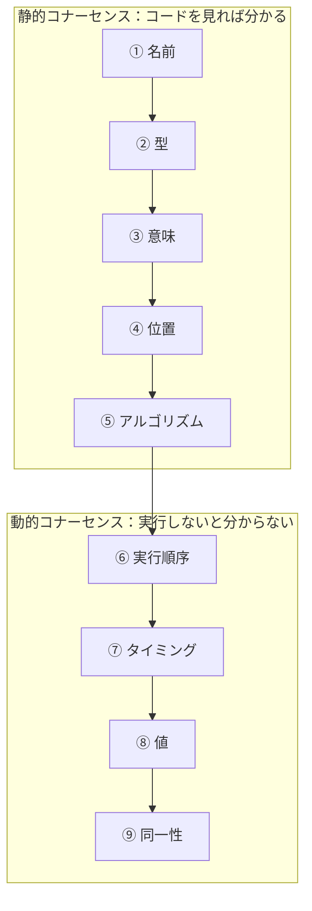

# コナーセンス（Connascence）

## この教材の目的

[[02_結合の指標_求心性遠心性と主系列からの距離]] では、結合を **数** で測る方法を学びました。しかし「依存が3つある」と分かっても、

- その依存は **どのくらい壊れやすいのか**
- **どう直せば弱くなるのか**

は分かりません。**コナーセンス** は、結合の **種類と強さ** を表すための語彙です。コードレビューで「ここ、結合が強いですね」ではなく「ここは **位置のコナーセンス** なので、**名前のコナーセンス** に弱めましょう」と具体的に言えるようになります。

この教材では、

- コナーセンスの定義と由来
- **3つの性質**（強さ・局所性・程度）
- **9つの種類**（静的5つ・動的4つ）と、それぞれの弱め方
- アーキテクチャ（サービス間）での使い方

を解説します。

---

## 1. コナーセンスとは

### 1.1 定義

> 2つの部品があり、**一方を変更したときに、システム全体の正しさを保つためにもう一方も変更しなければならない** とき、その2つは **コナーセント**（connascent）である。

- 「connascence」は「共に生まれる」という意味の英語。一緒に変わる運命にある関係、というニュアンスです
- **Meilir Page-Jones** が 1990 年代に提唱し（『What Every Programmer Should Know about Object-Oriented Design』1996 など）、その後 **Jim Weirich** の講演で広く知られるようになりました
- 『ソフトウェアアーキテクチャの基礎』第3章でも、結合を正確に説明するための言語として紹介されています

### 1.2 なぜ「数」だけでは足りないのか

次の2つの関数呼び出しは、どちらも「依存が1つ」です。

```typescript
// A: 名前で依存している
createUser({ name: "Taro", email: "taro@example.com", isAdmin: false });

// B: 位置で依存している
createUser("Taro", "taro@example.com", false);
```

- A は引数の **名前** にだけ依存している。引数の順番を入れ替えても壊れない
- B は引数の **順番** に依存している。`createUser(email, name, ...)` と定義が変わると、**エラーにならずに** 名前とメールが入れ替わる

数は同じでも、**B の方が壊れやすい**。この違いを表すのがコナーセンスです。

---

## 2. コナーセンスの3つの性質

| 性質 | 意味 | 望ましい状態 |
|---|---|---|
| **強さ**（Strength） | 見つけにくさ・直しにくさ。種類によって決まる | **弱い** ほど良い |
| **局所性**（Locality） | 結合している部品同士がどれだけ **近い** か（同じ関数・同じクラス・同じモジュール・別サービス） | 強い結合ほど **近く** に置く |
| **程度**（Degree） | その結合に巻き込まれている部品の **数** | **少ない** ほど良い |

この3つを組み合わせて考えるのがポイントです。

- 同じ関数の中の強い結合（局所性が高い）は、ほとんど問題にならない
- 別サービスとの強い結合（局所性が低い）は、深刻な問題になる
- 2か所だけの結合（程度が小さい）より、200か所に散らばった結合（程度が大きい）の方が直すのが大変

---

## 3. 9つの種類

コナーセンスには、現在広く合意されている **9つの種類** があります。下に行くほど **強い**（見つけにくく、直しにくい）結合です。



> **動的コナーセンスは、最も弱いものでも、最も強い静的コナーセンスより強い** とされます。実行時にしか分からない結合は、コンパイラやテストで見つけにくいためです。

### 3.1 静的コナーセンス（コードを読めば分かる）

#### ① 名前のコナーセンス（Connascence of Name）

複数の部品が、ある要素の **名前** について合意している必要がある。

```typescript
function calculateTax(price: number) { ... }
calculateTax(1000);   // 関数名を変えたら、呼び出し側も変える必要がある
```

- **最も弱い** コナーセンス。どんなコードにも必ずある
- IDE のリネーム機能で安全に一括変更できる
- **他のコナーセンスを、できるだけこの形に変えていく** のが基本方針

#### ② 型のコナーセンス（Connascence of Type）

複数の部品が、ある要素の **型** について合意している必要がある。

```typescript
function sendMail(to: EmailAddress) { ... }
sendMail(user.email);  // user.email も EmailAddress 型である必要がある
```

- 静的型付け言語ではコンパイラが検出してくれるので、比較的安全

#### ③ 意味のコナーセンス（Connascence of Meaning / Convention）

複数の部品が、ある **値の意味** について合意している必要がある。

```typescript
// ✕ 「1 は有効、0 は無効」という約束を、送る側と受け取る側の両方が知っている
if (user.status === 1) { ... }

// ○ 名前付きの定数・列挙型にする → 名前のコナーセンスに弱まる
enum UserStatus { Active = "active", Inactive = "inactive" }
if (user.status === UserStatus.Active) { ... }
```

- 「マジックナンバー」「マジックストリング」がこれにあたる
- **定数や列挙型で名前を付ける** と、名前のコナーセンスに弱められる

#### ④ 位置のコナーセンス（Connascence of Position）

複数の部品が、値の **順番** について合意している必要がある。

```typescript
// ✕ 引数の順番に依存
createUser("Taro", "taro@example.com", false, true);

// ✕ 配列の位置に意味がある
const row = ["Taro", 30, "Tokyo"];  // row[1] が年齢、という約束

// ○ オブジェクトにして名前で渡す → 名前のコナーセンスに弱まる
createUser({ name: "Taro", email: "taro@example.com", isAdmin: false, notify: true });
```

- **静的コナーセンスの中で最も強い部類**。同じ型の引数が並ぶと、順番を間違えてもコンパイラが気づかない
- 引数が3つを超えたら、オブジェクト（引数オブジェクト）にまとめることを検討する

#### ⑤ アルゴリズムのコナーセンス（Connascence of Algorithm）

複数の部品が、同じ **アルゴリズム** を使うことに合意している必要がある。

```typescript
// 送信側
const signature = hmacSha256(payload, secret);
// 受信側（別のサービス）も、まったく同じ方式で検証する必要がある
const expected = hmacSha256(payload, secret);
```

- 例：パスワードのハッシュ方式、署名の検証方式、チェックディジットの計算方法、データの暗号化方式
- 片方だけ変えると、**エラーにならずに検証が失敗し続ける**
- 対策：アルゴリズムを **1か所（共通モジュール・ライブラリ）に集約** し、両方がそれを呼ぶ形にする

### 3.2 動的コナーセンス（実行しないと分からない）

#### ⑥ 実行順序のコナーセンス（Connascence of Execution）

部品の **実行順序** が重要である。

```typescript
// ✕ open → write → close の順番を、呼び出し側が守る必要がある
const file = new File(path);
file.open();
file.write(data);
file.close();

// ○ 順番を内部に閉じ込める
writeFile(path, data);  // 内部で open → write → close
```

- 例：「初期化メソッドを呼んでから使う」「メール送信前に宛先を設定する」
- 対策：**正しい順番でしか呼べない API にする**（コンストラクタで初期化を済ませる、まとめて実行する関数を用意する）

#### ⑦ タイミングのコナーセンス（Connascence of Timing）

部品の **実行タイミング** が重要である。

- 例：2つのスレッドが同時に同じ変数を更新すると壊れる（競合状態）、タイムアウト値が呼び出し側と呼ばれる側で整合している必要がある
- 発見が非常に難しく、テストでも再現しにくい
- 対策：ロック・トランザクション・不変データ・メッセージキューによる直列化

#### ⑧ 値のコナーセンス（Connascence of Values）

複数の値が、**互いに整合した状態で一緒に変わる** 必要がある。

- 例：「注文の合計金額」と「明細の金額の合計」が常に一致している必要がある
- 例：分散システムで、2つのサービスにまたがるデータを同時に更新する必要がある（分散トランザクション）
- これは **不変条件**（常に成り立つべきルール）そのものです（→ [[03アーキテクチャに効く原則]] の「不変条件の境界」）
- 対策：整合性が必要な値を **1つの境界（集約・1つのサービス・1つのトランザクション）の中に閉じ込める**

#### ⑨ 同一性のコナーセンス（Connascence of Identity）

複数の部品が、**同じインスタンス（実体）** を参照している必要がある。

- 例：2つのコンポーネントが同じキュー・同じキャッシュオブジェクト・同じ DB 接続を共有していないと正しく動かない
- **最も強い** コナーセンス
- 対策：共有を減らし、必要なら所有者を1つに決めて、他はその所有者経由でアクセスする

### 3.3 静的コナーセンスと動的コナーセンスの違いを整理する

#### 一言で言うと

| | 静的コナーセンス | 動的コナーセンス |
|---|---|---|
| **定義** | **ソースコードを読めば（静的解析で）見つかる** 結合 | **プログラムを実行しないと見つからない** 結合 |
| **種類** | 名前・型・意味・アルゴリズム・位置 | 実行（実行順序）・タイミング・値・同一性 |
| **合意している対象** | コードの **書き方**（名前、型、値の約束、計算方法、並び順） | 実行時の **ふるまい**（呼ぶ順番、時間、値の整合、同じ実体） |
| **誰が見つけてくれるか** | コンパイラ・型チェッカー・IDE・リンター（の一部） | テスト・ログ・本番での障害（見つけにくい） |
| **壊れたときの現れ方** | コンパイルエラー、または読めば分かる不整合 | たまにしか起きない不具合、再現しにくいバグ |
| **強さ** | 比較的弱い | **静的より強い** |

> 覚え方：**静的 ＝ 「書いたもの」についての約束**、**動的 ＝ 「動いているもの」についての約束**。

#### 9種類の早見表

| 区分 | 種類 | 何について合意しているか | ひとこと例 | 弱め方の基本 |
|---|---|---|---|---|
| 静的 | **名前**（Name） | 名前 | 関数名・変数名 | （最も弱い。目標の形） |
| 静的 | **型**（Type） | 型 | 引数が `EmailAddress` 型 | 型チェッカーに任せる |
| 静的 | **意味**（Meaning） | 値の意味・約束事 | `status === 1` は「有効」 | 定数・列挙型で **名前** に |
| 静的 | **アルゴリズム**（Algorithm） | 計算方法 | 送信側と受信側が同じハッシュ方式 | 1か所に集約して両方が呼ぶ |
| 静的 | **位置**（Position） | 並び順 | 引数の順番、配列の何番目 | オブジェクト化して **名前** に |
| 動的 | **実行**（Execution） | 実行の順番 | `open()` してから `write()` | 順番を内部に閉じ込める |
| 動的 | **タイミング**（Timing） | 実行の時間・同時性 | 競合状態、タイムアウト | ロック・キュー・不変データ |
| 動的 | **値**（Values） | 複数の値の整合 | 合計金額と明細の合計 | 1つの境界・トランザクションに閉じ込める |
| 動的 | **同一性**（Identity） | 同じ実体を参照すること | 同じキャッシュオブジェクトを共有 | 所有者を1つに決める |

> **並び順の注意**：静的コナーセンスの中の **位置とアルゴリズムの順番は資料によって違います**。connascence.io などは「名前 → 型 → 意味 → 位置 → アルゴリズム」、資料によっては「名前 → 型 → 意味 → アルゴリズム → 位置」と並べます。本ノートの3.1節は前者に従っています。どちらの並びでも「**名前が最も弱く、静的はすべて動的より弱い**」という点は共通です。また「実行」は「実行順序」と訳されることもあります。

#### 動的コナーセンスのコード例（補足）

3.2節で例が文章だけだった3種類を、コードで示します。

```typescript
// ⑦ タイミング：2つの処理が「同時に動かない」ことを前提にしている
let stock = 1;
async function purchase() {
  if (stock > 0) {
    await chargeCard();   // ← この待ち時間中に別の purchase() が割り込むと…
    stock -= 1;           //    在庫が -1 になる（競合状態）
  }
}
```

```typescript
// ⑧ 値：order.total と items の金額は、常に一緒に変わる必要がある
order.items.push({ name: 'ペン', price: 100 });
// order.total += 100;   ← これを忘れると、合計と明細が食い違う

// ○ 整合を1つのメソッド（境界）の中に閉じ込める
class Order {
  private items: Item[] = [];
  addItem(item: Item) { this.items.push(item); }
  get total() { return this.items.reduce((s, i) => s + i.price, 0); }  // 常に明細から計算
}
```

```typescript
// ⑨ 同一性：2つの部品が「同じインスタンス」を見ていないと正しく動かない
const cacheA = new Cache();
const cacheB = new Cache();             // ← 別インスタンスを作ってしまうと
const writer = new ProductWriter(cacheA);
const reader = new ProductReader(cacheB); // 書いた値が読めない
// ○ 1つのインスタンスを所有者（Composition Root など）が作り、両方に渡す
```

#### 静的・動的を見分ける問い

- 「この結合は、**コードを grep したり型チェックしたりすれば** 全部見つかるか？」 → Yes なら静的
- 「この結合は、**動かしてみないと**（順番・時間・状態・インスタンスによって）壊れるかどうか分からないか？」 → Yes なら動的
- 動的コナーセンスを見つけたら、**静的コナーセンスに置き換えられないか** を考える
  - 例：実行順序（動的）→ コンストラクタで初期化を強制し、型で「初期化済み」を表す（静的な型のコナーセンス）
  - 例：値（動的）→ 合計を保存せず、明細から計算する（そもそも整合させる値をなくす）

---

## 4. コナーセンスを改善する3つの指針

Page-Jones と Weirich の考え方をまとめると、次の3つになります。

| 指針 | 内容 | 例 |
|---|---|---|
| **① 強さを弱める** | 強い種類のコナーセンスを、弱い種類に置き換える | 位置 → 名前（引数オブジェクト）、意味 → 名前（列挙型）、実行順序 → 内部に隠す |
| **② 局所性を高める** | 強いコナーセンスほど、**近く**（同じ関数・クラス・モジュール）に置く | 値のコナーセンスがある2つのデータを、別サービスから同じサービスへ移す |
| **③ 程度を減らす** | 結合に巻き込まれる部品の数を減らす | 50か所で同じ計算をしている → 1つの関数に集約して1か所にする |

『基礎』ではこれを **「カプセル化によって、強いコナーセンスをモジュールの内側に閉じ込める」** と表現しています。これは **高凝集** の言い換えでもあります。

> **モジュールの中は強く結びつき（高凝集）、モジュールの間は弱く結びつく（疎結合）**

という [[03_疎結合と高凝集]] の原則を、コナーセンスの言葉で具体化したものです。

---

## 5. アーキテクチャでの使い方 — サービス間のコナーセンス

コナーセンスはクラスや関数の話だけではありません。**サービス間・システム間の結合** を考えるときにも非常に役立ちます。局所性が最も低い（＝遠い）場所なので、**サービス間には弱いコナーセンスしか置くべきではありません**。

| サービス間で起きるコナーセンス | 例 | 弱め方 |
|---|---|---|
| **名前** | API のエンドポイント名・JSON のフィールド名 | 許容範囲。API のバージョニングで変更を管理 |
| **型** | JSON スキーマ・gRPC の型定義 | スキーマを契約として公開し、互換性を保つ |
| **意味** | `status: 3` が「発送済み」を意味する | 意味の分かる文字列にする、契約に明記する |
| **位置** | CSV 連携で列の順番に意味がある | 項目名付きの形式（JSON など）にする |
| **アルゴリズム** | 両サービスが同じ方式で署名・ハッシュを計算 | 共通ライブラリ化、または一方に処理を寄せる |
| **実行順序** | 「先に在庫サービスを呼んでから決済サービスを呼ぶ」必要がある | オーケストレーション（SAGA）で順序を1か所に集約 |
| **タイミング** | 呼び出し側のタイムアウトが呼ばれる側の処理時間より短い | 非同期化、タイムアウトとリトライの設計 |
| **値** | 注文サービスと在庫サービスのデータを同時に整合させる必要がある | **サービス境界を見直す**、または結果整合性と SAGA を採用 |
| **同一性** | 複数のサービスが同じ DB テーブルを直接読み書きする | **データ所有権** を1サービスに決め、他は API 経由にする |

下の3行（値・同一性）がサービス間に現れたら、**サービスの分け方そのものが間違っている** サインであることが多いです。これは **分散モノリス**（分けたのに一緒にしか動かせない状態）の典型的な原因です（→ [[02モノリスと分散モノリスとマイクロサービスといつ分けるか]]、[[04データ所有権と分散トランザクションとSAGAと整合性]]）。

---

## 6. ありがちな誤解

### 6.1 「コナーセンスはゼロにすべき」

**誤りです。** 部品が協力して動く以上、コナーセンスは必ずあります。目標は **ゼロにすること** ではなく、**弱い種類にし、近くに置き、数を減らす** ことです。

### 6.2 「強いコナーセンスは常に悪い」

**誤りです。** 同じ関数の中で、2つの変数が値のコナーセンスを持つのは普通のことです。問題になるのは、**強いコナーセンスが遠い場所（別モジュール・別サービス）にまたがるとき** です。

### 6.3 「静的型付け言語なら結合の問題は起きない」

**誤りです。** 型のコナーセンスまではコンパイラが守ってくれますが、意味・位置（同じ型が並ぶ場合）・アルゴリズム・すべての動的コナーセンスは検出できません。

---

## 7. まとめ

- **コナーセンス**：一方を変えたら、もう一方も変えなければ正しく動かない関係。結合の **種類と強さ** を表す語彙
- 3つの性質：**強さ**（種類で決まる）・**局所性**（近さ）・**程度**（巻き込まれる数）
- 9つの種類（弱い → 強い）
  - 静的：**名前 → 型 → 意味 → 位置 → アルゴリズム**
  - 動的：**実行順序 → タイミング → 値 → 同一性**
- **静的** はコードを読めば見つかる（書いたものの約束）、**動的** は実行しないと見つからない（動いているものの約束）。動的は静的より強い。動的は静的に置き換えられないかを考える
- 改善の指針：**強さを弱める・局所性を高める・程度を減らす**。強いコナーセンスはモジュールの内側に閉じ込める（＝高凝集）
- サービス間に **値・同一性** のコナーセンスがあれば、境界の見直しが必要なサイン

次は [[05_アーキテクチャ量子と粒度]] で、結合を「デプロイの単位」の視点から考えます。

---

## 参考資料

- Meilir Page-Jones『What Every Programmer Should Know about Object-Oriented Design』（1996）
- Mark Richards, Neal Ford『ソフトウェアアーキテクチャの基礎』第3章
- [connascence.io](https://connascence.io/)
- [Connascence as a vocabulary to discuss Coupling（thoughtbot）](https://thoughtbot.com/blog/connascence-as-a-vocabulary-to-discuss-coupling)
- [Connascence: Types, Examples, and Coupling（coupling.dev）](https://coupling.dev/posts/related-topics/connascence/)
- [Connascence: (de)coupling more effectively（QWAN, 2026）](https://www.qwan.eu/2026/05/08/connascence-intro.html)
- [Connascence - The Language You Have Been Needing in Code Review（Jason Butz）](https://jasonbutz.info/2019/04/connascence-lang-code-review/)
- [Connascence（Wikipedia）](https://en.wikipedia.org/wiki/Connascence)
- [Software Quality measurement metric : Connascence（DevelopersIO）](https://dev.classmethod.jp/articles/software-quality-measurement-metric-connascence/)
- [Modularity Metrics in Software Architecture — Connascence（Medium）](https://medium.com/@naozary.diyar/modularity-metrics-in-software-architecture-connascence-1ca4ccbaff98)
- [What is Connascence（Architecture Chronicles）](https://architecturechronicles.substack.com/p/what-is-connascence)
