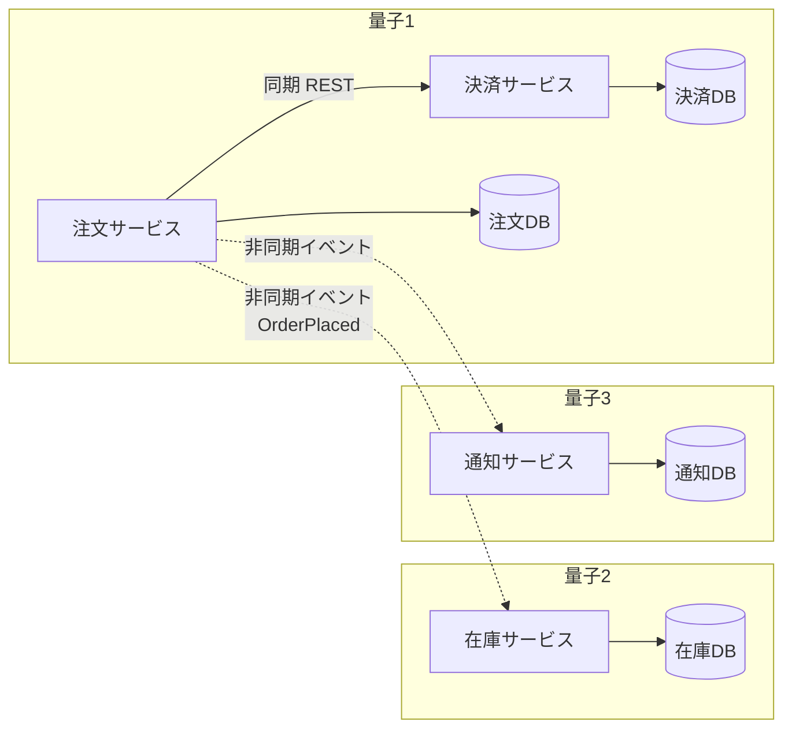
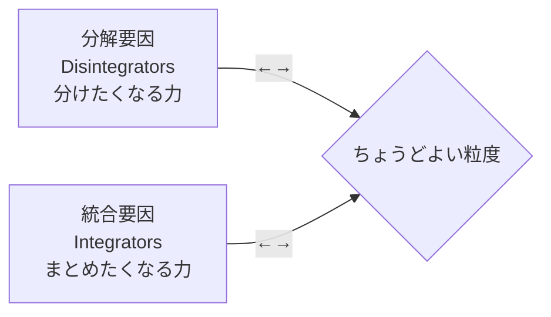

# アーキテクチャ量子と粒度

## この教材の目的

[[02_結合の指標_求心性遠心性と主系列からの距離]] と [[04_コナーセンス]] では、**コードの中の結合** を見てきました。
しかしシステムを複数のサービスに分けると、新しい問いが出てきます。

- 「サービスを5つに分けた」のに、**全部一緒にデプロイしないと動かない** のはなぜか
- サービスは **どのくらいの大きさ（粒度）** に分けるのが適切か
- 「分けすぎ」と「分けなさすぎ」をどう判断するか

この教材では、『進化的アーキテクチャ』『ソフトウェアアーキテクチャ・ハードパーツ』『ソフトウェアアーキテクチャの基礎』で使われている、

- **アーキテクチャ量子**（独立して動かせる単位）
- **静的結合と動的結合**
- 粒度を決める **分解要因と統合要因**

を解説します。13_モジュール性・結合 と 40_システム・分散 をつなぐノートです。

---

## 1. アーキテクチャ量子とは

### 1.1 定義

> **アーキテクチャ量子**（Architecture Quantum）とは、**独立してデプロイできる成果物** であり、**高い機能的凝集**・**高い静的結合**・**同期的な動的結合** を持つもの。

「量子」は物理学の言葉で「それ以上分けられない最小単位」を意味します。アーキテクチャ量子は **「独立して動かせる最小のまとまり」** です。

定義は次のように発展してきました。

| 年 | 書籍 | 定義 |
|---|---|---|
| 2017 | 『進化的アーキテクチャ』初版 | 独立してデプロイできる、高い機能的凝集を持つコンポーネント |
| 2021 | 『ソフトウェアアーキテクチャ・ハードパーツ』 | ＋ **高い静的結合**、＋ **同期的な動的結合** を追加 |

### 1.2 定義を分解する

| 要素 | 意味 | 確認する問い |
|---|---|---|
| **独立してデプロイできる** | 他の部分と切り離して、単独でリリース・起動できる。**動くのに必要なもの（DB など）はすべて量子に含まれる** | 「これだけをデプロイして動くか？」 |
| **高い機能的凝集** | 1つの目的のためにまとまっている（1つのワークフロー・1つのドメイン） | 「何をする単位か、一言で言えるか？」 |
| **高い静的結合** | 動くために必要なもの（DB・フレームワーク・共有ライブラリ・ブローカー）と強く結びついている | 「動かすのに何が必要か？」 |
| **同期的な動的結合** | 実行時に **同期呼び出し**（相手の返事を待つ）でつながっている部分は、同じ量子とみなす | 「相手が落ちたら自分も止まるか？」 |

### 1.3 一番大事な判断基準

> **サービス A とサービス B を一緒にデプロイしなければならないなら、名前が何であれ、それは1つの量子である。**

「サービス」という名前や、リポジトリが分かれていることは関係ありません。**実際に独立して動かせるかどうか** で数えます。

---

## 2. 静的結合と動的結合

量子の境界を決めるのは、2種類の結合です。

### 2.1 静的結合 — 「動くために何が必要か」

コンポーネントが **動作するために依存しているもの** です。デプロイ時・起動時に決まります。

- データベース（とくに **共有 DB**）
- 共有ライブラリ・共通モジュール
- メッセージブローカー
- フレームワーク・ランタイム

> 静的結合で最も影響が大きいのが **共有データベース** です。サービスを10個に分けても、全サービスが1つの DB を共有していれば、DB のスキーマ変更のたびに全サービスが影響を受けます。この場合、量子は **1つ** です。

### 2.2 動的結合 — 「実行時にどうやり取りするか」

実行中にコンポーネント同士が **どう通信するか** です。『ハードパーツ』では3つの観点で整理しています。

| 観点 | 選択肢 | 影響 |
|---|---|---|
| **通信** | 同期（返事を待つ）／非同期（待たない） | 同期だと、相手の遅延・障害が自分に波及する |
| **一貫性** | アトミック（全部成功か全部失敗か）／結果整合性（いずれ整合する） | アトミックを求めるほど、分散は難しくなる |
| **調整** | オーケストレーション（指揮役がいる）／コレオグラフィ（各自がイベントに反応する） | 指揮役は流れが見えやすいが、結合点になる |

**同期通信** でつながったサービス同士は、実行時には **運命共同体** です。片方が遅くなればもう片方も遅くなり、片方が落ちればもう片方も止まります。だから「同期的な動的結合」がある部分は、同じ量子とみなすのです。

### 2.3 例で考える

- 注文サービスは決済サービスを **同期で** 呼び、返事を待つ → 決済が止まると注文も止まる → **同じ量子**
- 在庫・通知へは **非同期イベント** で知らせるだけ → 在庫が止まっても注文は受け付けられる → **別の量子**
- サービスは4つだが、量子は **3つ**

もし全サービスが **1つの共有 DB** を使っていたら、静的結合によって量子は **1つ** になります。

---

## 3. なぜ量子が重要なのか — 特性のスコープ

### 3.1 アーキテクチャ特性は量子ごとに決まる

[[04_アーキテクチャ特性の見つけ方と分類]] で「特性はシステム全体で一律とは限らない」と学びました。量子はまさに、**アーキテクチャ特性をそろえられる単位** です。

| 量子が1つ（モノリス・分散モノリス） | 量子が複数（真に分割されたシステム） |
|---|---|
| システム全体で **1組の特性** しか持てない | 量子ごとに **違う特性** を持てる |
| 検索だけ弾力性を上げる、ができない | 検索の量子だけ弾力性を高め、管理画面の量子はシンプルに保てる |
| 1か所の障害が全体に波及しやすい | 障害が量子の中に閉じやすい |

『ソフトウェアアーキテクチャの基礎』では、この考え方を使って **「システムに必要な特性が部分ごとに大きく違うなら、量子を分ける＝分散アーキテクチャを検討する。全体で同じなら、モノリスで十分」** という判断の目安を示しています。

### 3.2 スタイルと量子の数

| スタイル | 量子の数 | 理由 |
|---|---|---|
| レイヤード / モジュラーモノリス / マイクロカーネル | 1 | 1つのデプロイ単位 |
| サービスベース | 1 になりやすい | サービスは分かれていても、**DB を共有** することが多い |
| イベント駆動 | 複数になりうる | 非同期通信で動的結合が弱い。ただし DB を共有すれば 1 |
| マイクロサービス | 複数 | サービスごとに DB を持ち、独立してデプロイする |

MOC のスタイル比較表で、サービスベースとマイクロサービスの「拡張性」「進化しやすさ」の★が違うのは、この **量子の数の違い** が大きな理由です。

### 3.3 分散モノリスの正体

**分散モノリス** とは、「サービスに分けたのに、量子は1つのまま」の状態です。

- 共有 DB（静的結合）
- サービス同士の同期呼び出しの連鎖（動的結合）
- 一緒にリリースしないと動かない

この状態は、**モノリスの欠点（独立できない）と分散の欠点（ネットワーク越しで遅い・運用が複雑）を両方持つ** 最悪の組み合わせです（→ [[02モノリスと分散モノリスとマイクロサービスといつ分けるか]]）。

---

## 4. 粒度 — サービスはどのくらいの大きさにするか

量子を分けると決めたら、次は「どのくらい細かく分けるか」です。『ハードパーツ』では、粒度を **2つの逆向きの力の釣り合い** として考えます。

### 4.1 分解要因 — 分けるべき理由

| 分解要因 | 問い | 例 |
|---|---|---|
| **サービスの範囲と機能** | 無関係なことを1つのサービスでやりすぎていないか？ | 「通知サービス」がメール・SMS・プッシュ・請求書 PDF 生成までやっている |
| **コードの変動性** | 変更が一部に集中していないか？ | 決済手段の追加は頻繁だが、請求処理はほぼ変わらない |
| **スケーラビリティとスループット** | 部分ごとに必要な処理量が大きく違わないか？ | 商品検索は秒間1万件、商品登録は1日100件 |
| **耐障害性** | 一部の障害が、重要な機能まで止めていないか？ | 画像変換のメモリ不足で、注文受付まで落ちる |
| **セキュリティ** | 一部だけ高いセキュリティが必要ではないか？ | カード情報を扱う部分だけ、アクセスを厳しく制限したい |
| **拡張性** | 今後、種類が増えていく部分ではないか？ | 決済手段が今後も増え続ける |

### 4.2 統合要因 — まとめるべき理由

| 統合要因 | 問い | 例 |
|---|---|---|
| **データベーストランザクション** | 1つのトランザクション（全部成功か全部失敗か）が必要ではないか？ | 「注文の作成」と「在庫の引当」を必ず同時に成功させたい |
| **ワークフローとコレオグラフィ** | 分けるとサービス間の呼び出しが多くなりすぎないか？ | 1つの画面表示に5サービスの同期呼び出しが必要 → 遅く、障害にも弱くなる |
| **共有コード** | 同じ **業務ロジック** を複数サービスが使っていないか？ | 料金計算ロジックを3サービスが共有ライブラリで使い、変更のたびに3つ同時にリリースが必要 |
| **データの関係** | データ同士が強く結びついていないか？ | 分けると、互いのデータを頻繁に問い合わせる必要がある |

### 4.3 よくある失敗

> 多くのチームは **分解要因ばかりを見て、統合要因を無視する**。

その結果、

- サービスが細かくなりすぎて、1つの処理に多数のサービス呼び出しが必要になる
- 分散トランザクションや SAGA が大量に必要になる
- 共有コードの変更のたびに複数サービスを同時リリースする（＝分散モノリス）

という状態に陥ります。**分ける理由と同じくらい、まとめる理由を真剣に検討する** ことが大切です。これは [[04_コナーセンス]] の「強いコナーセンス（値・同一性）は近くに置く」と同じ考え方です。

### 4.4 判断の進め方

1. 分解要因・統合要因を **表に書き出す**（どちらか一方だけでなく両方）
2. それぞれ、このシステムでどれだけ重要かを **ビジネスの言葉で** 説明する（例：「決済だけ切り出すと、PCI DSS の監査範囲を小さくできる」）
3. 釣り合いを判断し、**理由を ADR に残す**（→ [[02ADRとArchitecture Decision Record]]）
4. 迷ったら **粗めに分ける**。細かいサービスを後からまとめるより、粗いサービスを後から分ける方が簡単

---

## 5. ありがちな誤解

### 5.1 「サービスの数＝独立した単位の数」

**誤りです。** 共有 DB や同期呼び出しの連鎖があれば、サービスが10個でも量子は1つです。数えるべきは **独立してデプロイ・運用できる単位** です。

### 5.2 「細かく分けるほどマイクロサービスらしい」

**誤りです。** 粒度は分解要因と統合要因の **釣り合い** で決まります。細かすぎると、トランザクションやワークフローの問題が爆発的に増えます。

### 5.3 「非同期にすれば結合はなくなる」

**誤りです。** 非同期にすると **動的結合** は弱まりますが、共有 DB やイベントの形式（スキーマ）を通じた **静的結合** は残ります。両方を見る必要があります。

---

## 6. まとめ

- **アーキテクチャ量子**：独立してデプロイできる、高い機能的凝集・高い静的結合・同期的な動的結合を持つ単位
- **一緒にデプロイしなければならないなら、それは1つの量子**
- **静的結合**（DB・共有ライブラリ）と **動的結合**（同期／非同期・一貫性・調整）が量子の境界を決める
- アーキテクチャ特性は **量子ごと** に持てる。部分ごとに必要な特性が違うことが、分散を選ぶ理由になる
- **分散モノリス** は、分けたのに量子が1つのままの状態
- 粒度は **分解要因**（範囲・変動性・スケール・耐障害性・セキュリティ・拡張性）と **統合要因**（トランザクション・ワークフロー・共有コード・データの関係）の釣り合いで決める
- 分解要因だけを見て、統合要因を無視するのが典型的な失敗

次は [[06_論理コンポーネントの見つけ方]] で、そもそも「何を部品とするか」をどう見つけるかを学びます。

---

## 参考資料

- Neal Ford, Rebecca Parsons, Patrick Kua『進化的アーキテクチャ』（*Building Evolutionary Architectures*）
- Neal Ford, Mark Richards, Pramod Sadalage, Zhamak Dehghani『ソフトウェアアーキテクチャ・ハードパーツ』（*Software Architecture: The Hard Parts*）第2章・第7章
- Mark Richards, Neal Ford『ソフトウェアアーキテクチャの基礎』第7章（アーキテクチャ特性のスコープ）
- [Software Architecture: The Hard Parts 第7章（Thoughtworks 公開 PDF）](https://www.thoughtworks.com/content/dam/thoughtworks/documents/books/bk_software_architecture_hard_parts_ch7_en.pdf)
- [Book notes: Software Architecture: The Hard Parts（Dan Lebrero）](https://danlebrero.com/2022/03/30/software-architecture-the-hard-parts-book-summary/)
- [Architectural Quanta: The Secret to Independent Deployability（vijayanant.com）](https://vijayanant.com/posts/architectural-quantum-modular-deployable-architecture/)
- [Architecture Quantum (Quanta)（slys.dev）](https://iam.slys.dev/p/architecture-quantum)
- [Granularity Integrators and Disintegrators（Dev Genius）](https://blog.devgenius.io/granularity-integrators-and-disintegrators-11b72dce7a46?gi=8b3faffb55af)
