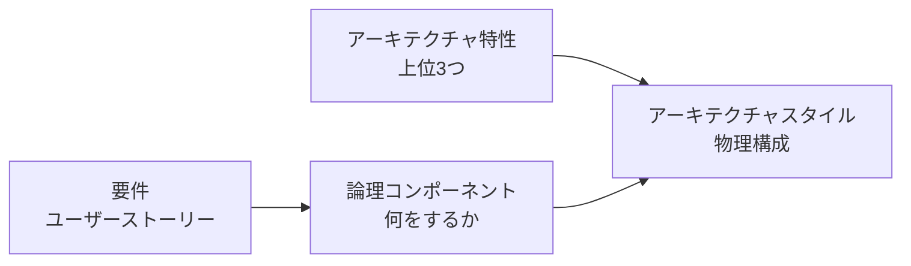
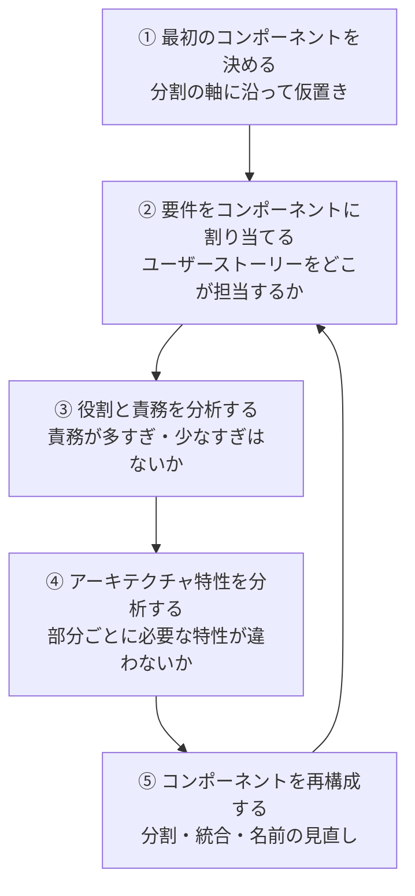
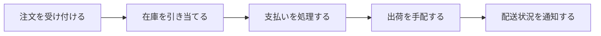

# 論理コンポーネントの見つけ方

## この教材の目的

ここまでの 13_モジュール性・結合 では、部品の **良し悪しを評価する方法**（凝集・結合・コナーセンス・量子）を学びました。
では、そもそも **最初の部品はどうやって見つけるのか**。白紙の状態から「このシステムは、どんな部品で構成されるか」を考えるのが、この教材のテーマです。

『ソフトウェアアーキテクチャの基礎』では、これを **コンポーネントベース思考**（Component-Based Thinking）と呼び、アーキテクチャの4つの側面の1つ **論理コンポーネント** として扱っています（[[00ソフトウェアアーキテクチャ]]）。

この教材では、

- 論理コンポーネントとは何か（物理的な構成との違い）
- 分割の軸：**技術による分割** と **ドメインによる分割**
- コンポーネントを見つける **繰り返しの手順**
- 見つける手法：**アクター／アクション・ワークフロー・イベントストーミング**
- 典型的な失敗：**エンティティの罠**

を解説します。

---

## 1. 論理コンポーネントとは

### 1.1 定義

**論理コンポーネント** とは、システムが **何をするか**（振る舞い）を表す、機能のまとまりです。

- 例：「注文受付」「在庫管理」「支払い処理」「通知」
- コード上は、**名前空間・パッケージ・ディレクトリ** として表れることが多い（例：`app/order/placement`）
- C4 モデルのレベル3「コンポーネント」に対応します

### 1.2 論理アーキテクチャと物理アーキテクチャ

| | 論理アーキテクチャ | 物理アーキテクチャ |
|---|---|---|
| 何を表すか | システムが **何をするか**（機能の部品と関係） | システムが **どう動くか**（サービス・DB・サーバー・通信方式） |
| 例 | 注文受付 → 在庫引当 → 支払い → 通知 | 注文サービス（コンテナ）、PostgreSQL、Kafka |
| 決めるもの | 機能の分け方 | アーキテクチャスタイル（モノリス／マイクロサービスなど） |

『基礎』では、**論理コンポーネントを先に考え、それをアーキテクチャ特性と照らし合わせて物理構成（スタイル）を選ぶ** 流れを勧めています。いきなり「マイクロサービスで行こう」と物理構成から決めると、機能の分け方が技術の都合に引きずられます。



---

## 2. 分割の軸 — 技術か、ドメインか

コンポーネントを分けるとき、最初に決めるのが **最上位の分割の軸** です。

### 2.1 技術による分割（Technical Partitioning）

技術的な役割ごとに分けます。

```text
app/
  presentation/   ← 画面・API
  business/       ← 業務ロジック
  persistence/    ← DB アクセス
```

- 代表例：レイヤードアーキテクチャ、MVC
- 良い点：技術ごとの専門家が担当しやすい。構造が分かりやすい
- 悪い点：「注文に割引機能を追加する」という **1つの業務変更が、全層に散らばる**

### 2.2 ドメインによる分割（Domain Partitioning）

業務の領域（ドメイン）ごとに分けます。

```text
app/
  order/          ← 注文に関するすべて（画面・ロジック・DB アクセス）
  inventory/
  payment/
  notification/
```

- 代表例：モジュラーモノリス、マイクロサービス、垂直スライスアーキテクチャ
- 良い点：**業務の変更が1つのコンポーネントに閉じやすい**。チームを業務ごとに分けやすい
- 悪い点：共通処理（ログ・認証など）が各所に重複しやすい

### 2.3 どちらを選ぶか

| 観点 | 技術による分割 | ドメインによる分割 |
|---|---|---|
| 変更の単位 | 技術の変更（DB の差し替えなど）が閉じる | **業務の変更** が閉じる |
| チーム構成 | フロント・バック・DB の専門チーム | 業務ごとのクロスファンクショナルチーム |
| 向いている | 小規模、業務がシンプル、変更の多くが技術的 | 中〜大規模、業務が複雑、変更の多くが業務的 |
| コンウェイの法則 | 技術別の組織と相性が良い | 業務別の組織と相性が良い |

現代の多くのシステムでは **業務の変更の方が技術の変更より頻繁** なので、ドメインによる分割が主流になりつつあります。ただし、ドメインで分けた各コンポーネントの **中** を技術で分ける（例：`order/` の中を domain・application・infrastructure に分ける）のはよくある組み合わせです（→ 20_アプリ内部構造）。

---

## 3. コンポーネントを見つける手順

『基礎』では、コンポーネントの特定を **一度で終わる作業ではなく、繰り返すサイクル** として説明しています。



| ステップ | 内容 | 確認する問い |
|---|---|---|
| ① 最初のコンポーネントを決める | 分割の軸（技術／ドメイン）に沿って、まず仮のコンポーネントを置く。**最初から正解を出そうとしない** | 「大まかに何の部品がありそうか？」 |
| ② 要件を割り当てる | ユーザーストーリーや要件を、どのコンポーネントが担当するかを決める | 「この要件は、どこが担当する？ どこにも入らない要件はないか？」 |
| ③ 役割と責務を分析する | 担当が多すぎるコンポーネント（神コンポーネント）、少なすぎるコンポーネントを見つける | 「このコンポーネントの責務を一文で言えるか？」 |
| ④ アーキテクチャ特性を分析する | 同じコンポーネントの中で、**必要な特性が大きく違う部分** がないかを見る | 「この中の一部だけ、スケール・セキュリティ・可用性の要求が違わないか？」 |
| ⑤ 再構成する | 分割・統合・移動・名前の変更を行い、②に戻る | 「前より凝集が高く、結合が低くなったか？」 |

④がアーキテクチャ特有のステップです。機能的には1つにまとまっていても、**一部だけ特性の要求が違うなら分ける** 理由になります（[[05_アーキテクチャ量子と粒度]] の分解要因と同じ考え方）。

> 例：「チケット販売」コンポーネントのうち、「座席の検索と予約」は発売開始の瞬間に弾力性が必要だが、「販売実績のレポート」は不要 → 2つに分ける

---

## 4. コンポーネントを見つける3つの手法

ステップ①②で使える、代表的な手法です。

### 4.1 アクター／アクション・アプローチ

**誰が（アクター）、何をするか（アクション）** を洗い出し、アクションのまとまりをコンポーネントにします。

例：オンライン書店

| アクター | アクション |
|---|---|
| 購入者 | 本を検索する、カートに入れる、注文する、注文状況を確認する、レビューを書く |
| 店舗スタッフ | 在庫を登録する、注文を発送する、返品を処理する |
| システム（自動処理） | 在庫が減ったら発注する、発送通知を送る |

ここから見えてくるコンポーネントの候補：

- **商品検索**（検索する）
- **カート・注文**（カートに入れる・注文する・状況を確認する）
- **レビュー**（レビューを書く）
- **在庫管理**（在庫を登録する・自動発注）
- **出荷**（発送する・返品処理）
- **通知**（発送通知）

- 良い点：要件からそのまま始められ、分かりやすい。**利用者ごとの使い方** を意識できる
- 向いている：ユーザーの操作が中心のシステム、要件がユースケースで書かれているとき

### 4.2 ワークフロー・アプローチ

**業務の流れ（ワークフロー）** を時系列で書き出し、ステップのまとまりをコンポーネントにします。



- アクターよりも **業務の流れ** に注目する
- 良い点：処理の順序や、ステップ間で受け渡すデータがはっきりする
- 向いている：手順が決まった業務（受発注・審査・申請承認など）

### 4.3 イベントストーミング

DDD（ドメイン駆動設計）から生まれた、ワークショップ形式の手法です（Alberto Brandolini が考案）。

1. 業務の専門家と開発者が集まる
2. **「業務で起きる出来事（ドメインイベント）」** を過去形で付箋に書き出す（例：「注文が確定した」「支払いが完了した」「商品が発送された」）
3. 時系列に並べ、イベントを引き起こす **コマンド**（「注文を確定する」）や **アクター** を加える
4. 関係の深いイベントのまとまりを見つけ、それを **コンポーネント（境界づけられたコンテキストの候補）** にする

- 良い点：業務の専門家と一緒に、**業務の言葉で** 境界を見つけられる
- 向いている：業務が複雑なシステム、イベント駆動やマイクロサービスを検討しているとき
- 『基礎』では、イベントストーミングは **イベントやメッセージでコンポーネントが通信すること** を前提にした手法である点に注意を促しています

### 4.4 手法の比較

| 手法 | 起点 | 得意なこと | 向いているシステム |
|---|---|---|---|
| アクター／アクション | 利用者と操作 | 利用者視点の機能の洗い出し | 画面操作が中心の Web アプリ |
| ワークフロー | 業務の流れ | 処理の順序と受け渡しの明確化 | 手順が決まった業務システム |
| イベントストーミング | 業務で起きる出来事 | 業務の専門家との協働、境界の発見 | 複雑な業務、イベント駆動 |

1つに決める必要はなく、**アクター／アクションで洗い出し、ワークフローで流れを確認する** のように組み合わせて使えます。

---

## 5. 典型的な失敗 — エンティティの罠

### 5.1 エンティティの罠とは

**DB のテーブル（エンティティ）ごとに、1つずつコンポーネントを作ってしまう** 失敗です。

```text
CustomerManager   ← customers テーブルの CRUD
OrderManager      ← orders テーブルの CRUD
ProductManager    ← products テーブルの CRUD
InventoryManager  ← inventory テーブルの CRUD
```

一見きれいに分かれていますが、問題があります。

| 問題 | 説明 |
|---|---|
| **これはアーキテクチャではなく、ORM（DB とオブジェクトの対応づけ）** | テーブル構造をなぞっているだけで、システムが **何をするか**（振る舞い）が見えない |
| **実際の業務は複数のエンティティにまたがる** | 「注文する」には顧客・注文・商品・在庫のすべてが関わる。どの Manager に書くべきか分からない |
| **Manager が肥大化する** | 「顧客に関係すること」がすべて CustomerManager に集まり、神クラス化する |
| **業務ロジックがあちこちに散らばる** | 注文のルールが OrderManager・InventoryManager・CustomerManager に分散する |

### 5.2 どう避けるか

- コンポーネントを **データ（名詞）** ではなく **振る舞い（動詞・業務）** で考える
  - ✕ `OrderManager` → ○ `注文受付`・`注文追跡`・`返品処理`
- アクター／アクションやワークフローのように、**何をするか** から出発する手法を使う
- 「Manager」「Service」「Handler」のような曖昧な名前が多いときは、エンティティの罠に陥っているサイン

> 補足：単純な CRUD（作成・読み取り・更新・削除）が中心のアプリなら、エンティティ単位の構成でも問題ないこともあります。その場合は、無理に複雑なアーキテクチャを選ばず、ローコードツールや CRUD 向けフレームワークで十分なこともあります。

---

## 6. コンポーネントの粒度

コンポーネントは大きすぎても小さすぎても困ります。

| 粒度 | 症状 | 対策 |
|---|---|---|
| **大きすぎる** | 責務を一文で言えない。変更のたびに多くの人が同じコンポーネントを触る | 責務・特性の違いで分割する |
| **小さすぎる** | 1つの処理に多数のコンポーネントの連携が必要。呼び出し関係が複雑になる | 一緒に変わるものをまとめる（凝集の単位＝変更の単位） |

目安は、[[03_疎結合と高凝集]] の **「一緒に変わるものを一緒に置く」** と、[[04_コナーセンス]] の **「強いコナーセンスはコンポーネントの内側に」** です。

---

## 7. ありがちな誤解

### 7.1 「コンポーネントは最初の設計で確定させるもの」

**誤りです。** コンポーネントの特定は **繰り返しのサイクル** です。要件が増えたり、特性の違いが見えたりするたびに見直します。

### 7.2 「テーブルごとに分ければきれいな設計になる」

**誤りです。** それは **エンティティの罠** です。業務は複数のエンティティにまたがるため、振る舞いで分けます。

### 7.3 「先にマイクロサービスにすると決めてから、サービスを考える」

**順番が逆です。** 論理コンポーネントを先に見つけ、アーキテクチャ特性と照らし合わせてから、物理構成（スタイル）を選びます。

---

## 8. まとめ

- **論理コンポーネント**：システムが何をするか（振る舞い）を表す機能のまとまり。物理構成より先に考える
- 分割の軸は **技術による分割**（レイヤード）と **ドメインによる分割**（モジュラーモノリス・マイクロサービス）。業務の変更が多いならドメインで分ける
- 特定の手順は **① 仮置き → ② 要件の割り当て → ③ 責務の分析 → ④ 特性の分析 → ⑤ 再構成** の繰り返し
- 見つける手法：**アクター／アクション**（利用者と操作）・**ワークフロー**（業務の流れ）・**イベントストーミング**（業務で起きる出来事）
- **エンティティの罠**：テーブルごとに Manager を作るのはアーキテクチャではなく ORM。振る舞いで分ける

これで 10_基礎 の「ものさし」はそろいました。次は [[00_解説_アプリ内部構造]] で、1つのアプリの中の具体的なスタイルを学びます。

---

## 参考資料

- Mark Richards, Neal Ford『ソフトウェアアーキテクチャの基礎』第8章（コンポーネントベース思考）
- Alberto Brandolini『Introducing EventStorming』
- [Component-Based Thinking — Fundamentals of Software Architecture Chapter 8（Medium）](https://medium.com/@mohamedsallam953/component-based-thinking-fundamental-of-software-architecture-chapter-8-c0c65951eee4)
- [Lesson 193 - Identifying Components: The Actor/Action Approach（developertoarchitect.com）](https://developertoarchitect.com/lessons/lesson193.html)
- [Book notes: Fundamentals of Software Architecture（Dan Lebrero）](https://danlebrero.com/2021/11/17/fundamentals-of-software-architecture-summary/)
- [Components — Mastering Software Architecture](https://romerogabriel.github.io/mastering-software-architecture/components/)
