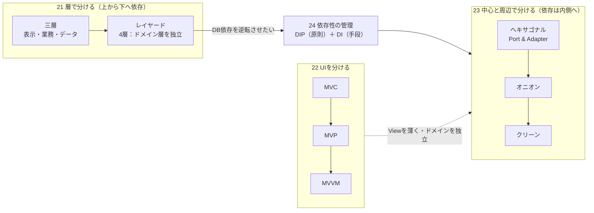

# アプリ内部構造

## このフォルダで扱うこと

**1つのアプリケーション（1つのプロセス・1つのデプロイ単位）の中を、どう部品に分け、どの向きにつなぐか** を扱います。  
C4 モデルでいえば「コンテナの中身（コンポーネント）」のズームレベルです。

| サブフォルダ | 扱うこと |
|---|---|
| 21_レイヤー | 層化の考え方、三層アーキテクチャ、レイヤードアーキテクチャ（4層）、クリーンアーキテクチャの層構成 |
| 22_UI分離_MVC系 | 画面（UI）と業務ロジックの分け方：MVC / MVP / MVVM、MVC違反 |
| 23_クリーン・ヘキサ・オニオン | ドメインを中心に置き、依存を内側へ向けるアーキテクチャ群 |
| 24_依存性の管理 | 依存性逆転の原則（DIP）、依存性注入（DI）、インターフェースと抽象化 |

**ここでは扱わないこと（本拠地フォルダ）**

| テーマ | 本拠地 |
|---|---|
| 複数サービスへの分割（モノリス〜マイクロサービス、イベント駆動） | 40_システム・分散 |
| レンダリング方式・BFF など画面の配信構成 | 30_フロントエンド構成 |
| SOLID・関心の分離などの原則そのもの | 48_原則 |
| DDD の集約・エンティティ・値オブジェクト | 42_ソフトウェア設計 |
| パッケージ・モジュール分割の実務 | 43_モジュール設計 |
| Express / Next.js など特定 FW での Controller・Service・Repository の書き方 | 34_Backend / 33_Next.js |
| React の状態管理ライブラリ | 36_状態管理 |

---

## 全体像

アプリ内部構造のアーキテクチャは、大きく **「上下に積む（層）」** から **「中心と周辺に分ける（同心円）」** へと発展してきました。その橋渡しをしたのが **依存性逆転（DIP）** です。



**読み解きのポイント**

- 21 と 22 は「**何をどこに書くか**（責務の分け方）」の話です
- 23 は、それに加えて「**依存の矢印をどちらに向けるか**」まで決めた話です
- 24 は、23 を実現するための **道具** です

---

## 主要概念の解説

### 1. レイヤー（層化）

**層化** とは、ソフトウェアを役割ごとに「層」に分け、**上の層は下の層だけを使う** というルールで積み重ねる考え方です。

| 構成 | 層 | 特徴 |
|---|---|---|
| **三層** | 表示層 / 業務層 / データアクセス層 | 最も古典的。業務層にユースケースも業務ルールも入る。小〜中規模の CRUD 向き |
| **レイヤード（4層）** | プレゼンテーション / アプリケーション / ドメイン / インフラ | 業務層を「アプリケーション層（手順）」と「ドメイン層（業務ルール）」に分ける。中〜大規模向き |
| **N層** | 必要に応じて増やす | 層を増やすほど分離は進むが、素通りする層も増える |

**なぜ層に分けるのか**

- **関心の分離**：画面の都合・業務の都合・DB の都合が混ざらない
- **変更の局所化**：画面のデザイン変更が DB 処理を壊さない
- **分業とテスト**：層ごとに担当・テストを分けられる

**注意したい言葉の違い**：**Layer（層）は論理的な分割**（同じプロセス内のモジュール分け）、**Tier（ティア）は物理的な分割**（Web・AP・DB の別サーバー）です。「3層」はどちらの意味でも使われるので、文脈で読み分けます。

**よくある落とし穴**

- どの層も何もせず次へ渡すだけの **素通り（Sinkhole）**
- 業務ロジックが画面側に **染み出す**
- ドメイン層が空っぽで、ただの「Controller → Service → DB」になっている

> 伝統的なレイヤードでは **ドメイン層がインフラ層（DB）に依存** します。これが「DB を変えると業務ロジックまで影響する」問題の原因になり、23 の同心円型アーキテクチャが生まれるきっかけになりました。

**閉じた層・開いた層とシンクホール**：層を飛ばせない **閉じた層** が「ある層の変更が他に波及しない（隔離層）」を生みます。共通サービス層などの補助的な層は、飛ばしてよい **開いた層** にできます。何もしない層を素通りするリクエストが2割程度なら自然ですが、8割を超えたらレイヤードが合っていないサインです（**80/20 ルール**）。

**横ではなく縦に切る：垂直スライス**：Jimmy Bogard（2018）が提唱した、機能（1リクエスト）ごとに画面〜DB までをまとめる構成です。「**スライス間の結合は最小に、スライス内の結合は最大に**」が原則で、単純な参照は SQL 直書き、複雑な更新だけドメインモデル、のようにスライスごとに作り方を変えられます。クリーンアーキテクチャとは切る方向が違うだけで、組み合わせられます。

詳細：[[01層化]] / [[三層アーキテクチャ]] / [[レイヤードアーキテクチャ]] / [[レイヤー構成]] / [[02_閉じた層と開いた層_隔離層とシンクホール]] / [[03_垂直スライスアーキテクチャ]]

### 2. UI とドメインの分離：MVC・MVP・MVVM

画面まわりの構造は、どれも **「View（見た目）を薄くし、業務ロジックを画面から独立させる」** という同じ目的のパターンです。違いは **「View と Model の間を誰が取り持つか」** です。

| 観点 | MVC | MVP | MVVM |
|---|---|---|---|
| 間を取り持つ役 | Controller | Presenter | ViewModel |
| View が見るもの | Model と Controller | Presenter のみ | ViewModel |
| View の役割 | 描画＋一部の入力処理 | 完全に受け身 | バインディングで自動更新 |
| データの流れ | Model から通知（push） | Presenter が View に指示 | 双方向データバインディング |
| 主な舞台 | 古典的な Web FW（Rails など） | デスクトップ・Android | リッチクライアント・モダンフロント |

- **MVC（1979年）**：Smalltalk 向けに生まれた、画面・操作・データを3つに分ける元祖です。Web の MVC（Express・Rails）は、リクエストを Controller が受けて Model を呼び View を返す形に変化しています
- **MVP**：Controller が肥大化する問題に対し、View を完全に受け身にしてテストしやすくしました
- **MVVM（2005年）**：ViewModel の状態を View に **データバインディング** で自動反映します。React/Vue の「ストア＋リアクティブ更新」は MVVM の考え方に近いものです

**MVC 違反** の典型は「View に業務ロジックを書く」「Controller に何でも書く（Fat Controller）」「Model が View に依存する」の3つです。

> MVC は **アプリ全体の構造ではなく、UI まわりの構造** です。「MVC だからレイヤードは要らない」という誤解に注意します。

**系譜を知ると説明の食い違いが解ける**：Fowler の「GUI Architectures」は、MVP を **Supervising Controller**（単純な同期は View のデータバインディング）と **Passive View**（View は完全に受け身）の2流派に分けています。MVVM は Fowler の **Presentation Model**（画面専用のモデル）をデータバインディングと組み合わせたものです。「テストしにくい境界を薄くし、ロジックを外へ」という **Humble Object** の考え方は、クリーンアーキテクチャのアダプタにも通じます。

詳細：[[33_MVCアーキテクチャとは]] / [[MVCとMVVM]] / [[02UIとドメイン分離]] / [[01_MVC違反とは]] / [[02_MVC_UI分離のまとめ]] / [[03_GUIアーキテクチャの系譜_PassiveView・PresentationModel]]

### 3. クリーン・ヘキサゴナル・オニオン：共通点と違い

3つとも **「ビジネスルール（ドメイン）を中心に置き、DB・Web・FW などの技術は外側に追い出す」** アーキテクチャです。

**共通する唯一のルール：依存性のルール（The Dependency Rule）**

> ソースコードの依存は **外側から内側へ** だけ向ける。内側は外側の名前（DB、HTTP、FW のクラス）を知らない。

これにより、

- **FW・DB・UI から独立**：外側を差し替えても中心は壊れない
- **テストが容易**：中心部分は DB なしでテストできる
- **ドメインが守られる**：業務ルールが技術の都合で歪まない

**3つの違いは「図の描き方・用語・層の切り方」だけ** です。

| 項目 | ヘキサゴナル | オニオン | クリーン |
|---|---|---|---|
| 提唱者・年 | Alistair Cockburn（2005） | Jeffrey Palermo（2008） | Robert C. Martin（2012） |
| 図 | 六角形 | タマネギ（同心円） | 同心円 |
| 層 | 2層（コア＋アダプタ） | 4層（Domain Model / Domain Service / Application Service / Infrastructure） | 4層（Entities / Use Cases / Interface Adapters / Frameworks & Drivers） |
| 強調する言葉 | Port / Adapter | Domain | Boundary（境界）/ Use Case |

- **ヘキサゴナル**：コアの入口・出口を **Port（インターフェース）** として定義し、外部技術は **Adapter** として差し込みます。入力側（Driving：HTTP、CLI、テスト）と出力側（Driven：DB、外部 API）の2種類のポートがあります。「六角形＝6層」ではありません
- **オニオン**：DDD との相性を意識し、**Domain Service と Application Service を分ける** のが特徴です
- **クリーン**：これまでの考え方を統合し、**Use Cases（アプリ固有の手順）を独立した層** として明示しました

**よくある NG**：Entity に ORM のアノテーションを付ける / UseCase で HTTP 例外を throw する / View が Entity を直接使う ——いずれも内側が外側の事情を知ってしまっている状態です。  
ただし **完璧主義は禁物** で、小さなアプリに4層＋全インターフェースは過剰になりがちです。

**読み取りが重いときは CQRS**：ドメインモデルを中心に置くと、一覧画面のために集約を大量に組み立てる無駄が生じます。**CQRS** は書き込み（コマンド：ドメインモデルで業務ルールを守る）と読み取り（クエリ：画面に合わせて SQL を直接書く）のモデルを分けます。まずは同じ DB のままコードだけ分ける段階から始めます。DB まで分けると結果整合性が必要になり、Fowler は「ほとんどのシステムにはリスクの高い複雑さ」と警告しています。

**関数型の視点**：副作用（DB・HTTP）を外側の薄い殻に、純粋な計算を内側に置く「Functional Core, Imperative Shell」は、同心円型アーキテクチャを関数レベルで表したものです（46_メソッド設計 の [[03_Functional_Core_Imperative_Shell]]）。

詳細：[[依存性のルール]] / [[ヘキサゴナルアーキテクチャ]] / [[オニオンアーキテクチャとの比較]] / [[クリーンアーキテクチャの概要]] / [[レイヤー構成]] / [[CQRS_コマンドとクエリの責務分離]]

### 4. 依存性の管理：DIP と DI

「業務ロジック（内側）が DB（外側）を使う」のに「依存は内側へ」を守るには、**依存の矢印をひっくり返す** 必要があります。そのための原則と手段がこの2つです。

| | DIP（依存性逆転の原則） | DI（依存性注入） |
|---|---|---|
| 何か | 原則・思想 | テクニック |
| 内容 | 上位モジュールも下位モジュールも **抽象（インターフェース）に依存** させる | 使う部品を **内部で new せず、外から渡す** |
| 関係 | **ゴール** | **手段** |

**逆転の仕組み（リポジトリの例）**

```text
【適用前】 UseCase ──使う──▶ MySQLUserRepository      （内側が外側に依存）

【適用後】 UseCase ──使う──▶ UserRepository（interface、内側に置く）
                                   ▲
                    MySQLUserRepository ──実装──┘    （外側が内側に依存）
```

ポイントは **インターフェースを「使う側（上位・内側）」に置く** ことです。上位が「こういう機能が欲しい」と宣言し、下位がそれに合わせて実装します。

**DI の3つの形**：コンストラクタ注入（最も推奨）/ セッター注入 / メソッド注入。依存が増えてきたら **DI コンテナ**（tsyringe など）で組み立てを自動化できますが、「DI コンテナを使えば自動的に DIP になる」わけではありません。

**抽象化の粒度** にも注意します。実装が1つしかない・差し替える予定もない場所にまでインターフェースを切ると、読みにくさだけが増えます。「外部システムとの境界」「テストで差し替えたい所」から始めるのが実務的です。

**IoC・DIP・DI と Composition Root**：**IoC**（制御の反転、「ハリウッドの原則」）は最も広い考え方で、**DI** はその一種です（Fowler, 2004）。**DIP** は依存の矢印の向きを決める原則です。DI を徹底したときに最終的に `new` するのは、エントリーポイントの近くに置く唯一の組み立て場所 **Composition Root** です。DI コンテナの `resolve()` をそれ以外の場所で呼ぶと **サービスロケーター**（依存が隠れ、実行時エラーを招くアンチパターン）になります。ライフタイムでは、シングルトンがリクエストごとの依存を抱え込む **捕らわれた依存** に注意します。

詳細：[[01依存性逆転]] / [[02_依存関係逆転の原則]] / [[01_依存性注入]] / [[03_制御の反転とComposition Root]] / [[04_インターフェースと抽象化]]

---

## スタイル比較（★1〜5）

MOC のスタイル比較表と同じ軸です。★が多いほどその特性に優れます（「手軽さ・コスト」は★が多いほど **安く済む**）。

| スタイル | 分割の軸 | 手軽さ・コスト | シンプルさ | デプロイ容易性 | テスト容易性 | 拡張性（スケール） | 耐障害性 | 進化しやすさ |
|---|---|---|---|---|---|---|---|---|
| レイヤード | 技術 | ★★★★★ | ★★★★★ | ★ | ★★ | ★ | ★ | ★ |
| クリーン・ヘキサ・オニオン | 技術（依存の向き） | ★★★ | ★★ | ★ | ★★★★ | ★ | ★ | ★★★ |

- **レイヤード** は『ソフトウェアアーキテクチャの基礎』（Richards & Ford）の評価に基づきます。テスト容易性は資料によって★1〜2と揺れがあります。書籍の評価は **デプロイ単位全体** に対するもので、「3行の変更でも全体を再デプロイする」ためデプロイ容易性・テスト容易性が低く評価されています
- **クリーン・ヘキサ・オニオン** は書籍に評価がないため **独自の目安** です。1つのデプロイ単位である点はレイヤードと同じなので、デプロイ・スケール・耐障害性は変わりません。一方、ドメインを DB なしでテストでき、外側の技術を差し替えやすいぶん、テスト容易性・進化しやすさを上げ、層とインターフェースが増えるぶんシンプルさ・コストを下げています
- デプロイ・スケール・耐障害性を上げたいなら、アプリ内部構造ではなく **40_システム・分散** のスタイル（モジュラーモノリス、マイクロサービスなど）を検討します

---

## 学ぶ順番とノート一覧

### Step 1：層で分ける（21_レイヤー）
1. [[01層化]] — 層化・三層・N層の全体像、Layer と Tier の違い、落とし穴
2. [[三層アーキテクチャ]] — 表示・業務・データアクセスの3層、Next.js での対応
3. [[レイヤードアーキテクチャ]] — ドメイン層を独立させた4層、依存ルール
   - [[02_閉じた層と開いた層_隔離層とシンクホール]] — 閉じた層・開いた層、隔離層、シンクホールと80/20ルール、★評価の理由
   - [[03_垂直スライスアーキテクチャ]] — 機能で縦に切る、Package by Feature、クリーンとの組み合わせ

### Step 2：UI を分ける（22_UI分離_MVC系）
4. [[02_MVC_UI分離のまとめ]] — MVC 関連ノートの読み順ガイド
5. [[33_MVCアーキテクチャとは]] — MVC の定義、Express での実装例
6. [[02UIとドメイン分離]] — MVC / MVP / MVVM の比較と、フロントの状態管理との対応
7. [[MVCとMVVM]] — MVVM 中心の比較、同じ要件を3通りで書く
8. [[01_MVC違反とは]] — 層の混在アンチパターンとチェックリスト
   - [[03_GUIアーキテクチャの系譜_PassiveView・PresentationModel]] — Forms and Controls、MVP の2流派、Presentation Model→MVVM、Humble Object

### Step 3：依存の向きを理解する（24_依存性の管理）
9. [[01依存性逆転]] — DIP の実務的イメージ、before / after 図
10. [[02_依存関係逆転の原則]] — DIP の原則本文とコード例、DIP と DI の違い
    - ※ 9 と 10 は内容が重なっています。原則そのものは 48_原則/SOLID が本拠地です
11. [[01_依存性注入]] — DI の3つの形、DI コンテナ
    - [[03_制御の反転とComposition Root]] — IoC・DIP・DI の違い、Composition Root、サービスロケーター、ライフタイム
12. [[04_インターフェースと抽象化]] — 抽象化の粒度、インターフェース設計のコツ

### Step 4：中心と周辺で分ける（23_クリーン・ヘキサ・オニオン）
13. [[依存性のルール]] — 依存は内側へ、の本質と NG パターン
14. [[ヘキサゴナルアーキテクチャ]] — Port & Adapter、Driving / Driven
15. [[クリーンアーキテクチャの概要]] — 同心円と4層
16. [[レイヤー構成]] — Entities / UseCases / Adapters / Frameworks の中身、import ルール
17. [[オニオンアーキテクチャとの比較]] — 3つの比較と選び方
18. [[CQRS_コマンドとクエリの責務分離]] — CQS から CQRS へ、3つの段階、クリーンとの組み合わせ、使うべきでない場面

> 年代順に流れを追いたいときは [[アーキテクチャ]]（西暦順の年表）が便利です。

---

## 関連フォルダ

| フォルダ | 関係 |
|---|---|
| 10_基礎 | 結合・凝集（[[03_疎結合と高凝集]]）、品質特性（[[01品質属性]]）は、ここでの判断の物差し |
| 30_フロントエンド構成 | 画面をどこで描画するか。22 の MVVM・状態管理と組み合わせて考える |
| 40_システム・分散 | 1つのアプリを複数サービスに分ける話。内部構造の次のズームレベル |
| 48_原則 | SOLID（DIP を含む）・関心の分離 |
| 42_ソフトウェア設計 | DDD の戦術パターン（23 の中心に置く「ドメイン」の作り方） |
| 43_モジュール設計 | フォルダ・パッケージの切り方の実務 |
| 34_Backend | Controller / Service / Repository など、バックエンドでの具体的な組み込み方 |
| 36_状態管理 | フロントエンドの状態管理（MVVM の ViewModel に相当） |
