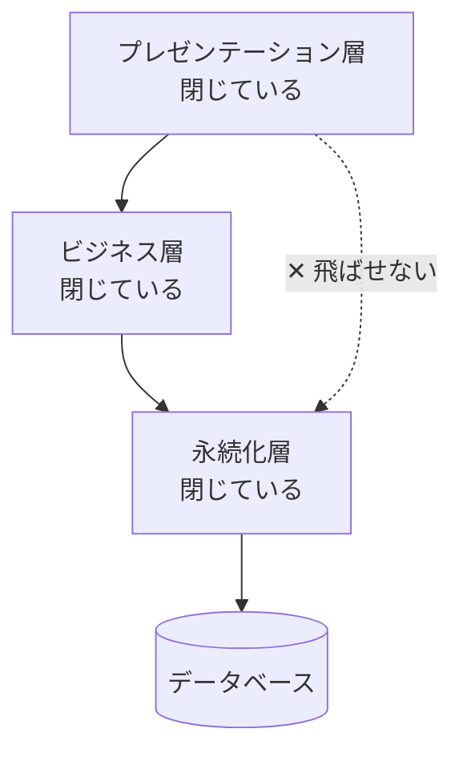
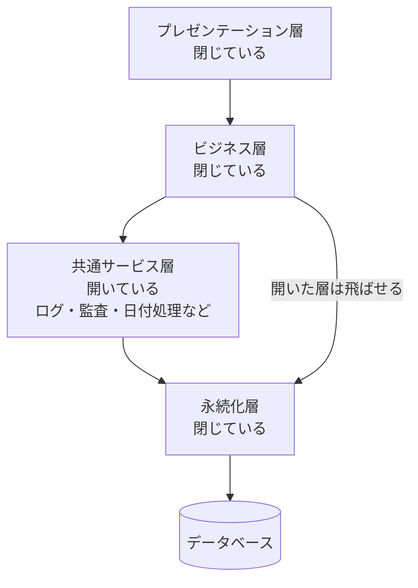

# 閉じた層と開いた層 — 隔離層とシンクホール

## この教材の目的

[[01層化]] と [[レイヤードアーキテクチャ]] では、「上の層は下の層だけを使う」という基本ルールを学びました。
しかし実務では、すぐに次のような疑問にぶつかります。

- 画面に一覧を出すだけなのに、Controller → Service → Repository と **何もしない層** を全部通す必要があるのか
- 「共通処理」はどの層に置けばよいのか
- 「素通りの層」はどのくらいまで許されるのか

この教材では、『ソフトウェアアーキテクチャの基礎』『Software Architecture Patterns』（Mark Richards）で整理されている、

- **閉じた層** と **開いた層**
- **隔離層**（Layers of Isolation）という考え方
- **アーキテクチャ・シンクホール** アンチパターンと **80/20 ルール**
- レイヤードアーキテクチャの **★評価の理由**

を解説します。

---

## 1. 閉じた層と開いた層

### 1.1 閉じた層（Closed Layer）

**リクエストは、閉じた層を飛ばして下に進めない** というルールです。



- プレゼンテーション層が DB のデータを欲しくても、必ずビジネス層・永続化層を順に通る
- これがレイヤードアーキテクチャの **標準** です

### 1.2 開いた層（Open Layer）

**その層を飛ばして、さらに下の層に直接アクセスしてよい** というルールです。

典型例は **共通サービス層** です。



- 共通サービス層（ログ・監査・暗号化・日付処理など）を、ビジネス層の **下** に置く
- この層を **開いた層** にすると、ビジネス層は共通サービスを使いたいときだけ使い、使わないときは飛ばして永続化層に行ける
- 共通サービスを **ビジネス層からしか使えないようにする**（プレゼンテーション層から直接使わせない）という制約も表現できる

### 1.3 どちらを選ぶか

| | 閉じた層 | 開いた層 |
|---|---|---|
| 依存の範囲 | 1つ下の層だけ | 2つ以上下の層にも依存できる |
| 変更の影響 | 1つ上の層にしか広がらない | 飛ばして使っている層すべてに広がる |
| 素通りの手間 | 多い | 少ない |
| 向いている層 | 主要な層（プレゼンテーション・ビジネス・永続化） | 補助的な層（共通サービス・ユーティリティ） |

> **どの層が開いていて、どの層が閉じているかを、チームで明文化しておく** ことが最も大切です。曖昧なままだと、開発者ごとに判断がばらつき、層の意味がなくなります（→ ADR に残す・アーキテクチャテストで検査する）。

---

## 2. 隔離層（Layers of Isolation）

### 2.1 考え方

**ある層の変更が、他の層に影響しない** 状態を **隔離層** と呼びます。

- 永続化層で SQL を ORM に書き換えても、ビジネス層・プレゼンテーション層は影響を受けない
- プレゼンテーション層で画面フレームワークを変えても、ビジネス層は影響を受けない

### 2.2 閉じた層が隔離を生む

隔離層が成り立つのは、層が **閉じている** からです。

- プレゼンテーション層が永続化層に直接アクセスしていたら、SQL の変更がプレゼンテーション層にまで及ぶ
- 層が閉じていれば、永続化層の変更の影響は **すぐ上のビジネス層** で止まる

つまり、

> **閉じた層を増やすほど隔離は強まるが、素通りの手間も増える**

というトレードオフがあります。これが次のシンクホールの問題につながります。

---

## 3. アーキテクチャ・シンクホール アンチパターン

### 3.1 シンクホールとは

**リクエストが、どの層でも何の処理もされずに、ただ素通りしていく** 状態です。「シンクホール（陥没穴）」のように、リクエストがそのまま下に落ちていくイメージです。

```typescript
// Controller：受け取って渡すだけ
class UserController {
  getUser(id: string) {
    return this.userService.getUser(id);
  }
}

// Service：受け取って渡すだけ
class UserService {
  getUser(id: string) {
    return this.userRepository.findById(id);
  }
}

// Repository：ここで初めて仕事をする
class UserRepository {
  findById(id: string) {
    return db.query("SELECT * FROM users WHERE id = ?", [id]);
  }
}
```

- Controller と Service は **何もしていない**
- それでもファイルが3つ必要で、テストも3つ、変更時の修正箇所も3つになる

### 3.2 80/20 ルール

Richards は、シンクホールが **ある程度あるのは自然** だとしています。判断の目安が **80/20 ルール** です。

| 状態 | 判断 |
|---|---|
| リクエストの **約20%** がシンクホール | 許容範囲。単純な参照系があるのは普通 |
| リクエストの **約80%** がシンクホール | レイヤードアーキテクチャが **このアプリに合っていない** サイン |

### 3.3 80% がシンクホールだったら

選択肢は3つあります。

1. **一部の層を開く**：参照系だけビジネス層を飛ばしてよい、と明文化する
2. **層を減らす**：業務ロジックがほぼない CRUD アプリなら、2層（Controller + Repository）で十分なこともある
3. **別のスタイルを検討する**：機能ごとに必要な層が違うなら、[[03_垂直スライスアーキテクチャ]] のように「機能ごとに必要なだけ層を持つ」構成も選択肢

> 「何もしない Service」が大量にあるのは、**層の数を目的にしてしまった** 典型的な状態です。層は手段であり、仕事をしない層は削ってよい、という判断も立派な設計です。

---

## 4. 層が抱えやすいその他の問題

| 問題 | 症状 | 対策 |
|---|---|---|
| **層の飛び越し**（明文化されていない） | プレゼンテーション層から Repository を直接呼ぶコードが少しずつ増える | 開いた層・閉じた層を明文化し、アーキテクチャテスト（ArchUnit、dependency-cruiser など）で検査 |
| **ロジックの染み出し** | 業務ルールが Controller や画面に書かれる | 業務ルールはビジネス（ドメイン）層、と明確にする（→ [[01_MVC違反とは]]） |
| **巨大な層** | ビジネス層に全機能のサービスが集まり、数千行のファイルになる | 層の **中** をドメイン（機能）ごとに分ける |
| **技術で分けたことによる変更の分散** | 「注文に割引を追加」で全層を修正する | 層の中を機能で分ける、または垂直スライスを検討 |

---

## 5. レイヤードアーキテクチャの★評価の理由

MOC のスタイル比較表で、レイヤードは次のように評価されています（『ソフトウェアアーキテクチャの基礎』）。

| 特性 | ★ | 理由 |
|---|---|---|
| 手軽さ・コスト | ★★★★★ | 最もよく知られた形で、多くの FW がこの形を前提にしている |
| シンプルさ | ★★★★★ | 構造が直感的で、学習コストが低い |
| デプロイ容易性 | ★ | **1つのデプロイ単位**。小さな変更でも全体を再デプロイする |
| テスト容易性 | ★★ | 層ごとのテストはできるが、変更のたびに全体の回帰テストが必要になりがち |
| 拡張性（スケール） | ★ | 全体をまとめてしかスケールできない |
| 耐障害性 | ★ | 1か所のメモリ不足やバグで全体が落ちる |
| 進化しやすさ | ★ | 技術で分割しているため、業務の変更が全層に散らばる |

ポイントは、**低い★の多くが「1つのデプロイ単位であること」と「技術で分割していること」から来ている** ことです。

- 前者（デプロイ・スケール・耐障害性）は、アプリ内部の構造をどう工夫しても改善しない → 40_システム・分散 のスタイルの領域
- 後者（進化しやすさ）は、層の中を機能で分ける、クリーンアーキテクチャで依存を整理する、垂直スライスにする、などで改善できる

### 5.1 レイヤードが向いている場面

- 小規模なアプリ、予算や期間が限られたプロジェクト
- 最初の一歩として、アーキテクチャがまだはっきりしないとき（後から別のスタイルに移る前提で）
- チームのメンバーがレイヤードに慣れている

### 5.2 向いていない場面

- 大規模で、多くのチームが同時に開発する
- 部分ごとに必要なスケール・可用性が大きく違う
- 業務の変更が頻繁で、変更のたびに全層を触っている

---

## 6. ありがちな誤解

### 6.1 「層は必ず全部通らなければならない」

**誤りです。** 補助的な層を **開いた層** にするのは正当な設計です。大事なのは、どの層が開いているかを **明文化すること** です。

### 6.2 「何もしない層があるのは悪い設計」

**半分だけ正しいです。** 2割程度のシンクホールは自然です。8割を超えたら、構成を見直すサインです。

### 6.3 「層を守れば保守性は自動的に上がる」

**誤りです。** 層は技術で分けているので、**業務の変更** は複数の層にまたがります。レイヤードの「進化しやすさ」が★1なのはそのためです。

---

## 7. まとめ

- **閉じた層**：飛ばせない層。隔離を生む。主要な層は閉じるのが基本
- **開いた層**：飛ばしてよい層。共通サービス層などの補助的な層に使う
- **隔離層**：ある層の変更が他の層に影響しない状態。閉じた層によって成り立つ
- **シンクホール**：何もしない層を素通りするリクエスト。**20% なら許容、80% なら構成を見直す**（80/20 ルール）
- どの層が開いていて閉じているかを **明文化し、ツールで検査する**
- レイヤードの低い★は「1つのデプロイ単位」と「技術での分割」から来ている

次は [[03_垂直スライスアーキテクチャ]] で、層ではなく機能で縦に切る考え方を学びます。

---

## 参考資料

- Mark Richards, Neal Ford『ソフトウェアアーキテクチャの基礎』第10章（レイヤードアーキテクチャ）
- Mark Richards『Software Architecture Patterns』（O'Reilly）
- [Software Architecture Patterns: Layered Architecture（DEV Community）](https://dev.to/alexr/5-common-software-architecture-patterns-28a7)
- [Layered Software Architecture（Candost's Blog）](https://candost.blog/notes/47a/)
- [Introduction to Layered Architecture（Medium）](https://medium.com/@mortezatavakoli/introduction-to-layered-architecture-6aa940ad839a)
- [Notes on Fundamentals of Software Architecture（bagerbach.com）](https://bagerbach.com/books/fundamentals-of-software-architecture/)
