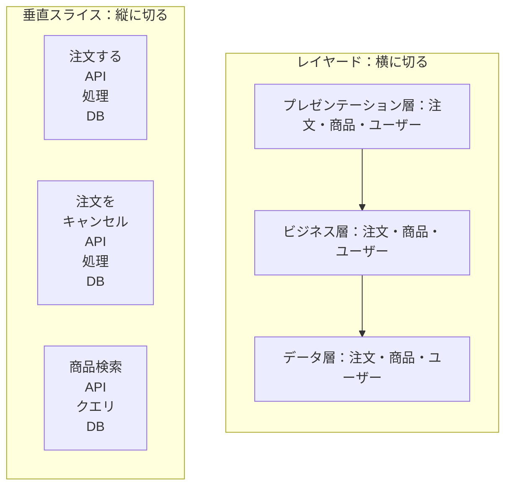

# 垂直スライスアーキテクチャ（Vertical Slice Architecture）

## この教材の目的

レイヤードやクリーンアーキテクチャは、アプリを **横に** 切ります（画面・業務・DB のように技術の役割で分ける）。
しかし実際の変更は、たいてい **1つの機能** 単位でやってきます。「注文に割引を追加する」と言われたら、画面・API・業務ロジック・DB アクセスを **縦に全部** 触ることになります。

この教材では、**機能ごとに縦に切る** という発想の **垂直スライスアーキテクチャ** を解説します。

- 横に切る（Package by Layer）と縦に切る（Package by Feature）の違い
- 垂直スライスアーキテクチャの原則と構造
- クリーンアーキテクチャとの関係（対立か、組み合わせか）
- 向いている場面・向いていない場面

---

## 1. 横に切るか、縦に切るか

### 1.1 横に切る（Package by Layer）

```text
src/
  controllers/
    OrderController.ts
    ProductController.ts
    UserController.ts
  services/
    OrderService.ts
    ProductService.ts
    UserService.ts
  repositories/
    OrderRepository.ts
    ProductRepository.ts
    UserRepository.ts
```

- フォルダを開くと「**何の技術で作られているか**」が分かる
- 「注文」の機能を直すには、3つのフォルダを行き来する

### 1.2 縦に切る（Package by Feature）

```text
src/
  features/
    orders/
      place-order/
        PlaceOrderEndpoint.ts
        PlaceOrderHandler.ts
        PlaceOrderValidator.ts
        PlaceOrder.test.ts
      cancel-order/
        CancelOrderEndpoint.ts
        CancelOrderHandler.ts
      get-order-history/
        GetOrderHistoryEndpoint.ts
        GetOrderHistoryQuery.ts
    products/
      search-products/
      ...
```

- フォルダを開くと「**このアプリが何をするか**」が分かる
- 「注文をキャンセルする」機能を直すには、`cancel-order/` だけを見ればよい

Robert C. Martin はこれを **「叫ぶアーキテクチャ（Screaming Architecture）」** と呼びました。フォルダ構成を見たときに、「Rails のアプリだ」ではなく **「これは EC サイトだ」と叫んでいる** べきだ、という考え方です。

---

## 2. 垂直スライスアーキテクチャとは

### 2.1 提唱と原則

**Jimmy Bogard**（.NET のライブラリ MediatR・AutoMapper の作者）が 2018 年のブログ記事で提唱しました。原則はひとことで表されます。

> **スライス間の結合は最小に、スライス内の結合は最大に。**
> （Minimize coupling between slices, and maximize coupling in a slice.）

- **スライス** ＝ 1つのリクエスト（1つのユースケース）を処理するのに必要な、画面〜DB までのすべてのコード
- スライスの中は強く結びついていてよい（高凝集）
- スライス同士はできるだけ独立させる（疎結合）

これは [[03_疎結合と高凝集]] の「凝集の単位 ＝ 変更の単位」を、**機能（ユースケース）** を単位にして徹底した形です。

### 2.2 図で比べる



### 2.3 スライスごとに作り方を変えてよい

垂直スライスの大きな特徴は、**スライスごとに最適な実装方法を選べる** ことです。

| スライス | 複雑さ | 実装方法の例 |
|---|---|---|
| 注文履歴を表示する | 単純な参照 | SQL を直接書いて DTO で返す。ドメインモデルは使わない |
| 商品を検索する | 性能が重要 | 検索エンジンや最適化したクエリを直接使う |
| 注文する | 業務ルールが複雑 | ドメインモデル（集約）を使い、在庫・割引・与信のルールを表現する |

レイヤードでは「すべての機能が Controller → Service → Repository を通る」のが普通ですが、垂直スライスでは **単純な機能は単純に、複雑な機能だけ丁寧に** 作れます。[[02_閉じた層と開いた層_隔離層とシンクホール]] で見た **シンクホール（何もしない層）** が生まれにくい構造です。

### 2.4 共通の抽象を減らす

Bogard は、垂直スライスにすると **層ごとの共通の抽象**（汎用 Repository、汎用 Service、基底 Controller など）の多くが **不要になる** と述べています。

- 各スライスは、他のスライスとサービス・リポジトリ・基底クラスを **共有しない** のが基本
- 共有するのは「本当に共有すべき理由があるもの」だけ（ドメインモデル、認証、ログなど）

---

## 3. コードのイメージ

TypeScript で「注文をキャンセルする」スライスを書くと、次のようになります。

```typescript
// features/orders/cancel-order/CancelOrderHandler.ts
export type CancelOrderCommand = { orderId: string; userId: string };

export class CancelOrderHandler {
  constructor(private readonly db: Database) {}

  async handle(cmd: CancelOrderCommand): Promise<void> {
    const order = await this.db.orders.findById(cmd.orderId);
    if (!order) throw new NotFoundError("注文が見つかりません");
    if (order.userId !== cmd.userId) throw new ForbiddenError();

    order.cancel(); // 業務ルール（発送済みならキャンセル不可など）はドメインモデルに
    await this.db.orders.save(order);
  }
}
```

```typescript
// features/orders/get-order-history/GetOrderHistoryQuery.ts
// 参照だけのスライスは、ドメインモデルを通さず直接 SQL で DTO を返してよい
export async function getOrderHistory(db: Database, userId: string) {
  return db.sql<OrderHistoryDto>`
    SELECT id, ordered_at, total_amount, status
    FROM orders WHERE user_id = ${userId}
    ORDER BY ordered_at DESC LIMIT 50`;
}
```

- 書き込み（コマンド）と読み取り（クエリ）で、作り方がまったく違う
- これは自然と [[CQRS_コマンドとクエリの責務分離]] の考え方に近づきます。実際、垂直スライスは CQRS と組み合わせて紹介されることが多いです

---

## 4. クリーンアーキテクチャとの関係

### 4.1 対立するものではない

「垂直スライスか、クリーンアーキテクチャか」と対立的に語られることがありますが、実際には **切る方向が違う** だけで、組み合わせられます。

| | クリーン / ヘキサゴナル / オニオン | 垂直スライス |
|---|---|---|
| 主な関心 | **依存の向き**（内側＝ドメインを守る） | **変更の単位**（機能ごとにまとめる） |
| 切る方向 | 同心円（技術 vs ドメイン） | 縦（機能ごと） |
| 共通の抽象 | Port（インターフェース）を多く定義する | 必要なものだけ |

### 4.2 よくある組み合わせ方

```text
src/
  features/                 ← 縦に切る（垂直スライス）
    orders/
      place-order/
      cancel-order/
  domain/                   ← 複数のスライスで共有するドメインモデル（内側）
    order/Order.ts
    order/OrderStatus.ts
  infrastructure/           ← DB・外部 API のアダプタ（外側）
    db/
    payment-gateway/
```

- 最上位は **機能で縦に切り**、
- 業務ルールが複雑な部分は **ドメインモデルとして内側に置き**、インフラへの依存を逆転させる（[[依存性のルール]]）
- 単純なスライスはドメイン層を通さない

これは [[06_論理コンポーネントの見つけ方]] の「最上位をドメインで分割し、その中を技術で分ける」とも同じ発想です。

---

## 5. メリットとデメリット

### 5.1 メリット

| メリット | 説明 |
|---|---|
| **変更が局所化する** | 1つの機能の変更が、1つのフォルダに閉じる |
| **理解しやすい** | 新しく入った人も「この機能のコードはここ」とすぐ分かる |
| **過剰な抽象が減る** | 何もしない Service や汎用 Repository が不要になる |
| **スライスごとに最適化できる** | 単純な機能は単純に、複雑な機能だけ丁寧に |
| **並行開発しやすい** | 別の機能を担当する人同士の衝突が減る |
| **削除しやすい** | 不要になった機能はフォルダごと消せる |

### 5.2 デメリット・注意点

| デメリット | 説明 | 対策 |
|---|---|---|
| **コードの重複** | スライス間で似た処理が繰り返される | 3回以上重複したら共通化を検討する（早すぎる共通化を避ける） |
| **業務ルールが散らばる** | 「注文はキャンセルできるか」のルールが複数スライスに書かれる | 業務ルールは **ドメインモデル** に集約する。スライスはそれを呼ぶだけ |
| **スライスごとにバラバラな作り** | 自由度が高いぶん、統一感がなくなる | チームでパターン（単純な参照ならこう、複雑な更新ならこう）を決めておく |
| **リファクタリングの力が必要** | 「どこまで共通化するか」を継続的に判断する必要がある | コードの匂い（重複・肥大化）に気づいたら直す習慣 |

> とくに注意したいのが「業務ルールの散らばり」です。垂直スライスは **ドメインモデルが不要になる** という意味ではありません。複雑な業務ルールは、引き続きドメインモデルに集めるべきです（→ 42_ソフトウェア設計 の DDD）。

---

## 6. 向いている場面・向いていない場面

| 向いている | 向いていない |
|---|---|
| 機能ごとに複雑さが大きく違う | すべての機能が同じような単純 CRUD（素直なレイヤードで十分） |
| 機能の追加・変更が頻繁 | 業務ルールが複雑に絡み合い、ほぼすべての機能が同じドメインモデルを使う |
| シンクホール（何もしない層）が多いレイヤードに悩んでいる | チームがリファクタリングや重複の判断に慣れていない |
| 将来、機能のまとまりをモジュール・サービスとして切り出す可能性がある | — |

最後の点は重要です。垂直スライスで機能ごとにまとまっていると、**モジュラーモノリス** や **サービス** に切り出すときの境界がすでに見えています（→ 40_システム・分散）。

---

## 7. ありがちな誤解

### 7.1 「垂直スライスはレイヤーを使わない」

**誤りです。** スライスの **中** には、必要に応じて層（エンドポイント・処理・データアクセス）があります。違うのは、**層を最上位の分け方にしない** ことと、**スライスごとに層の数を変えてよい** ことです。

### 7.2 「クリーンアーキテクチャの代わりになる」

**半分だけ正しいです。** 切る方向が違うので、組み合わせられます。依存の向きの考え方（ドメインを技術から守る）は、垂直スライスでも有効です。

### 7.3 「重複は絶対に悪い」

**誤りです。** スライス間で似たコードがあっても、**変わる理由が違う** なら別々にしておく方が安全です。早すぎる共通化は、スライス同士を結合させてしまいます。

---

## 8. まとめ

- **横に切る**（Package by Layer）は技術で、**縦に切る**（Package by Feature）は機能で分ける
- **垂直スライスアーキテクチャ**：Jimmy Bogard が 2018 年に提唱。「**スライス間の結合は最小に、スライス内の結合は最大に**」
- スライスごとに **最適な作り方** を選べる。単純な参照は単純に、複雑な更新だけドメインモデルで
- 層ごとの **共通の抽象が減り**、シンクホールが生まれにくい
- クリーンアーキテクチャとは **切る方向が違う** だけで、組み合わせられる
- 注意点は **業務ルールの散らばり**。複雑なルールはドメインモデルに集める

---

## 参考資料

- [Vertical Slice Architecture（Jimmy Bogard, 2018）](https://www.jimmybogard.com/vertical-slice-architecture/)
- [Encountering "Vertical Slice Architecture"... Is it incompatible with Clean Architecture?（Jeremiah Flaga）](https://jeremiahflaga.github.io/2019/05/20/vertical-slice-architecture-is-it-incompatible-with-clean-architecture/)
- [My thoughts on Vertical Slices, CQRS, Semantic Diffusion and other fancy words（Architecture Weekly）](https://www.architecture-weekly.com/p/my-thoughts-on-vertical-slices-cqrs)
- [Vertical Slice Architecture - A collection of best practices](https://toeggel.github.io/ReadTheDocs/architecture/vertical-slice/)
- [Exploring Software Architecture: Vertical Slice（Medium）](https://medium.com/@andrew.macconnell/exploring-software-architecture-vertical-slice-789fa0a09be6)
- Robert C. Martin『Clean Architecture』第21章（叫ぶアーキテクチャ）
