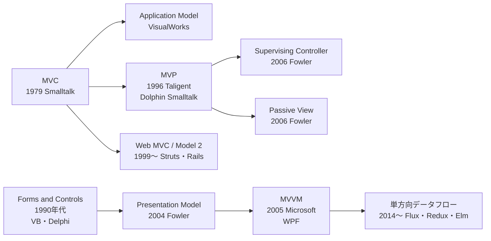

# GUI アーキテクチャの系譜 — Passive View・Supervising Controller・Presentation Model

## この教材の目的

[[02UIとドメイン分離]] と [[MVCとMVVM]] では、MVC・MVP・MVVM の3つを比較しました。
しかし実際の歴史はもっと枝分かれしていて、**「MVP」と呼ばれるものにも複数の流派** があり、**MVVM にも前身** があります。これを知らないと、資料によって説明が食い違う理由が分かりません。

この教材では、Martin Fowler の論考「GUI Architectures」（2006）を軸に、

- MVC 以前の **Forms and Controls**
- MVP の2つの流派：**Supervising Controller** と **Passive View**
- MVVM の前身：**Presentation Model**
- テストのための考え方：**Humble Object（謙虚なオブジェクト）**
- Web の MVC（Model 2）と、その後の単方向データフロー

を、**「画面のロジックをどこに置くか」** という1本の軸で整理します。

---

## 1. すべてのパターンに共通する問い

GUI のパターンはどれも、次の3種類のロジックを **どこに置くか** の違いです。

| ロジックの種類 | 例 |
|---|---|
| **ドメインロジック** | 「在庫が0なら注文できない」「会員ランクで割引率が変わる」 |
| **プレゼンテーションロジック**（画面の振る舞い） | 「在庫が0なら注文ボタンを無効にする」「割引中は価格を赤字で表示する」 |
| **描画** | ボタンを置く、文字を描く、色を塗る |

どのパターンでも、**ドメインロジックは画面から切り離す** ことは共通しています（[[02UIとドメイン分離]]）。違いは、**プレゼンテーションロジックを View に置くか、別のオブジェクトに置くか** です。

---

## 2. 系譜の全体像



年はおおよその目安です。以下、順に見ていきます。

---

## 3. Forms and Controls（フォームとコントロール）

1990年代の Visual Basic や Delphi でおなじみの、最も素朴な形です。

- **フォーム**（画面）に、**コントロール**（テキストボックス・ボタンなどの部品）を並べる
- 単純なデータの表示はデータバインディングで行い、複雑な処理は **イベントハンドラ** に書く

```text
Button1_Click() {
  if (txtQuantity.Text > stock) {     ← ドメインロジック
    lblError.Visible = true           ← プレゼンテーションロジック
    lblError.Text = "在庫が足りません"
  }
}
```

- 良い点：作るのが簡単で速い
- 悪い点：**画面とロジックが同じ場所にある** ため、ロジックだけをテストできない。画面が増えると同じロジックが重複する

後のすべてのパターンは、**この「全部フォームに書く」状態から、何を外に出すか** の工夫です。

---

## 4. MVP の2つの流派

MVP（Model-View-Presenter）は 1990年代半ばに Taligent 社（Apple と IBM の合弁）で生まれ、Dolphin Smalltalk で広まりました。Fowler は 2006 年に、MVP を **2つのパターンに分けて** 整理しました。

### 4.1 Supervising Controller（監督するコントローラー）

> **単純な表示の同期は View に任せ（データバインディング）、複雑なロジックだけを Presenter が担当する。**

- ユーザーの操作は View が受けて Presenter に渡す
- 「名前を表示する」程度の単純な同期は、View がデータバインディングで行う
- 「在庫が足りなければボタンを無効化してエラーを出す」のような複雑な処理は Presenter が行う

### 4.2 Passive View（受け身のビュー）

> **View は完全に受け身で、ロジックを一切持たない。表示の更新はすべて Presenter が行う。**

- View は Model を知らない。Presenter から「このテキストを表示せよ」「このボタンを無効にせよ」と言われたとおりにするだけ
- データバインディングも使わない

```typescript
// Passive View：View はインターフェースだけ
interface OrderView {
  setPrice(text: string): void;
  setOrderButtonEnabled(enabled: boolean): void;
  showError(message: string): void;
}

class OrderPresenter {
  constructor(private view: OrderView, private model: OrderModel) {}

  onQuantityChanged(quantity: number) {
    const result = this.model.canOrder(quantity);      // ドメインロジックは Model
    this.view.setOrderButtonEnabled(result.ok);         // 表示の判断は Presenter
    this.view.setPrice(`${this.model.priceFor(quantity).toLocaleString()} 円`);
    if (!result.ok) this.view.showError(result.reason);
  }
}

// テストでは偽物の View を渡すだけで、画面なしに振る舞いを検証できる
```

### 4.3 2つの比較

| 観点 | Supervising Controller | Passive View |
|---|---|---|
| View のロジック | 単純な同期（データバインディング）を持つ | **一切持たない** |
| Presenter の仕事 | 複雑な処理だけ | 表示の更新すべて |
| テスト容易性 | 高い（ただし View の同期部分はテストしにくい） | **最も高い**（View 以外すべてテストできる） |
| コード量 | 少なめ | 多め（すべての表示更新を書く） |
| 向いている | データバインディングが強力な環境 | テストを最優先したいとき |

> 資料によって「MVP では View は Model を知らない」「いや知ってよい」と説明が食い違うのは、**Passive View と Supervising Controller のどちらを MVP と呼んでいるか** の違いです。

---

## 5. Presentation Model（プレゼンテーションモデル）→ MVVM

### 5.1 Presentation Model とは

Fowler が 2004 年ごろに整理したパターンです。

> **画面の状態と振る舞いをすべて持つ「画面専用のモデル」を作り、View はそれと同期するだけにする。**

- Presentation Model は「注文ボタンが有効か」「エラーメッセージは何か」「表示用の価格文字列」といった **画面の状態** をプロパティとして持つ
- View はそのプロパティを読んで描画し、操作があれば Presentation Model のメソッドを呼ぶ
- Presentation Model は **View を知らない**（Passive View の Presenter は View を知っている点が違う）

```typescript
// Presentation Model：画面の状態と振る舞いを持つが、View は知らない
class OrderPresentationModel {
  quantity = 1;
  get price(): string { return `${this.model.priceFor(this.quantity).toLocaleString()} 円`; }
  get canOrder(): boolean { return this.model.canOrder(this.quantity).ok; }
  get errorMessage(): string | null {
    const r = this.model.canOrder(this.quantity);
    return r.ok ? null : r.reason;
  }
  constructor(private model: OrderModel) {}
}
```

### 5.2 MVVM は Presentation Model の一種

2005 年、Microsoft の John Gossman が WPF（Windows のUIフレームワーク）向けに **MVVM** を発表しました。MVVM の **ViewModel は、Presentation Model を、強力なデータバインディングと組み合わせたもの** です。

- Presentation Model では、View と同期するコードを自分で書く必要があった
- WPF のデータバインディングがそれを自動化したので、ViewModel のプロパティを書き換えるだけで画面が更新されるようになった

つまり、**「ViewModel ＝ 画面のための Model」** であり、「View のためのロジック置き場」というより「**画面の状態そのもの**」と捉えると理解しやすくなります（[[MVCとMVVM]] の「誤解2」）。

---

## 6. Humble Object（謙虚なオブジェクト）

ここまでのパターンに共通する、**テストのための考え方** です。

> **テストしにくい部分（画面・DB・外部 API）は、ロジックを持たない「謙虚な（humble）」薄い層にし、ロジックはテストしやすいオブジェクトに移す。**

- Michael Feathers が「Humble Dialog Box」（2002）として提唱し、Gerard Meszaros『xUnit Test Patterns』で **Humble Object** パターンとして一般化されました
- Passive View は、Humble Object を GUI に当てはめた典型例です
- Robert C. Martin も『Clean Architecture』で、Presenter と View の境界を Humble Object で説明しています

この考え方は GUI に限りません。クリーンアーキテクチャの Interface Adapters、ヘキサゴナルの Adapter も「外部との境界を薄くし、ロジックを内側へ」という同じ発想です（→ [[依存性のルール]]、[[ヘキサゴナルアーキテクチャ]]）。

---

## 7. Web の MVC と、その後

### 7.1 Web MVC（Model 2）

1999 年ごろ、Java の JSP の設計で **Model 2** と呼ばれる形が登場し、Struts・Ruby on Rails・Spring MVC・Express に受け継がれました（[[33_MVCアーキテクチャとは]]）。

| | Smalltalk の MVC | Web の MVC（Model 2） |
|---|---|---|
| Controller の役割 | キーボード・マウスの入力を処理 | **HTTP リクエスト** を受けて処理を振り分ける |
| View の更新 | Model の変更通知（Observer）で自動更新 | リクエストごとに **HTML を生成して返す** |
| 寿命 | 画面が開いている間ずっと生きている | 1リクエストで終わる |

名前は同じでも、**中身はかなり違うパターン** です。「Web の MVC は本来の MVC ではない」と言われるのはこのためです。

### 7.2 単方向データフローへ

2014 年ごろから、フロントエンドでは **Flux**（Facebook）・**Redux**・**Elm Architecture** のような **単方向データフロー** が主流になりました。

- 双方向データバインディング（MVVM）は、画面が複雑になると「どこで状態が変わったか」が追いにくくなる
- そこで「**状態 → 描画 → 操作（アクション）→ 新しい状態**」と、データを一方向にだけ流す

詳しくは 47_フロントエンド設計 の [[02_UIは状態の関数と単方向データフロー]] を参照してください。

---

## 8. まとめ表

| パターン | 年（目安） | プレゼンテーションロジックの置き場所 | View が知っているもの | テスト容易性 |
|---|---|---|---|---|
| Forms and Controls | 1990年代 | フォーム（View）のイベントハンドラ | すべて | 低い |
| MVC（Smalltalk） | 1979 | View と Controller に分散 | Model | 中 |
| Supervising Controller | 2006（整理） | 複雑な部分は Presenter、単純な同期は View | Model と Presenter | 高い |
| Passive View | 2006（整理） | **すべて Presenter** | Presenter だけ | **最も高い** |
| Presentation Model | 2004 | 画面専用のモデル | Presentation Model | 高い |
| MVVM | 2005 | ViewModel（＋データバインディング） | ViewModel | 高い |
| Web MVC（Model 2） | 1999〜 | Controller と テンプレート | Controller が渡すデータ | 中 |
| 単方向データフロー | 2014〜 | ストア（Reducer）・セレクター | 状態（読み取り専用） | 高い |

Fowler 自身も、Presentation Model・Supervising Controller・Passive View の **どれを選ぶかは、使っている GUI 環境での作りやすさと好みの問題** だと述べています。大事なのはパターン名ではなく、

> **ドメインロジックを画面から外す。プレゼンテーションロジックも、テストしたいなら描画から外す。**

という共通の原則です。

---

## 9. ありがちな誤解

### 9.1 「MVP は1種類」

**誤りです。** Supervising Controller と Passive View の2つの流派があり、View が Model を知っているかどうかが違います。

### 9.2 「MVVM はまったく新しい発明」

**誤りです。** MVVM は Presentation Model を、強力なデータバインディングのある環境に合わせたものです。

### 9.3 「Web の MVC と Smalltalk の MVC は同じ」

**誤りです。** 名前は同じでも、Controller の役割と View の更新方法がまったく違います。

---

## 10. まとめ

- GUI パターンの違いは **プレゼンテーションロジックをどこに置くか**
- **Forms and Controls**：全部フォームに書く。すべての出発点
- **MVP** には **Supervising Controller**（単純な同期は View）と **Passive View**（View は完全に受け身）の2流派がある
- **Presentation Model** は画面専用のモデル。**MVVM** はそれをデータバインディングと組み合わせたもの
- **Humble Object**：テストしにくい境界を薄くし、ロジックをテストしやすい場所へ移す。クリーンアーキテクチャのアダプタにも通じる
- **Web MVC（Model 2）** は Smalltalk の MVC とは別物。フロントエンドはその後 **単方向データフロー** へ

---

## 参考資料

- [Martin Fowler — GUI Architectures](https://martinfowler.com/eaaDev/uiArchs.html)
- [Martin Fowler — Supervising Controller](https://martinfowler.com/eaaDev/SupervisingPresenter.html)
- [Martin Fowler — Passive View](https://martinfowler.com/eaaDev/PassiveScreen.html)
- [Martin Fowler — Presentation Model](https://martinfowler.com/eaaDev/PresentationModel.html)
- [Martin Fowler — Organizing Presentation Logic](https://martinfowler.com/eaaDev/OrganizingPresentations.html)
- [Model-View-Presenter: Variations on the Basic Pattern（Rich Newman）](https://richnewman.wordpress.com/2008/02/26/model-view-presenter-variations-on-the-basic-pattern-introduction-to-cabscsf-part-24/)
- [Presentation Model pattern in WPF（Microsoft Learn アーカイブ）](https://learn.microsoft.com/en-us/archive/blogs/mattdotson/presentation-model-pattern-in-wpf)
- Gerard Meszaros『xUnit Test Patterns』（Humble Object）
