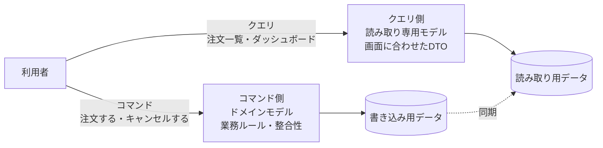

# CQRS — コマンドとクエリの責務分離

## この教材の目的

クリーンアーキテクチャやヘキサゴナルアーキテクチャで **ドメインモデル** を中心に据えると、次のような悩みが出てきます。

- 一覧画面のために、集約を何十件も読み込んでから DTO に詰め替えている。遅いうえにコードが冗長
- 画面ごとに欲しいデータの形が違い、Repository に `findForListScreen()` `findForDashboard()` … とメソッドが増え続ける
- 書き込みのための「正しいモデル」と、読み取りのための「便利なモデル」が1つのクラスでせめぎ合っている

この教材では、この悩みに対する考え方 **CQRS**（Command Query Responsibility Segregation）を解説します。

- 源流である **CQS**（コマンド・クエリ分離）との関係
- CQRS の **段階**（コードの分離 → モデルの分離 → データストアの分離）
- クリーン／ヘキサゴナル／垂直スライスとの組み合わせ
- **使うべきでない場面**（Fowler の警告）

---

## 1. 源流：CQS（コマンド・クエリ分離）

### 1.1 CQS とは

Bertrand Meyer が『オブジェクト指向入門』（1988）で提唱した、**メソッドレベル** の原則です。

> メソッドは、**状態を変える「コマンド」** か、**値を返す「クエリ」** のどちらか一方であるべきで、両方を兼ねてはならない。
> 「質問をしても答えが変わってはいけない」

```typescript
// ✕ 値を返しながら状態も変える
function popAndCount(): number { ... }

// ○ 分ける
function pop(): void { ... }        // コマンド：状態を変える、何も返さない
function count(): number { ... }    // クエリ：値を返す、状態を変えない
```

詳しくは 46_メソッド設計 の [[01_CQS]] を参照してください。

### 1.2 CQS から CQRS へ

**Greg Young** が 2010 年ごろ、この考え方を **アーキテクチャのレベル** に広げたのが CQRS です。

| | CQS | CQRS |
|---|---|---|
| 単位 | メソッド | **モデル・コンポーネント・データストア** |
| 分けるもの | 1つのメソッドの責務 | **書き込み側のモデルと読み取り側のモデル** |
| 提唱 | Bertrand Meyer（1988） | Greg Young（2010年ごろ） |

---

## 2. CQRS とは

### 2.1 基本の考え方

> **データを更新するためのモデル（コマンド側）と、データを読み取るためのモデル（クエリ側）を、別々に作る。**



### 2.2 なぜ分けるのか — 書き込みと読み取りは性質が違う

| 観点 | 書き込み（コマンド） | 読み取り（クエリ） |
|---|---|---|
| 目的 | **業務ルールを守って** 状態を変える | **画面に必要な形で** データを見せる |
| 重視すること | 整合性・不変条件・トランザクション | 速さ・画面への合わせやすさ |
| データの形 | 集約（業務のまとまり）単位 | 画面単位（複数の集約をまたいで結合・集計） |
| 量 | 少ない（1件ずつ） | 多い（一覧・検索・集計） |
| 頻度 | 一般的に少ない | 一般的に多い（読み取りが9割以上のシステムも多い） |

1つのモデルで両方を満たそうとすると、**どちらにとっても中途半端** になります。

- 業務ルールのためのドメインモデルに、画面表示用のプロパティが増えていく
- 一覧表示のために、重いドメインモデルを大量に組み立てて捨てる

---

## 3. CQRS の段階

CQRS は「全部やるか、やらないか」ではなく、**段階的に** 適用できます。

### 段階1：コードの分離（同じ DB）

**書き込みはドメインモデル、読み取りは直接クエリ** に分けます。DB は1つのままです。

```typescript
// コマンド側：ドメインモデルで業務ルールを守る
class CancelOrderUseCase {
  constructor(private orders: OrderRepository) {}
  async execute(orderId: string) {
    const order = await this.orders.findById(orderId);
    order.cancel();                 // 「発送済みならキャンセル不可」などのルールは Order が守る
    await this.orders.save(order);
  }
}

// クエリ側：ドメインモデルを通さず、画面に必要な形を直接取る
class OrderListQuery {
  constructor(private db: Database) {}
  async forUser(userId: string): Promise<OrderListItemDto[]> {
    return this.db.sql`
      SELECT o.id, o.ordered_at, o.status, SUM(i.price * i.qty) AS total
      FROM orders o JOIN order_items i ON i.order_id = o.id
      WHERE o.user_id = ${userId}
      GROUP BY o.id ORDER BY o.ordered_at DESC`;
  }
}
```

- **最も手軽で、効果が大きい** 段階。多くのアプリはここで十分
- Repository は **集約の保存と取得だけ** に専念でき、画面ごとの検索メソッドが増え続ける問題が消える
- [[03_垂直スライスアーキテクチャ]] の「スライスごとに作り方を変える」も、この段階の CQRS とほぼ同じ発想です

### 段階2：モデルの分離（読み取り専用のビュー・テーブル）

読み取り用に、**画面に最適化したビューやテーブル**（リードモデル・投影）を用意します。

- 例：注文一覧のために、注文・顧客・商品を結合済みの `order_list_view` を用意する
- 書き込み時に、同じトランザクション内で、またはイベント経由で更新する

### 段階3：データストアの分離

書き込み用と読み取り用で、**別のデータベース** を使います。

- 例：書き込みは RDB（整合性重視）、読み取りは検索エンジン（Elasticsearch など）やキャッシュ（速さ重視）
- 両者は **非同期に同期** されるため、**結果整合性**（書き込み直後は読み取り側に反映されていないことがある）を受け入れる必要がある
- ここまで来ると、40_システム・分散 の領域（イベント駆動・結果整合性）と重なります（→ [[04データ所有権と分散トランザクションとSAGAと整合性]]）

| 段階 | 分けるもの | 複雑さ | 結果整合性 |
|---|---|---|---|
| 1. コードの分離 | クラス・処理 | 低い | なし |
| 2. モデルの分離 | 読み取り用ビュー・テーブル | 中 | 更新方法次第 |
| 3. データストアの分離 | データベース | **高い** | **あり** |

### 補足：イベントソーシングとの関係

CQRS は **イベントソーシング**（状態ではなく「起きた出来事の列」を保存する方式）とセットで語られることが多いですが、**別の概念** です。

- CQRS はイベントソーシングなしでも使える（段階1・2の多くはそう）
- イベントソーシングを使う場合は、出来事の列から読み取り用モデルを作る必要があるため、ほぼ必ず CQRS になる

イベントソーシングはデータの持ち方の話なので、62_データアーキテクチャ・40_システム・分散 の領域です。

---

## 4. クリーン／ヘキサゴナルとの組み合わせ

CQRS は、クリーンアーキテクチャやヘキサゴナルと **相性が良い** です。

```text
src/
  application/
    commands/                    ← コマンド側：ドメインモデルを使う
      PlaceOrderUseCase.ts
      CancelOrderUseCase.ts
    queries/                     ← クエリ側：読み取り専用のインターフェース
      OrderListQuery.ts          （interface：内側に置く）
  domain/
    order/Order.ts               ← 業務ルールはコマンド側だけが使う
    order/OrderRepository.ts     ← 集約の保存・取得だけ
  infrastructure/
    db/PrismaOrderRepository.ts
    db/SqlOrderListQuery.ts      ← クエリの実装：SQL を直接書いてよい
```

- **コマンド側** は、これまでどおり依存性のルールを守り、ドメインモデルで業務ルールを表現する
- **クエリ側** は、読み取り専用なので業務ルールを守る必要がない。インターフェースだけ内側に置き、実装は SQL を直接書いてよい
- 結果として、ドメインモデルは **書き込みの正しさ** だけに集中でき、画面の都合から解放される

> クリーンアーキテクチャで「一覧画面のためだけに Entity を大量に組み立てる」のがつらいと感じたら、それは段階1の CQRS を入れるサインです。

---

## 5. 使うべきでない場面 — Fowler の警告

Martin Fowler は CQRS の解説で、はっきりと次のように警告しています。

> **ほとんどのシステムにとって、CQRS はリスクの高い複雑さを加える。**
> CQRS を使うときは、非常に慎重であるべきだ。

とくに段階3（データストアの分離）は、

- 同期の仕組み・結果整合性への対応・障害時のリカバリが必要になる
- 「保存したのに一覧に出てこない」という問い合わせに対応する必要がある
- チームの学習コストが高い

という大きなコストを伴います。

| CQRS が向いている | CQRS が向いていない |
|---|---|
| 読み取りと書き込みの **負荷が大きく違う**（読み取りが圧倒的に多い） | 単純な CRUD アプリ |
| 読み取りの形が **画面ごとに大きく違う**（ダッシュボード・検索・レポート） | 読み書きのモデルがほぼ同じ |
| 書き込み側の **業務ルールが複雑**（DDD を使っている） | 業務ルールが単純 |
| システムの **一部分**（境界づけられたコンテキストの1つ）に限定して使う | システム全体に一律に適用しようとしている |

Fowler も、CQRS は **システム全体ではなく、特定の境界づけられたコンテキストにだけ** 適用すべきだと述べています。

> 実務的な指針：**まず段階1（コードの分離）から始める**。これは低コストで、ほとんどのアプリで効果があります。段階2・3は、性能やスケールの問題が **実際に起きてから** 検討します。

---

## 6. ありがちな誤解

### 6.1 「CQRS には DB を2つ用意する必要がある」

**誤りです。** 同じ DB のまま、コードとモデルを分けるだけでも CQRS です（段階1）。

### 6.2 「CQRS とイベントソーシングはセット」

**誤りです。** よく一緒に使われますが、別の概念です。CQRS はイベントソーシングなしで使えます。

### 6.3 「CQRS を入れればスケールする」

**半分だけ正しいです。** 段階3まで進めれば読み取り側を独立してスケールできますが、そのぶん複雑さと結果整合性のコストを払います。多くのシステムでは、段階1で十分です。

---

## 7. まとめ

- **CQS**（Meyer）：メソッドはコマンドかクエリのどちらか。**CQRS**（Greg Young）：それをモデル・アーキテクチャのレベルに広げたもの
- 書き込み（業務ルール・整合性）と読み取り（速さ・画面への合わせやすさ）は **性質が違う** ので、モデルを分ける
- 段階は **① コードの分離 → ② モデルの分離 → ③ データストアの分離**。③ では結果整合性を受け入れる必要がある
- イベントソーシングとは **別の概念**
- クリーン／ヘキサゴナルでは、**コマンド側だけドメインモデル、クエリ側は SQL 直書き** という組み合わせが実用的
- Fowler の警告：**ほとんどのシステムにとって CQRS はリスクの高い複雑さ**。まず段階1から、必要な部分にだけ

---

## 参考資料

- [Martin Fowler — CQRS](https://martinfowler.com/bliki/CQRS.html)
- [Command Query Responsibility Segregation（Wikipedia）](https://en.wikipedia.org/wiki/Command_Query_Responsibility_Segregation)
- [Command–query separation（Wikipedia）](https://en.wikipedia.org/wiki/Command%E2%80%93query_separation)
- [CQS and CQRS Principles: Splitting the Read from the Write（gersti.at）](https://gersti.at/posts/cqrs/)
- [Tackling Complexity in CQRS（Vladik Khononov）](https://vladikk.com/2017/03/20/tackling-complexity-in-cqrs/)
- [My thoughts on Vertical Slices, CQRS, Semantic Diffusion and other fancy words（Architecture Weekly）](https://www.architecture-weekly.com/p/my-thoughts-on-vertical-slices-cqrs)
- Bertrand Meyer『オブジェクト指向入門』（CQS の原典）
