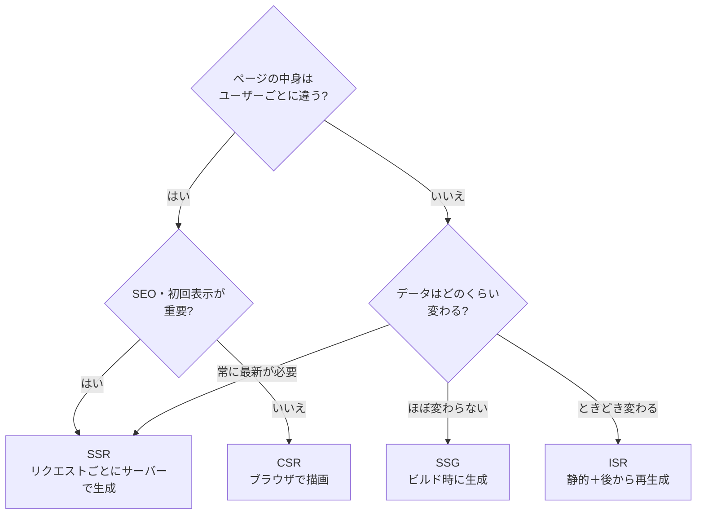
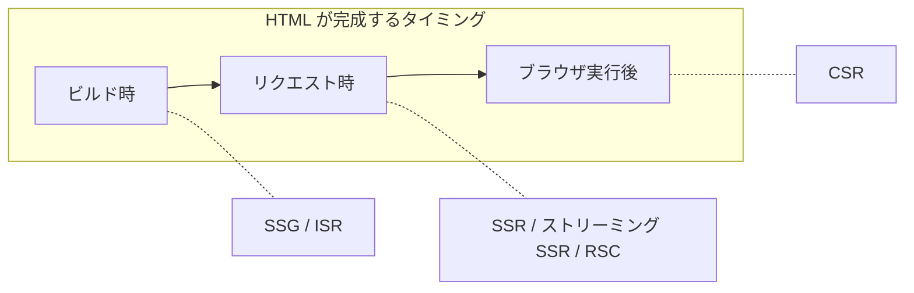

# フロントエンド構成

## このフォルダで扱うこと

**画面（HTML）を「いつ・どこで」作り、ユーザーへどう届けるか** という、フロントエンドのアーキテクチャ上の判断を扱います。  
コードの書き方ではなく、**レンダリング方式の選択・フロント専用のサーバー層（BFF）・フロントエンドの分割** といった「構成」の話です。

| 扱うこと | 例 |
|---|---|
| レンダリング方式 | CSR / SSR / SSG / ISR、ハイドレーション、ストリーミング SSR、React Server Components、アイランド |
| フロント専用のサーバー層 | BFF（Backend for Frontend） |
| フロントエンドの分割 | マイクロフロントエンド |

**ここでは扱わないこと（本拠地フォルダ）**

| テーマ | 本拠地 |
|---|---|
| React のコンポーネント・Hooks・再レンダーの仕組み | 32_React |
| Next.js の App Router・`revalidate` などの具体的な書き方 | 33_Next.js |
| コンポーネント設計・ディレクトリ構成などフロントのコード設計 | 47_フロントエンド設計 |
| 状態の置き場所（ローカル・グローバル・サーバー状態） | 36_状態管理 |
| MVC / MVVM など UI とロジックの分け方 | 20_アプリ内部構造（22_UI分離_MVC系） |
| API ゲートウェイ・サービス間通信 | 40_システム・分散 |
| Core Web Vitals などの計測・チューニング | 66_パフォーマンス |

> **境界の目安**：「どの方式を選ぶか・なぜか」は 41/30、「その方式を Next.js でどう書くか」は 33、「コンポーネントをどう分けるか」は 47 に置きます。

---

## 全体像

判断の軸は2つだけです。**① HTML はいつ・どこで完成するか**、**② データはどれくらいの頻度で変わるか**。

実際のアプリは1つの方式に統一する必要はなく、**ページ単位（さらには部品単位）で混ぜる** のが現在の主流です。

---

## 主要概念の解説

### 1. 4つの基本レンダリング方式

| 略称 | 正式名 | HTML ができるタイミング | 一言 |
|---|---|---|---|
| **CSR** | Client-Side Rendering | ブラウザが JS を実行したあと | 空の HTML ＋ JS で、ブラウザが画面を組み立てる |
| **SSR** | Server-Side Rendering | リクエストのたび（サーバー上） | 毎回サーバーで完成した HTML を返す |
| **SSG** | Static Site Generation | ビルド時 | 事前に HTML を作り、CDN から配る |
| **ISR** | Incremental Static Regeneration | ビルド時＋後から再生成 | SSG のページを一定時間ごと・トリガーで作り直す |

#### CSR（クライアントサイドレンダリング）
最初に薄い HTML と大きな JS バンドルを返し、ブラウザが API を叩いて画面を描きます。いわゆる **SPA（シングルページアプリケーション）** の形です。

- **長所**：画面遷移後の操作がなめらか。サーバーは静的ファイルと API だけでよい
- **短所**：JS を読み込むまで何も表示されない。検索エンジンのクローラーが中身を読みにくく **SEO に不利**
- **向く例**：管理画面、チャット、地図アプリなど「アプリ」に近い UI、ログイン後の画面

#### SSR（サーバーサイドレンダリング）
リクエストが来るたびに、サーバーがデータを取得して完成した HTML を返します。

- **長所**：リクエスト時点の最新データを反映できる。完成した HTML を返すので **初回表示が速く SEO に強い**
- **短所**：毎回サーバー処理が走るので **サーバー負荷・レイテンシが増える**。常時動くサーバー（または Edge）が必要
- **向く例**：在庫・価格が変わる商品ページ、個人別のダッシュボード、SEO が必要なコンテンツサイト

#### SSG（静的サイト生成）
`npm run build` のときに全ページの HTML を作っておき、CDN や静的ホスティングで配ります。

- **長所**：**最速**。サーバー負荷がほぼゼロでキャッシュしやすい。SEO にも強い
- **短所**：データが変わるたびに再ビルドが必要。ページ数が多いとビルドが長くなる
- **向く例**：ブログ、ドキュメント、LP、コーポレートサイト

#### ISR（増分静的再生成）
まず SSG として配り、**一定時間が経ったら（またはトリガーで）裏側でページを作り直す** 方式です。代表的には **Next.js の機能** として知られ、共通の標準仕様があるわけではありません。

- **長所**：SSG の速さを保ちつつ、ある程度の更新に追従できる
- **短所**：FW・ホスティングの対応に依存する。再生成までの間は古いページが表示されうる
- **向く例**：ニュース一覧、商品一覧など「更新はあるが毎リクエスト DB までは要らない」ページ

#### ハイドレーション
SSR / SSG で届いた HTML は、そのままでは **ボタンを押しても動かない「見た目だけ」** の状態です。ブラウザで JS を読み込み、HTML にイベント処理を結びつけて操作可能にする工程を **ハイドレーション** と呼びます。「表示は速いが、操作できるまでに時間がかかる」という SSR 系の弱点はここから来ます。

詳細：[[Webレンダリング方式_SSG_SSR_CSR_ISR]] / [[あなたはどのレンダリングパターンを採用しますか？【CSRSSRSSGISRを図解で解説】]]

### 2. 発展形：ストリーミング SSR・RSC・アイランド

基本の4方式の弱点（SSR の待ち時間、ハイドレーションの重さ）を減らすための新しい方式です。ここでは概要だけ押さえます。

| 方式 | 何を改善するか | しくみ | 代表例 |
|---|---|---|---|
| **ストリーミング SSR** | SSR で「全データが揃うまで何も返せない」問題 | 準備できた部分から HTML を少しずつ送る。遅い部分は後から差し込む | React 18 の Suspense、Next.js App Router |
| **React Server Components（RSC）** | JS バンドルとハイドレーションの重さ | サーバーだけで動くコンポーネントを作り、その部分の JS をブラウザに送らない。操作が必要な部品だけ Client Component にする | Next.js App Router |
| **アイランドアーキテクチャ** | ページ全体をハイドレーションする無駄 | ページは基本的に静的 HTML とし、操作が必要な「島」だけを個別にハイドレーションする | Astro の `client:*` |

> 共通する流れは **「JS をブラウザに送る量を減らし、サーバーでできることはサーバーでやる」** です。CSR 中心だった SPA 時代から、サーバー側に振り戻す方向に進んでいます。

### 3. BFF（Backend for Frontend）

**特定のフロントエンド（Web、iOS、Android など）専用に用意する、薄いバックエンド** です。

**なぜ必要か**：マイクロサービス化が進むと、1画面を表示するためにフロントが複数のサービスを呼び、データを組み合わせる必要が出てきます。これをブラウザでやると通信回数が増え、フロントのコードも複雑になります。

**BFF がやること**

- 複数の API を呼んで **1画面分のデータにまとめる**（集約）
- フロントが使いやすい形に **データを変換** する
- 認証トークンの扱いなど、**ブラウザに置きたくない処理** を肩代わりする

**API ゲートウェイとの違い**：API ゲートウェイは **全クライアント共通の入口**（認証・レート制限・ルーティング）で、BFF は **クライアントごとの専用窓口**（画面都合の集約・変換）です。両方を組み合わせることもあります。

**フロントエンド構成との関係**：Next.js の Route Handler や Server Components でサーバー側のデータ取得を書くと、それ自体が **BFF の役割** を果たします。SSR / RSC を選ぶことは、実質的に「BFF を持つ」ことでもあります。

**注意点**：BFF に業務ロジックを入れすぎると、クライアントごとにロジックが重複します。BFF はあくまで **画面の都合を吸収する層** にとどめます。

詳細：[[05BFFとAPIゲートウェイとグレースフルデグレーデーション]]

### 4. マイクロフロントエンド

**大きなフロントエンドを、機能（ドメイン）ごとに独立したアプリに分け、別々のチームが開発・デプロイできるようにする** 考え方です。バックエンドのマイクロサービスをフロントエンドに持ち込んだものといえます。

| 観点 | 内容 |
|---|---|
| 分け方 | 「商品検索」「カート」「マイページ」など、ドメイン単位でチームとアプリを分ける |
| 組み立て方 | ビルド時に統合（npm パッケージ）/ 実行時に統合（Module Federation、iframe、Web Components）/ サーバーやエッジで統合 |
| 長所 | チームごとに独立してリリースできる。技術スタックを段階的に移行できる |
| 短所 | 共通 UI・デザインの一貫性を保つのが難しい。重複したライブラリで JS が重くなる。構成が複雑 |
| 向く場面 | 複数チームが1つの大規模画面を開発していて、リリースの調整がボトルネックになっているとき |

> **小〜中規模のチームには過剰** になりやすい構成です。まずは 1 つのアプリの中でディレクトリ・モジュールを機能別に分ける（47_フロントエンド設計、43_モジュール設計）ところから始め、チームの独立性が本当に必要になってから検討します。チーム構成がシステム構成に表れる点は、70_進化と組織 の [[04進化型アーキテクチャとリバースコンウェイの法則]] と同じ話です。

---

## レンダリング方式の比較

| 観点 | CSR | SSR | SSG | ISR |
|---|---|---|---|---|
| HTML の生成タイミング | ブラウザ実行後 | リクエスト時 | ビルド時 | ビルド時＋後から再生成 |
| 初回表示の速さ | 遅い（JS 待ち） | 速い（サーバー処理の分だけ待つ） | 最速 | 最速 |
| SEO | 不利 | 強い | 強い | 強い |
| サーバー負荷 | 小（API のみ） | 大（毎リクエスト） | ほぼなし | 小（再生成時のみ） |
| データの鮮度 | API 次第で最新 | 常に最新 | ビルド時点 | 再生成間隔の分だけ遅れる |
| ユーザー別の内容 | 得意 | 得意 | 不向き | 不向き |
| 常時動くサーバー | 不要（API は別） | 必要 | 不要 | 再生成の基盤が必要 |
| 向く例 | 管理画面・チャット | 商品詳細・ダッシュボード | ブログ・ドキュメント・LP | ニュース・商品一覧 |

---

## 学ぶ順番とノート一覧

1. [[Webレンダリング方式_SSG_SSR_CSR_ISR]] — 4方式の定義・長所短所・比較、Astro との対応
2. [[あなたはどのレンダリングパターンを採用しますか？【CSRSSRSSGISRを図解で解説】]] — 動画の書き起こし。Next.js のコード例と、どんなプロジェクトにどの方式を使うか
3. [[05BFFとAPIゲートウェイとグレースフルデグレーデーション]] — BFF と API ゲートウェイ（40_システム・分散 にあるノート）
4. （未作成）ストリーミング SSR と React Server Components
5. （未作成）アイランドアーキテクチャ
6. （未作成）マイクロフロントエンド

---

## 関連フォルダ

| フォルダ | 関係 |
|---|---|
| 20_アプリ内部構造 | MVC / MVVM など、画面の中の構造（[[02UIとドメイン分離]]） |
| 40_システム・分散 | BFF・API ゲートウェイ、マイクロサービスとの対応 |
| 10_基礎 | 性能・SEO・運用コストのトレードオフを判断する物差し（[[02トレードオフ]]） |
| 32_React / 33_Next.js | レンダリング方式の具体的な実装 |
| 47_フロントエンド設計 | コンポーネント・ディレクトリの設計 |
| 36_状態管理 | サーバー状態とクライアント状態の置き場所 |
| 66_パフォーマンス | 初回表示・Core Web Vitals の計測 |
