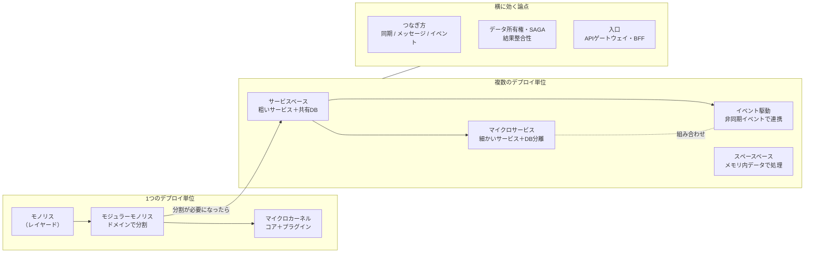

# システム・分散

## このフォルダで扱うこと

20_アプリ内部構造 が「**1つのアプリの中**をどう分けるか」だったのに対し、このフォルダは「**システム全体を、いくつのデプロイ単位・プロセス・サービスに分けるか**」と「**分けた部品同士をどうつなぐか**」を扱います。

扱うこと:

- システム全体のアーキテクチャスタイル（モノリス / モジュラーモノリス / マイクロカーネル / サービスベース / イベント駆動 / スペースベース / マイクロサービス）
- サービス間のつなぎ方（同期 API・メッセージ・イベント）
- データの持ち方と整合性（データ所有権・分散トランザクション・SAGA・結果整合性）
- システムの入口（API ゲートウェイ・BFF）と、部分障害への備え（グレースフルデグレーデーション）

扱わないこと（本拠地）:

| テーマ | 本拠地 | このフォルダとの境界 |
|---|---|---|
| ジョブキュー・Webhook・リトライなどの**実装** | 34_Backend（50_非同期・メッセージング / 60_外部連携 / 80_信頼性・スケーラビリティ） | 41 は「非同期にするか・どこで区切るか」という判断、34 は「どう書くか」 |
| パッケージ・モジュール分割の実務 | 43_モジュール設計 | 43 はコードの中のモジュール、41 はデプロイ単位としての分割 |
| DB 設計・スキーマ・マイグレーション | 62_データアーキテクチャ | 41 は「どのサービスがどのデータを所有するか」まで、テーブル設計は 68 |
| キュー・キャッシュ・分散トレーシングの仕組みと運用 | 68_分散システム / 66_可観測性 | 41 は構成図上の位置づけ、68（キュー・キャッシュ）・66（トレーシング）は仕組みと運用の詳細 |
| API のエンドポイント設計 | 45_API設計 | 41 は「同期 API でつなぐか」まで |
| DDD の境界づけられたコンテキスト | 42_ソフトウェア設計 | サービス境界の決め方の根拠として参照する |

---

## 全体像

左から右に進むほど、**独立性・スケール・耐障害性**が上がる代わりに、**シンプルさ・コスト・一貫性の取りやすさ**を失っていきます。どれが一番よいかではなく、**今のチーム・規模・品質特性に合うか**で選びます（[[02トレードオフ]]）。

---

## 主要概念の解説

### 1. モノリス（Monolith）

**アプリ全体を1つのデプロイ単位として作り、1つのプロセス・1つのDBで動かす**形です。中身はたいてい [[レイヤードアーキテクチャ]] のように「技術の層」で分かれています。

- 良い点: 開発・テスト・デプロイが単純。1つのトランザクションで整合性を保てる。ローカル呼び出しなので速い
- 悪い点: 規模が大きくなると、1か所の変更で全体を再デプロイする必要がある。一部だけスケールできない。1つのバグで全体が落ちることがある

「悪い形」ではなく、**多くのプロダクトの正しい出発点**です。詳しくは [[02モノリスと分散モノリスとマイクロサービスといつ分けるか]]。

### 2. モジュラーモノリス（Modular Monolith）

デプロイ単位は1つのまま、**中身を「技術の層」ではなく「ドメイン（注文・在庫・会計…）」で区切った**モノリスです。『ソフトウェアアーキテクチャの基礎』第2版で独立した章として追加されました。

- モジュール間は公開インターフェース経由でしか呼ばない、他モジュールのテーブルを直接触らない、というルールを守ります
- 将来サービスに切り出すとき、**境界がすでに引かれている**ので分割しやすくなります
- ルールを破っても動いてしまうため、依存関係のチェック（アーキテクチャテスト）で守るのが実務的です

「いきなりマイクロサービス」を避けたいときの有力な選択肢です。

### 3. マイクロカーネル（Microkernel / Plug-in）

**最小限のコアシステム**に、機能を**プラグイン**として差し込む形です。Eclipse・VS Code・Jenkins・ブラウザ拡張などが代表例です。

- コア: 基本の流れと、プラグインを登録・呼び出す仕組みだけを持つ
- プラグイン: 互いに独立した追加機能。コアが決めた契約（インターフェース）に従う
- 向いている: 顧客ごとに機能を足し引きする製品、ルールが頻繁に変わる業務（保険の査定ルールなど）
- 弱い点: 通常は1つのデプロイ単位なので、スケール・耐障害性はモノリスと同程度

### 4. サービスベース（Service-Based）

**4〜12個程度の粗い「ドメインサービス」**に分けて別々にデプロイし、**DBは共有することが多い**、分散の中では最も実務的な形です。

- マイクロサービスほど細かく切らないので、サービス間通信やデータ同期の苦労が少ない
- DB 共有のため、1サービス内なら通常の ACID トランザクションが使える
- 「モノリスから分けたいが、マイクロサービスは重すぎる」ときの落とし所になります
- 注意: DB を共有したまま、サービス同士が同期で呼び合い始めると **分散モノリス** になりやすい（[[02モノリスと分散モノリスとマイクロサービスといつ分けるか]]）

### 5. イベント駆動（Event-Driven Architecture, EDA）

「**〜が起きた**」というイベントを発行し、関心のある部品が**非同期に反応する**形です。発行側は誰が受け取るかを知りません（ファイア＆フォーゲット）。詳しくは [[010Programming/41_アーキテクチャ/40_システム・分散/イベント駆動アーキテクチャ|イベント駆動アーキテクチャ]] と [[03同期APIとメッセージとイベント駆動の概観]]。

イベントの流し方には2つの型（トポロジー）があります。

| 型 | 仕組み | 向いている | 弱い点 |
|---|---|---|---|
| **ブローカー型** | 中央の指揮役がいない。各プロセッサーがイベントを受けて処理し、結果を**派生イベント**として発行する（連鎖反応） | 拡張性・応答性を重視、処理の追加が多い | 全体の流れが見えにくい。エラー処理・再実行が難しい |
| **メディエーター型** | **メディエーター（指揮役）**がワークフローを持ち、各プロセッサーに順番に指示する | 手順が決まった業務フロー、エラー時の制御が必要 | メディエーターが結合点・ボトルネックになりやすい |

これは SAGA の **コレオグラフィ（ブローカー型に近い）** と **オーケストレーション（メディエーター型に近い）** の関係と同じ構図です。

- 良い点: 高いスケール・性能・耐障害性。新しい処理を既存コードを変えずに追加できる
- 悪い点: 流れが追いにくくテストしにくい。イベントの取りこぼし・重複・順序の対策（永続化キュー、確認応答、冪等性）が必要

### 6. スペースベース（Space-Based）

**DB をリクエスト処理の経路から外し**、処理ユニットごとに**メモリ内のレプリケートされたデータ（データグリッド）**で処理する形です。DB への書き込みは後から非同期で行います。名前は「タプルスペース」という分散共有メモリの考え方に由来します。

- 向いている: チケット販売・オークション・セールなど、**アクセスが一瞬で数十倍に跳ねる**システム
- 良い点: DB がボトルネックにならないため、弾力性・スケール・性能が非常に高い
- 悪い点: データの衝突・同期の設計が難しく、テストも困難。構築・運用コストが高い

まだ個別ノートはありません。まずは「極端な負荷のための特殊なスタイル」と覚えておけば十分です。

### 7. マイクロサービス（Microservices）

**1つの業務の境界（境界づけられたコンテキスト）ごとに小さなサービス**を作り、**サービスごとに DB を持ち**、独立してデプロイする形です。

- 良い点: チームごとに独立して開発・デプロイ・スケールできる。障害が1サービスに閉じやすい。技術選択も独立
- 悪い点: ネットワーク越しの呼び出しで遅くなる。分散トランザクション・観測性・運用の難易度が上がる。コストが最も高い
- 前提条件: 自動デプロイ（CI/CD）・監視・トレースが整っていること、チームが複数あること

「サービスの数」より **「データと境界の独立」** が本質です。DB を共有したまま細かく分けても、マイクロサービスの利点は得られません（[[02モノリスと分散モノリスとマイクロサービスといつ分けるか]]）。

### 8. 同期と非同期（つなぎ方）

部品を分けたら、次は**どうつなぐか**を決めます（[[03同期APIとメッセージとイベント駆動の概観]]）。

| つなぎ方 | 呼んだ側は | 例 | 注意点 |
|---|---|---|---|
| 同期 API（REST・gRPC） | 返事を**待つ** | 在庫の問い合わせ、ログイン | 相手が遅い・落ちると自分も止まる（連鎖障害） |
| メッセージ（キュー） | 送ったら**待たない**。宛先は決まっている | メール送信、画像変換 | 到達保証・再送・重複処理（冪等性）が必要 |
| イベント（Pub/Sub） | 「起きたこと」を**知らせるだけ**。宛先を知らない | 注文確定 → 在庫・通知・分析がそれぞれ反応 | 全体の流れが見えにくい |

- **コマンド**は「〜してほしい」（宛先1つ、断られることもある）、**イベント**は「〜が起きた」（過去形、受け手は複数・任意）
- 実務では「ユーザーが結果をすぐ必要とする部分は同期、後でよい部分は非同期」という**ハイブリッド**が一般的です

### 9. データ所有権・SAGA・結果整合性

分散で一番難しいのが**データ**です（[[04データ所有権と分散トランザクションとSAGAと整合性]]）。

- **データ所有権**: 各データには「持ち主」のサービスを1つだけ決め、他のサービスは API やイベント経由でしか触らない。他サービスの DB を直接読むのは典型的なアンチパターン
- **分散トランザクション**: 複数の DB をまたいで「全部成功か全部失敗か」を保証する方法（2PC など）は、遅く・壊れやすいため、一般には避けます
- **結果整合性（Eventual Consistency）**: 「一瞬ずれることはあるが、最終的には揃う」ことを受け入れる考え方。在庫表示が数秒遅れても業務上問題ないか、を業務側と決めます
- **SAGA**: 長い処理を**各サービスのローカルトランザクションの連鎖**に分け、途中で失敗したら**補償トランザクション**（取り消し処理）で戻す方法
  - オーケストレーション: 指揮役が順番に指示する（追いやすい）
  - コレオグラフィ: 各サービスがイベントを見て次を起こす（疎結合だが追いにくい）

### 10. API ゲートウェイ・BFF・グレースフルデグレーデーション

サービスが増えると、クライアントから見た**入口**を整える必要が出てきます（[[05BFFとAPIゲートウェイとグレースフルデグレーデーション]]）。

- **API ゲートウェイ**: 全クライアント共通の**単一の入口**。ルーティング・認証の一次チェック・レート制限・ログなど、横断的な処理をまとめる（→ 50_横断的関心事）
- **BFF（Backend for Frontend）**: Web 用・モバイル用など、**画面の種類ごとの専用バックエンド**。複数サービスの結果を画面に合わせて集約・整形する。フロントエンド側の構成は 30_フロントエンド構成 とつながります
- **グレースフルデグレーデーション**: 一部のサービスが落ちても、**機能を縮小して動き続ける**設計。例: おすすめ欄が出なくても商品ページと購入は動く。タイムアウト・サーキットブレーカー・フォールバックで実現します

---

## スタイル比較（★1〜5）

『ソフトウェアアーキテクチャの基礎』の特性評価をもとにした表です。★が多いほどその特性に**強い**ことを表します（「手軽さ・コスト」は★が多いほど**安い**）。

| スタイル | 分割の軸 | 手軽さ・コスト | シンプルさ | デプロイ容易性 | テスト容易性 | 拡張性（スケール） | 耐障害性 | 進化しやすさ |
|---|---|---|---|---|---|---|---|---|
| （参考）レイヤード | 技術 | ★★★★★ | ★★★★★ | ★ | ★★ | ★ | ★ | ★ |
| モジュラーモノリス ※目安 | ドメイン | ★★★★★ | ★★★★ | ★★ | ★★★ | ★ | ★ | ★★★ |
| マイクロカーネル | 技術 / ドメイン | ★★★★★ | ★★★★ | ★★★ | ★★★ | ★ | ★ | ★★★ |
| サービスベース | ドメイン | ★★★★ | ★★★ | ★★★★ | ★★★★ | ★★★ | ★★★★ | ★★★ |
| イベント駆動 | 技術 | ★★★ | ★ | ★★★ | ★★ | ★★★★★ | ★★★★★ | ★★★★★ |
| スペースベース | 技術 | ★★ | ★ | ★★★ | ★ | ★★★★★ | ★★★ | ★★★ |
| マイクロサービス | ドメイン | ★ | ★ | ★★★★ | ★★★★ | ★★★★★ | ★★★★ | ★★★★★ |

読み方のポイント:

- **1つのデプロイ単位**のスタイル（レイヤード・モジュラーモノリス・マイクロカーネル）は、安くてシンプルだが、スケールと耐障害性が★1
- **分散**のスタイルは、スケール・耐障害性が上がる代わりに、シンプルさとコストを失う
- **サービスベース**は分散の中で最もバランスがよく、最初の分割先として選ばれやすい
- ★の合計が多いスタイルが「最良」ではありません。**自分のシステムで重要な特性（上位3つ程度）**に★が付いているかで選びます（[[01品質属性]]）

出典と注記:

- モジュラーモノリス以外の値は、Mark Richards & Neal Ford『ソフトウェアアーキテクチャの基礎』（初版、O'Reilly Japan）各スタイル章の特性評価表に基づきます。サービスベースの値は読書ノート（bagerbach.com）、マイクロサービスの合計値は読書ノート（danlebrero.com）でも一致を確認しました
- 第2版では評価項目と一部の値が見直されていますが、Web 上で第2版の表全体は確認できませんでした
- **モジュラーモノリスは第2版の新章で、値は確認できていないため「目安」**です。書籍で確認したら書き換えてください
- 評価は「そのスタイルの傾向」であり、実装次第で変わります

---

## 学ぶ順番とノート一覧

1. [[01_分散とスタイル]] — このフォルダ（旧第5部）の入口。「分散」とは何か、なぜ学ぶか
2. [[02モノリスと分散モノリスとマイクロサービスといつ分けるか]] — 3つの形の比較と、分けるべきサイン
3. [[03同期APIとメッセージとイベント駆動の概観]] — サービス間のつなぎ方の3分類と選び方
4. [[010Programming/41_アーキテクチャ/40_システム・分散/イベント駆動アーキテクチャ|イベント駆動アーキテクチャ]] — 書籍の読書メモ。イベントブローカー・データロス防止・エラー処理
5. [[04データ所有権と分散トランザクションとSAGAと整合性]] — データの持ち主、2PC が難しい理由、SAGA
6. [[05BFFとAPIゲートウェイとグレースフルデグレーデーション]] — 入口の整理と部分障害への備え

未作成（書くときはMOCのスタイルノート共通テンプレートを使う）:

- モジュラーモノリス
- マイクロカーネル
- サービスベース
- スペースベース

---

## 関連フォルダ

- 10_基礎 — スタイルを選ぶ前提となる品質特性・トレードオフ（[[01品質属性]]、[[02トレードオフ]]）
- 20_アプリ内部構造 — 各サービスの**中身**の構造（[[レイヤードアーキテクチャ]]、[[クリーンアーキテクチャの概要]]）
- 30_フロントエンド構成 — BFF とレンダリング方式のつながり
- 50_横断的関心事 — 分散したときの認証・観測性・設定の置き場所
- 60_意思決定・文書化 — スタイル選択を ADR に残す（[[02ADRとArchitecture Decision Record]]）
- 70_進化と組織 — モノリスから段階的に分ける、チーム構造とサービス境界（[[04進化型アーキテクチャとリバースコンウェイの法則]]）
- 34_Backend — 非同期処理・外部連携・スケーリングの実装
- 42_ソフトウェア設計 — 境界づけられたコンテキスト（サービス境界の根拠）
- 43_モジュール設計 — モジュラーモノリスのモジュール分割の実務
- 62_データアーキテクチャ — サービスごとの DB 設計
- 68_分散システム — キュー・キャッシュ
- 66_可観測性 — 分散トレーシング
