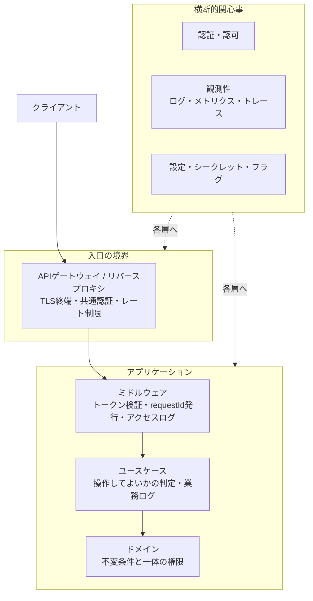

# 横断的関心事

## このフォルダで扱うこと

**横断的関心事（Cross-Cutting Concerns）**とは、注文・在庫・会計といった**どの機能にも必要なのに、どれか1つの業務には属さない**関心事のことです。認証・認可、ログ、設定などが代表例です。

このフォルダでは、それらを**アーキテクチャ図のどこに置くか**（どの層・どの境界で扱うか）と、**どうやって各機能に行き渡らせるか**を扱います。セキュリティや SRE の専門的な詳細ではなく、「置き場所の判断」が中心です。

扱うこと:

- 認証・認可を**どの境界に置くか**（ゲートウェイ / ミドルウェア / ユースケース / ドメイン）
- 観測性（ログ・メトリクス・トレース）の**計測点をどこに置くか**
- 設定・シークレット・フィーチャーフラグの**置き場所と分け方**
- 横断的関心事を実現する仕組み（ミドルウェア・AOP・サイドカー・サービスメッシュ）

扱わないこと（本拠地）:

| テーマ | 本拠地 | このフォルダとの境界 |
|---|---|---|
| 認証・認可の**仕組み**（OAuth・OIDC・JWT・RBAC の実装） | 73_認証認可 | 41 は「どの層で検証・判定するか」、73 は「どう検証するか」 |
| セッション・Cookie・トークンの**基礎** | 74_セッション管理 | 41 はトークンを境界をまたいで伝搬させる設計まで |
| 分散トレーシング・キュー・キャッシュの**製品と運用** | 65_可観測性 / 69_分散システム | 41 は計測点と相関 ID の設計、65（トレーシング）・69（キュー・キャッシュ）はツール・運用 |
| エラー処理・構造化ログの**実装** | 34_Backend（70_エラー処理・ロギング） | 41 はログの責務分担、34 はコード |
| Web 脆弱性対策・セキュリティ全般 | 71〜75 のセキュリティ系フォルダ | 41 は信頼境界の引き方まで |
| CI/CD・デプロイ時の環境変数の注入 | 62_CI-CD / 63_リリース・デプロイ | 41 は「コードから分離する」という原則まで |

---

## 全体像

ポイントは、**1つの関心事を1か所にまとめるのではなく、層ごとに役割を分担させる**ことです。たとえば認可なら「ゲートウェイでログイン済みか」「ユースケースでこの注文の持ち主か」「ドメインで締め後は変更不可か」と、層によって判定の中身が違います。

---

## 主要概念の解説

### 1. 横断的関心事とは

アーキテクチャは、機能を**縦に**分けます（層・ドメイン・サービス）。しかし認証やログは、どの縦の区切りにも**横から**関わります。これを放置すると、次の問題が起きます（[[01_横断的関心事]]）。

- **コピペの増殖**: 全ハンドラーに同じ認証チェック・ログ出力を書き、1か所の修正漏れが障害やセキュリティホールになる
- **業務ロジックの汚染**: 本来の処理の間にログ・権限チェック・設定読み込みが混ざり、読みにくくテストしにくくなる
- **障害時に追えない**: ログの形式や ID がバラバラで、どのリクエストがどこで失敗したかつながらない

対策の基本は2つです。

1. **共通基盤に寄せる**: ミドルウェアやフックなど、機能から独立した場所で一括して処理する
2. **業務の意味を持つ部分だけは業務側に残す**: 「この注文をキャンセルしてよいか」「なぜ失敗したか」は業務ルールなので、ユースケースやドメインで扱う

これは [[03アーキテクチャに効く原則]] の**関心の分離**を、機能をまたぐ方向に適用したものです。

### 2. 認証・認可の置き場所

まず**認証（あなたは誰か）**と**認可（あなたは何をしてよいか）**を分けて考えます（[[02認可と認証の置き方と境界とアイデンティティ]]）。

| 置き場所 | 向いている処理 | 向いていない処理 |
|---|---|---|
| API ゲートウェイ | 共通認証、レート制限、TLS 終端 | 注文ごとの所有者チェック |
| ミドルウェア | セッション / JWT の検証、ルート単位のロール判定 | 複雑な業務ルール |
| ユースケース | 「この操作をしてよいか」の判定（持ち主か、状態は正しいか） | トークン署名の検証（インフラ寄り） |
| ドメイン | 不変条件と一体の権限（例: 締め後は変更不可） | HTTP ヘッダーの解釈 |

- **認証は外側（入口）で早めに**、**細かい認可は内側（業務に近い場所）で**、が基本の型です
- **信頼境界（Trust Boundary）**: 「ここから内側は検証済みとして信用する」線を明示します。分散システムでは、ゲートウェイを通ったからといって内部サービス同士の呼び出しを無条件に信用しない（ゼロトラスト）設計が増えています
- **アイデンティティの伝搬**: マイクロサービスでは、「誰の操作か」をトークンやヘッダーで下流のサービスに引き継ぐ必要があります
- 人間のユーザーだけでなく、**サービス自身のアイデンティティ**（サービスアカウント・mTLS）も認証の対象です

仕組みそのもの（OAuth・JWT・セッション）は 73_認証認可 / 74_セッション管理 で学びます。

### 3. 観測性（Observability）

**観測性**とは、システムの外に出てくる情報から、**中で何が起きているかを推測できる度合い**のことです。監視（決めた指標を見張る）より広く、「想定していなかった障害も調べられる」ことを目指します（[[03観測性とログとメトリクスとトレースとアーキテクチャ上の接点]]）。

三本柱:

| 種類 | 何がわかるか | 例 |
|---|---|---|
| ログ | **個別の出来事**の詳細 | 「注文 123 のキャンセルが、締め後のため拒否された」 |
| メトリクス | **数値の傾向**（集計） | リクエスト数、エラー率、レイテンシの p99 |
| トレース | **1リクエストの旅路**（どこで時間がかかったか） | ゲートウェイ → 注文 → 在庫 → DB の各所要時間 |

アーキテクチャ上の判断:

- **境界ごとに計測点を置く**: 入口（HTTP）、外部呼び出し、DB、メッセージの送受信は必ず計測する
- **相関 ID（requestId / traceId）**: 入口で発行し、ログ・メッセージ・下流の呼び出しすべてに引き継ぐ。これがないと分散環境ではログがつながらない
- **層ごとの分担**: HTTP ステータスや DB エラーはインフラ・ミドルウェアで、「なぜキャンセルできなかったか」のような業務理由はユースケースで記録する。ドメイン層はログを厚くしない
- **非同期処理**: メッセージにもトレース情報を載せないと、イベントの先で流れが途切れる
- **SLI / SLO**: 「何を測れば利用者の満足度がわかるか（SLI）」「どこまでを目標とするか（SLO）」を決めると、計測点が自然に決まる

ツールと運用（OpenTelemetry・分散トレーシング基盤など）は 65_可観測性 で扱います。

### 4. 設定・シークレット・フィーチャーフラグ

3つとも「コードの外から振る舞いを変える」ものですが、**変わるタイミングと扱いの厳しさ**が違うため、分けて管理します（[[04設定とシークレットとフィーチャーフラグ]]）。

| 項目 | 例 | 変わるタイミング | 典型的な管理 |
|---|---|---|---|
| 設定 | DB の接続先、外部 API の URL、タイムアウト | デプロイ時 | 環境変数、設定ファイル |
| シークレット | パスワード、API キー、署名鍵 | ローテーション時 | シークレットマネージャー |
| フィーチャーフラグ | 新機能の ON/OFF、段階リリースの対象割合 | **実行中にも** | フラグサービス、管理画面 |

- **設定はコードから分離する**（12-Factor App の「III. 設定」）。同じビルド成果物を、設定を変えるだけで開発・検証・本番で動かせるようにする
- **シークレットはリポジトリに入れない**。ログにも出さない。漏れたときに差し替え（ローテーション）できる仕組みにする
- **フィーチャーフラグ**は「デプロイ（コードを置く）」と「リリース（機能を見せる）」を切り離す道具。ただし古いフラグを放置すると分岐だらけになるので、寿命を決めて削除する
- 設定の読み込みはアプリの入口（起動時の組み立て部分）に集め、業務ロジックには値として渡すと、テストしやすくなります（[[01_依存性注入]]）

### 5. 実現手段 — ミドルウェア・AOP・サイドカー・サービスメッシュ

横断的関心事を「各機能に書かずに行き渡らせる」ための代表的な仕組みです。**範囲が小さいものから大きいもの**の順に並べます。

| 手段 | どこで効くか | 仕組み | 例 |
|---|---|---|---|
| **ミドルウェア** | 1つのアプリの HTTP の入口 | リクエストが業務処理に届く前後に、共通処理を**チェーン状に挟む** | Express のミドルウェア、Next.js の middleware、認証チェック、アクセスログ |
| **AOP（アスペクト指向プログラミング）** | 1つのアプリのメソッド単位 | 「どのメソッドの前後に何をするか」を別に定義し、**実行時に織り込む** | Spring の `@Transactional`、デコレーターでのログ・計測 |
| **サイドカー** | 1つのサービスの隣 | サービスと同じ単位で**別プロセスを横に置き**、通信・ログ転送などを肩代わりさせる | ログ収集エージェント、Envoy プロキシ |
| **サービスメッシュ** | サービス間通信の全体 | 全サービスのサイドカーを**まとめて管理**し、mTLS・リトライ・トレースをインフラ側で一括適用 | Istio、Linkerd |

選び方の目安:

- **モノリスや小規模**なら、ミドルウェアと共通ラッパー（DB クライアントのフック、メッセージ consumer の共通処理）で十分です
- **AOP** は便利ですが、コードを読んだだけでは何が実行されるか見えにくくなります。トランザクション・ログ・計測など**用途を絞って**使います
- **マイクロサービス**で言語やチームがバラバラなときに、サイドカー・サービスメッシュが効いてきます。ただし運用の複雑さが大きく増えるので、サービス数が少ないうちは導入しないのが一般的です
- どの手段でも、**業務の判断（細かい認可・業務ログ）までインフラ側に押し込まない**ことが大切です

関連: [[レイヤードアーキテクチャ]]（ミドルウェア・AOP で横断処理を扱う説明）、[[05BFFとAPIゲートウェイとグレースフルデグレーデーション]]（ゲートウェイに集める共通処理）

---

## 学ぶ順番とノート一覧

1. [[01_横断的関心事]] — このフォルダ（旧第6部）の入口。横断的関心事とは何か、覚えておきたい3つのこと
2. [[02認可と認証の置き方と境界とアイデンティティ]] — 認証と認可の区別、4つの置き場所、信頼境界と伝搬
3. [[03観測性とログとメトリクスとトレースとアーキテクチャ上の接点]] — 三本柱、計測点の置き方、層ごとのログの分担、SLI / SLO
4. [[04設定とシークレットとフィーチャーフラグ]] — 3つの違いと管理方法、12-Factor App との対応

未作成の候補:

- ミドルウェア・AOP・サイドカー・サービスメッシュの比較（本ノートの5章を独立させる）
- キャッシュ・レート制限・国際化（i18n）など、その他の横断的関心事

---

## 関連フォルダ

- 20_アプリ内部構造 — 横断処理を挟む「層」の考え方（[[レイヤードアーキテクチャ]]、[[01_依存性注入]]）
- 40_システム・分散 — 分散すると横断的関心事が難しくなる理由（[[05BFFとAPIゲートウェイとグレースフルデグレーデーション]]、[[03同期APIとメッセージとイベント駆動の概観]]）
- 10_基礎 — セキュリティ・可用性・運用性などの品質属性（[[01品質属性]]）
- 60_意思決定・文書化 — 認証方式やログ基盤の選定を ADR に残す（[[02ADRとArchitecture Decision Record]]）
- 34_Backend — ミドルウェア・エラー処理・ロギングの実装
- 65_可観測性 — トレーシングの仕組みと運用
- 69_分散システム — キュー・キャッシュの仕組みと運用
- 73_認証認可 / 74_セッション管理 — 認証・認可・セッションの仕組み
- 71〜75 — セキュリティ全般
