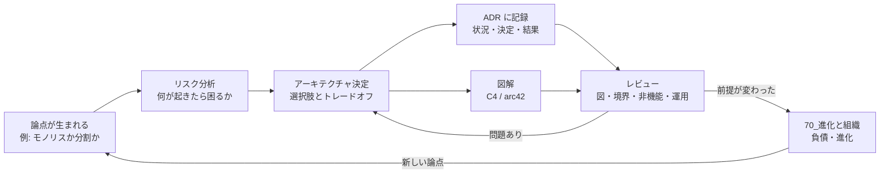
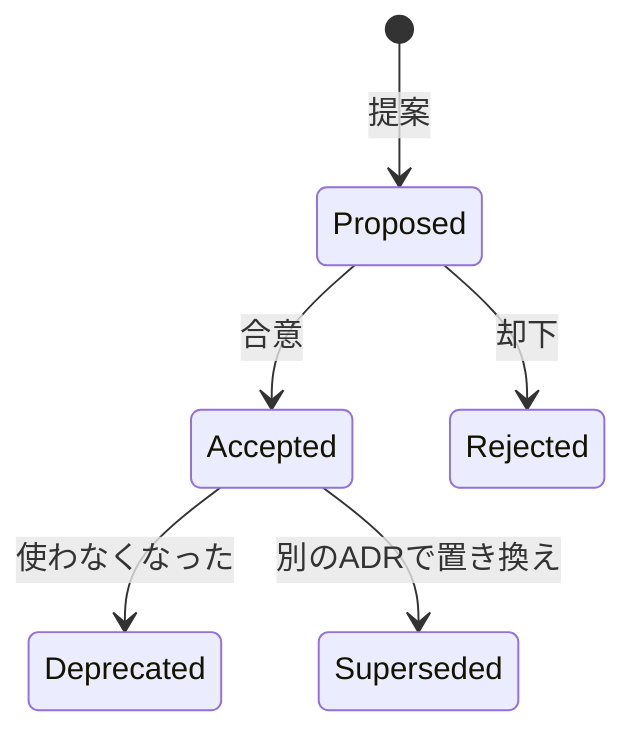
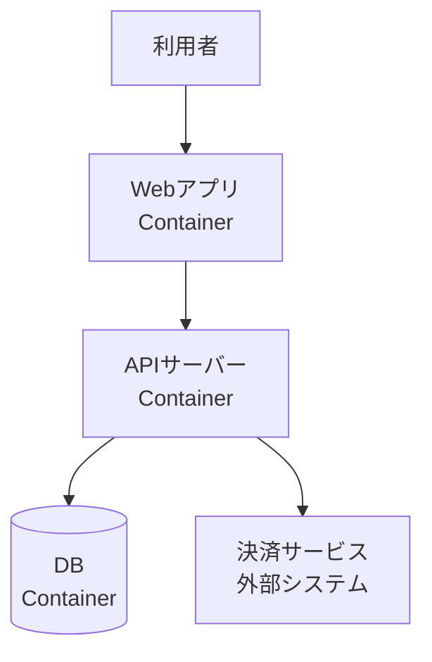

# 意思決定・文書化

## このフォルダで扱うこと

このフォルダは、**アーキテクチャを「どう決め、どう残し、どう確かめるか」** を扱います。  
10〜50 のフォルダが「どんな構造にするか」だったのに対し、ここは **構造を決めるプロセスと記録** の話です。

| 扱うこと | 具体例 |
|----------|--------|
| アーキテクチャ上の決定 | 何を「アーキテクチャ決定」とみなすか、決め方のアンチパターン |
| 決定の記録 | ADR（Architecture Decision Record） |
| リスクの洗い出し | リスクマトリクス、リスクストーミング |
| 構造の図解 | C4 モデル、arc42 テンプレート |
| レビュー | 図・境界・非機能・運用の観点、ATAM |

**扱わないこと（本拠地）**

| テーマ | 本拠地 |
|--------|--------|
| Markdown の書き方・ドキュメントツール・README 一般 | 56_ドキュメント |
| 品質属性・トレードオフそのものの説明 | 10_基礎/12_品質特性・トレードオフ |
| 技術的負債・進化的アーキテクチャ・組織との関係 | 70_進化と組織 |
| コードレビューの作法 | 81_テスト戦略 / 86_QAプロセス |

> 境界の目安: **「どう書くか（道具・書式）」は 56**、**「アーキテクチャの何を、なぜ残すか」は 60** です。ADR を Markdown で書くときの記法は 56、ADR に何を書くべきかは 60 に置きます。

---

## 全体像



「決める → 残す → 見せる → 確かめる」のループを回し続けるのが、このフォルダの主題です。  
入口ノートは [[01_意思決定と進化]] です。

---

## 主要概念の解説

### 1. アーキテクチャ決定とは何か

**アーキテクチャ決定**とは、あとから変えるのが高くつく、システム全体の形に効く選択のことです。  
『ソフトウェアアーキテクチャの基礎』（Richards & Ford）では、次のいずれかに当てはまる決定をアーキテクチャ上重要（architecturally significant）とみなします。

| 観点 | 例 |
|------|-----|
| **構造** | レイヤードにするか、マイクロサービスにするか |
| **非機能特性** | 可用性 99.9% を満たすために冗長化する |
| **依存関係** | サービス間を同期 API でつなぐか、イベントでつなぐか |
| **インターフェース** | 外部公開 API を REST にするか GraphQL にするか |
| **構築手法** | 特定のフレームワークやクラウドサービスを全社標準にする |

逆に、「関数名をどうするか」「どのループ構文を使うか」はアーキテクチャ決定ではありません（[[02_アーキテクチャと設計の違い]]）。

#### 決め方のアンチパターン

同書では、決定をめぐる3つの典型的な失敗が紹介されています。

| アンチパターン | 症状 | 対策 |
|----------------|------|------|
| **Covering Your Assets（保身）** | 間違えるのが怖くて、決定を先延ばしにする | 「最後に責任を持てる時点」まで待ち、そこで決める。開発者と協働して決定を検証する |
| **Groundhog Day（毎日が同じ日）** | 同じ議論が何度も繰り返される | 決定の **理由（技術的理由とビジネス上の理由）** を必ず残す |
| **Email-Driven Architecture（メール駆動）** | 決定がメールやチャットに埋もれ、誰も見つけられない | 決定は1か所（ADR など）にまとめ、通知ではリンクだけ送る |

2番目と3番目の対策が、そのまま次の ADR につながります。

---

### 2. ADR（Architecture Decision Record）

**ADR** は、**1つのアーキテクチャ決定を1枚の短い文書に残す**形式です。2011年に Michael Nygard がブログ記事で提案し、現在では多くのチームが使っています。詳しくは [[02ADRとArchitecture Decision Record]] にまとめています。

#### 基本構成

| 節 | 書く内容 |
|----|----------|
| **タイトル** | 通し番号 + 決定を一言で（例: ADR-007: 注文通知を非同期イベントで送る） |
| **ステータス** | 今この決定がどの段階にあるか |
| **状況（Context）** | なぜこの論点が生まれたか、制約は何か |
| **決定（Decision）** | 何を選んだか。「〜する」と言い切る |
| **結果（Consequences）** | 良くなること、受け入れる悪いこと |

余裕があれば「検討した選択肢」「見直し条件」を加えると、後から読む人が判断を追いやすくなります。

#### ステータスの流れ



決定を変えるときは、古い ADR を **書き換えたり消したりしません**。新しい ADR を作り、古い方を「Superseded by ADR-012」とします。こうすると「なぜ変えたか」の歴史が残ります。

#### テンプレート例

```markdown
# ADR-007: 注文完了の通知を非同期イベントで送る

## ステータス
Accepted（2026-09-25）

## 状況
- 注文完了時にメール・在庫・ポイントの3処理を同期で呼んでいる
- メール送信の遅延で注文 API のレスポンスが 3 秒を超えることがある
- チームにはメッセージキューの運用経験が少ない

## 検討した選択肢
1. 現状維持（同期呼び出し）
2. 非同期イベント（マネージドなキューを使う）
3. メール送信だけバックグラウンドジョブに移す

## 決定
選択肢2を採用する。注文サービスは「注文完了」イベントを発行するだけにする。

## 結果
- 良い: 注文 API の応答が通知処理に左右されなくなる
- 受け入れる: 通知は数秒遅れることがある（結果整合性）
- 受け入れる: キューの監視・デッドレターの運用が新たに必要

## 見直し条件
- イベントの種類が 20 を超えたら、スキーマ管理の方式を再検討する
```

#### 置き場所と運用のコツ

- コードと同じリポジトリの `docs/adr/` に置く（コードと一緒にレビューできる）
- 1ファイル1決定、短く（1〜2ページ）
- PR の説明から ADR へリンクする
- 「迷ったら書く」くらいでよい。書かずに後悔する方がずっと高くつく

---

### 3. リスク分析

アーキテクチャの仕事の多くは「何がうまくいかない可能性があるか」を先に見つけることです。『ソフトウェアアーキテクチャの基礎』では2つの道具が紹介されています（このテーマの専用ノートは未作成）。

#### リスクマトリクス

リスクを **影響度 × 発生可能性** の2軸で、それぞれ 1（低）〜3（高）で評価し、掛け算で点数にします。

| 影響度 ＼ 可能性 | 低 (1) | 中 (2) | 高 (3) |
|------------------|--------|--------|--------|
| **高 (3)** | 3 | 6 | 9 |
| **中 (2)** | 2 | 4 | 6 |
| **低 (1)** | 1 | 2 | 3 |

- 1〜2: 低リスク（緑）
- 3〜4: 中リスク（黄）
- 6〜9: 高リスク（赤）

評価するときは、**まず影響度を考え、次に可能性を考える**のがコツです。これを「サービス × 品質特性（可用性・拡張性・性能…）」の表にすると、どこが危ないかが一目で分かる **リスク評価表** になります。

#### リスクストーミング

一人で評価すると見落としが出るため、チームで行う **共同作業** がリスクストーミングです。Simon Brown（C4 モデルの考案者）が広めた手法で、次の3段階で進めます。

1. **識別（個人作業）** — アーキテクチャ図を見ながら、各自が付箋にリスクと点数を書く
2. **合意（全員）** — 付箋を図に貼り、点数が食い違うところを話し合う。食い違いこそ知識の差を表す
3. **軽減（全員）** — 高リスクの箇所について、対策とそのコストを検討する

一度に全部を対象にせず、「今日は可用性だけ」のように **観点を1つに絞る** と議論が深まります。

---

### 4. 図解 — C4 モデルと arc42

図と文書は「チームが同じ地図を見る」ための道具です。どちらも専用ノートは未作成で、レビューでの使い方は [[05レビュー観点と図と境界と非機能と運用]] に一部あります。

#### C4 モデル（4つのズームレベル）

Simon Brown が考案した、**地図の縮尺のように図を段階的に拡大していく**描き方です。

| レベル | 見せるもの | 主な読み手 |
|--------|------------|------------|
| **1. System Context（コンテキスト）** | 対象システムと、利用者・外部システムの関係 | 非技術者も含む全員 |
| **2. Container（コンテナ）** | Web アプリ、API、DB、キューなど **実行・デプロイの単位** | 開発者・運用者 |
| **3. Component（コンポーネント）** | 1つのコンテナの中の主要な部品 | 開発者 |
| **4. Code（コード）** | クラス図など | 必要なときだけ（IDE から自動生成が多い） |

※ C4 の「コンテナ」は Docker のコンテナではなく、「独立して動く実行単位」という意味です。



上はレベル2（コンテナ図）のイメージです。図には必ず **凡例**（矢印が同期か非同期かなど）と **日付** を付けます。

#### arc42（アーキテクチャ文書の12節テンプレート）

arc42 は、アーキテクチャ文書の **目次の型** です。C4 が「図の描き方」なら、arc42 は「文書全体の構成」です。両者は組み合わせて使えます（5〜7節の図を C4 で描く、など）。

| 節 | 内容 |
|----|------|
| 1. 導入と目標 | 主な要求、品質目標、ステークホルダー |
| 2. 制約 | 技術・組織・法律上の制約 |
| 3. コンテキストとスコープ | 外部との境界（C4 レベル1に相当） |
| 4. ソリューション戦略 | 主要な方針の要約 |
| 5. ビルディングブロックビュー | 静的な構造（C4 レベル2〜3に相当） |
| 6. ランタイムビュー | 代表的なシナリオでの動き |
| 7. デプロイメントビュー | インフラへの配置 |
| 8. 横断的な概念 | 認証・ログ・エラー処理など（[[01_横断的関心事]]） |
| 9. アーキテクチャ決定 | ADR の一覧 |
| 10. 品質要求 | 品質シナリオ（[[01品質属性]]） |
| 11. リスクと技術的負債 | リスク分析の結果、負債の一覧 |
| 12. 用語集 | ドメイン用語 |

全部を埋める必要はありません。小さなプロジェクトなら 1・3・4・5・9 だけでも十分に役立ちます。

---

### 5. アーキテクチャレビュー

**レビュー**の目的は、実装の細部を見ることではなく、**後から直すと高くつく問題を安いうちに見つける**ことです。日常的な観点は [[05レビュー観点と図と境界と非機能と運用]] の4つ（図・境界・非機能・運用）で十分です。

#### ATAM（軽く知っておく）

**ATAM（Architecture Tradeoff Analysis Method）** は、カーネギーメロン大学ソフトウェア工学研究所（SEI）が体系化した、本格的なアーキテクチャ評価手法です。

| 用語 | 意味 |
|------|------|
| **品質特性ユーティリティツリー** | 品質目標を「性能 → 応答時間 → 検索は1秒以内」のように木構造で具体化したもの |
| **シナリオ** | 「ピーク時に1万人が同時に検索したら」のような具体的な状況 |
| **感度ポイント** | ある品質特性に大きく効く設計上の選択 |
| **トレードオフポイント** | 複数の品質特性に逆向きに効く選択（例: 暗号化はセキュリティ↑・性能↓） |
| **リスク / 非リスク** | 問題になりそうな決定 / 問題なさそうな決定 |

数日がかりの正式な手法なので、日常ではそのまま使うことはまれです。ただ、「**シナリオで具体化し、トレードオフポイントを見つける**」という考え方は、普段のレビューでも役立ちます（[[02トレードオフ]]）。

---

## 学ぶ順番とノート一覧

1. [[01_意思決定と進化]] — このフォルダと 70_進化と組織 の入口。決める・残す・変えるの地図
2. [[02ADRとArchitecture Decision Record]] — ADR のテンプレート、ステータス、何を書くか
3. [[05レビュー観点と図と境界と非機能と運用]] — 図・境界・非機能・運用の4観点チェックリスト

未作成のテーマ（作成したらここに追加）:

- リスク分析（リスクマトリクス・リスクストーミング）
- C4 モデル
- arc42
- ATAM とアーキテクチャ評価

前提として [[01品質属性]]・[[02トレードオフ]] を読んでおくと理解しやすくなります。

---

## 関連フォルダ

| フォルダ | 関係 |
|----------|------|
| 10_基礎 | 決定の判断材料になる品質特性・トレードオフ |
| 40_システム・分散 | ADR の題材になりやすい大きな構造の選択（[[02モノリスと分散モノリスとマイクロサービスといつ分けるか]]） |
| 70_進化と組織 | 決定がどう古くなり、どう直すか（[[03技術的負債と意図的な暫定案]]） |
| 56_ドキュメント | Markdown・図のツールなど、書くための道具 |
| 42_ソフトウェア設計 | 境界の決め方の土台になる DDD（[[03_境界づけられたコンテキストとコンテキストマップ]]） |
