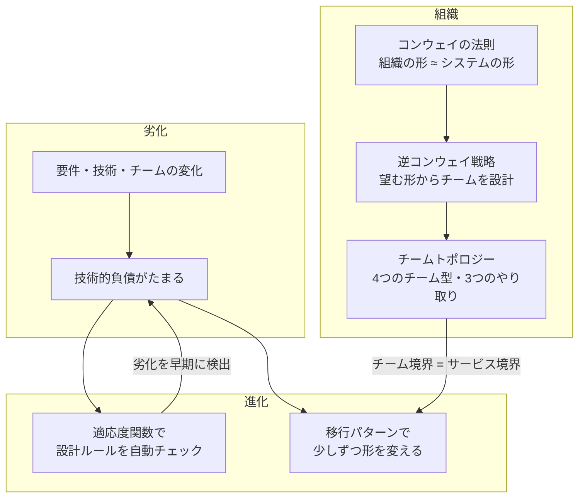
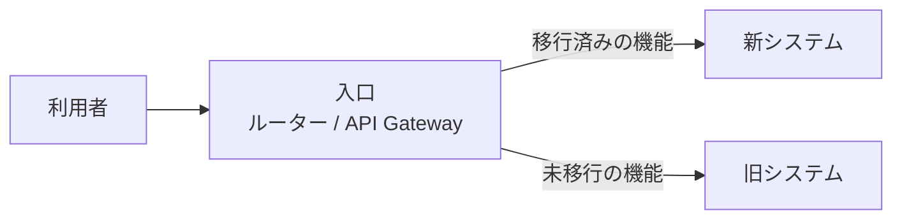

# 進化と組織

## このフォルダで扱うこと

このフォルダは、**アーキテクチャが時間とともにどう劣化し、どう変えていくか、そして組織とどう影響し合うか** を扱います。  
60_意思決定・文書化 が「今の決定をどう決めて残すか」なら、ここは **その決定が古くなったあとの話** です。

| 扱うこと | 具体例 |
|----------|--------|
| 技術的負債 | 負債の四象限、意図的な暫定案、返済の優先順位 |
| 進化的アーキテクチャ | 変化を前提にした設計、適応度関数（fitness function） |
| 組織とアーキテクチャ | コンウェイの法則、逆コンウェイ戦略、チームトポロジー |
| 移行パターン | ストラングラーフィグ、抽象化によるブランチ、並行稼働 |

**扱わないこと（本拠地）**

| テーマ | 本拠地 |
|--------|--------|
| 組織論一般（組織構造・組織文化・組織変革・人事制度） | 020Management/40_組織（マクロ） |
| チームづくり・集団力学 | 020Management/30_チーム（メゾ） |
| コード単位のリファクタリング手法 | 42_ソフトウェア設計（[[04_リファクタリングの考え方]]） |
| 決定の記録（ADR）・レビュー | 60_意思決定・文書化 |
| フィーチャーフラグの仕組み | 50_横断的関心事 |

> 境界の目安: **「組織そのものをどう良くするか」は 020Management**、**「組織の形がシステムの形にどう効くか」は 70** です。チームトポロジーのチーム型は、ソフトウェアの境界と結びつけて語るときだけここに置きます。

---

## 全体像



「放っておくと劣化する」→「測って気づく」→「少しずつ直す」→「組織もそれに合わせる」という流れで捉えると整理しやすくなります。

---

## 主要概念の解説

### 1. 技術的負債

**技術的負債（Technical Debt）** は、Ward Cunningham が 1992年に使い始めた比喩で、**今の手早い選択が、将来の変更コスト（利息）を生む状態** を指します。詳しくは [[03技術的負債と意図的な暫定案]] にまとめています。

#### 負債の四象限

Martin Fowler は、負債を **「意図的か / うっかりか」** と **「無謀か / 慎重か」** の2軸で4つに分けました。

| | **無謀（Reckless）** | **慎重（Prudent）** |
|---|---|---|
| **意図的（Deliberate）** | 「設計する時間はない」<br/>→ 分かっていて雑に作る | 「今は出荷を優先し、結果は受け入れる」<br/>→ 意図的な暫定案 |
| **うっかり（Inadvertent）** | 「レイヤー分けって何？」<br/>→ 知識不足で生まれる | 「今なら、どう作るべきだったか分かる」<br/>→ 学習の結果として気づく |

大事なのは、**右上（意図的・慎重）の負債は戦略として正当になり得る** という点です。そのためには、[[03技術的負債と意図的な暫定案]] の「意図・範囲・期限・直し方」の4点セットを決め、ADR に残します（[[02ADRとArchitecture Decision Record]]）。  
右下（うっかり・慎重）は、どれだけ優秀なチームでも必ず生まれます。システムを作りながらドメインを理解していくからです。

#### アーキテクチャ上の負債

コードの汚さより高くつくのが、**構造そのものの負債** です。

- レイヤーの依存方向が崩れ、ドメインが DB に依存している（[[依存性のルール]]）
- サービスを分けたのに DB を共有しており、分散モノリスになっている（[[02モノリスと分散モノリスとマイクロサービスといつ分けるか]]）
- 認証やログの処理が各所にコピーされている（[[01_横断的関心事]]）

こうした負債は一度に返せないため、次の「適応度関数」で悪化を止め、「移行パターン」で少しずつ返します。

---

### 2. 進化的アーキテクチャと適応度関数

**進化的アーキテクチャ（Evolutionary Architecture）** は、Neal Ford・Rebecca Parsons・Patrick Kua の書籍『進化的アーキテクチャ』で提唱された考え方で、  
**「複数の観点にわたって、ガイドされた漸進的な変更を支えるアーキテクチャ」** と定義されています。概要は [[04進化型アーキテクチャとリバースコンウェイの法則]] にあります。

キーワードは2つです。

| キーワード | 意味 |
|------------|------|
| **漸進的（incremental）** | 一気に作り直さず、小さな変更を積み重ねる。そのためにデプロイやテストが自動化されている |
| **ガイドされた（guided）** | 好き勝手に変わるのではなく、守るべき性質を **適応度関数** でチェックしながら変わる |

#### 適応度関数（Fitness Function）

**適応度関数**は、**アーキテクチャが守るべき性質を、客観的にチェックする仕組み** です。進化生物学で「その個体が環境にどれだけ適応しているか」を測る関数から名前を借りています。  
[[04進化型アーキテクチャとリバースコンウェイの法則]] では「フィットネス関数」と表記しています（同じものです）。

| 分類 | 意味 | 例 |
|------|------|-----|
| **アトミック（単一）** | 1つの性質だけを見る | 循環依存がないか |
| **ホリスティック（全体）** | 複数の性質の組み合わせを見る | 暗号化を入れても性能要件を満たすか |
| **トリガー型** | ビルドやデプロイのたびに実行 | CI での依存ルール検査 |
| **継続型** | 本番で常に監視 | レスポンスタイムのアラート |

#### 具体例（ツール）

| 守りたい性質 | ツールの例 |
|--------------|------------|
| レイヤーの依存方向（Java） | **ArchUnit** — 「domain パッケージは infrastructure に依存しない」をテストとして書ける |
| モジュール間の依存方向（JavaScript / TypeScript） | **dependency-cruiser**、**eslint-plugin-boundaries** |
| 依存方向（.NET） | **NetArchTest** |
| 性能 | 負荷テストの閾値（k6 など）、本番の SLO アラート |
| セキュリティ | 依存ライブラリの脆弱性スキャン（CI に組み込む） |

dependency-cruiser なら、たとえば次のようなルールを CI で検査できます。

```js
// .dependency-cruiser.js（イメージ）
module.exports = {
  forbidden: [
    {
      name: "domain-must-not-depend-on-infra",
      severity: "error",
      from: { path: "^src/domain" },
      to: { path: "^src/infrastructure" },
    },
    { name: "no-circular", severity: "error", from: {}, to: { circular: true } },
  ],
};
```

これで「ドメイン層はインフラ層に依存しない」という [[クリーンアーキテクチャの概要]] のルールが、**人の記憶ではなく CI で守られる** ようになります。いきなりツールを入れなくても、レビューのチェックリストから始めて構いません（[[05レビュー観点と図と境界と非機能と運用]]）。

---

### 3. コンウェイの法則・逆コンウェイ戦略・チームトポロジー

#### コンウェイの法則

1968年に Melvin Conway が述べた観察です。

> システムを設計する組織は、その組織のコミュニケーション構造をまねた設計を生み出す

1つの大きなチームはモノリスを作りやすく、フロント・バック・DB で分かれたチームは技術で分かれたレイヤー構造を作りやすくなります。詳しくは [[04進化型アーキテクチャとリバースコンウェイの法則]] を参照してください。

#### 逆コンウェイ戦略（Inverse Conway Maneuver）

コンウェイの法則を逆手にとり、**望むアーキテクチャに合わせて先にチームの境界を設計する** 考え方です。既存ノートでは「リバースコンウェイの法則」と呼んでいます。

- 注文と在庫を独立したサービスにしたい → 注文チームと在庫チームを分ける
- チームを分けないまま、図の上だけでサービスを分けると、分散モノリスになりやすい

#### チームトポロジー（Team Topologies）

Matthew Skelton と Manuel Pais の書籍『チームトポロジー』（2019）は、逆コンウェイ戦略を実践するための **チームの型とやり取りの型** を整理しました（専用ノートは未作成）。

**4つのチーム型**

| チーム型 | 役割 | ソフトウェアの境界との対応 |
|----------|------|----------------------------|
| **ストリームアラインドチーム** | 1つの価値の流れ（機能・顧客層）を端から端まで担当する。中心となるチーム | 境界づけられたコンテキスト・サービス単位 |
| **プラットフォームチーム** | 他のチームがセルフサービスで使える基盤を提供する | 共通基盤・内部 API |
| **イネイブリングチーム** | 他のチームに新しい技術や手法を教え、自立を助ける | 特定の境界は持たない |
| **コンプリケイテッド・サブシステムチーム** | 高度な専門知識が必要な部分を担当する（例: 動画変換エンジン） | 専門性の高いコンポーネント |

**3つのやり取りのモード**

| モード | 内容 |
|--------|------|
| **コラボレーション** | 2チームが密に協力する。新しい領域の探索向き。長く続けるとコストが高い |
| **X-as-a-Service** | 一方がサービスとして提供し、もう一方は使うだけ。境界が安定した状態 |
| **ファシリテーション** | 一方が他方を支援・指導する（主にイネイブリングチーム） |

このほかに **認知負荷（cognitive load）** という考え方が重要です。1つのチームが理解・保守できる範囲には限りがあるので、**サービスの大きさはチームの認知負荷に収まるように決める** べき、という指針になります。  
境界の決め方は DDD の [[03_境界づけられたコンテキストとコンテキストマップ]] と組み合わせて考えます。

---

### 4. 移行パターン

古い構造から新しい構造へ移るとき、**一気に作り直す（ビッグバン書き換え）はほとんどの場合失敗しやすい** とされます。代わりに、動かしながら少しずつ置き換える移行パターンを使います（専用ノートは未作成）。

| パターン | やり方 | 向いている場面 |
|----------|--------|----------------|
| **ストラングラーフィグ** | 古いシステムの前に入口（ルーターやプロキシ）を置き、機能ごとに新システムへ振り分けていく。最後に古い方を止める | モノリスからサービスへの段階的な移行 |
| **抽象化によるブランチ（Branch by Abstraction）** | 置き換えたい部品の前にインターフェースを作り、裏で新旧の実装を切り替える | 1つのコードベース内での大きな部品の入れ替え（[[04_インターフェースと抽象化]]） |
| **並行稼働（Parallel Run）** | 新旧両方で同じ処理をし、結果を比べる。ユーザーには旧の結果を返す | 計算ロジックなど、正しさの確認が重要な部分 |
| **フィーチャーフラグ** | 新機能をフラグで一部の利用者にだけ公開する | 段階的な公開と、問題時の即時切り戻し（[[04設定とシークレットとフィーチャーフラグ]]） |

ストラングラーフィグ（絞め殺しのイチジク）という名前は、宿主の木に絡みついて育ち、最後は宿主に取って代わるイチジクの木から来ています。



どのパターンでも、**「何を・どの順で・どうなったら完了か」** を ADR に残し、適応度関数で後戻りを防ぐのが基本です。

---

## 学ぶ順番とノート一覧

1. [[03技術的負債と意図的な暫定案]] — 負債の比喩、意図的な暫定案の4点セット、返済の優先順位
2. [[04進化型アーキテクチャとリバースコンウェイの法則]] — 進化的アーキテクチャ、フィットネス関数、ストラングラーフィグ、コンウェイの法則

未作成のテーマ（作成したらここに追加）:

- 技術的負債の四象限と負債の可視化
- 適応度関数（ArchUnit / dependency-cruiser の実例）
- チームトポロジー（4つのチーム型・3つのやり取り・認知負荷）
- 移行パターン（ストラングラーフィグ・抽象化によるブランチ・並行稼働）

入口として、60_意思決定・文書化 の [[01_意思決定と進化]] を先に読むとつながりが分かりやすくなります。

---

## 関連フォルダ

| フォルダ | 関係 |
|----------|------|
| 60_意思決定・文書化 | 負債や移行の決定を ADR に残す（[[02ADRとArchitecture Decision Record]]） |
| 20_アプリ内部構造 | 適応度関数で守る依存ルール（[[依存性のルール]]） |
| 40_システム・分散 | 移行パターンの主な行き先（[[02モノリスと分散モノリスとマイクロサービスといつ分けるか]]） |
| 42_ソフトウェア設計 | コード単位のリファクタリング、DDD の境界 |
| 020Management/40_組織（マクロ） | 組織構造・組織変革の一般論 |
| 020Management/30_チーム（メゾ） | チームづくり・集団力学 |
