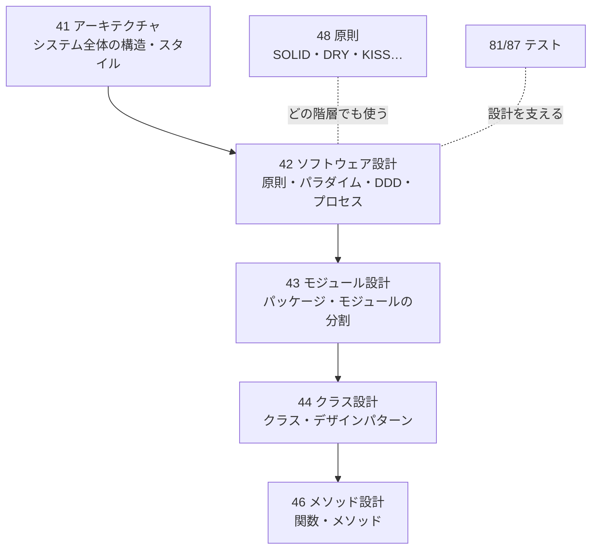
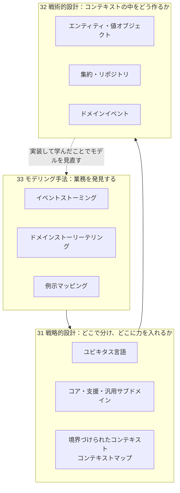
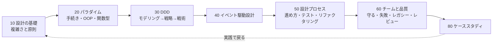

# ソフトウェア設計体系（全体の解説）

## このノートの位置づけ

[[MOC_ソフトウェア設計体系]] が「どこに何があるか」の地図、[[00_ソフトウェア設計の変遷]] が「どう発展してきたか」の年表だとすれば、このノートは **「ソフトウェア設計という分野を、ひとつながりの考え方として理解する」** ための解説です。

読み終えたときに、次の問いに答えられることを目標にします。

1. ソフトウェア設計とは何か。アーキテクチャや実装とどう違うのか
2. 「良い設計」は何を基準に判断するのか
3. 設計原則（凝集・結合・情報隠蔽…）は、結局何を目指しているのか
4. パラダイム（手続き・OOP・関数型）と DDD は、どういう関係にあるのか
5. 設計はどう進め、どう守り、どう改善するのか

---

## 1. ソフトウェア設計とは何か

### 1.1 SWEBOK の定義

ソフトウェア工学の知識体系 **SWEBOK**（IEEE Computer Society）では、ソフトウェア設計を次のように位置づけています。

> 要求を分析して、ソフトウェアの **内部構造の記述** を作り出す活動。その記述は、実装（構築）の土台となる。

SWEBOK は設計を大きく2つの段階に分けています。

| 段階 | 中身 | このVaultでの置き場 |
|---|---|---|
| **アーキテクチャ設計**（高レベル設計） | システム全体を構成要素に分け、その関係を決める | 41_アーキテクチャ |
| **詳細設計** | 各構成要素の中身（モジュール・クラス・関数・データ）を決める | 42〜46 |

42_ソフトウェア設計 は、この2つの **間をつなぐ考え方**（原則・パラダイム・ドメインモデリング・設計プロセス）を扱います（→ [[02_設計の階層と全体像]]）。

### 1.2 設計の階層とフォルダの対応



上に行くほど **変えにくく影響が大きい判断**、下に行くほど **変えやすく局所的な判断** です。42 は、どの階層でも使える **共通の考え方** を提供する位置にあります。

---

## 2. 「良い設計」の基準 — 複雑さを管理すること

### 2.1 設計の目的は「変更しやすさ」

動くコードを書くだけなら、設計はいりません。設計が必要になるのは、ソフトウェアが **変更され続ける** からです（→ [[01_ソフトウェア設計を学ぶ理由]]）。

- 要求は変わる（新機能・法改正・競合への対応）
- 技術は変わる（ライブラリの更新・クラウドへの移行）
- 人は変わる（メンバーの入れ替わり）

良い設計とは、**これらの変更を、少ないコストで、安全に行える設計** です。

### 2.2 Ousterhout の「複雑さ」の定義

スタンフォード大学の John Ousterhout は『A Philosophy of Software Design』（2018、第2版 2021）で、設計の敵を **複雑さ** と定義しました。

> **複雑さ** とは、ソフトウェアの構造のうち、**理解しにくく、変更しにくくしているもの** すべてである。

複雑さは、次の3つの症状として現れます。

| 症状 | 意味 | 例 |
|---|---|---|
| **変更の増幅**（Change Amplification） | 一見単純な変更なのに、多くの場所を直す必要がある | 消費税率を変えるのに、20ファイルを修正する |
| **認知負荷**（Cognitive Load） | 変更するために、知っておくべきことが多すぎる | この関数を呼ぶ前に、3つのグローバル変数を正しく設定しておく必要がある |
| **知らないことを知らない**（Unknown Unknowns） | 何を知る必要があるのかすら分からない。**最も悪い症状** | ある設定値を変えると、まったく関係なさそうな画面が壊れる。変更してバグが出るまで誰も気づかない |

複雑さの原因は、大きく2つに集約されます。

- **依存**：あるコードを、他のコードと切り離して理解・変更できない
- **不明瞭さ**：重要な情報が、見て分かる形になっていない

### 2.3 設計原則は「複雑さとの戦い方」

10_設計の基礎 で学ぶ原則は、すべてこの複雑さと戦うための道具として整理できます。

| 原則 | 戦う相手 | ノート |
|---|---|---|
| **関心の分離** | 異なる理由の変更が混ざること（変更の増幅） | [[04_関心の分離]] |
| **高凝集** | 関連するものが散らばること（変更の増幅） | [[05_凝集度と結合度]] |
| **疎結合** | 依存が多く強いこと（変更の増幅・知らないことを知らない） | [[05_凝集度と結合度]] |
| **カプセル化・情報隠蔽** | 知るべきことが多すぎること（認知負荷） | [[06_カプセル化と情報隠蔽]] |
| **変化の隔離** | 変わりやすい部分が広がること | [[07_変化に強い設計の考え方]] |
| **明確な命名・ユビキタス言語** | 不明瞭さ | [[02_ユビキタス言語]] |

---

## 3. 設計の基本原則

### 3.1 SWEBOK が挙げる設計原則

SWEBOK は、ソフトウェア設計の基本原則として次のものを挙げています。

| 原則 | 意味 |
|---|---|
| **抽象化** | 目的に関係する情報だけに注目し、それ以外を無視する（手続きの抽象・データの抽象・制御の抽象） |
| **結合度と凝集度** | モジュール間の依存の強さ／モジュール内の要素の関連の強さ |
| **分解とモジュール化** | 大きなソフトウェアを、明確なインターフェースを持つ小さな部品に分ける |
| **カプセル化・情報隠蔽** | 抽象の内部の詳細をまとめ、外から見えなくする |
| **インターフェースと実装の分離** | 公開する約束（インターフェース）と、中身（実装）を分ける |
| **十分性・完全性・原始性** | 抽象が必要な性質を過不足なく持ち、基本的な操作だけで構成されていること |
| **関心の分離** | 関係者ごとの関心事を、別々の部分で扱う |

### 3.2 すべての出発点：Parnas の情報隠蔽（1972）

これらの原則の多くは、David Parnas の 1972 年の論文「On the Criteria To Be Used in Decomposing Systems into Modules（システムをモジュールに分解する基準について）」にさかのぼります。

Parnas は、同じシステムを2通りに分けて比較しました。

| 分け方 | 基準 | 結果 |
|---|---|---|
| **処理の流れで分ける**（入力 → 処理 → 出力） | フローチャートの段階ごとにモジュールにする | データ形式を変えると、ほぼすべてのモジュールに影響する |
| **隠す設計判断で分ける**（情報隠蔽） | **変わりそうな設計判断** を1つずつモジュールに閉じ込める | データ形式を変えても、影響は1つのモジュールに収まる |

> **モジュールは、処理の段階ではなく、「何を隠すか」で分けるべきである。隠すべきなのは、変わる可能性の高い設計判断である。**

変わりやすい設計判断の例として、Parnas は **データ形式・ユーザーインターフェース・ハードウェア・OS** を挙げています。50年以上前の論文ですが、クリーンアーキテクチャの「DB や UI を外側に追い出す」、マイクロサービスの「データを隠す」まで、この考え方の延長線上にあります。

### 3.3 深いモジュール（Ousterhout）

Ousterhout は情報隠蔽を発展させ、**深いモジュール**（Deep Module）という考え方を示しました。

```text
 浅いモジュール            深いモジュール
 ┌──────────────┐         ┌────┐ ← インターフェース（小さい）
 │インターフェース│         │    │
 ├──────────────┤         │    │
 │   実装       │         │実装│ ← 多くの機能・複雑さを隠している
 └──────────────┘         │    │
                          │    │
                          └────┘
```

- **深いモジュール**：インターフェースは **単純**、実装は **多くの機能と複雑さを隠している**（例：Unix のファイル入出力は `open/read/write/close` の5つ程度の関数で、ディスク管理・キャッシュ・権限などの膨大な複雑さを隠している）
- **浅いモジュール**：インターフェースが実装と同じくらい複雑で、隠しているものが少ない（例：何もしないラッパークラス、1行の処理のためのクラス）

「小さなクラスをたくさん作れば良い設計」とは限らない、という指摘です。これは 41_アーキテクチャ で見た **シンクホール（何もしない層）** の問題とも重なります。モジュール設計としての詳細は 43_モジュール設計 で扱います。

---

## 4. パラダイム — 設計の「道具箱」

### 4.1 3つのパラダイムの関係

| パラダイム | 複雑さへの対処法 | 得意なこと | ノート |
|---|---|---|---|
| **手続き・構造化** | 処理を手順と関数に分ける | 単純な処理・スクリプト・性能が重要な部分 | [[01_手続き指向設計]] |
| **オブジェクト指向** | データと振る舞いをまとめ、**状態を隠す**（カプセル化） | 種類が増えていく領域、状態を持つ業務の概念 | [[01_オブジェクト指向設計]] |
| **関数型** | **状態を持たない**（不変・純粋関数）、副作用を端に寄せる | 計算・変換・検証、並行処理、操作が増えていく領域 | [[01_関数型指向の考え方]] / [[02_不変データと純粋関数_関数型の設計原則]] |

オブジェクト指向は「状態を **隠す**」ことで、関数型は「状態を **持たない**」ことで、それぞれ影響範囲を狭めます。目指しているものは同じで、**手段が違う** のです。

### 4.2 現代は「組み合わせる」時代

TypeScript・Kotlin・Swift・C# など、現代の主要な言語は複数のパラダイムを取り込んでいます。実務では、次のような組み合わせが一般的です（→ [[01_パラダイムの選び方と組み合わせ]]）。

- **業務の概念**（注文・顧客）はオブジェクトや型で表す
- **計算・検証** は純粋関数で書く
- **値オブジェクト** は不変にする（関数型の考え方）
- **副作用** はユースケースの最初と最後に集める（Functional Core, Imperative Shell）
- **状態の種類** は直和型で表す（→ [[03_型でドメインを表す_DomainModelingMadeFunctional]]）

---

## 5. ドメイン駆動設計 — 「何を」モデル化するか

### 5.1 パラダイムと DDD の違い

パラダイムが「**どう** 書くか」の道具だとすれば、DDD は「**何を** 中心に設計するか」の考え方です。

> **ソフトウェアの中心に、業務（ドメイン）の知識を置き、業務の専門家と開発者が同じ言葉でモデルを育てていく。**

### 5.2 DDD の全体像



| 段階 | 問い | ノート |
|---|---|---|
| **モデリング手法** | 業務をどう理解するか | [[01_イベントストーミング]] / [[02_ドメインストーリーテリングと例示マッピングとキャンバス]] |
| **戦略的設計** | どこで分け、どこに力を入れるか | [[01_戦略的設計]] / [[02_ユビキタス言語]] / [[04_境界づけられたコンテキスト]] / [[05_コアドメインとサブドメイン]] |
| **戦術的設計** | コンテキストの中をどう作るか | [[01_戦術的設計]] / [[03_エンティティと値オブジェクト]] / [[04_集約とリポジトリ]] / [[05_ドメインイベント]] |

### 5.3 DDD で最も大切な判断：どこに力を入れるか

DDD は「重くて難しい」と言われがちですが、その多くは **すべての部分に戦術パターンを使おうとする** ことから来ています。

- **コアサブドメイン**（競争優位を生む部分）だけ、ドメインモデルで丁寧に作る
- **支援サブドメイン** はシンプルに作る（CRUD で十分なことも多い）
- **汎用サブドメイン**（認証・決済など）は買う・借りる

詳しくは [[05_コアドメインとサブドメイン]] を参照してください。

### 5.4 イベント駆動設計

DDD の **ドメインイベント**（「注文が確定した」）を軸に、システムの部品やコンテキスト同士をつなぐのが **イベント駆動設計** です（→ 40_イベント駆動設計）。分散システムとしての実装（メッセージブローカー・SAGA）は 41_アーキテクチャ/40_システム・分散 が本拠地です。

---

## 6. 設計の進め方・守り方・直し方

### 6.1 設計は「一度で決める」ものではない

| 考え方 | 内容 | ノート |
|---|---|---|
| **段階的に深める** | 最初は粗く、理解が深まるにつれて詳しくする | [[02_設計の段階的な深化]] |
| **YAGNI と変化への備えのバランス** | 「いつか必要かも」で作り込まない。ただし変わりやすい部分は隔離しておく | [[07_変化に強い設計の考え方]] |
| **テストが設計を導く** | テストしにくいコードは、たいてい結合が強い。TDD はテストを先に書くことで設計を改善する | [[03_テストと設計の関係]] |
| **リファクタリングで設計を育てる** | 動作を変えずに構造を改善し続ける。設計は「書いた後」も続く | [[04_リファクタリングの考え方]] |

Ousterhout は、目の前の機能を動かすことだけを考える **戦術的プログラミング** と、設計の質に少しずつ投資し続ける **戦略的プログラミング** を対比し、開発時間の **10〜20% 程度** を設計の改善に投資することを勧めています。

### 6.2 チームで設計を守る

設計は、一人が正しく作っても、チームで守られなければ崩れていきます（→ [[01_チームで設計を守る]]）。

- **ユビキタス言語** と用語集で、言葉をそろえる
- **設計レビュー** で、判断の理由を共有する（→ [[04_設計レビューの実践]]）
- **ADR** で、決定の理由を残す（41_アーキテクチャ/60）
- **静的解析・アーキテクチャテスト** で、依存のルールを自動で守らせる
- **よくある失敗** を知っておく（→ [[02_よくある設計の失敗]] / [[付録E_アンチパターン一覧]]）

---

## 7. 2020年代の論点

| 論点 | 内容 |
|---|---|
| **結合を「バランス」で考える** | Vlad Khononov『Balancing Coupling in Software Design』（2024）は、結合を「ゼロにすべきもの」ではなく、**強さ・距離・変動性** の3つでバランスを取るものとして整理した（43_モジュール設計 で扱う） |
| **型駆動設計の普及** | TypeScript の普及により、「ありえない状態を表現できなくする」「検証するな、解析せよ」といった関数型由来の型設計が、一般の Web 開発でも使われるようになった（→ [[03_型でドメインを表す_DomainModelingMadeFunctional]]） |
| **協働的モデリングの定着** | イベントストーミング・ドメインストーリーテリング・DDD Crew のキャンバス群など、業務の専門家と開発者が一緒にモデルを作る手法が体系化された |
| **AI と設計** | AI コーディングアシスタントがコードを大量に書く時代には、「どう書くか」より **「何を・どこで分けるか」という設計判断** と、**設計のルールを機械が検査できる形で残すこと**（型・テスト・アーキテクチャテスト）の価値が高まっている。明確なモジュール境界と型は、人間だけでなく AI にとっての **認知負荷** も下げる |

---

## 8. よくある誤解

| 誤解 | 実際 |
|---|---|
| 設計はコードを書く前に完成させるもの | 設計は段階的に深め、リファクタリングで育て続けるもの |
| クラスや関数を小さく分けるほど良い設計 | インターフェースが単純で多くを隠す **深いモジュール** が良い。浅い部品を増やすと複雑さが増える |
| オブジェクト指向と関数型は対立する | 目的は同じ（影響範囲を狭める）。現代は組み合わせて使う |
| DDD は全部に戦術パターンを使うこと | 力を入れるのはコアだけ。DDD の本質は戦略的設計と協働的モデリング |
| 設計原則は守れば守るほど良い | 原則同士もトレードオフになる。YAGNI とのバランスが必要 |
| 良い設計は個人のセンス | 複雑さの症状（変更の増幅・認知負荷・知らないことを知らない）として **言語化・検証** できる |

---

## 9. 学習ロードマップ



1. **10_設計の基礎** — 「良い設計」の物差し（関心の分離・凝集結合・情報隠蔽・変化への強さ）
2. **20_パラダイム** — 設計の道具箱。とくに関数型の [[02_不変データと純粋関数_関数型の設計原則]] と [[03_型でドメインを表す_DomainModelingMadeFunctional]] は、OOP 言語でもすぐ使える
3. **30_ドメイン駆動設計** — [[01_イベントストーミング]] で業務を発見し、[[05_コアドメインとサブドメイン]] で力の入れどころを決め、戦術的設計で作る
4. **40_イベント駆動設計** — ドメインイベントでつなぐ
5. **50_設計プロセス / 60_チームと品質** — 進め方・守り方・直し方
6. **80_ケーススタディ** — 総合演習

教材の章順で読みたい場合は MOC の「学習順インデックス」、歴史の流れで読みたい場合は [[00_ソフトウェア設計の変遷]] を使ってください。

---

## 参考資料

**知識体系・古典**

- [SWEBOK — Chapter 2: Software Design（swebokwiki.org）](http://swebokwiki.org/Chapter_2:_Software_Design)
- [SWEBOK（IEEE Computer Society）](https://www.computer.org/education/bodies-of-knowledge/software-engineering/topics)
- [D. L. Parnas — On the Criteria To Be Used in Decomposing Systems into Modules（1972）](http://sunnyday.mit.edu/16.355/parnas-criteria.html)
- [On the criteria to be used in decomposing systems into modules（the morning paper による解説）](https://blog.acolyer.org/2016/09/05/on-the-criteria-to-be-used-in-decomposing-systems-into-modules/)

**複雑さと設計**

- John Ousterhout『A Philosophy of Software Design』（第2版, 2021）
- [Book notes: A Philosophy of Software Design（Dan Lebrero）](https://danlebrero.com/2021/02/24/philosophy-of-software-design-summary/)
- [Ousterhout Software Design Guide（binaryphile, 2026）](https://www.binaryphile.com/2026/01/09/ousterhout-software-design-guide.html)

**DDD・モデリング**

- Vlad Khononov『ドメイン駆動設計をはじめよう』（*Learning Domain-Driven Design*）
- [DDD Starter Modelling Process（DDD Crew）](https://ddd-crew.github.io/ddd-starter-modelling-process/)
- [Event storming（Wikipedia）](https://en.wikipedia.org/wiki/Event_storming)

**関数型・型駆動設計**

- Scott Wlaschin『Domain Modeling Made Functional』
- [Designing with types: Making illegal states unrepresentable（F# for Fun and Profit）](https://fsharpforfunandprofit.com/posts/designing-with-types-making-illegal-states-unrepresentable/)
- [Alexis King — Parse, don't validate](https://lexi-lambda.github.io/blog/2019/11/05/parse-don-t-validate/)
