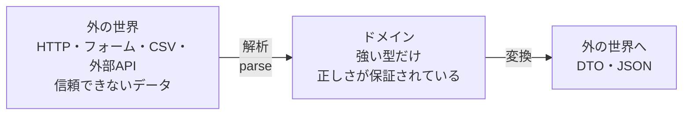

# 型でドメインを表す — Domain Modeling Made Functional

## この教材の目的

DDD（ドメイン駆動設計）の戦術的設計は、エンティティや値オブジェクトといった **オブジェクト指向の言葉** で説明されることがほとんどです（[[01_戦術的設計]]）。
しかし、**型システム** を使っても、業務ルールを非常に正確に表現できます。

この教材では、Scott Wlaschin の『Domain Modeling Made Functional』（2018）を軸に、

- **ありえない状態を表現できなくする**（Make Illegal States Unrepresentable）
- **検証するな、解析せよ**（Parse, Don't Validate）
- **制約付きの単純型**（プリミティブ型への執着をやめる）
- **状態ごとに型を分ける**
- **ワークフローを関数のパイプラインとして表す**

を、TypeScript のコード例で解説します。関数型言語でなくても使える考え方です。

---

## 1. なぜ型で業務ルールを表すのか

### 1.1 よくあるモデル

```typescript
type Contact = {
  name: string;
  email: string | null;
  emailVerified: boolean;
  postalAddress: string | null;
};
```

このモデルには、**業務的にありえない状態** がたくさん入り込めます。

| ありえない状態 | なぜ表現できてしまうか |
|---|---|
| `email` が `null` なのに `emailVerified` が `true` | 2つのフィールドが独立している |
| `email` が `"abc"`（メール形式でない） | ただの `string` |
| `email` も `postalAddress` も `null`（連絡手段がない） | 両方とも `null` を許している |
| `name` が空文字列 | ただの `string` |

これらは、**どこかで if 文でチェックしなければならない**。しかしチェックを忘れる場所が必ず出てきます。

### 1.2 型で表すと

**業務ルールを型そのものに埋め込めば、ルールに反するデータはそもそも作れなくなります**。コンパイラが、ルールの番人になってくれます。

> 「型は、コンパイラが常にチェックしてくれる **ドキュメント** であり **テスト** である」

---

## 2. ありえない状態を表現できなくする

### 2.1 由来

**Make Illegal States Unrepresentable**（ありえない状態を表現できなくせよ）は、Jane Street の **Yaron Minsky** が 2010 年ごろ、OCaml についての講義で広めた言葉です。

### 2.2 直和型で「どれか1つ」を表す

先ほどの例の「連絡手段はメールか住所の **少なくとも一方** が必要」というルールは、直和型で表せます。

```typescript
type ContactInfo =
  | { kind: "emailOnly"; email: EmailAddress }
  | { kind: "postalOnly"; address: PostalAddress }
  | { kind: "both"; email: EmailAddress; address: PostalAddress };

type Contact = { name: NonEmptyString; contactInfo: ContactInfo };
```

- 「メールも住所もない」状態は、**型として存在しない** ので作れない
- `switch (contactInfo.kind)` で分岐すれば、TypeScript がすべてのケースを扱ったかをチェックしてくれる（網羅性チェック）

### 2.3 ブール値のフラグをやめる

`emailVerified: boolean` のようなフラグは、ありえない組み合わせの温床です。状態を **別の型** にします。

```typescript
type UnverifiedEmail = { kind: "unverified"; address: EmailAddress };
type VerifiedEmail = { kind: "verified"; address: EmailAddress; verifiedAt: Date };
type Email = UnverifiedEmail | VerifiedEmail;

// パスワードリセットのメールは、確認済みのアドレスにしか送れない
function sendPasswordReset(email: VerifiedEmail) { ... }
```

- `sendPasswordReset` に未確認のメールを渡すと **コンパイルエラー** になる
- 「確認済みかどうかを if でチェックし忘れる」バグが、構造的に起きなくなる

---

## 3. プリミティブ型への執着をやめる — 制約付きの単純型

### 3.1 問題

`string` や `number` をそのまま使うと、意味の違う値を取り違えてもコンパイラが気づきません。

```typescript
function transfer(fromAccountId: string, toAccountId: string, amount: number) { ... }

transfer(toId, fromId, 1000);  // 引数を逆にしても気づかない
transfer(fromId, toId, -500);  // マイナスの金額も通ってしまう
```

これは **プリミティブ型への執着**（Primitive Obsession）と呼ばれるコードの匂いです。

### 3.2 制約付きの型を作る

TypeScript では **ブランド型**（Branded Type）で、同じ `string` でも区別できる型を作れます。

```typescript
type Brand<T, B> = T & { readonly __brand: B };

type AccountId = Brand<string, "AccountId">;
type EmailAddress = Brand<string, "EmailAddress">;
type PositiveAmount = Brand<number, "PositiveAmount">;

// 作る方法を「スマートコンストラクタ」に限定する
function toPositiveAmount(n: number): Result<PositiveAmount, string> {
  return n > 0 && Number.isFinite(n)
    ? ok(n as PositiveAmount)
    : err("金額は正の数である必要があります");
}

function transfer(from: AccountId, to: AccountId, amount: PositiveAmount) { ... }
```

- `PositiveAmount` を作るには、**必ず `toPositiveAmount` を通る** → マイナスの金額は存在できない
- `AccountId` と `EmailAddress` は取り違えるとコンパイルエラー
- これは DDD の **値オブジェクト** を、型で表したものです（→ [[03_エンティティと値オブジェクト]]）

---

## 4. 検証するな、解析せよ（Parse, Don't Validate）

### 4.1 由来と考え方

Alexis King が 2019 年に書いた記事 **「Parse, don't validate」** は、型駆動設計の本質を表した文章として広く読まれています。

| | 検証（validate） | 解析（parse） |
|---|---|---|
| やること | データを調べて、OK か NG かを **真偽値で返す** | 弱い型のデータを調べて、**強い型のデータに変換して返す** |
| 結果 | 調べた結果を **すぐ忘れる**（型は元のまま） | 調べた結果が **型として残る** |
| その後 | 後の処理でも「これは本当に正しいデータか？」と不安が残る | 後の処理は、型を見るだけで正しさを信頼できる |

```typescript
// ✕ 検証：調べた結果を忘れる
function isValidEmail(s: string): boolean { ... }

if (isValidEmail(input)) {
  sendMail(input);  // input は相変わらず string。他の場所で未検証の string を渡すミスを防げない
}

// ○ 解析：調べた結果を型に残す
function parseEmail(s: string): Result<EmailAddress, string> { ... }

const email = parseEmail(input);
if (email.ok) {
  sendMail(email.value);  // EmailAddress 型。sendMail は EmailAddress しか受け取らない
}
```

### 4.2 境界で一度だけ解析する

この考え方を設計に当てはめると、次のようになります。



- **システムの境界**（API の入口・フォームの受け取り）で、**一度だけ** 解析する
- ドメインの内側には **解析済みの強い型** しか入ってこない
- 内側のコードは「このメールアドレスは正しい形式か？」を二度とチェックしなくてよい

これは、41_アーキテクチャ の [[依存性のルール]]（データは境界で変換して持ち込む）や、zod・valibot などのスキーマライブラリの使い方とも一致します。

---

## 5. 状態ごとに型を分ける — ライフサイクルを型で表す

### 5.1 1つの型にフラグを詰め込む問題

```typescript
type Order = {
  id: string;
  items: OrderLine[];
  status: "unvalidated" | "validated" | "priced" | "shipped";
  validatedAt?: Date;
  totalPrice?: number;       // priced 以降でしか意味がない
  trackingNumber?: string;   // shipped でしか意味がない
};
```

- `status` が `"unvalidated"` なのに `totalPrice` が入っている、という状態が作れる
- `totalPrice` を使うたびに `undefined` チェックが必要

### 5.2 状態ごとに別の型にする

```typescript
type UnvalidatedOrder = { orderId: string; lines: UnvalidatedOrderLine[]; customerInfo: unknown };
type ValidatedOrder   = { orderId: OrderId; lines: ValidatedOrderLine[]; customer: Customer };
type PricedOrder      = ValidatedOrder & { lines: PricedOrderLine[]; amountToBill: PositiveAmount };
type ShippedOrder     = PricedOrder & { trackingNumber: TrackingNumber; shippedAt: Date };
```

- 「価格が付いている注文」は `PricedOrder` 型として存在し、`amountToBill` は **必ずある**
- 発送処理は `PricedOrder` しか受け取らない → 価格計算前の注文を発送するバグは起きない
- 状態遷移は **型を変換する関数** として表される

これは DDD の **集約のライフサイクル** を型で表したものです（→ [[04_集約とリポジトリ]]）。

---

## 6. ワークフローを関数のパイプラインとして表す

### 6.1 ワークフローは「入力型 → 出力型」の関数

『Domain Modeling Made Functional』では、業務のワークフロー（ユースケース）を **型のシグネチャ** として先に設計します。

```typescript
// 注文を受け付けるワークフロー全体
type PlaceOrder = (input: UnvalidatedOrder) => Promise<Result<OrderPlacedEvent[], PlaceOrderError>>;

// それを構成するステップ
type ValidateOrder = (input: UnvalidatedOrder) => Result<ValidatedOrder, ValidationError>;
type PriceOrder    = (input: ValidatedOrder) => Result<PricedOrder, PricingError>;
type CreateEvents  = (input: PricedOrder) => OrderPlacedEvent[];
```

- **型のシグネチャだけで、業務の流れが読める**。業務の専門家と一緒にレビューすることもできる
- ワークフローは、これらのステップの **合成**（パイプライン）として実装される（→ [[02_不変データと純粋関数_関数型の設計原則]] の関数合成）
- 出力は **ドメインイベント**（「注文が確定した」）。副作用（DB 保存・メール送信）はワークフローの外で行う（→ [[05_ドメインイベント]]）

### 6.2 エラーも型で表す

例外を投げる代わりに、**成功または失敗を表す型**（`Result` 型）で返します。

```typescript
type Result<T, E> = { ok: true; value: T } | { ok: false; error: E };

type PlaceOrderError =
  | { kind: "validation"; field: string; message: string }
  | { kind: "pricing"; productCode: string; message: string }
  | { kind: "remoteService"; service: string; message: string };
```

- 関数のシグネチャを見るだけで、**どんな失敗がありうるか** が分かる
- 呼び出し側は失敗のケースを扱わないとコンパイルが通らない（例外は見落としやすい）
- 業務上の失敗（在庫切れ・検証エラー）は `Result` で、本当に想定外の失敗（メモリ不足など）だけ例外で、という使い分けが実用的

> Wlaschin はこの書き方を **鉄道指向プログラミング**（Railway Oriented Programming）と呼んでいます。成功の線路と失敗の線路が並走し、どこかで失敗したら失敗の線路に乗り換えて最後まで進む、というイメージです。

---

## 7. オブジェクト指向の DDD との対応

| OOP の DDD | 型による DDD（関数型） |
|---|---|
| 値オブジェクト（クラス＋コンストラクタでの検証） | 制約付きの単純型（ブランド型＋スマートコンストラクタ） |
| エンティティ（ID を持つ可変オブジェクト） | ID を持つ不変のレコード。変更は新しい版を返す関数 |
| 集約（不変条件を守るメソッドを持つ） | 状態ごとの型＋状態遷移の関数 |
| ドメインサービス | 純粋関数 |
| アプリケーションサービス（ユースケース） | ワークフロー（関数のパイプライン） |
| ドメインイベント | ワークフローの出力（直和型） |

どちらが正しいということはなく、**同じ DDD の考え方を、別の道具で表している** と捉えるのが良いでしょう。TypeScript では両方を混ぜて使えます。

---

## 8. 向いている場面・注意点

| 向いている | 注意が必要 |
|---|---|
| 業務ルールが多く、ありえない状態を防ぎたい | 型が複雑になりすぎると、かえって読みにくくなる |
| 状態遷移がはっきりしている（注文・申請・審査） | チーム全員が型の読み書きに慣れている必要がある |
| 外部からの入力が多く、検証漏れが怖い | ORM との相性（DB の行と強い型の変換が必要） |

---

## 9. ありがちな誤解

### 9.1 「型を細かく作るのは過剰」

**場合によります。** すべての `string` をブランド型にする必要はありません。**取り違えると事故になる値**（ID・金額・メールアドレス）や、**業務ルールがある値** から始めます。

### 9.2 「バリデーションライブラリを使えば十分」

**使い方次第です。** zod などで検証した後、**結果を強い型として受け取り、内側ではその型だけを使う** なら「解析」になります。検証して元の `string` のまま使うなら「検証」のままです。

### 9.3 「関数型言語でないと使えない」

**誤りです。** TypeScript の判別可能ユニオン・ブランド型・網羅性チェックで、ほとんどの考え方を実践できます。

---

## 10. まとめ

- **ありえない状態を表現できなくする**（Yaron Minsky）：直和型やブール値フラグの排除で、業務ルールに反するデータを作れなくする
- **制約付きの単純型**：プリミティブ型への執着をやめ、ブランド型＋スマートコンストラクタで値オブジェクトを表す
- **検証するな、解析せよ**（Alexis King, 2019）：調べた結果を型に残す。**境界で一度だけ解析** し、内側は強い型だけを扱う
- **状態ごとに型を分ける**：ライフサイクルを型で表し、状態遷移を関数にする
- **ワークフローは型のシグネチャ** で設計し、関数のパイプラインとして実装する。エラーは `Result` 型で表す
- OOP の DDD と型による DDD は、**同じ考え方を別の道具で表したもの**

---

## 参考資料

- Scott Wlaschin『Domain Modeling Made Functional』（Pragmatic Bookshelf, 2018）
- [Designing with types: Making illegal states unrepresentable（F# for Fun and Profit）](https://fsharpforfunandprofit.com/posts/designing-with-types-making-illegal-states-unrepresentable/)
- [Make Illegal States Unrepresentable（functional-architecture.org）](https://functional-architecture.org/make_illegal_states_unrepresentable/)
- [Alexis King — Parse, don't validate（2019）](https://lexi-lambda.github.io/blog/2019/11/05/parse-don-t-validate/)
- [Parse, Don't Validate（DevIQ）](https://deviq.com/practices/parse-dont-validate/)
- [Parse, Don't Validate — In a Language That Doesn't Want You To（TypeScript）](https://cekrem.github.io/posts/parse-dont-validate-typescript/)
- [Domain Modeling Made Functional: Takeaways](https://canro91.github.io/2021/12/13/DomainModelingMadeFunctional/)
- [Railway Oriented Programming（F# for Fun and Profit）](https://fsharpforfunandprofit.com/rop/)
