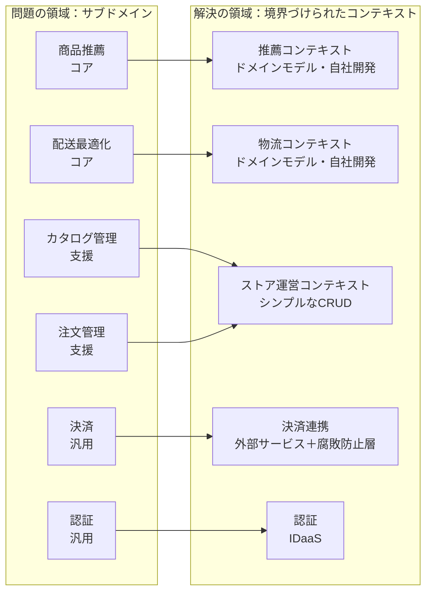

# コアドメインとサブドメイン

## この教材の目的

[[01_戦略的設計]] と [[04_境界づけられたコンテキスト]] では、システムを **どこで分けるか** を学びました。
しかし、分けた部分は **すべて同じ力の入れ具合で作るべき** でしょうか。

- 決済の仕組みを自社でゼロから作るべきか、Stripe などのサービスを使うべきか
- ベテランのエンジニアは、どの部分に配置すべきか
- DDD の戦術パターン（集約・値オブジェクト）は、全部に使うべきか

この教材では、こうした **投資の配分** を決めるための考え方、

- **ドメイン** と **サブドメイン**
- サブドメインの3分類：**コア・支援・汎用**
- 分類ごとの **作り方・調達方法・設計の深さ**
- 分類を可視化する **コアドメインチャート**
- 境界づけられたコンテキストとの関係

を解説します。

---

## 1. ドメインとサブドメイン

### 1.1 ドメイン

**ドメイン** とは、**その会社が事業として取り組んでいる領域** です。

- 例：EC 事業、物流、オンライン学習、病院の予約、保険

### 1.2 サブドメイン

ドメインは大きすぎるので、**より細かい業務の領域** に分けます。これが **サブドメイン** です。

例：EC 事業のサブドメイン

| サブドメイン | 中身 |
|---|---|
| 商品推薦 | 閲覧・購入履歴から、その人に合った商品を薦める |
| 在庫・配送最適化 | 倉庫の在庫配置と配送ルートを最適化する |
| カタログ管理 | 商品情報の登録・編集 |
| 注文管理 | カート・注文・キャンセル |
| 決済 | クレジットカード・電子マネーの処理 |
| 認証 | ログイン・会員登録 |
| 会計 | 売上の記帳・請求書の発行 |

### 1.3 サブドメインは「見つける」もの

サブドメインは **設計者が決めるものではなく、事業の中にすでにあるもの** です。

- 組織の部署、業務の担当者、業務マニュアルの章立てなどがヒントになる
- 一方、境界づけられたコンテキストは **設計者がソフトウェアの都合で決めるもの**（§5 で扱います）

---

## 2. サブドメインの3分類

DDD では、サブドメインを **事業にとっての価値** で3つに分類します。ここでは Vlad Khononov『ドメイン駆動設計をはじめよう』（*Learning Domain-Driven Design*）の整理に沿って説明します。

### 2.1 コアサブドメイン（Core）

> **競合他社と違うやり方をしていて、競争優位を生み出している業務**

- 例：EC なら商品推薦や配送最適化、配車アプリならマッチングと料金の動的決定、保険なら独自の査定ロジック
- この会社が **「なぜ選ばれるのか」の理由** そのもの
- **複雑** で、**頻繁に変わる**（競合に追いつかれないよう改善し続けるため）

### 2.2 支援サブドメイン（Supporting）

> **それ自体は競争優位を生まないが、コアを支えるために必要で、その会社特有の業務**

- 例：カタログ管理、社内向けの管理画面、独自の業務フローを持つ受注管理
- **比較的単純**（CRUD やシンプルな業務ルールが中心）
- 既製品では会社特有のやり方に合わないので、**自社で作ることが多い**

### 2.3 汎用サブドメイン（Generic）

> **どの会社も同じやり方をしていて、すでに解決策が存在する業務**

- 例：認証、決済、メール配信、会計、チャット、地図表示
- **複雑なことも多い**（認証や決済は非常に難しい）が、**自社で作っても競争優位にならない**
- **買う・借りる（SaaS・OSS・外部サービス）** のが基本

### 2.4 3分類の比較

| 観点 | コア | 支援 | 汎用 |
|---|---|---|---|
| 競争優位 | **ある** | ない | ない |
| 複雑さ | 高い | 低い | 高い（ことが多い） |
| 変化の頻度 | **高い** | 低い | 低い |
| 自社特有か | はい | はい | いいえ（どこも同じ） |
| 解決策 | 自社で作る | 自社で作る（または外注） | **買う・借りる** |

---

## 3. 分類ごとの作り方

分類は、**誰が・どう作るか・どこまで丁寧に設計するか** を決めるために使います。

### 3.1 調達方法と人の配置

| 分類 | 調達方法 | 人の配置 |
|---|---|---|
| コア | **自社で作る**。外注しない（ノウハウが外に出る・変化に追いつけない） | **最も経験のある人** を配置する |
| 支援 | 自社で作る、または外注・ローコードツール | 若手の育成の場にもなる |
| 汎用 | **SaaS・OSS・外部サービスを使う** | 組み込み・連携ができる人がいればよい |

### 3.2 設計の深さ

DDD の戦術パターンは、**どこにでも使うものではありません**。

| 分類 | 設計の深さの目安 |
|---|---|
| コア | **ドメインモデル**（集約・値オブジェクト・ドメインイベント）で業務ルールを丁寧に表現する。テストも厚く書く（→ [[01_戦術的設計]]） |
| 支援 | **トランザクションスクリプト** や **アクティブレコード** で十分なことが多い。シンプルに作る |
| 汎用 | 外部サービスを **腐敗防止層**（アンチコラプションレイヤー）で包んで、自社のモデルを汚さないようにする（→ [[03_境界づけられたコンテキストとコンテキストマップ]]） |

> 「DDD は難しくて重い」という印象の多くは、**すべての部分に戦術パターンを使おうとする** ことから来ます。戦術パターンを本気で使うのは **コアだけ** で十分です。

### 3.3 よくある失敗

| 失敗 | 結果 |
|---|---|
| **汎用を自作する**（独自の認証基盤・独自の決済処理を作る） | 時間とお金を、競争優位にならない部分に費やす。セキュリティリスクも高い |
| **コアを外注・既製品に頼る** | 競合と同じことしかできない。改善のたびに外注先との調整が必要になる |
| **支援を過剰に設計する**（管理画面に集約・CQRS・イベントソーシング） | 単純な機能に複雑なアーキテクチャのコストを払う |
| **コアを手抜きで作る**（業務ルールが Controller や SQL に散らばる） | 最も変化が激しい部分が、最も変えにくくなる |

---

## 4. 分類は変わる

サブドメインの分類は **固定ではありません**。事業や市場の変化とともに移り変わります。

| 変化 | 例 |
|---|---|
| **コア → 汎用** | かつては独自の検索技術が競争優位だったが、高品質な検索サービスが一般化して誰でも使えるようになった |
| **支援 → コア** | 単なる配送手配だったものを、独自の最適化で「翌日配送」を実現し、競争優位の源泉にした |
| **汎用 → コア** | 多くの会社にとって決済は汎用だが、決済代行会社にとってはそれ自体がコア |

最後の例のように、**同じ業務でも、会社によって分類が違う** ことにも注意します。分類は「業務の種類」ではなく、「**その会社にとっての価値**」で決まります。

> 分類が変われば、作り方も変えるべきです。コアだったものが汎用になったら、自社開発をやめて既製品に置き換えることも検討します。

---

## 5. 境界づけられたコンテキストとの関係

### 5.1 違い

| | サブドメイン | 境界づけられたコンテキスト |
|---|---|---|
| どこにあるか | **問題の領域**（事業の中にある） | **解決の領域**（ソフトウェアの中にある） |
| 誰が決めるか | 事業が決める（設計者は見つける） | **設計者が決める** |
| 何の境界か | 業務の領域 | モデルとユビキタス言語の境界 |

### 5.2 対応の仕方

- 理想は **1つのサブドメイン ＝ 1つの境界づけられたコンテキスト** だが、必ずしもそうなるとは限らない
- 1つのコンテキストに複数の **支援サブドメイン** をまとめることもある（単純なので、分けるコストの方が大きい）
- 逆に、大きなコアサブドメインを複数のコンテキストに分けることもある



---

## 6. コアドメインチャートで可視化する

### 6.1 コアドメインチャートとは

DDD のコミュニティ「DDD Crew」が公開している **コアドメインチャート**（Core Domain Charts）は、サブドメイン（やコンテキスト）を2つの軸で配置して、分類を可視化する道具です。

```text
 事業上の
 差別化
   高 │                    ┌──────────────┐
      │                    │  コア         │
      │                    │  ・商品推薦   │
      │                    │  ・配送最適化 │
      │                    └──────────────┘
      │  ┌──────────────┐
      │  │  支援        │
      │  │  ・カタログ  │  ┌──────────────┐
      │  │  ・注文管理  │  │  汎用        │
      │  └──────────────┘  │  ・決済・認証│
   低 │                    └──────────────┘
      └────────────────────────────────────── 
       低              モデルの複雑さ          高
```

| 軸 | 問い |
|---|---|
| **事業上の差別化**（縦軸） | この業務は、競合との違いを生み出しているか？ |
| **モデルの複雑さ**（横軸） | この業務をソフトウェアで表すのは、どれだけ難しいか？ |

### 6.2 使い方

- 業務の専門家・企画・開発者が集まり、付箋で配置を議論する
- 意見が割れたら、それ自体が **重要な発見**（事業戦略の認識がそろっていない）
- 結果を **投資の優先順位・内製か外注かの判断・人の配置** に使う

DDD Crew は、DDD を始めるための手順（DDD スターターモデリングプロセス）の中で、このチャートを **戦略を決める段階** の道具として位置づけています（→ [[02_ドメインストーリーテリングと例示マッピングとキャンバス]]）。

---

## 7. ありがちな誤解

### 7.1 「複雑なものがコア」

**誤りです。** 認証や決済は非常に複雑ですが、多くの会社にとっては汎用です。コアかどうかは **複雑さではなく、競争優位を生むかどうか** で決まります。

### 7.2 「DDD は全部の部分に適用するもの」

**誤りです。** 戦術パターンを丁寧に使うのは **コア** に限るのが現実的です。支援はシンプルに、汎用は買います。

### 7.3 「一度分類したら終わり」

**誤りです。** 市場や事業戦略の変化で分類は変わります。定期的に見直します。

---

## 8. まとめ

- **ドメイン**：事業の領域。**サブドメイン**：その中の、より細かい業務の領域。事業の中にあり、設計者は「見つける」
- 3分類
  - **コア**：競争優位を生む。複雑で変化が多い → **自社で、最も経験のある人が、ドメインモデルで丁寧に作る**
  - **支援**：コアを支える自社特有の業務。単純 → **シンプルに作る**
  - **汎用**：どこも同じ。複雑でも差別化にならない → **買う・借りる**（腐敗防止層で包む）
- 分類は **その会社にとっての価値** で決まり、**時間とともに変わる**
- サブドメインは **問題の領域**、境界づけられたコンテキストは **解決の領域**
- **コアドメインチャート**（差別化 × 複雑さ）で可視化し、投資配分を議論する

---

## 参考資料

- Vlad Khononov『ドメイン駆動設計をはじめよう』（*Learning Domain-Driven Design*, O'Reilly）第1章
- Eric Evans『エリック・エヴァンスのドメイン駆動設計』第15章（蒸留）
- [Domain-Driven Design: Core, Supporting & Generic Subdomains（lazebny.io）](https://lazebny.io/domain-driven-design-core-supporting-generic-subdomains/)
- [Book review: Learning Domain-Driven Design（Medium）](https://tonisoueid.medium.com/book-review-learning-domain-driven-design-by-vlad-khononov-c7473afa5ba)
- [Learning Domain-Driven Design — notes（guh.me）](https://guh.me/notes/learning-domain-driven-design/)
- [DDD Crew — Core Domain Charts（GitHub）](https://github.com/ddd-crew/core-domain-charts)
- [DDD Starter Modelling Process（DDD Crew）](https://ddd-crew.github.io/ddd-starter-modelling-process/)
