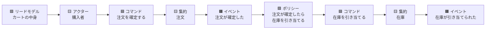

# イベントストーミング（EventStorming）

## この教材の目的

DDD では「業務の専門家と開発者が一緒にモデルを作る」ことが重要だと言われます（[[02_ユビキタス言語]]）。しかし、実際に会議室に集まっても、

- 業務の人は UML やクラス図を読めない
- 開発者は業務の全体像を知らない
- 長い要件定義書を読み合わせても、誰も全体を把握できない

ということがよく起きます。**イベントストーミング** は、この問題を **付箋と長い壁** で解決するワークショップ手法です。

この教材では、

- イベントストーミングとは何か、なぜ効くのか
- 付箋の **色と意味**（文法）
- **3つのレベル**（ビッグピクチャー・プロセスモデリング・ソフトウェア設計）
- 進め方と、結果から **境界づけられたコンテキスト・集約** を見つける方法
- 失敗しないためのコツ

を解説します。

---

## 1. イベントストーミングとは

### 1.1 定義

> **業務で起きる出来事（ドメインイベント）を、業務の専門家と開発者が一緒に付箋で壁に貼り出し、時系列に並べることで、業務の全体像とモデルを共同で発見するワークショップ手法。**

- イタリアの **Alberto Brandolini** が 2013 年ごろに考案
- DDD のコミュニティで広まり、マイクロサービスの境界を見つける手法としても使われる

### 1.2 なぜ「イベント」から始めるのか

| 理由 | 説明 |
|---|---|
| **誰でも分かる** | 「注文が確定した」「商品が発送された」は、業務の人にも開発者にも同じように分かる。専門的な表記法がいらない |
| **事実だから議論しやすい** | 「何が起きたか」は、「どう作るべきか」より合意しやすい |
| **業務の流れが自然に見える** | 時系列に並べるだけで、業務のストーリーが浮かび上がる |
| **抜けや矛盾が見つかる** | 並べてみると「この間に何か起きているはず」「部署によって順番が違う」が見える |

### 1.3 必要なもの

- **長い壁**（数メートル以上）と模造紙。オンラインなら Miro・FigJam などのホワイトボードツール
- **色の違う付箋** を大量に
- **正しい人たち**：業務の専門家（質問に答えられる人）と開発者、可能なら企画・UX・運用
- **ファシリテーター**

> Brandolini は「**無制限のモデリング空間**」が重要だと強調しています。壁が狭いと、人は無意識に「書けることを減らして」しまうからです。

---

## 2. 付箋の色と意味（文法）

イベントストーミングでは、付箋の色に意味があります。一般的な割り当ては次のとおりです（ツールやチームによって多少の違いがあります）。

| 色 | 要素 | 書き方 | 例 |
|---|---|---|---|
| 🟧 **オレンジ** | **ドメインイベント** | **過去形**。業務にとって意味のある出来事 | 「注文が確定した」「支払いが完了した」 |
| 🟦 **青** | **コマンド** | 命令形。イベントを引き起こす意図 | 「注文を確定する」 |
| 🟨 **小さい黄色** | **アクター** | コマンドを出す人・役割 | 「購入者」「倉庫スタッフ」 |
| 🟪 **紫（ライラック）** | **ポリシー** | 「〜が起きたら、〜する」という反応のルール | 「支払いが完了したら、出荷を指示する」 |
| 🟩 **緑** | **リードモデル** | アクターが判断するために見る情報 | 「在庫数」「カートの中身と合計金額」 |
| 🩷 **ピンク** | **外部システム** | 自社の外にあるシステム | 「決済代行サービス」「配送業者の API」 |
| 🟨 **大きい黄色** | **集約** | コマンドを受け取り、イベントを発生させるもの。**最後に** 加える | 「注文」「在庫」 |
| 🟥 **赤（斜めに貼る）** | **ホットスポット** | 疑問・意見の対立・問題点。**議論を止めずに印を付けて先に進む** | 「キャンセルはいつまで可能？」「部署で手順が違う」 |

### 2.1 基本の文型

これらの要素は、次の文型でつながります。



> **アクターがリードモデルを見て、コマンドを出す。コマンドを受けた集約がイベントを発生させる。ポリシーがイベントに反応して、次のコマンドを出す。**

これを繰り返すことで、業務の流れ全体がつながっていきます。

---

## 3. 3つのレベル

イベントストーミングには、目的に応じて **3つのレベル** があります。

| レベル | 目的 | 範囲 | 参加者 | 使う付箋 |
|---|---|---|---|---|
| **ビッグピクチャー** | 業務全体を **探索** し、問題点と境界を見つける | 事業全体（広い・あいまい） | 多くの部署の人（10〜30人） | 主にイベントとホットスポット（＋アクター・外部システム） |
| **プロセスモデリング** | 1つの業務プロセスを **始めから終わりまで** 詳しく描く | 1つのプロセス（開始と終了が明確） | そのプロセスに関わる人 | イベント・コマンド・アクター・ポリシー・リードモデル・外部システム |
| **ソフトウェア設計** | プロセスを **ソフトウェアの設計** に落とす | 1つのコンテキスト | 開発者中心＋業務の専門家 | 上記すべて＋**集約** |

最初から全部やる必要はありません。**ビッグピクチャーで全体を見て、重要なところ（コアドメイン）だけプロセスモデリング・ソフトウェア設計に進む** のが一般的です（→ [[05_コアドメインとサブドメイン]]）。

---

## 4. ビッグピクチャーの進め方

### ステップ1：混沌とした探索（Chaotic Exploration）

- 全員が **一斉に**、思いつくドメインイベント（オレンジ）を **過去形で** 書いて壁に貼る
- 順番は気にしない。重複も気にしない。**量を出すことが目的**
- 「〜した」「〜された」と過去形で書くよう、ファシリテーターが促す

### ステップ2：時系列に並べる（Enforcing the Timeline）

- 貼られたイベントを、左から右へ **時間の流れ** に沿って並べ直す
- 重複をまとめ、表現のゆれ（「受注した」と「注文を受けた」）を議論する → **ユビキタス言語** が生まれる
- 並べられないもの・矛盾するものには **ホットスポット**（赤）を貼る

### ステップ3：重要なイベントを見つける（Pivotal Events）

- 業務の流れを大きく区切る **重要なイベント**（ピボタルイベント）を見つける
  - 例：「注文が確定した」「商品が発送された」「請求が締められた」
- これらは、**業務のフェーズの切れ目** であり、**境界づけられたコンテキストの境目の候補** になる

### ステップ4：人と外部システムを加える

- 誰がイベントを引き起こすか（アクター）、どの外部システムが関わるか（ピンク）を加える

### ステップ5：問題と機会を探す

- ホットスポットを見直し、**どこに問題があるか**（手作業が多い・ミスが多い・部署間で揉める）を議論する
- 参加者に投票してもらい、**最も重要な問題・機会** を決める

---

## 5. 結果からモデルを見つける

### 5.1 境界づけられたコンテキストの候補

壁を眺めると、イベントの **まとまり** が見えてきます。

```text
 [カートに入れた][注文が確定した][支払いが完了した] | [出荷が指示された][梱包された][発送された] | [請求書が発行された][入金が確認された]
 ←────────── 注文 ──────────→                  ←────────── 物流 ──────────→         ←────── 会計 ──────→
```

- **ピボタルイベント** で区切られたまとまり
- **同じ言葉が違う意味で使われ始める** ところ（注文の「商品」は価格を持つが、物流の「商品」は重さとサイズを持つ）
- **担当する部署・人が変わる** ところ

これらが、境界づけられたコンテキストの境目の候補です（→ [[04_境界づけられたコンテキスト]]）。

### 5.2 集約の候補

ソフトウェア設計レベルでは、**同じ種類のコマンドを受け取り、関連するイベントを発生させるもの** をまとめて、集約（大きい黄色）を置きます。

- 「注文を確定する」「注文をキャンセルする」「配送先を変更する」 → **注文** 集約
- 集約は **最後に** 置くのがコツ。最初から「注文クラス」のようなデータ中心の発想で始めると、[[06_論理コンポーネントの見つけ方]] で見た **エンティティの罠** に陥りやすい

集約の詳細は [[04_集約とリポジトリ]] を参照してください。

### 5.3 その他の成果

| 成果 | 使い道 |
|---|---|
| ドメインイベントの一覧 | イベント駆動設計のイベント候補（→ [[05_ドメインイベント]]、40_イベント駆動設計） |
| ポリシー | 業務ルール・自動化の候補。サービス間連携（コレオグラフィ）の候補 |
| リードモデル | 画面・クエリの候補（→ CQRS のクエリ側） |
| ホットスポット | 要件の未決事項リスト、リスク一覧 |
| 用語の合意 | ユビキタス言語の辞書 |

---

## 6. うまく進めるコツ

| コツ | 理由 |
|---|---|
| **最初は文法を厳密にしない** | ビッグピクチャーではオレンジと赤だけで十分。色のルールを最初から細かく説明すると、手が止まる |
| **過去形にこだわる** | 「注文確定」ではなく「注文が確定した」。過去形にすると「本当に起きた事実か」が明確になる |
| **議論で止まったらホットスポット** | 意見が割れたら赤を貼って先に進む。全体を見てから戻る方が効率的 |
| **業務の専門家に書いてもらう** | 開発者が代筆すると、業務の言葉が開発者の言葉に置き換わってしまう |
| **椅子を片付ける** | 立って壁の前を動き回る方が、議論が活発になる（オンラインなら全員がカーソルを動かす） |
| **結果を写真・ボードで残す** | 壁はすぐ片付けられてしまう。成果はその場で記録する |
| **一度で完成させようとしない** | 理解が深まるたびに、何度でも行う |

---

## 7. ありがちな誤解

### 7.1 「イベントストーミングはイベント駆動アーキテクチャのための手法」

**誤りです。** ドメインイベントを **業務を理解するための道具** として使っているだけで、結果のシステムがイベント駆動である必要はありません。ただし、イベント駆動を採用するなら、そのまま設計に活かせます。

### 7.2 「開発者だけでやってもよい」

**効果が大きく下がります。** 最大の価値は、**業務の専門家と開発者の認識のずれ** を見つけることです。業務の専門家がいないと、開発者の思い込みを付箋にするだけになります。

### 7.3 「付箋の色を正しく使わないといけない」

**目的次第です。** 色は共通言語として便利ですが、ビッグピクチャーではオレンジと赤だけで十分です。文法の厳密さより、**全員が参加できること** を優先します。

---

## 8. まとめ

- **イベントストーミング**：Alberto Brandolini が考案。業務の出来事（ドメインイベント）を付箋で壁に貼り、業務の専門家と開発者が一緒に業務を発見するワークショップ
- 付箋の文法：**オレンジ＝イベント（過去形）・青＝コマンド・黄＝アクター・紫＝ポリシー・緑＝リードモデル・ピンク＝外部システム・大きい黄＝集約・赤＝ホットスポット**
- 基本の文型：**アクター → コマンド → 集約 → イベント → ポリシー → 次のコマンド**
- 3つのレベル：**ビッグピクチャー**（全体の探索）→ **プロセスモデリング**（1プロセスの詳細）→ **ソフトウェア設計**（集約まで）
- **ピボタルイベント** や **言葉の意味が変わるところ** が、境界づけられたコンテキストの候補になる
- 集約は **最後に** 置く。データ中心の発想（エンティティの罠）を避けるため

次は [[02_ドメインストーリーテリングと例示マッピングとキャンバス]] で、イベントストーミング以外のモデリング手法を学びます。

---

## 参考資料

- Alberto Brandolini『Introducing EventStorming』（Leanpub）
- [Event storming（Wikipedia）](https://en.wikipedia.org/wiki/Event_storming)
- [EventStorming Guide: From Sticky Notes to .NET Code（Milan Jovanović）](https://milanjovanovic.tech/blog/eventstorming-guide)
- [Design Level Event Storming with examples（Mr. Picky）](https://mrpicky.dev/design-level-event-storming-with-examples/)
- [event-storming-cheatsheet（GitHub）](https://github.com/wwerner/event-storming-cheatsheet)
- [awesome eventstorming（GitHub）](https://github.com/forkarea/awesome-eventstorming)
- [Event Storming: The Complete Guide（Qlerify）](https://www.qlerify.com/post/event-storming-the-complete-guide)
