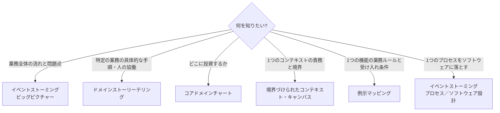

# ドメインストーリーテリング・例示マッピング・キャンバス

## この教材の目的

[[01_イベントストーミング]] は強力ですが、唯一のモデリング手法ではありません。目的や場面によって、もっと向いている手法があります。

この教材では、DDD の実践でよく使われる次の手法を紹介し、**いつ、どれを使うか** を整理します。

| 手法 | ひとことで | 主な目的 |
|---|---|---|
| **ドメインストーリーテリング** | 業務の人に「物語」を語ってもらい、絵文字で記録する | 具体的な業務の流れを理解する |
| **例示マッピング** | 1つのストーリーを「ルール」と「具体例」に分解する | 業務ルールと受け入れ条件をはっきりさせる |
| **コアドメインチャート** | サブドメインを「差別化 × 複雑さ」で配置する | 投資の優先順位を決める |
| **境界づけられたコンテキスト・キャンバス** | 1つのコンテキストの設計を1枚にまとめる | コンテキストの責務と境界を文書化する |
| **DDD スターターモデリングプロセス** | 上記の手法を並べた手順書 | DDD をどこから始めるかの道しるべ |

---

## 1. ドメインストーリーテリング（Domain Storytelling）

### 1.1 概要

> **業務の専門家に、実際の仕事の流れを「物語」として語ってもらい、それを簡単な絵文字の言語で記録していく手法。**

- ドイツの **Stefan Hofer** と **Henning Schwentner** が体系化（書籍『Domain Storytelling』2021年）
- 人が「話を聞いて新しい言葉を覚える」という自然な能力を活かす
- ホワイトボードと付箋、または無料の専用ツール（Egon.io）だけで始められる

### 1.2 絵文字の言語

ドメインストーリーは、3種類の要素だけで描きます。

| 要素 | 表し方 | 例 |
|---|---|---|
| **アクター** | 人のアイコン（人・役割・システム） | 顧客、受付担当、在庫システム |
| **ワークオブジェクト** | 物のアイコン（書類・メール・物・情報） | 注文書、見積書、商品、メール |
| **アクティビティ** | アクターから伸びる **矢印と動詞** | 「送る」「確認する」「登録する」 |

矢印には **番号** を振り、順番を表します。

```text
 ① 顧客 ──「依頼する」──▶ [見積依頼] ──▶ 営業担当
 ② 営業担当 ──「確認する」──▶ [在庫] ──（在庫システムで）
 ③ 営業担当 ──「作成する」──▶ [見積書]
 ④ 営業担当 ──「送る」──▶ [見積書] ──▶ 顧客
 ⑤ 顧客 ──「承認する」──▶ [見積書]
```

1つ1つの文が **「誰が・何を・どうする（・誰に）」** という単純な形になっているのが特徴です。

### 1.3 進め方とコツ

- 業務の専門家が語り、**モデレーター** が絵文字で描く。描きながら「この後どうなりますか？」と質問する
- **具体的な1つのケース** を語ってもらう（「普通の注文の場合」「返品がある場合」）。分岐を1つの図に詰め込まない
- 物語ごとに **範囲**（粒度・現状か理想か・純粋な業務か IT を含むか）を決めておく
  - **現状（As-is）** の物語で問題を見つけ、**理想（To-be）** の物語で新しい業務を設計する

### 1.4 イベントストーミングとの違い

| | ドメインストーリーテリング | イベントストーミング |
|---|---|---|
| 起点 | **人の行動**（誰が何をするか） | **出来事**（何が起きたか） |
| 参加人数 | 少人数（業務の専門家数名） | 多人数も可（ビッグピクチャーは数十人） |
| 得意なこと | 1つの具体的な業務の流れを正確に描く。**人と人の協働** を描く | 業務全体を広く探索する。**問題点と境界** を見つける |
| 図の形 | 番号付きの矢印でつながる絵 | 時系列に並んだ付箋の帯 |

**ビッグピクチャーで全体を見て、気になる業務をドメインストーリーテリングで深掘りする**、のように組み合わせることもできます。

---

## 2. 例示マッピング（Example Mapping）

### 2.1 概要

> **1つのユーザーストーリーを、「ルール」と「具体例」と「質問」に分解し、受け入れ条件をはっきりさせる短い会話の手法。**

- BDD（振る舞い駆動開発）のツール Cucumber の共同作者 **Matt Wynne** が 2015 年ごろに考案
- **1つのストーリーにつき約 25〜30 分** で行う
- 参加者は「3人の仲間（Three Amigos）」：**業務（プロダクトオーナー）・開発・テスト** の視点を持つ人

### 2.2 4色のカード

| 色 | 要素 | 例（ストーリー：「会員はポイントで支払える」） |
|---|---|---|
| 🟨 **黄色** | **ストーリー**（一番上に1枚） | 会員はポイントで支払える |
| 🟦 **青** | **ルール**（受け入れ条件。ストーリーの下に並べる） | ・1ポイント＝1円として使える ・ポイントと現金を併用できる ・期限切れのポイントは使えない |
| 🟩 **緑** | **具体例**（各ルールの下に並べる） | ・500ポイント持っていて800円の商品 → 500ポイント＋300円 ・期限が昨日のポイント100 → 使えない |
| 🟥 **赤** | **質問**（その場で答えが出ないこと） | ・セール品にもポイントは使える？ ・ポイントで払った分にもポイントは付く？ |

```text
                    🟨 会員はポイントで支払える
   ┌──────────────────┬──────────────────┬──────────────────┐
  🟦 1pt＝1円        🟦 現金と併用できる  🟦 期限切れは使えない
  🟩 1000pt→1000円引  🟩 500pt＋300円      🟩 昨日期限の100pt→不可
                     🟩 全額ポイントも可   🟩 今日期限の100pt→可

  🟥 セール品にも使える？   🟥 ポイント払い分にもポイントは付く？
```

### 2.3 カードの色から分かること

| 状態 | 意味 | 対応 |
|---|---|---|
| **赤が多い** | まだ分からないことが多い | 開発を始める前に、質問を解決する |
| **青が多い** | ストーリーが大きく複雑 | ストーリーを分割する |
| **緑が多い**（1つのルールに） | そのルールが複雑 | ルールを分割する |
| **赤がなく、青と緑がそろっている** | よく理解できている | 開発を始めてよい |

### 2.4 設計とのつながり

- **ルール（青）** は、ドメインモデルの **不変条件** や **業務ルール** の候補になる（→ [[04_集約とリポジトリ]]）
- **具体例（緑）** は、そのまま **テストケース**（Given-When-Then）になる（→ [[03_テストと設計の関係]]）
- 具体例の中で使われる言葉は、**ユビキタス言語** の候補になる（→ [[02_ユビキタス言語]]）

イベントストーミングやドメインストーリーテリングが **業務の流れ** を描くのに対し、例示マッピングは **1つの機能のルール** を掘り下げる手法です。

---

## 3. 境界づけられたコンテキスト・キャンバス

### 3.1 概要

> **1つの境界づけられたコンテキストの設計を、決まった項目に沿って1枚にまとめるテンプレート。**

- DDD のコミュニティ **DDD Crew**（Nick Tune ほか）が GitHub で公開している
- イベントストーミングなどで見つけたコンテキストの候補を、**設計として固める** ときに使う

### 3.2 主な項目

| 項目 | 書くこと |
|---|---|
| **名前** | コンテキストの名前 |
| **目的** | このコンテキストが存在する理由（業務の言葉で） |
| **戦略的分類** | コア／支援／汎用（→ [[05_コアドメインとサブドメイン]]）、事業上の役割 |
| **ドメインの役割** | 例：仕様を決める・実行する・分析する・ゲートウェイ |
| **受け取るメッセージ** | 外から受け取るコマンド・クエリ・イベント（誰から） |
| **送り出すメッセージ** | 外へ送るコマンド・クエリ・イベント（誰へ） |
| **ユビキタス言語** | このコンテキストで使う重要な用語とその意味 |
| **業務上の判断** | このコンテキストが担う主な業務ルール・判断 |
| **前提と未解決の質問** | 確証のない前提、決まっていないこと |

### 3.3 何に役立つか

- コンテキストの **責務と境界** をチームで合意できる
- **受け取る／送り出すメッセージ** を書くことで、他のコンテキストとの依存関係が明確になる（→ コンテキストマップ：[[03_境界づけられたコンテキストとコンテキストマップ]]）
- マイクロサービスやモジュラーモノリスの **モジュールの設計書** としても使える

---

## 4. コアドメインチャート

サブドメインを **「事業上の差別化」×「モデルの複雑さ」** の2軸に配置し、コア・支援・汎用を可視化する道具です。これも DDD Crew が公開しています。

詳しくは [[05_コアドメインとサブドメイン]] の「コアドメインチャートで可視化する」を参照してください。

---

## 5. DDD スターターモデリングプロセス — どこから始めるか

### 5.1 概要

DDD Crew は、「DDD を始めたいが、どこから手を付ければいいか分からない」という人のために、手法を順番に並べた **DDD スターターモデリングプロセス**（DDD Starter Modelling Process）を公開しています。

> あくまで **最初の一歩のための直線的な手順**。慣れてきたら、行ったり来たりしてよい。

### 5.2 8つのステップ

| # | ステップ | やること | 代表的な手法 |
|---|---|---|---|
| 1 | **理解する**（Understand） | 事業の目的・顧客・ビジネスモデルを理解する | ビジネスモデルキャンバス、インパクトマッピング |
| 2 | **発見する**（Discover） | 業務の流れを、業務の専門家と一緒に発見する | **イベントストーミング**、**ドメインストーリーテリング** |
| 3 | **分解する**（Decompose） | 業務をサブドメインに分ける | ビッグピクチャーのピボタルイベント、ビジネスケイパビリティ |
| 4 | **戦略を立てる**（Strategize） | どこに投資するかを決める | **コアドメインチャート** |
| 5 | **つなぐ**（Connect） | サブドメイン同士がどう連携するかを描く | ドメインメッセージフロー図 |
| 6 | **組織する**（Organise） | チームの構成を設計に合わせる | チームトポロジー |
| 7 | **定義する**（Define） | 各コンテキストの責務を定義する | **境界づけられたコンテキスト・キャンバス** |
| 8 | **コードにする**（Code） | ドメインモデルを実装する | **例示マッピング**、集約の設計キャンバス、TDD |

ステップ6の「組織する」は、41_アーキテクチャ の [[04進化型アーキテクチャとリバースコンウェイの法則]]（コンウェイの法則・チームトポロジー）とつながります。

---

## 6. どの手法を、いつ使うか



| 場面 | おすすめの手法 |
|---|---|
| 新しいプロジェクトの立ち上げ。業務の全体像が誰にも分からない | イベントストーミング（ビッグピクチャー） |
| 既存業務をシステム化する。担当者のやり方を正確に知りたい | ドメインストーリーテリング（現状） |
| 「どこを内製し、どこを買うか」を決めたい | コアドメインチャート |
| マイクロサービス・モジュールの境界と責務を固めたい | 境界づけられたコンテキスト・キャンバス |
| スプリントで着手する前に、ストーリーの理解をそろえたい | 例示マッピング |
| DDD を始めたいが、何から手を付ければよいか分からない | DDD スターターモデリングプロセス |

---

## 7. ありがちな誤解

### 7.1 「手法を1つ選んで、それだけを使う」

**誤りです。** 手法ごとに得意な範囲（広さ・深さ）が違います。広く探索する手法と、深く掘り下げる手法を組み合わせます。

### 7.2 「モデリングは設計者が一人でやるもの」

**誤りです。** ここで紹介した手法はすべて、**業務の専門家と開発者が一緒に** 行うことを前提にしています。モデリングの価値の多くは、**認識のずれを見つける会話** そのものにあります。

### 7.3 「ワークショップの成果物を完璧に残すことが目的」

**誤りです。** 目的は **共通理解** を作ることです。成果物は記録として残しますが、理解が深まれば何度でも描き直します。

---

## 8. まとめ

- **ドメインストーリーテリング**（Hofer & Schwentner）：業務の人に物語を語ってもらい、**アクター・ワークオブジェクト・アクティビティ** の絵文字で記録する。具体的な業務の流れと、人の協働を描くのが得意
- **例示マッピング**（Matt Wynne）：1つのストーリーを **黄＝ストーリー・青＝ルール・緑＝具体例・赤＝質問** に分解する。具体例はそのままテストになる
- **境界づけられたコンテキスト・キャンバス**（DDD Crew）：1つのコンテキストの目的・分類・受け取る／送り出すメッセージ・用語を1枚にまとめる
- **コアドメインチャート**：差別化 × 複雑さで投資配分を決める
- **DDD スターターモデリングプロセス**：理解 → 発見 → 分解 → 戦略 → 接続 → 組織 → 定義 → コード の8ステップで、手法を組み合わせる道しるべ

---

## 参考資料

- Stefan Hofer, Henning Schwentner『Domain Storytelling』（Addison-Wesley, 2021）
- [Domain Storytelling with Stefan Hofer and Henning Schwentner（InfoQ ポッドキャスト）](https://www.infoq.com/podcasts/domain-storytelling/)
- [Domain Storytelling（DDD Academy）](https://ddd.academy/domain-storytelling/)
- [Introducing Example Mapping（Matt Wynne）](https://medium.com/@mattwynne/introducing-example-mapping-42ccd15f8adf)
- [Example Mapping（Cucumber 公式）](https://cucumber.io/docs/bdd/example-mapping/)
- [Bounded Context Canvas（DDD Crew, GitHub）](https://github.com/ddd-crew/bounded-context-canvas)
- [DDD Starter Modelling Process（DDD Crew）](https://ddd-crew.github.io/ddd-starter-modelling-process/)
- [Domain-Driven Design Crew（GitHub）](https://github.com/ddd-crew)
