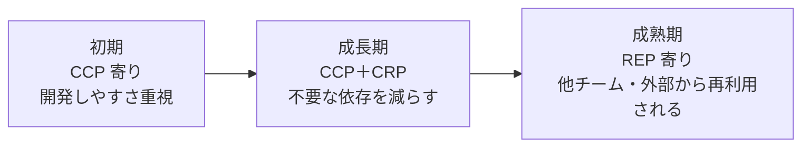

# 凝集の3原則（REP・CCP・CRP）とテンションダイアグラム

## この章の目的

[[01_パッケージ設計の原則]] では、6つのパッケージ原則を1本で概観しました。
この章では、そのうち **「何を1つのパッケージ（コンポーネント）にまとめるか」** を決める **凝集の3原則** を掘り下げます。

- 3原則それぞれの意味と、実務での具体例
- 3原則が **互いに引っ張り合う** 関係（テンションダイアグラム）
- プロジェクトの **成長段階** によって、重視すべき原則が変わること

Robert C. Martin『Clean Architecture』第13章「コンポーネントの凝集性」を骨格にしています。ここでいう **コンポーネント** は、npm パッケージ・Java の jar・.NET のアセンブリのような **リリースの単位** を指しますが、リポジトリ内のモジュール（ディレクトリ）にも同じ考え方が使えます。

---

## 1. 3つの原則

### 1.1 REP：再利用・リリース等価の原則（Reuse/Release Equivalence Principle）

> **再利用の単位は、リリースの単位と等しい。**

- 他の人に再利用してもらうなら、**バージョン番号を付けてリリースし、変更履歴を管理する** 必要がある
- だから、1つのパッケージにまとめるクラスやモジュールは、**一緒にリリースして意味のあるもの** でなければならない
- 「たまたま同じリポジトリにある、無関係な機能の寄せ集め」は REP 違反

```text
✕ REP 違反：@company/utils
   ├─ date/        ← 日付処理
   ├─ payment/     ← 決済 SDK のラッパー
   └─ image/       ← 画像変換
   → 日付処理だけ使いたい人も、決済の変更のたびにバージョンが上がる

○ REP を満たす：
   @company/date-utils
   @company/payment-client
   @company/image-tools
```

### 1.2 CCP：閉鎖性共通の原則（Common Closure Principle）

> **同じ理由・同じタイミングで変更されるものは、同じコンポーネントにまとめる。異なる理由・異なるタイミングで変更されるものは、別のコンポーネントに分ける。**

- **単一責任の原則（SRP）をコンポーネント単位にした** もの
- 「1つの変更要求が来たとき、**直すコンポーネントが1つで済む**」ようにする
- 保守性を重視する原則。多くのアプリでは、**再利用性より保守性の方が重要** なので、CCP が最も重要な原則になることが多い

```text
「消費税の計算方法が変わった」という変更要求に対して
✕ tax-calc は utils に、税率は config に、表示は ui に散らばっている → 3つ直す
○ tax/ コンポーネントに計算・税率・表示用フォーマッタがまとまっている → 1つ直す
```

### 1.3 CRP：全体再利用の原則（Common Reuse Principle）

> **コンポーネントの利用者に、不要なものへの依存を強制してはならない。**

- 一緒に使われるものは一緒にまとめ、**一緒に使われないものは分ける**
- **インターフェース分離の原則（ISP）をコンポーネント単位にした** もの
- あるコンポーネントに依存すると、その **中の一部しか使っていなくても**、残りの部分の変更のたびに再ビルド・再テスト・再デプロイが必要になる

```text
✕ CRP 違反：@company/ui
   ├─ Button, Input       ← 全員が使う
   └─ RichTextEditor      ← 1画面しか使わない。巨大な依存ライブラリを含む
   → Button だけ使いたいアプリも、エディタの依存ライブラリまでインストールする

○ CRP を満たす：
   @company/ui-basic          （Button, Input）
   @company/ui-rich-editor    （RichTextEditor）
```

### 1.4 3原則の性格

| 原則 | 性格 | コンポーネントの大きさ | 守るもの |
|---|---|---|---|
| **REP** | まとめる方向（包含的） | **大きく** する | 再利用する人の便利さ |
| **CCP** | まとめる方向（包含的） | **大きく** する | 保守する人の便利さ |
| **CRP** | 分ける方向（排他的） | **小さく** する | 利用者を不要な変更から守る |

REP と CCP は「まとめろ」、CRP は「分けろ」と言っています。**3つを同時に完全に満たすことはできません**。

---

## 2. テンションダイアグラム

### 2.1 図

Martin は、3原則の引っ張り合いを **三角形の図**（テンションダイアグラム）で表しました。

```text
                         REP
                   （再利用のためにまとめる）
                        ／＼
                       ／  ＼
  再利用しにくい      ／    ＼    不要なリリースが多すぎる
  （REP を捨てた代償）／      ＼  （CRP を捨てた代償）
                    ／        ＼
                   ／          ＼
                CCP ──────────── CRP
          （保守のためにまとめる）  （不要な依存を避けるために分ける）

                  変更の影響を受けるコンポーネントが多すぎる
                         （CCP を捨てた代償）
```

**辺は、反対側の頂点の原則を捨てたときに払う代償** を表します。

| 重視する原則 | 捨てる原則 | 払う代償 |
|---|---|---|
| REP ＋ CCP | CRP | **不要なリリースが多すぎる**：大きなコンポーネントになり、使っていない部分の変更でもバージョンが上がり、利用者は追従を強いられる |
| CCP ＋ CRP | REP | **再利用しにくい**：変更しやすく不要な依存もないが、リリースの単位として整理されていないので、外部の人が再利用しにくい |
| REP ＋ CRP | CCP | **変更の影響を受けるコンポーネントが多すぎる**：細かく分かれていて再利用しやすいが、1つの変更要求で多くのコンポーネントを直す必要がある |

### 2.2 どこに位置するかは、プロジェクトの段階で変わる

Martin は、**三角形のどこに位置すべきかは、プロジェクトの成熟度によって変わる** と述べています。



| 段階 | 重視する原則 | 理由 |
|---|---|---|
| **初期** | **CCP**（＋CRP） | 何が再利用されるかまだ分からない。まずは **変更しやすさ** が最優先。再利用性（REP）は後回しでよい |
| **成長期** | CCP ＋ CRP | 利用者が増え、不要な依存による再ビルド・再デプロイが問題になってくる |
| **成熟期** | **REP** の比重が増える | 他のチームや外部から再利用されるようになり、リリースの単位としての整理が重要になる |

> 最初から「再利用できるように」と細かく分けたパッケージを作ると、変更のたびに多くのパッケージを直すことになります（REP ＋ CRP で CCP を捨てた状態）。**再利用は、実際に再利用されるようになってから** 考えるのが現実的です。

---

## 3. 実務での判断

### 3.1 ディレクトリ・モジュールに当てはめる

npm パッケージとして公開しない、アプリ内部のモジュール（ディレクトリ）でも、3原則は役立ちます。

| 原則 | アプリ内部での問い |
|---|---|
| REP | このモジュールの公開 API（`index.ts`）は、**まとまった意味のある単位** になっているか？ |
| CCP | 1つの業務の変更要求で、**直すモジュールは1つで済む** か？ |
| CRP | このモジュールを使う側は、**中身の大部分を使っている** か？ 一部しか使わないなら分けるべきでは？ |

### 3.2 よくある症状と、どの原則の問題か

| 症状 | 原則 | 対策 |
|---|---|---|
| 小さな機能追加で、いつも5つのモジュールを直している | **CCP 違反** | 一緒に変わるものを1つのモジュールに集める |
| `common/` を import すると、関係ない巨大ライブラリまで読み込まれる | **CRP 違反** | 用途ごとにモジュールを分ける |
| 社内ライブラリのバージョンが毎週上がり、追従が大変 | **CRP 違反**（REP＋CCP 寄りすぎ） | 変更頻度の違う部分を別パッケージに分ける |
| 共通化したパッケージが細かすぎて、どれを使えばいいか分からない | **REP 違反** | 意味のあるリリース単位にまとめ直す |

### 3.3 バランス結合との関係

CCP（同じ理由で変わるものをまとめる）と CRP（一緒に使われないものを分ける）は、[[03_バランス結合_強度・距離・変動性]] でいう **「強く結びつくものは近くに、弱く結びつくものは遠くに」** を、リリースの単位で表したものと見ることができます。

---

## 4. ありがちな誤解

### 4.1 「3原則をすべて満たすのが理想」

**不可能です。** REP・CCP はまとめる方向、CRP は分ける方向に働くので、必ずどこかで妥協します。

### 4.2 「最初から再利用しやすく作るべき」

**多くの場合、逆効果です。** 初期は CCP（変更しやすさ）を優先し、実際に再利用されるようになってから REP を考えます。

### 4.3 「凝集の原則は npm パッケージだけの話」

**誤りです。** アプリ内のディレクトリ・モジュールの切り方にもそのまま使えます。

---

## まとめ

- **REP**（再利用・リリース等価）：再利用の単位＝リリースの単位。意味のあるまとまりでリリースする
- **CCP**（閉鎖性共通）：同じ理由で変わるものをまとめる。SRP のコンポーネント版。**多くのアプリで最重要**
- **CRP**（全体再利用）：利用者に不要な依存を強制しない。ISP のコンポーネント版
- REP・CCP は **大きくする**、CRP は **小さくする** 方向に働き、**テンションダイアグラム** で引っ張り合う
- 辺は「捨てた原則の代償」：**不要なリリースが多すぎる／再利用しにくい／変更の影響が広すぎる**
- **初期は CCP 寄り、成熟するにつれて REP 寄り** に移る

### 次に進む章

- [[03_結合の3原則と循環依存の断ち切り方]] — コンポーネント同士の「つながり方」の原則

---

## 参考資料

- Robert C. Martin『Clean Architecture』第13章「コンポーネントの凝集性」
- [Clean Architecture: Component Cohesion Principles（Medium）](https://medium.com/@anca.rebeca/clean-architecture-component-cohesion-principles-8c9722abd9bd)
- [clean-architecture/part-4-component-principles.md（serodriguez68, GitHub）](https://github.com/serodriguez68/clean-architecture/blob/master/part-4-component-principles.md)
- [Clean Architecture - Chapter 13（letscodethemup）](https://www.letscodethemup.com/clean-architecture-chapter-13-component-cohesion/)
- [Component Principles: The concept behind the code（DEV Community）](https://dev.to/rubemfsv/component-principles-the-concept-behind-the-code-dn6)
