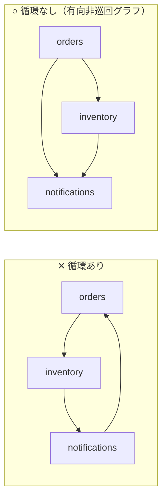
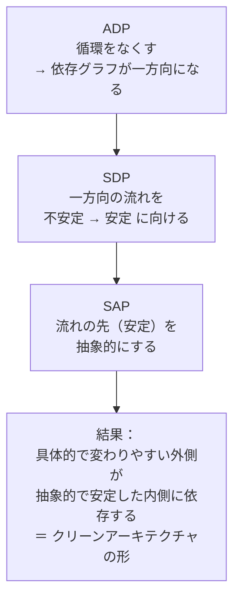

# 結合の3原則（ADP・SDP・SAP）と循環依存の断ち切り方

## この章の目的

[[02_凝集の3原則とテンションダイアグラム]] では「何をまとめるか」を学びました。
この章では、まとめたコンポーネント同士を **どうつなぐか** を決める **結合の3原則** を掘り下げます。

- **ADP**（非循環依存の原則）と、**循環依存を断ち切る具体的な方法**
- **SDP**（安定依存の原則）：依存は安定した方へ向ける
- **SAP**（安定度・抽象度等価の原則）：安定したものほど抽象的に
- 3原則をどう実務で確かめるか

Robert C. Martin『Clean Architecture』第14章「コンポーネントの結合」を骨格にしています。安定度・抽象度の **計算方法とグラフの読み方** は、41_アーキテクチャ の [[02_結合の指標_求心性遠心性と主系列からの距離]] に詳しくまとめているので、この章では **設計判断と直し方** に重点を置きます。

---

## 1. ADP：非循環依存の原則（Acyclic Dependencies Principle）

### 1.1 原則

> **コンポーネントの依存グラフに、循環があってはならない。**



### 1.2 循環があると何が困るのか

| 問題 | 説明 |
|---|---|
| **実質的に1つの巨大なコンポーネントになる** | 循環に含まれるコンポーネントは、どれか1つを変えると全部に影響しうる。分けた意味がない |
| **単独でテスト・ビルドできない** | `orders` をテストするには `inventory` と `notifications` も必要で、`notifications` には `orders` が必要… |
| **リリースの順番が決められない** | どれを先にリリースすべきか決まらない。Martin はこれを「**翌朝症候群**」（帰る前に動いていたコードが、翌朝誰かの変更で動かなくなる）の原因として説明している |
| **言語・ツールでの問題** | JavaScript の ESM では、循環 import によって **初期化前の値が `undefined` になる** バグが起きることがある |

### 1.3 循環を断ち切る2つの方法

Martin は、循環を断ち切る方法として次の2つを挙げています。

#### 方法1：依存性逆転（DIP）を使う

依存の向きを、**インターフェースを挟んで逆転** させます。

```text
✕ 循環
  orders ──→ notifications （注文確定時に通知を送る）
  notifications ──→ orders （通知文面に注文情報を使う）

○ DIP で逆転
  orders ──→ notifications
  notifications は orders を直接知らず、
  自分が定義した「OrderSummary」インターフェースだけを知る
  orders が OrderSummary を実装して渡す
```

```typescript
// notifications/index.ts（notifications が欲しい形を自分で定義する）
export interface OrderSummary { orderId: string; customerEmail: string; total: number }
export function sendOrderConfirmation(order: OrderSummary) { ... }

// orders/placeOrder.ts（orders → notifications の一方向だけ）
import { sendOrderConfirmation } from "../notifications";
sendOrderConfirmation({ orderId: o.id, customerEmail: o.customer.email, total: o.total });
```

#### 方法2：新しいコンポーネントを作る

両方が依存している部分を、**新しいコンポーネントとして切り出し**、両方からそこへ依存させます。

```text
✕ 循環
  orders ⇄ customers （互いの型を使っている）

○ 共通部分を切り出す
  orders ──→ shared-kernel ←── customers
             （CustomerId・Money など両方が使う型）
```

- 注意：切り出した `shared-kernel` が何でも入る `common` にならないよう、**本当に両方が必要とするものだけ** に絞る（→ [[02_凝集の3原則とテンションダイアグラム]] の CRP）

#### 方法3（実務でよく使う）：イベントで逆向きの通知をする

「A が B を呼ぶ」に加えて「B の出来事を A が知りたい」場合は、B が **イベントを発行し、A が購読する** 形にすると、ソースコードの依存は A → B の一方向だけになります（→ 42 の [[05_ドメインイベント]]）。

### 1.4 循環依存は「放っておくと必ず生まれる」

- 開発中のコンポーネント構成は、機能追加とともに必ず変化する
- 循環は **少しずつ、気づかないうちに** 入り込む
- だから **ツールで常に検出する** ことが重要です（→ [[06_依存ルールの自動検査]]。dependency-cruiser の `no-circular` ルール、Nx の循環検出など）

---

## 2. SDP：安定依存の原則（Stable Dependencies Principle）

### 2.1 原則

> **安定度の高い方向に依存せよ。**

ここでの「安定」は「バグがない」ではなく、**「変更しにくい」**（多くのコンポーネントから依存されているので、変えると影響が大きい）という意味です。

### 2.2 安定度の測り方

| 指標 | 意味 |
|---|---|
| **Fan-in**（求心性結合 Ca） | このコンポーネントに依存している外部のクラスの数 |
| **Fan-out**（遠心性結合 Ce） | このコンポーネントが依存している外部のクラスの数 |
| **不安定度 I** | I ＝ Fan-out ÷（Fan-in ＋ Fan-out）。**0 が最も安定、1 が最も不安定** |

計算例とグラフは 41_アーキテクチャ の [[02_結合の指標_求心性遠心性と主系列からの距離]] を参照してください。

### 2.3 なぜ安定な方へ依存するのか

```text
✕ SDP 違反
  domain（安定：多くから依存されている）──→ ui-widgets（不安定：頻繁に変わる）
  → UI の部品を変えるたびに、domain とそれに依存する全部が影響を受ける

○ SDP を満たす
  ui-widgets（不安定）──→ domain（安定）
```

- **変わりやすいもの（不安定）は、変わりにくいもの（安定）に依存してよい**
- **変わりにくいもの（安定）が、変わりやすいもの（不安定）に依存してはいけない**
- 依存グラフの矢印をたどると、**I の値が下がっていく**（不安定 → 安定）のが理想

### 2.4 SDP 違反の直し方

安定したコンポーネントが、どうしても不安定なコンポーネントの機能を使いたいときは、**DIP** を使います。

- 安定した側に **インターフェースを定義** する
- 不安定な側がそれを **実装** する
- 依存の矢印は「不安定 → 安定」に逆転する

これは 41_アーキテクチャ の [[依存性のルール]] とまったく同じ考え方です。

---

## 3. SAP：安定度・抽象度等価の原則（Stable Abstractions Principle）

### 3.1 原則

> **コンポーネントの抽象度は、その安定度と同じ程度でなければならない。**

- **安定したコンポーネントは、抽象的であるべき**（インターフェース・抽象クラスが中心）
  - 安定している（変えにくい）けれど、抽象的なら **実装を差し替えて拡張できる**（開放閉鎖の原則）
- **不安定なコンポーネントは、具体的であってよい**
  - 変えやすいので、具体的な実装を直接書いても困らない

### 3.2 SDP と SAP を合わせると

> **依存は、抽象度の高い方へ向かう。**

これは、**依存性逆転の原則（DIP）をコンポーネント単位に拡大したもの** です。

### 3.3 2つの危険ゾーン

| ゾーン | 状態 | 例 | 問題 |
|---|---|---|---|
| **苦痛ゾーン** | 安定 ＋ 具体的 | 全員が直接使う DB スキーマ、何でも入った `utils` | 変えにくいのに拡張もできない |
| **無駄ゾーン** | 不安定 ＋ 抽象的 | 誰も実装していないインターフェース群 | 誰にも使われない抽象 |

詳しくは 41_アーキテクチャ の [[02_結合の指標_求心性遠心性と主系列からの距離]] の「主系列からの距離」を参照してください。

---

## 4. 3原則のつながり



- **ADP** で依存グラフを **一方向** にし、
- **SDP** でその方向を **「変わりやすい → 変わりにくい」** にそろえ、
- **SAP** で変わりにくい側を **抽象的** にする

その結果できあがるのが、41_アーキテクチャ の [[クリーンアーキテクチャの概要]] や [[ヘキサゴナルアーキテクチャ]] の形です。結合の3原則は、これらのアーキテクチャの **理論的な裏付け** になっています。

---

## 5. 実務での確かめ方

| 確かめること | 方法 |
|---|---|
| 循環がないか（ADP） | dependency-cruiser の `no-circular`、Nx のグラフ、madge などで CI 検査 |
| 依存の向きが正しいか（SDP） | 「domain は infrastructure に依存しない」などのルールを CI で検査 |
| 安定度・抽象度のバランス（SAP） | 静的解析ツールで I・A・D を計算（Java なら JDepend、PHP なら PDepend など） |
| 全体の形 | 依存グラフを可視化して、定期的にチームで眺める |

具体的な設定例は [[06_依存ルールの自動検査]] にまとめています。

---

## 6. ありがちな誤解

### 6.1 「循環依存は少しくらいなら問題ない」

**危険です。** 循環は少しずつ広がり、気づいたときには大部分が1つの塊になっています。ツールで **ゼロを維持** するのが現実的です。

### 6.2 「すべてのコンポーネントは安定であるべき」

**誤りです。** すべてが安定（変えにくい）だと、システムは変更できなくなります。UI やアダプターのように **変わりやすい部分は、不安定であるべき** です。

### 6.3 「抽象的にすれば良い設計」

**誤りです。** 誰も依存していないのに抽象化すると **無駄ゾーン** に入ります。抽象化は **多くから依存される安定した部分** に必要です。

---

## まとめ

- **ADP**：依存グラフに循環を作らない。循環は「実質1つの巨大コンポーネント」を生む
- 循環の断ち切り方：**① DIP で向きを逆転 ② 共通部分を新しいコンポーネントに切り出す ③ イベントで逆向きの通知をする**
- **SDP**：依存は **不安定 → 安定** の向きに。安定＝変えにくい（多くから依存されている）
- **SAP**：**安定したものほど抽象的に**。SDP と合わせて「依存は抽象の方へ」＝ DIP のコンポーネント版
- 3原則を満たすと、**クリーンアーキテクチャ・ヘキサゴナルの形** が自然にできあがる
- 循環と依存の向きは、**ツールで常に検査** する

### 次に進む章

- [[04_npmパッケージとモノレポでの適用]] — パッケージ原則をモノレポで実践する

---

## 参考資料

- Robert C. Martin『Clean Architecture』第14章「コンポーネントの結合」
- [clean-architecture/part-4-component-principles.md（serodriguez68, GitHub）](https://github.com/serodriguez68/clean-architecture/blob/master/part-4-component-principles.md)
- [Clean Architecture -> PART IV: Component Principles（Medium）](https://medium.com/@mammimia/clean-architecture-part-iv-component-principles-89d3cb58c195)
- [Object-oriented metrics by Robert Martin（CodeProject）](https://www.codeproject.com/Articles/1007524/Object-oriented-metrics-by-Robert-Martin)
- [dependency-cruiser rules reference（GitHub）](https://github.com/sverweij/dependency-cruiser/blob/main/doc/rules-reference.md)
