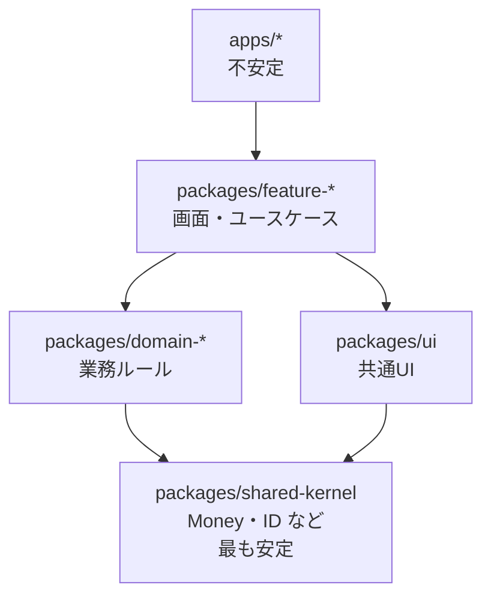

# npm パッケージ・モノレポでの適用

## この章の目的

[[02_凝集の3原則とテンションダイアグラム]] と [[03_結合の3原則と循環依存の断ち切り方]] で学んだパッケージ原則は、**JavaScript / TypeScript のモノレポ** で最も直接的に実践できます。

この章では、

- **モノレポ** とは何か、ポリレポとの違い
- **pnpm workspaces** による内部パッケージの作り方
- **`package.json` の `exports`** による公開範囲の制御（カプセル化）
- パッケージの **切り方**（パッケージ原則の当てはめ方）
- **Turborepo・Nx** によるビルドと境界の管理
- **バージョン管理** の考え方

を解説します。

---

## 1. モノレポとは

### 1.1 定義

> **複数のプロジェクト・パッケージを、1つのリポジトリで管理する方式。**

| | モノレポ | ポリレポ |
|---|---|---|
| リポジトリ | 1つ | パッケージごとに別々 |
| パッケージ間の変更 | **1つのコミット・PR** で複数パッケージを同時に変更できる | 各リポジトリで順番にリリース・更新が必要 |
| 依存のバージョン | 内部パッケージは常に最新を参照できる | 各リポジトリが別々のバージョンを参照する |
| ツール・設定 | 共通化しやすい | リポジトリごとに重複しがち |
| 注意点 | 規模が大きくなるとビルド時間・権限管理が課題。**境界を守る仕組みが必要** | 横断的な変更が大変 |

### 1.2 モノレポの典型的な構成

```text
my-monorepo/
  pnpm-workspace.yaml
  package.json
  turbo.json                 （または nx.json）
  apps/                      ← デプロイされるアプリ
    web/                     （Next.js）
    api/                     （Node.js / NestJS）
    admin/
  packages/                  ← 内部パッケージ（ライブラリ）
    domain-orders/           ← 業務のパッケージ
    domain-customers/
    ui/                      ← 共通 UI 部品
    api-client/              ← API の型とクライアント
    config-eslint/           ← 共通設定
    config-typescript/
```

- `apps/` は **不安定**（頻繁に変わる・誰からも依存されない）
- `packages/` は **安定**（apps から依存される）
- 依存は **apps → packages** の一方向（SDP）

---

## 2. pnpm workspaces で内部パッケージを作る

### 2.1 ワークスペースの宣言

```yaml
# pnpm-workspace.yaml
packages:
  - "apps/*"
  - "packages/*"
```

### 2.2 内部パッケージに依存する

```json
// apps/web/package.json
{
  "name": "@acme/web",
  "dependencies": {
    "@acme/domain-orders": "workspace:*",
    "@acme/ui": "workspace:*"
  }
}
```

- `workspace:*` は「このリポジトリ内のパッケージを使う」という指定
- import は通常の npm パッケージと同じ書き方になる：`import { placeOrder } from "@acme/domain-orders"`
- **相対パスで他のパッケージの中身を直接 import しない**（`../../packages/domain-orders/src/internal/...` は禁止）

### 2.3 依存を明示することの意味

ワークスペースでは、**`package.json` の `dependencies` に書いていないパッケージは import できない**（pnpm は厳格）。これにより、

- パッケージ間の依存関係が **`package.json` を見るだけで分かる**
- 「いつの間にか依存していた」が起きにくい
- 依存グラフが **ツールで可視化・検査** できる

---

## 3. `exports` でカプセル化する

### 3.1 問題：何でも import できてしまう

`exports` を指定しないパッケージは、**中のどのファイルでも import できてしまいます**。

```typescript
// 本来は公開していない内部実装を直接使えてしまう
import { calculateDiscountInternal } from "@acme/domain-orders/src/pricing/internal";
```

これは [[04_統合強度_侵入・機能・モデル・契約]] でいう **侵入的結合** です。

### 3.2 `exports` で公開する入口を限定する

```json
// packages/domain-orders/package.json
{
  "name": "@acme/domain-orders",
  "type": "module",
  "exports": {
    ".": {
      "types": "./dist/index.d.ts",
      "import": "./dist/index.js"
    },
    "./testing": {
      "types": "./dist/testing.d.ts",
      "import": "./dist/testing.js"
    }
  }
}
```

- `@acme/domain-orders` と `@acme/domain-orders/testing` **だけ** が import できる
- それ以外のパス（`@acme/domain-orders/src/...`）は **Node.js・TypeScript・バンドラーがエラーにする**
- つまり `exports` は、**パッケージの公開 API を言語レベルで強制する仕組み** です（→ [[01_モジュール間インターフェースの設計]]）

### 3.3 サブパスエクスポートで CRP を満たす

[[02_凝集の3原則とテンションダイアグラム]] の CRP（不要な依存を強制しない）は、サブパスエクスポートでも実現できます。

```json
// packages/ui/package.json
"exports": {
  "./button": "./dist/button/index.js",
  "./dialog": "./dist/dialog/index.js",
  "./rich-editor": "./dist/rich-editor/index.js"
}
```

- `import { Button } from "@acme/ui/button"` と書けば、リッチエディタの依存は読み込まれない
- パッケージを分けるほどではないが、**部分ごとに独立して使えるようにしたい** ときに便利

---

## 4. パッケージの切り方 — 原則の当てはめ方

### 4.1 切り方の軸

| 軸 | パッケージの例 | 当てはまる原則 |
|---|---|---|
| **業務（ドメイン）** | `domain-orders`, `domain-customers` | CCP（同じ業務の変更は1つのパッケージで） |
| **技術的な共通部品** | `ui`, `api-client`, `logger` | REP（再利用の単位としてまとめる）、CRP（使わないものを強制しない） |
| **設定** | `config-eslint`, `config-typescript` | REP |
| **アプリ** | `apps/web`, `apps/api` | 最も不安定。誰からも依存されない |

### 4.2 内部パッケージの依存ルールの例



- 依存は **上から下へ** だけ（ADP・SDP）
- `domain-*` 同士は **直接依存しない**（必要なら公開 API かイベント経由）
- `shared-kernel` は **小さく、抽象的に** 保つ（SAP）

### 4.3 よくある失敗

| 失敗 | 結果 | 対策 |
|---|---|---|
| **`packages/common` に何でも入れる** | 苦痛ゾーン。全アプリが依存し、変えられなくなる | 用途ごとに分割（CRP） |
| **最初から細かく分けすぎる** | 1つの機能追加で5パッケージを直す（CCP 違反） | 初期は粗く。必要になってから分割 |
| **`exports` を書かない** | 内部実装に直接依存される（侵入的結合） | すべての内部パッケージに `exports` を書く |
| **アプリ同士が依存する** | `apps/admin` が `apps/web` の中身を import | 共通部分を `packages/` に切り出す |

---

## 5. Turborepo と Nx

モノレポの規模が大きくなると、**ビルド時間** と **境界の管理** が課題になります。それを支援するのが Turborepo と Nx です。

| 機能 | Turborepo | Nx |
|---|---|---|
| **タスクの依存関係に沿った実行** | ✅ `turbo.json` でパイプラインを定義 | ✅ |
| **キャッシュ**（変更のないパッケージはビルドを省略） | ✅ ローカル＋リモート | ✅ ローカル＋リモート |
| **影響範囲の実行**（変更されたパッケージと、それに依存するものだけテスト） | ✅ `--filter` | ✅ `nx affected` |
| **依存グラフの可視化** | ✅ | ✅ `nx graph` |
| **モジュール境界の強制** | ❌（ESLint などを別途使う） | ✅ **`@nx/enforce-module-boundaries`**（タグで依存ルールを定義） |
| 思想 | 軽量。既存の pnpm workspaces に後から足しやすい | 多機能。コード生成・プラグインも含む |

### 5.1 Nx のモジュール境界ルール（例）

```json
// 各プロジェクトの project.json でタグを付ける
{ "tags": ["type:domain", "scope:orders"] }
```

```javascript
// eslint.config.mjs
"@nx/enforce-module-boundaries": ["error", {
  depConstraints: [
    { sourceTag: "type:app",     onlyDependOnLibsWithTags: ["type:feature", "type:ui", "type:domain"] },
    { sourceTag: "type:feature", onlyDependOnLibsWithTags: ["type:domain", "type:ui"] },
    { sourceTag: "type:domain",  onlyDependOnLibsWithTags: ["type:domain-kernel"] },
    { sourceTag: "scope:orders", onlyDependOnLibsWithTags: ["scope:orders", "scope:shared"] }
  ]
}]
```

- **種類のタグ**（app・feature・domain）で層のルール、**スコープのタグ**（orders・customers）で業務の境界のルールを表せる
- ルール違反の import は **ESLint のエラー** になる

詳しくは [[06_依存ルールの自動検査]] を参照してください。

---

## 6. バージョン管理の考え方

内部パッケージのバージョンには、大きく2つの方針があります。

| 方針 | 内容 | 向いている |
|---|---|---|
| **バージョンを付けない**（内部専用） | 常に `workspace:*` で最新を参照。リポジトリ全体で1つの状態 | アプリ内部だけで使うパッケージ。ほとんどのプロダクト開発 |
| **バージョンを付けて公開する** | Changesets などで変更履歴とバージョンを管理し、npm に公開 | 外部・他チームに配布するライブラリ（REP が重要になる段階） |

- 社内のモノレポでは、**バージョンを付けない内部パッケージ** から始めるのが一般的です
- 外部に公開する段階になったら、REP（再利用の単位＝リリースの単位）に沿って整理し、**セマンティックバージョニング** と **変更履歴** を管理します

---

## 7. ありがちな誤解

### 7.1 「モノレポにすれば自然とモジュール化される」

**誤りです。** 1つのリポジトリに入れただけでは、相対パスでどこでも import できてしまいます。**`exports`・依存の明示・境界ルール** がそろって初めてモジュール化されます。

### 7.2 「パッケージは細かいほど再利用しやすい」

**初期には逆効果です。** CCP（同じ理由で変わるものはまとめる）を優先し、実際に再利用されるようになってから分けます。

### 7.3 「モノレポはマイクロサービスと相性が悪い」

**誤りです。** 複数のサービスを1つのリポジトリで管理し、共通の型やクライアントをパッケージとして共有する構成はよく使われます。ただし、**共有パッケージがサービス間の強い結合（分散モノリス）を生まないように** 注意します。

---

## まとめ

- **モノレポ**：複数パッケージを1リポジトリで管理。横断的な変更がしやすいが、**境界を守る仕組みが必要**
- **pnpm workspaces**：`workspace:*` で内部パッケージに依存。依存を `package.json` に明示する
- **`exports`**：公開する入口を限定し、内部実装への **侵入的結合を言語レベルで防ぐ**。サブパスで CRP も満たせる
- 切り方：**業務パッケージは CCP、共通部品は REP・CRP**。依存は **apps → feature → domain → shared-kernel** の一方向
- **Turborepo** はビルドとキャッシュ、**Nx** はそれに加えて **タグによるモジュール境界の強制** が得意
- 内部パッケージは **バージョンなし** から始め、外部公開の段階で REP に沿って整理する

### 次に進む章

- [[06_言語のモジュール機構_ESM・TypeScript・barrel]] — 言語レベルでのモジュールの仕組み

---

## 参考資料

- [Managing TypeScript Packages in Monorepos（Nx Blog）](https://nx.dev/blog/managing-ts-packages-in-monorepos)
- [Live types in a TypeScript monorepo（Colin McDonnell）](https://colinhacks.com/essays/live-types-typescript-monorepo)
- [How I Structured a TypeScript Monorepo with pnpm Workspaces（DEV Community）](https://dev.to/pavelespitia/how-i-structured-a-typescript-monorepo-with-pnpm-workspaces-1cp1)
- [Monorepos in JavaScript & TypeScript（Robin Wieruch）](https://www.robinwieruch.de/javascript-monorepos/)
- [Enforce Module Boundaries（Nx）](https://nx.dev/docs/features/enforce-module-boundaries)
- [pnpm Workspaces（公式）](https://pnpm.io/workspaces)
- [Turborepo（公式）](https://turborepo.com/)
- [Node.js — Package entry points（exports）](https://nodejs.org/api/packages.html#package-entry-points)
