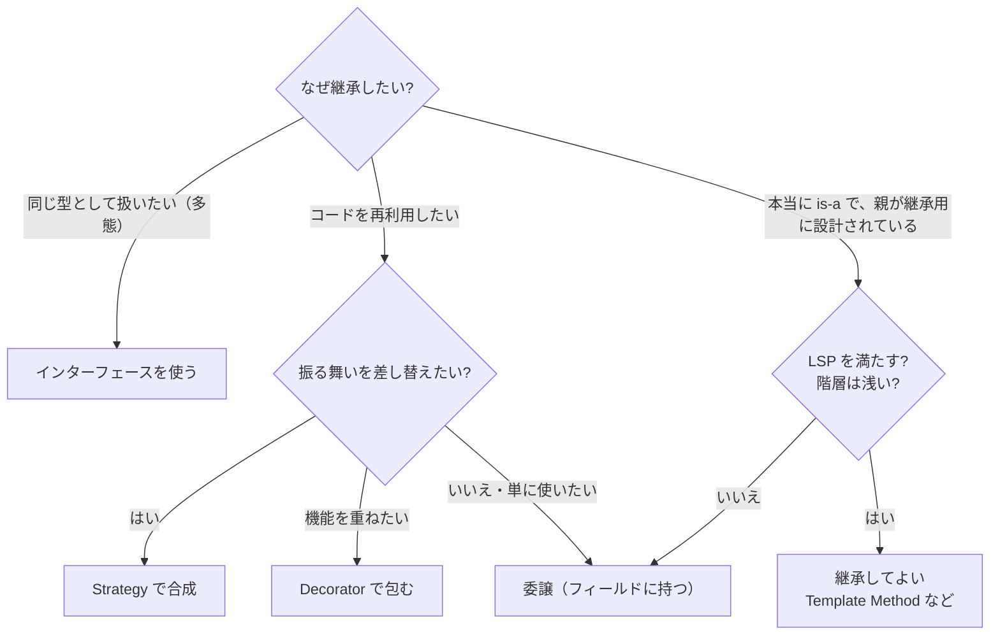

# 継承より合成（Composition over Inheritance）

## この章の目的

[[02_継承と多態]] では継承の仕組みを、42_ソフトウェア設計 の [[03_継承と合成]] では「is-a と has-a」の考え方を学びました。
この章では、**クラス設計の場面で、継承の代わりに合成をどう使うか** を具体的に学びます。

- GoF が「継承より合成」を勧めた理由
- 継承の最大の問題：**脆い基底クラス問題**
- 継承を合成に置き換える **具体的な技法**（委譲・Strategy・Decorator・インターフェース）
- それでも **継承を使ってよい場面**
- TypeScript での書き方

---

## 1. GoF の原則

1994 年の『デザインパターン』（GoF 本）は、序章で2つの原則を掲げました。

> 1. **実装ではなく、インターフェースに対してプログラムせよ。**
> 2. **クラスの継承より、オブジェクトの合成を優先せよ。**（Favor object composition over class inheritance.）

| | 継承（クラスの継承） | 合成（オブジェクトの合成） |
|---|---|---|
| 関係 | 「〜**である**」（is-a） | 「〜を**持つ**」（has-a） |
| 決まるタイミング | **コンパイル時**（クラス定義で固定） | **実行時**（どのオブジェクトを持たせるか変えられる） |
| 中身の見え方 | 親の **実装の詳細** が子に見える（ホワイトボックス再利用） | 相手の **インターフェースだけ** が見える（ブラックボックス再利用） |
| 結合の強さ | **最も強い結合** | 弱い結合 |

GoF の23パターンの多くは、**継承の代わりに合成を使って柔軟性を得る方法** として読むことができます。

---

## 2. 脆い基底クラス問題（Fragile Base Class）

### 2.1 何が起きるか

> **基底クラス（親）の、一見安全な変更が、子クラスを壊してしまう問題。**

```typescript
class CountingSet<T> extends Set<T> {
  count = 0;

  add(value: T) {
    this.count++;
    return super.add(value);
  }

  addAll(values: T[]) {
    this.count += values.length;
    values.forEach((v) => super.add(v));
  }
}
```

もし親クラスの実装が「`addAll` の中で `add` を呼ぶ」ように変わったら？

- `addAll` で `count` が二重に増える（`addAll` で +n、中で呼ばれる `add` でさらに +n）
- 親クラスの **公開インターフェースは何も変わっていない** のに、子クラスが壊れる
- 子クラスは、親の **内部実装（どのメソッドがどのメソッドを呼ぶか）** に依存していた

これは Joshua Bloch『Effective Java』の有名な例（`InstrumentedHashSet`）を TypeScript で書き直したものです。

### 2.2 なぜ起きるか

- 子クラスは親クラスの **実装の詳細** に依存している（カプセル化が破れている）
- 親クラスの作者は、**どんな子クラスが作られているか知らない**
- 継承の階層が深いほど、**祖父母クラスの変更が孫クラスを壊す** 可能性が高まる

43_モジュール設計 の [[04_統合強度_侵入・機能・モデル・契約]] の言葉でいえば、継承は相手の内部実装を共有する **侵入的結合** に近い、最も強い結合です。

### 2.3 その他の継承の問題

| 問題 | 説明 |
|---|---|
| **組み合わせ爆発** | 「音声通知・メール通知」×「即時・まとめて」×「ログあり・なし」を継承で表すと、クラスが掛け算で増える |
| **不要な機能の継承** | 親のメソッドを子が使わない・使えない（Fowler の臭い **相続拒否（Refused Bequest）**）。LSP 違反につながる |
| **ヨーヨー問題** | 処理を追うために、継承階層を上へ下へと何度も行き来する（→ [[02_アンチパターンとコードの臭い]]） |
| **単一継承の制約** | 多くの言語は親を1つしか持てない。2つの性質を同時に継承できない |
| **実行時に変えられない** | 一度作ったオブジェクトの振る舞いを、後から変えられない |

---

## 3. 継承を合成に置き換える技法

### 3.1 委譲（Delegation）

**親クラスを継承する代わりに、そのオブジェクトをフィールドに持ち、処理を任せる** 方法です。

```typescript
// ○ 委譲：Set を「持つ」。必要なメソッドだけを公開する
class CountingSet<T> {
  private readonly inner = new Set<T>();
  count = 0;

  add(value: T): this {
    this.count++;
    this.inner.add(value);
    return this;
  }

  addAll(values: T[]): this {
    values.forEach((v) => this.add(v));
    return this;
  }

  has(value: T): boolean {
    return this.inner.has(value);
  }
}
```

- `Set` の内部実装がどう変わっても、`CountingSet` は影響を受けない（公開メソッドだけを使っている）
- 公開するメソッドを **自分で選べる**（不要なメソッドを継承しない）
- Fowler のリファクタリング **Replace Superclass with Delegate**（スーパークラスを委譲に置き換える）にあたります

### 3.2 Strategy で振る舞いを差し替える

**継承で振る舞いのバリエーションを作る代わりに、振る舞いをオブジェクトとして渡す** 方法です。

```typescript
// ✕ 継承：割引の種類ごとにサブクラス
class Order { calcTotal() { ... } }
class MemberOrder extends Order { calcTotal() { /* 会員割引 */ } }
class CampaignOrder extends Order { calcTotal() { /* キャンペーン割引 */ } }
// 会員かつキャンペーン中は？ → MemberCampaignOrder…（組み合わせ爆発）

// ○ 合成：割引を差し替え可能な部品にする
interface DiscountPolicy {
  apply(subtotal: Money): Money;
}

class Order {
  constructor(private readonly discounts: DiscountPolicy[]) {}
  calcTotal(): Money {
    return this.discounts.reduce((total, d) => d.apply(total), this.subtotal());
  }
}

new Order([new MemberDiscount(), new CampaignDiscount()]);  // 組み合わせ自由
```

詳しくは [[01_振る舞いに関するパターン]] の Strategy を参照してください。

### 3.3 Decorator で機能を重ねる

**継承で機能を追加する代わりに、同じインターフェースを持つオブジェクトで包む** 方法です。

```typescript
interface Notifier { send(message: string): Promise<void>; }

class EmailNotifier implements Notifier { async send(m: string) { /* メール送信 */ } }

class LoggingNotifier implements Notifier {
  constructor(private readonly inner: Notifier) {}
  async send(m: string) {
    console.log("送信:", m);
    await this.inner.send(m);
  }
}

class RetryingNotifier implements Notifier {
  constructor(private readonly inner: Notifier, private readonly times: number) {}
  async send(m: string) { /* 失敗したら times 回まで this.inner.send を再試行 */ }
}

// 機能を自由に重ねられる
const notifier = new LoggingNotifier(new RetryingNotifier(new EmailNotifier(), 3));
```

- 「ログ付き」「リトライ付き」を継承で作ると、`LoggingRetryingEmailNotifier` のような組み合わせクラスが必要になる
- Decorator なら、**部品を積み重ねるだけ**（→ [[01_構造に関するパターン]]）

### 3.4 インターフェースで「型としての共通性」を表す

継承を使う理由が「**同じ型として扱いたい（多態）**」だけなら、**インターフェース** で十分です。

```typescript
interface Shape { area(): number; }

class Circle implements Shape { constructor(private r: number) {} area() { return Math.PI * this.r ** 2; } }
class Rect implements Shape { constructor(private w: number, private h: number) {} area() { return this.w * this.h; } }

const shapes: Shape[] = [new Circle(1), new Rect(2, 3)];
```

- 実装を共有しないので、脆い基底クラス問題が起きない
- 1つのクラスが **複数のインターフェース** を実装できる

> 継承には「**型の共有**（多態のため）」と「**実装の共有**（コード再利用のため）」の2つの目的が混ざっています。**型の共有はインターフェースで、実装の共有は合成で** 分けて行うのが、現代的なクラス設計の基本です。

---

## 4. それでも継承を使ってよい場面

「継承は絶対に使うな」ではありません。次の条件がそろうときは、継承が自然な選択です。

| 条件 | 説明 |
|---|---|
| **本当に is-a である** | 子クラスは、**あらゆる場面で親クラスの代わりに使える**（リスコフの置換原則を満たす → [[03_リスコフの置換原則]]） |
| **親クラスが継承のために設計されている** | 抽象クラスで、オーバーライドしてよいメソッドが明確に決まっている（**Template Method** パターン） |
| **同じ作者・同じモジュールで管理されている** | 親の変更が子に与える影響を、作者自身が把握できる |
| **階層が浅い** | 1〜2段まで。深い階層は避ける |
| **フレームワークが要求する** | UI フレームワークの基底クラス、例外クラス（`class NotFoundError extends Error`）など |

Joshua Bloch は『Effective Java』で、**「継承のために設計して文書化せよ。さもなければ継承を禁止せよ」** と述べています。他人が作った具体的なクラスを継承するのは、最も危険なパターンです。

---

## 5. 判断のフローチャート



---

## 6. ありがちな誤解

### 6.1 「継承はコード再利用のための仕組み」

**半分だけ正しいです。** コード再利用だけが目的なら、委譲の方が安全です。継承の本来の価値は **「親の代わりに使える型を作る」**（多態）ことにあります。

### 6.2 「合成にするとコードが増える」

**多少は増えます。** 委譲では、使いたいメソッドを自分で書く必要があります。しかしその代わりに、**親の変更に壊されない安全性** と、**公開するものを選べる柔軟性** が得られます。

### 6.3 「抽象クラスを継承するなら安全」

**常にではありません。** 抽象クラスでも、子クラスが親の実装の詳細に依存していれば、脆い基底クラス問題は起きます。オーバーライドしてよい場所が明確に決められていることが重要です。

---

## まとめ

- GoF の原則：**インターフェースに対してプログラムせよ**、**継承より合成を優先せよ**
- 継承は **最も強い結合**。**脆い基底クラス問題**（親の安全そうな変更が子を壊す）、組み合わせ爆発、相続拒否などを生む
- 置き換えの技法：**委譲**（持って任せる）、**Strategy**（振る舞いを差し替える）、**Decorator**（機能を重ねる）、**インターフェース**（型だけを共有する）
- **型の共有はインターフェースで、実装の共有は合成で** 分ける
- 継承を使ってよいのは、**本当に is-a・LSP を満たす・継承用に設計された親・浅い階層** のとき

### 次の章

- [[01_単一責任の原則]] — SOLID の適用へ

---

## 参考資料

- Erich Gamma ほか『オブジェクト指向における再利用のためのデザインパターン』（GoF, 1994）序章
- Joshua Bloch『Effective Java 第3版』項目18「継承よりコンポジションを選ぶ」・項目19「継承のために設計および文書化する、でなければ継承を禁止する」
- Martin Fowler『リファクタリング 第2版』（Replace Superclass with Delegate / Replace Subclass with Delegate）
- [Fragile base class（Wikipedia）](https://en.wikipedia.org/wiki/Fragile_base_class)
- [Fragile Base Class Problem: Composition over Inheritance（Pratik Pandey）](https://pratikpandey.substack.com/p/fragile-base-class-problem-composition)
- [The Hidden Treasures of Object Composition（Eric Elliott）](https://medium.com/javascript-scene/the-hidden-treasures-of-object-composition-60cd89480381)
- [Favor Composition Over Inheritance?（Programming Linguistics）](https://pling.jondgoodwin.com/post/favor-composition-over-inheritance/)
