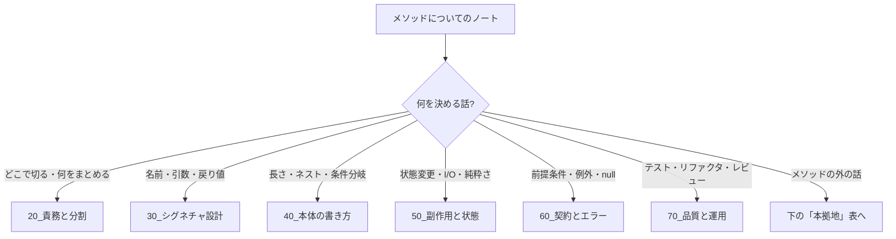

# MOC_メソッド設計体系

46_メソッド設計 の入口ノート。**1 つの関数・メソッドを「どう切り出し、どんな形にし、中身をどう書くか」**——いちばん小さな単位の設計を扱う。骨格は McConnell『Code Complete』第7章「高品質なルーチン」（作る理由 → 凝集 → 名前 → 長さ → 引数）と、Martin『Clean Code』第3章「関数」。そこに Ousterhout『A Philosophy of Software Design』（深いメソッド・エラーが起きない設計）、Fowler『Refactoring』第2版、Normand『Grokking Simplicity』（アクション／計算／データ）の視点を加える構成にした。

フォルダは **メソッドの構成要素別**（責務 → シグネチャ → 本体 → 副作用 → 契約とエラー）、教材（旧 第01〜08部・全25章）を読む **学習順** は下の「学習順インデックス」で持つ。

## フォルダ構成と運用ルール

| フォルダ | 役割 | 問い |
|---|---|---|
| 00_全体像 | 本MOC・年表（[[00_メソッド設計の変遷]]）・教材の目次と前書き | — |
| 10_メソッドの基礎 | なぜ学ぶか / 関数とメソッド・入力・出力・副作用の基本 | メソッドとは何か |
| 20_責務と分割 | どこで切るか / 1 メソッド 1 責任 / KISS・DRY・YAGNI / Extract Method | 何を 1 つにまとめるか |
| 30_シグネチャ設計 | 名前 / 引数 / 戻り値と情報隠蔽 | 外からどう見えるか |
| 40_本体の書き方 | サイズと抽象度 / Guard Clause / 複雑度と分岐 | 中身をどう読ませるか |
| 50_副作用と状態 | CQS / 純粋関数 / FCIS / オブジェクトのメソッド | 何を変えるか |
| 60_契約とエラー | 事前・事後条件（DbC）/ Fail Fast / エラー処理 | 失敗をどう扱うか |
| 70_品質と運用 | テスト / リファクタリング / レビュー / チームで守る | 品質をどう保つか |
| 80_ケーススタディ | 総合演習 | — |
| 90_付録 | 用語集・チェックリスト・早見表・アンチパターン・図解・推奨図書 | — |

- ファイル名は各フォルダ内で **読む順に `01_` から連番**。見出しには教材の章番号（第N章）を書かず、節番号は `N.M` → `M.` にした
- 教材の元の章立て（第1〜25章）は [[010Programming/46_メソッド設計/00_全体像/目次|目次]] と下の学習順インデックスにだけ残す
- 各章末の「次の章」リンクは新しいフォルダ順（10 → 20 → … → 80）でつないである
- `目次` / `00_はじめに` / `付録X` は 42〜45 にも同じ名前がある。リンクするときはフルパスで書く

### 新しいノートの置き場所

| テーマ | 本拠地 |
|---|---|
| KISS・DRY・YAGNI・SRP などの原則そのもの | 48_原則（46 では「メソッド単位での使い方」だけ） |
| クラスの責務・カプセル化・GoF | 44_クラス設計・デザインパターン |
| モジュール・パッケージ単位の分割 | 43_モジュール設計 |
| パラダイム（手続き・OOP・関数型）の一般論 | 42_ソフトウェア設計/20_パラダイム |
| Web API のインターフェース設計 | 45_API設計 |
| 命名・フォーマットのチーム規約 | 59_AI開発ツール・コーディング規約/コーディング規約 |
| テスト戦略・テスト設計技法 | 81_テスト戦略 / 87_テスト設計技法 |

## 学習順インデックス（教材 全25章）

| 部 | 章 | 置き場 |
|---|---|---|
| 前書き | [[010Programming/46_メソッド設計/00_全体像/00_はじめに\|00_はじめに]] / [[010Programming/46_メソッド設計/00_全体像/目次\|目次]] | 00 |
| 第1部 はじめに | [[01_メソッド設計を学ぶ理由]] → [[02_関数とメソッドの基本]] | 10 |
| 第2部 設計の土台 | [[01_メソッドの分割]] → [[02_関心の分離と単一責任]] → [[03_KISS・DRY・YAGNI]] | 20 |
| 第3部 メソッドの切り方 | [[04_Extract_Method]] → [[03_情報隠蔽]] → [[02_引数の設計]] | 20 / 30 |
| 第4部 制御の書き方 | [[02_Guard_Clause]] → [[01_Design_by_Contract]] → [[03_複雑度と分岐]] | 40 / 60 |
| 第5部 振る舞いの設計 | [[01_CQS]] → [[02_純粋関数と副作用]] → [[04_オブジェクトのメソッド]] → [[03_Functional_Core_Imperative_Shell]] | 50 |
| 第6部 読みやすいメソッド | [[01_命名]] → [[01_サイズと抽象度]] → [[02_エラー処理]] | 30 / 40 / 60 |
| 第7部 品質を保つための実践 | [[01_テストしやすいメソッド設計]] → [[02_リファクタリングの実践]] → [[03_コードレビューで見るポイント]] | 70 |
| 第8部 チーム開発と演習 | [[04_チームでメソッド設計を守る]] → [[01_ケーススタディ_注文処理フロー]] → [[02_ケーススタディ_計算・バリデーション]] → [[05_設計レビューの実践]] | 70 / 80 |

> 歴史順に学びたい場合は [[00_メソッド設計の変遷]]（goto の時代 → 構造化 → OOP → 関数型）。

## 00_全体像
- [[00_メソッド設計の変遷]] — 西暦順でたどるメソッド設計（年表）
- [[010Programming/46_メソッド設計/00_全体像/目次|目次]] — 教材の詳細な章立て
- [[010Programming/46_メソッド設計/00_全体像/00_はじめに|00_はじめに]] — 教材の前書き

## 10_メソッドの基礎
- [[01_メソッド設計を学ぶ理由]]
- [[02_関数とメソッドの基本]]

## 20_責務と分割
- [[01_メソッドの分割]] — 段階的詳細化・粒度の判断
- [[02_関心の分離と単一責任]] — 原則の一般論は 48 の [[01_関心の分離]]・[[01_SRP（単一責任の原則）]]
- [[03_KISS・DRY・YAGNI]] — 原則の一般論は 48 の [[01_DRY_KISS_YAGNI]]
- [[04_Extract_Method]] — Replace Temp with Query・抽出しすぎの落とし穴
- [[05_深いメソッドと浅いメソッド_分割と統合の判断]] — 一緒にすべき／分けるべきサイン、良い分割・悪い分割、Clean Code との付き合い方

## 30_シグネチャ設計
- [[01_命名]] — 動詞＋目的語・`is/has/can`
- [[02_引数の設計]] — 引数の数・Parameter Object・フラグ引数・出力引数
- [[03_情報隠蔽]] — 戻り値で内部構造を漏らさない
- [[04_戻り値の設計]] — 番兵値を避ける・boolean・find/get・Result・空のコレクション・複数の値・Promise

## 40_本体の書き方
- [[01_サイズと抽象度]] — 1 関数 = 1 抽象度
- [[02_Guard_Clause]] — 早期 return
- [[03_複雑度と分岐]] — 循環的複雑度・ポリモーフィズムへの置き換え
- [[04_ループとコレクション処理]] — Replace Loop with Pipeline・専用の操作・reduce の乱用・ループが適する場面・非同期

## 50_副作用と状態
- [[01_CQS]] — コマンドとクエリの分離
- [[02_純粋関数と副作用]]
- [[03_Functional_Core_Imperative_Shell]]
- [[04_オブジェクトのメソッド]] — Tell, Don't Ask・貧血モデル
- [[05_共通処理と純粋関数・副作用の仕分け]] — 実務メモ（共通化する処理を純粋関数と副作用に仕分けた表）
- [[06_アクション・計算・データ]] — 3分類・伝染のルール・暗黙的な入出力・計算の取り出し方
- [[07_引数の破壊的変更とイミュータブル]] — 破壊的な配列メソッドと ES2023 の toSorted 等・コピーオンライト・防御的コピー・readonly

## 60_契約とエラー
- [[01_Design_by_Contract]] — 事前条件・事後条件・Fail Fast
- [[02_エラー処理]] — 例外・try-catch・null の扱い
- [[03_エラーが起きない設計にする]] — 定義からなくす・隠す・まとめる・クラッシュさせる（Ousterhout 10章）
- [[04_null・undefined・Result型の使い分け]] — 10億ドルの過ち・strictNullChecks・null と undefined・?. と ??・例外と Result

## 70_品質と運用
- [[01_テストしやすいメソッド設計]]
- [[02_リファクタリングの実践]] — 技法の一覧は [[付録D_リファクタリング技法早見表]]
- [[03_コードレビューで見るポイント]]
- [[04_チームでメソッド設計を守る]] — Lint・複雑度の CI 閾値
- [[05_設計レビューの実践]] — 教材の総仕上げ

## 80_ケーススタディ
- [[01_ケーススタディ_注文処理フロー]] — 200 行の `handleRequest()` を分割する
- [[02_ケーススタディ_計算・バリデーション]] — 料金計算を純粋関数に分解する

## 90_付録
- [[010Programming/46_メソッド設計/90_付録/付録A_用語集|付録A_用語集]]
- [[付録B_メソッド設計チェックリスト]]
- [[付録C_Clean_Code関数ルール早見表]]
- [[付録D_リファクタリング技法早見表]]
- [[010Programming/46_メソッド設計/90_付録/付録E_よくあるアンチパターン一覧|付録E_よくあるアンチパターン一覧]]
- [[010Programming/46_メソッド設計/90_付録/付録F_参考図解|付録F_参考図解]]
- [[010Programming/46_メソッド設計/90_付録/付録G_推奨図書|付録G_推奨図書]]
