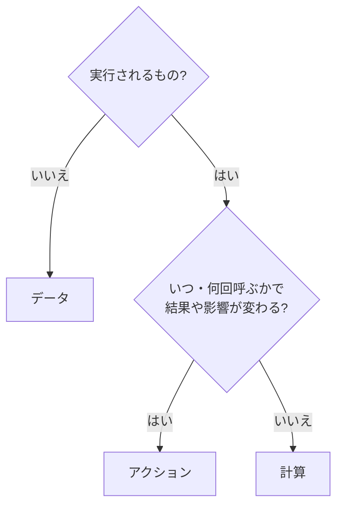
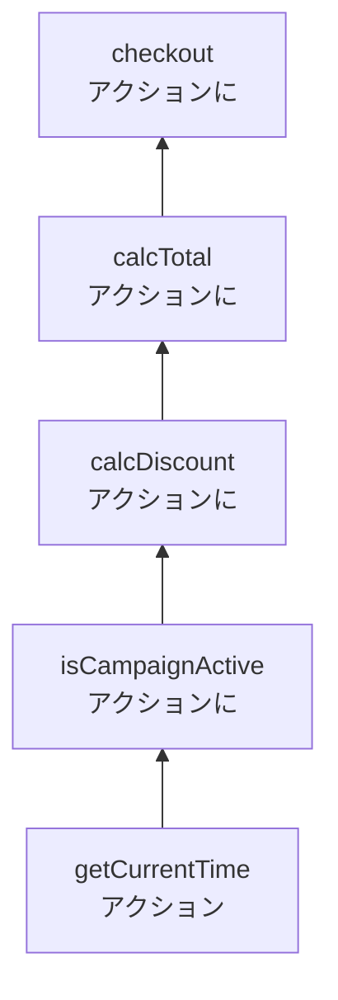

# アクション・計算・データ（Grokking Simplicity）

## この章の目的

[[02_純粋関数と副作用]] と [[03_Functional_Core_Imperative_Shell]] では、副作用を分離することの大切さを学びました。
この章では、Eric Normand『Grokking Simplicity』（2021）が提案した、**コードを3種類に分類する** シンプルで強力な考え方を学びます。

- **アクション・計算・データ** の定義と見分け方
- アクションが広がっていく **伝染のルール**（Spreading Rule）
- アクションから **計算を取り出す** 手順
- **暗黙的な入出力** を明示的にする
- 実務での使い方

関数型の一般的な設計原則は 42_ソフトウェア設計 の [[02_不変データと純粋関数_関数型の設計原則]] を参照してください。この章は **メソッドを書くときの判断** に焦点を当てます。

---

## 1. 3つの分類

Normand は、プログラムを構成するものを次の3つに分けます。

| 分類 | 定義 | 例 |
|---|---|---|
| **アクション**（Actions） | **いつ・何回** 呼ばれるかによって、結果や影響が変わるもの | メール送信、DB への保存、API の呼び出し、現在時刻の取得、乱数、グローバル変数の読み書き、画面への表示 |
| **計算**（Calculations） | **同じ入力なら、いつ・何回呼んでも同じ出力** を返すもの | 合計金額の計算、税額の計算、バリデーション、データの変換・並べ替え |
| **データ**（Data） | 出来事についての **記録された事実**。それ自体は何もしない | 注文の内容、ユーザー情報、設定値、イベントのログ |

### 1.1 見分け方



### 1.2 なぜ「いつ・何回」なのか

純粋関数・副作用という言葉より、「**いつ・何回**」という問いの方が、日常のコードで判断しやすいからです。

- `sendEmail(user)`：**2回呼べば2通届く**。今呼ぶか明日呼ぶかで結果が違う → アクション
- `getCurrentTime()`：**呼ぶたびに違う値** → アクション
- `calcTax(price)`：何回呼んでも、いつ呼んでも同じ → 計算
- `{ id: 1, total: 1000 }`：実行されない → データ

---

## 2. 3つの性質の違い

| 性質 | データ | 計算 | アクション |
|---|---|---|---|
| **理解しやすさ** | ◎ 見ればわかる | ◯ 入力と出力だけ見ればよい | △ 呼ばれるタイミング・回数・順序まで考える必要がある |
| **テストのしやすさ** | ◎ | ◎ 入力を渡して出力を確かめるだけ | △ DB・時刻・外部 API の準備やモックが必要 |
| **再利用のしやすさ** | ◎ | ◎ どこから呼んでも同じ | △ 呼ぶ場所や順序に制約がある |
| **並行処理** | ◎ | ◎ 安全 | △ 競合・順序の問題が起きる |

> Normand の方針は、**「データ ＞ 計算 ＞ アクション」の順に好む** ことです。アクションはなくせませんが、**できるだけ小さくし、計算とデータを増やす** ことで、プログラム全体が扱いやすくなります。

---

## 3. 伝染のルール（Spreading Rule）

### 3.1 ルール

> **計算の中でアクションを呼ぶと、その計算はアクションになる。さらに、それを呼ぶものもすべてアクションになる。**

```typescript
// これは計算
function calcTotal(items: Item[]): number {
  return items.reduce((s, i) => s + i.price, 0);
}

// ログを1行足しただけで…
function calcTotal(items: Item[]): number {
  console.log("計算中");          // アクション（画面に出力する）
  return items.reduce((s, i) => s + i.price, 0);
}
// calcTotal はアクションになった
// calcTotal を呼ぶ calcInvoice も、calcInvoice を呼ぶ createReport も、すべてアクションになる
```



### 3.2 なぜ重要か

- アクションは **呼び出しの連鎖を上に向かって伝染** する
- 深いところに1つアクションが紛れ込むと、**その上のすべての関数が、テストしにくく、理解しにくくなる**
- だから、**アクションはできるだけ呼び出しの上の方（外側）に置き、下の方（内側）は計算にしておく** のが良い設計です。これはまさに [[03_Functional_Core_Imperative_Shell]] の形です

### 3.3 伝染を止める

```typescript
// ✕ 深いところで現在時刻を取得している → すべてがアクションに
function calcDiscount(order: Order): number {
  const now = new Date();                     // アクション
  return isCampaignPeriod(now) ? order.total * 0.1 : 0;
}

// ○ 現在時刻を引数で受け取る → calcDiscount は計算のまま
function calcDiscount(order: Order, now: Date): number {
  return isCampaignPeriod(now) ? order.total * 0.1 : 0;
}

// アクション（現在時刻の取得）は一番外側で1回だけ
async function checkout(orderId: string) {
  const order = await repo.find(orderId);       // アクション
  const discount = calcDiscount(order, new Date());  // 計算に現在時刻を渡す
  await repo.save({ ...order, discount });      // アクション
}
```

---

## 4. 暗黙的な入出力を明示的にする

### 4.1 明示的な入出力と暗黙的な入出力

| | 明示的 | 暗黙的 |
|---|---|---|
| **入力** | **引数** | グローバル変数・クラスのフィールドの読み取り、現在時刻、乱数、DB からの読み込み |
| **出力** | **戻り値** | グローバル変数・フィールドの書き換え、引数の書き換え、DB への書き込み、画面表示、例外 |

> **関数が暗黙的な入出力を持っていれば、それはアクション。明示的な入出力（引数と戻り値）だけなら、計算。**

### 4.2 アクションから計算を取り出す手順

Normand は、アクションから計算を取り出す手順を次のように示しています。

1. **アクションの中で、計算にできる部分を見つける**（判断・計算・変換）
2. その部分を **新しい関数として抽出する**（Extract Method → [[04_Extract_Method]]）
3. **暗黙的な入力を引数に** 置き換える（グローバル変数・フィールド・現在時刻 → 引数で受け取る）
4. **暗黙的な出力を戻り値に** 置き換える（グローバル変数への代入・引数の書き換え → 新しい値を返す）
5. 抽出した関数が計算になったことを確認する

```typescript
// Before：アクションの中に計算が埋もれている
let cart: Item[] = [];
let cartTotal = 0;

function addToCart(name: string, price: number) {
  cart.push({ name, price });                                 // 暗黙的な出力（グローバルの書き換え）
  cartTotal = 0;
  for (const item of cart) cartTotal += item.price;           // 計算が埋もれている
  updateTotalDisplay(cartTotal);                              // アクション（画面表示）
  updateShippingIcons();                                      // アクション
}

// After：計算を取り出す
function addItem(cart: Item[], item: Item): Item[] {          // 計算：新しい配列を返す
  return [...cart, item];
}
function calcTotal(cart: Item[]): number {                    // 計算
  return cart.reduce((s, i) => s + i.price, 0);
}

function addToCart(name: string, price: number) {             // アクション（薄くなった）
  cart = addItem(cart, { name, price });
  const total = calcTotal(cart);
  updateTotalDisplay(total);
  updateShippingIcons(cart);
}
```

- `addItem` と `calcTotal` は **計算** になり、単体でテストできる
- `addToCart` は **アクションのまま** だが、中身は「計算を呼んで、結果を外に出す」だけになった
- 引数を書き換えず **新しい配列を返す** 書き方は、Normand が **コピーオンライト** と呼ぶ技法です（→ [[07_引数の破壊的変更とイミュータブル]]）

---

## 5. 実務での使い方

### 5.1 コードに印を付けてみる

既存のコードを読むとき、関数ごとに **A（アクション）・C（計算）・D（データ）** の印を付けてみると、設計の問題が見えてきます。

| 気づき | 改善 |
|---|---|
| 計算になるはずの関数が、**ログ出力や現在時刻の取得** のせいでアクションになっている | 暗黙的な入力を引数に、ログは呼ぶ側に移す |
| 呼び出しの **深いところ** にアクションがある | アクションを外側に移し、計算を内側に残す |
| **ほとんどがアクション** で、計算がほとんどない | 判断・計算・変換を抽出する |

### 5.2 アクション同士の扱い

アクションはなくせないので、Normand は **アクション同士のタイミング** の管理も重視しています（同書の後半）。

- 順番に実行すべきアクション、並行して実行してよいアクションを区別する
- 同じアクションが **2回実行されても安全** か（冪等性）を考える
- 非同期のアクションが **予期しない順序** で完了したときに壊れないか

これは分散システムやフロントエンドの非同期処理で特に重要になります。

---

## 6. ありがちな誤解

### 6.1 「アクションは悪いもの」

**誤りです。** アクションがなければプログラムは何もできません。目標は **アクションをなくす** ことではなく、**小さくし、外側に寄せる** ことです。

### 6.2 「ログ出力くらいはアクションに含めなくてよい」

**伝染のルールでは、ログもアクションです。** 実務上は許容することもありますが、テストでログが出る・ログの順序に依存する、といった問題が起きることを理解しておきます。

### 6.3 「クラスのメソッドは全部アクション」

**誤りです。** フィールドを読むだけで変更しない、かつ不変なオブジェクトのメソッド（値オブジェクトの `add` など）は、実質的に計算です（44 の [[04_値オブジェクトと完全コンストラクタ]]）。

---

## まとめ

- **アクション**：いつ・何回呼ぶかで結果が変わる。**計算**：同じ入力なら常に同じ出力。**データ**：記録された事実
- **データ ＞ 計算 ＞ アクション** の順に好む。アクションを小さく、計算とデータを増やす
- **伝染のルール**：計算の中でアクションを呼ぶと、それを呼ぶものすべてがアクションになる → アクションは **外側** に置く
- **暗黙的な入出力**（グローバル・フィールド・時刻・引数の書き換え）が、関数をアクションにする
- アクションから計算を取り出す：**抽出 → 暗黙的な入力を引数に → 暗黙的な出力を戻り値に**

→ 次の章: [[07_引数の破壊的変更とイミュータブル]]

---

## 参考資料

- Eric Normand『Grokking Simplicity: Taming complex software with functional thinking』（Manning, 2021）
- [Grokking Simplicity（Manning 公式）](https://www.manning.com/books/grokking-simplicity)
- [Notes on Grokking Simplicity（bagerbach.com）](https://bagerbach.com/books/grokking-simplicity/)
- [Book notes: Grokking Simplicity（Dan Lebrero）](https://danlebrero.com/2021/09/15/grokking-simplicity-summary/)
- [Book Review: Grokking Simplicity（Ylan Segal）](https://ylan.segal-family.com/blog/2021/06/11/book-review-grokking-simplicity/)
