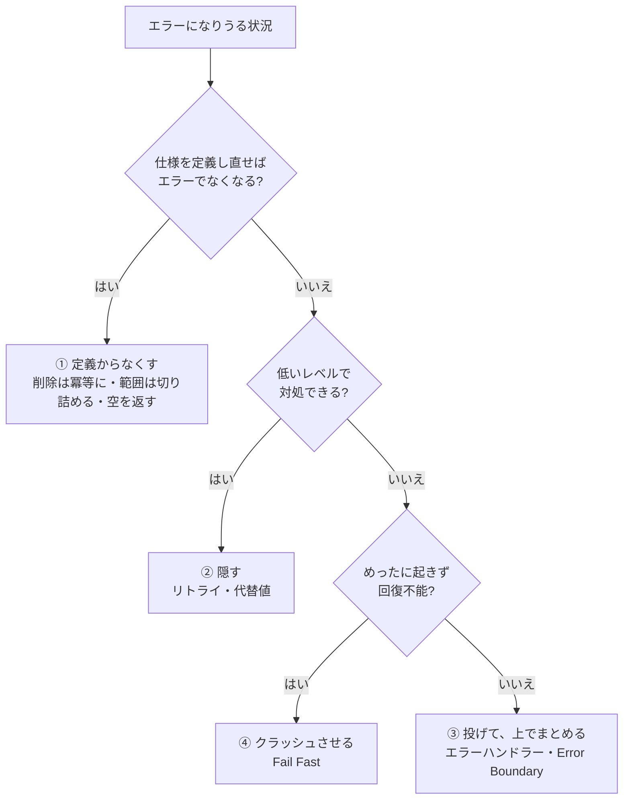

# エラーが起きない設計にする（Define Errors Out of Existence）

## この章の目的

[[02_エラー処理]] では、例外や try-catch の書き方を学びました。
しかし、エラー処理には根本的な問題があります。**エラー処理のコードそのものが、複雑さとバグの大きな原因になる** のです。

John Ousterhout は『A Philosophy of Software Design』第10章「エラーを定義からなくせ（Define Errors Out of Existence）」で、こう述べています。

> **目標は、エラーを「うまく処理する」ことではなく、エラーを処理しなければならない場所を「減らす」ことである。**

この章では、そのための4つの技法を学びます。

1. **エラーを定義からなくす**（Define errors out of existence）
2. **例外を隠す**（Exception masking）
3. **例外をまとめる**（Exception aggregation）
4. **単にクラッシュさせる**（Just crash）

---

## 1. なぜエラー処理は複雑さを生むのか

| 問題 | 説明 |
|---|---|
| **エラーを生む側も、処理する側も複雑になる** | 例外を投げるコードと、それを受け取る try-catch の両方が必要 |
| **呼ぶ側に負担が広がる** | 例外を投げるメソッドを呼ぶすべての場所で、対処を考える必要がある |
| **エラー処理のコードはテストされにくい** | 通常の流れに比べて実行される機会が少なく、バグが潜みやすい |
| **処理を忘れる** | 呼ぶ側が例外の可能性に気づかず、対処しないまま本番で問題になる |
| **例外を投げすぎる傾向** | 「とりあえず例外にしておけば安全」と考え、呼ぶ側に判断を押し付ける |

Ousterhout は、**「例外を投げる」ことは、難しい判断を呼ぶ側に押し付けることになりやすい** と指摘しています。例外は、メソッドの **インターフェース（呼ぶ側が知るべきこと）の一部** なので、例外が多いメソッドは **浅いメソッド** になります（→ [[05_深いメソッドと浅いメソッド_分割と統合の判断]]）。

---

## 2. 技法1：エラーを定義からなくす

### 2.1 考え方

> **メソッドの意味（仕様）を定義し直して、エラーになる状況そのものをなくす。**

### 2.2 例1：存在しないものを削除する

```typescript
// ✕ 存在しないキーを削除すると例外
function removeUser(id: string) {
  if (!users.has(id)) throw new Error(`ユーザー ${id} は存在しません`);
  users.delete(id);
}
// 呼ぶ側は、毎回「存在するか」を確認するか、try-catch が必要

// ○ 意味を「このメソッドの後、そのユーザーは存在しない」と定義する
function removeUser(id: string) {
  users.delete(id);   // 最初から存在しなくても、目的は達成されている
}
```

- 「削除する」の目的は **「その後、存在しない状態にする」** こと。最初から存在しなければ、すでに目的は達成されている
- JavaScript の `Map.prototype.delete` や `Set.prototype.delete` も、存在しないキーで例外を投げず `false` を返すだけ
- Ousterhout は、Tcl の `unset` コマンドを「存在しない変数を消すとエラーにした」のは自分の設計ミスだったと振り返っています

### 2.3 例2：範囲外の部分文字列

```typescript
// JavaScript の slice は、範囲外を指定しても例外を投げない
"hello".slice(2, 100);   // "llo"（末尾までに切り詰める）
"hello".slice(10, 20);   // ""（空文字）
```

Ousterhout は、Java の `substring` が範囲外のインデックスで例外を投げることを、**呼ぶ側に余計なチェックを強いる設計** の例として挙げています。「範囲と重なる部分を返す」と定義すれば、エラーはなくなります。

### 2.4 例3：空のコレクションを返す

```typescript
// ✕ 0件のときに例外や null
function findOrders(userId: string): Order[] | null

// ○ 0件なら空配列（エラーも特殊ケースもない）
function findOrders(userId: string): Order[]
```

（→ [[04_戻り値の設計]]）

### 2.5 例4：特殊ケースを通常ケースに含める

```typescript
// ✕ 「選択されていない」を特殊ケースとして扱う
function deleteSelection(text: string, selection: Selection | null) {
  if (selection === null) return text;   // 特殊ケース
  return text.slice(0, selection.start) + text.slice(selection.end);
}

// ○ 「選択なし」を「長さ0の選択」として表す → 特殊ケースが消える
function deleteSelection(text: string, selection: Selection) {
  return text.slice(0, selection.start) + text.slice(selection.end);
  // start === end なら、何も削除されない
}
```

Ousterhout は第10章の後半で、**特殊ケースそのものを設計からなくす**（Design special cases out of existence）ことも勧めています。**Null Object パターン**（「ない」場合にも、何もしないオブジェクトを使う）も同じ発想です。

---

## 3. 技法2：例外を隠す（Exception Masking）

### 3.1 考え方

> **低いレベルで例外を検出し、その場で対処して、上のレベルには伝えない。**

### 3.2 例

```typescript
// 一時的な通信エラーは、内部でリトライして隠す
async function fetchWithRetry<T>(url: string, retries = 3): Promise<T> {
  for (let i = 0; ; i++) {
    try {
      return await fetchJson<T>(url);
    } catch (e) {
      if (!isTransient(e) || i >= retries - 1) throw e;   // 一時的でない or 回数切れなら伝える
      await sleep(2 ** i * 200);                          // 待ってからリトライ
    }
  }
}
```

- TCP は、パケットの消失を **自動で再送して隠し**、上のアプリケーションには「確実に届くストリーム」だけを見せる。これが例外を隠す代表例
- 呼ぶ側は、一時的なネットワークの揺らぎを **意識しなくてよい**

### 3.3 注意点

- **隠してよいのは、その場で本当に対処できる例外だけ**。対処できないのに握りつぶすのは最悪（`catch (e) {}`）
- 隠した例外は、**ログやメトリクスには残す**（頻発していることに気づけるように）

---

## 4. 技法3：例外をまとめる（Exception Aggregation）

### 4.1 考え方

> **多くの例外を、1か所でまとめて処理する。**

### 4.2 例：Web サーバーのエラー処理

```typescript
// ✕ 各ハンドラーで、それぞれ同じような try-catch を書く
app.get("/users/:id", async (req, res) => {
  try { ... } catch (e) { if (e instanceof NotFound) res.status(404)...; else res.status(500)...; }
});
app.get("/orders/:id", async (req, res) => {
  try { ... } catch (e) { if (e instanceof NotFound) res.status(404)...; else res.status(500)...; }
});

// ○ ハンドラーは例外を投げるだけ。1か所のエラーハンドラーでまとめて処理
app.get("/users/:id", async (req, res) => {
  res.json(await getUser(req.params.id));   // 見つからなければ NotFound を投げるだけ
});

app.use((err, req, res, next) => {          // まとめて処理する
  if (err instanceof NotFound) return res.status(404).json({ message: err.message });
  if (err instanceof ValidationError) return res.status(400).json({ errors: err.details });
  logger.error(err);
  res.status(500).json({ message: "サーバーエラー" });
});
```

- エラー処理のコードが **1か所に集まる**（重複がなくなる）
- 各ハンドラーは **正常系の処理だけ** に集中できる
- React の **Error Boundary** も、画面のどこかで起きたエラーを上のコンポーネントでまとめて扱う、同じ発想の仕組みです

### 4.3 例外を隠す・まとめるの組み合わせ

Ousterhout は、**低いレベルで隠し、高いレベルでまとめる** のが効果的だと述べています。

| レベル | 技法 | 例 |
|---|---|---|
| 低いレベル（通信・I/O） | **隠す** | 一時的なエラーをリトライ |
| 中間のレベル（業務ロジック） | **投げるだけ** | `NotFound`・`ValidationError` を投げる |
| 高いレベル（入口・フレームワーク） | **まとめる** | エラーハンドラー・Error Boundary で HTTP ステータスや画面表示に変換 |

---

## 5. 技法4：単にクラッシュさせる（Just Crash）

### 5.1 考え方

> **めったに起きず、起きてもまともに回復できないエラーは、処理しようとせず、プログラムを止める。**

### 5.2 例

- **メモリ不足**：回復しようとするコード自体がメモリを必要とする
- **設定ファイルが壊れている・必須の環境変数がない**：起動時に止めるべき
- **プログラムのバグを示す状態**（「ありえない」はずの状態に到達した）

```typescript
// 起動時に必須の設定がなければ、すぐに止める
const databaseUrl = process.env.DATABASE_URL;
if (!databaseUrl) {
  throw new Error("DATABASE_URL が設定されていません");   // 起動を中止する
}

// ありえない状態はアサーションで止める
function assertNever(x: never): never {
  throw new Error(`想定外の値: ${JSON.stringify(x)}`);
}
```

- 中途半端に回復しようとすると、**壊れた状態のまま動き続け**、もっと分かりにくい問題を起こす
- これは [[01_Design_by_Contract]] の **Fail Fast**（早く失敗する）と同じ考え方です
- 止めた後は、プロセスの監視（コンテナの再起動など）に任せる

### 5.3 クラッシュさせてはいけない場面

- **ユーザーの入力エラー**：想定内なので、メッセージを返す
- **一部の機能の失敗**：全体を止めず、その機能だけを失敗させる（グレースフルデグレーデーション）
- **データの整合性が重要な処理の途中**：トランザクションで巻き戻してから止める

---

## 6. 4つの技法の使い分け



---

## 7. 注意：やりすぎない

Ousterhout も、**すべてのエラーをなくせばよいわけではない** と注意しています。

| やりすぎの例 | 問題 |
|---|---|
| 呼ぶ側にとって **重要な情報** を握りつぶす | 「送金先の口座が存在しない」を黙って成功扱いにしてはいけない |
| 不正な入力を **黙って補正** する | 「マイナスの金額を 0 にする」と、呼ぶ側のバグが隠れる |
| すべての例外を **一番上で握りつぶす** | 問題が起きていることに誰も気づかない |

> 判断の基準は、**「呼ぶ側が、そのエラーを知る必要があるか」** です。知る必要がないなら定義からなくすか隠す、知る必要があるなら明示的に伝えます（→ [[04_null・undefined・Result型の使い分け]]）。

---

## 8. ありがちな誤解

### 8.1 「エラーを減らす＝エラーを握りつぶす」

**違います。** 定義からなくすのは **仕様を変えて、そもそもエラーでない状況にする** こと。握りつぶすのは、本当のエラーを無視することです。

### 8.2 「例外は多いほど安全」

**逆効果になりやすいです。** 例外が多いと、呼ぶ側の処理が増え、処理し忘れが起きます。

### 8.3 「クラッシュさせるのは乱暴」

**場合によっては最も安全です。** 回復できない状態で動き続ける方が、データの破損など、より深刻な問題を起こします。

---

## まとめ

- エラー処理のコードは **複雑さとバグの大きな原因**。目標は **エラーを処理する場所を減らす** こと
- **① 定義からなくす**：仕様を定義し直す（削除は冪等に、範囲は切り詰める、空のコレクションを返す、特殊ケースを通常ケースに含める）
- **② 隠す**：低いレベルで対処できる例外は、その場で処理して上に伝えない（リトライなど）
- **③ まとめる**：多くの例外を1か所で処理する（エラーハンドラー・Error Boundary）
- **④ クラッシュさせる**：めったに起きず回復不能なものは、早く止める（Fail Fast）
- やりすぎない：**呼ぶ側が知る必要のあるエラー** は、明示的に伝える

→ 次の章: [[04_null・undefined・Result型の使い分け]]

---

## 参考資料

- John Ousterhout『A Philosophy of Software Design』第2版 第10章「Define Errors Out Of Existence」
- [Error Handling（Stanford CS190 講義ノート, Ousterhout）](https://web.stanford.edu/~ouster/cgi-bin/cs190-spring15/lecture.php?topic=errorHandling)
- [Exception Handling（Stanford CS190 講義ノート, Ousterhout）](https://web.stanford.edu/~ouster/cgi-bin/cs190-spring16/lecture.php?topic=exceptions)
- [A Philosophy of Software Design ch10 Define errors out of existence（勉強日記）](https://wand-ta.hatenablog.com/entry/2019/10/18/090227)
- [Reading notes on A Philosophy of Software Design（R-bloggers）](https://www.r-bloggers.com/2023/10/reading-notes-on-a-philosophy-of-software-design-by-john-ousterhout/)
