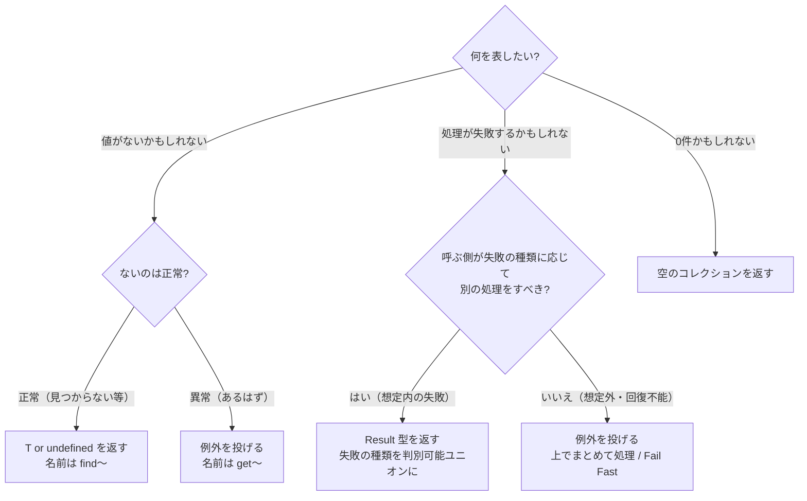

# null・undefined・Result 型の使い分け

## この章の目的

[[02_エラー処理]] では null の扱いの基本を、[[04_戻り値の設計]] では「ないかもしれない」値の返し方を学びました。
この章では、TypeScript を例に、**「値がない」「失敗した」をどう表すか** を体系的に整理します。

- null 参照が「**10億ドルの過ち**」と呼ばれる理由
- TypeScript の **`strictNullChecks`** が何を解決したか
- **`null` と `undefined`** の違いと使い分け
- 値がないときの便利な構文（`?.`・`??`・型の絞り込み）
- 失敗を表す **例外と Result 型** の使い分け
- Result 型の実装と、ライブラリ（neverthrow など）

---

## 1. null 参照：10億ドルの過ち

### 1.1 Tony Hoare の告白

null 参照を発明したのは、イギリスの計算機科学者 **Tony Hoare** です。1965 年、ALGOL W という言語の型システムを設計したときに導入しました。

2009 年の講演で、Hoare はこう述べています。

> 私はそれを **10億ドルの過ち** と呼んでいる。1965 年の null 参照の発明だ。……単に実装が簡単だったという理由で、null 参照を入れる誘惑に抵抗できなかった。これが、その後の40年間で、**数え切れないほどのエラー・脆弱性・システムクラッシュ** を引き起こし、おそらく10億ドル分の苦痛と損害をもたらしてきた。

### 1.2 何が問題だったのか

- 多くの言語では、**どんな参照型の変数にも null を入れられる**
- 型を見ても、**その変数が null かもしれないかどうか分からない**
- null のまま使うと、**実行時に** エラー（`NullPointerException`、`Cannot read properties of null`）になる
- コンパイラは警告してくれない

---

## 2. TypeScript の `strictNullChecks`

### 2.1 何が変わるか

`strictNullChecks`（`strict: true` に含まれる）を有効にすると、**`null` と `undefined` が独立した型** として扱われます。

```typescript
// strictNullChecks: true
let name: string = null;              // ❌ コンパイルエラー
let name: string | null = null;       // ✅ null の可能性を型に書く

function findUser(id: string): User | undefined { ... }

const user = findUser("1");
console.log(user.name);               // ❌ コンパイルエラー：user は undefined かもしれない
if (user) console.log(user.name);     // ✅ チェックした後なら使える
```

- **「null かもしれない」ことが型に現れる**
- **チェックせずに使うとコンパイルエラー** になる
- Hoare の「10億ドルの過ち」を、**型システムで解決** している

> **新しいプロジェクトでは、必ず `strict: true` を有効にしましょう。** 既存のプロジェクトでも、段階的に有効にする価値があります。

Kotlin（`String?`）、Swift（`String?`）、Rust（`Option<String>`）、C# 8 以降（null 許容参照型）など、現代の多くの言語が同じ考え方を取り入れています。

---

## 3. `null` と `undefined`

### 3.1 違い

| | `undefined` | `null` |
|---|---|---|
| 意味（慣習） | **まだ値が設定されていない**・存在しない | **意図的に「値がない」と設定した** |
| どこで現れるか | 初期化していない変数、存在しないプロパティ、引数の省略、戻り値のない関数、`Array.find` で見つからない | DOM API（`getElementById`）、JSON、DB の NULL、`String.match` の不一致 |
| `typeof` | `"undefined"` | `"object"`（歴史的なバグ） |
| JSON | プロパティごと消える | `null` として残る |
| 省略可能なプロパティ | `name?: string` は `undefined` を許す | 明示的に `string \| null` と書く必要がある |

### 3.2 使い分けの方針

どちらを使うかは、**チームで統一する** ことが最も大切です。代表的な方針は次の2つです。

| 方針 | 内容 | 採用例 |
|---|---|---|
| **`undefined` に統一** | 自分のコードでは `undefined` だけを使う。`null` は外部 API から来たときに変換する | TypeScript 本体のコーディング規約、多くのモダンなコードベース |
| **使い分ける** | 「未設定」は `undefined`、「意図的な空」は `null` | DB や JSON と密接にやり取りするコード |

```typescript
// undefined に統一する場合：境界で変換する
const element = document.getElementById("app") ?? undefined;
const row = await db.query(...);
const user: User = { ...row, middleName: row.middle_name ?? undefined };
```

---

## 4. 値がないときの便利な構文

### 4.1 オプショナルチェーン `?.`

```typescript
const city = user?.address?.city;      // 途中が null / undefined なら undefined
const first = list?.[0];
const result = callback?.();           // 関数が存在するときだけ呼ぶ
```

### 4.2 Null 合体演算子 `??`

```typescript
const pageSize = options.pageSize ?? 20;     // null / undefined のときだけ 20
const pageSize = options.pageSize || 20;     // ⚠️ 0 や "" のときも 20 になってしまう
```

`||` は `0`・`""`・`false` も「なし」とみなすので、**数値や文字列のデフォルト値には `??` を使う** のが安全です。

### 4.3 型の絞り込みとガード節

```typescript
function sendWelcome(userId: string) {
  const user = findUser(userId);
  if (!user) return;                    // ガード節で早期 return（→ 02_Guard_Clause）
  mailer.send(user.email, "ようこそ");  // ここでは user は User 型に絞り込まれている
}
```

### 4.4 非 null アサーション `!` は最後の手段

```typescript
const el = document.getElementById("app")!;   // 「絶対に null ではない」とコンパイラに伝える
```

- 型チェックを **黙らせるだけ** で、実行時の安全は保証しない
- 使うなら、**本当に null にならない理由** をコメントで書く。可能ならガード節や `if` で絞り込む

---

## 5. 失敗を表す：例外か Result 型か

### 5.1 2つの方式

| | 例外（throw） | Result 型 |
|---|---|---|
| 書き方 | `throw new Error(...)` | `return { ok: false, error }` |
| 型に現れるか | **現れない**（TypeScript には検査例外がない） | **現れる**（戻り値の型に失敗の種類が書かれる） |
| 処理し忘れ | 気づきにくい | 型チェックで気づける |
| 呼ぶ側のコード | 正常系がすっきり書ける | 毎回の分岐が必要 |
| 伝わり方 | 自動で上に伝わる（途中の関数は何もしなくてよい） | 明示的に返す必要がある |

### 5.2 使い分けの基準

| 種類 | 例 | おすすめ |
|---|---|---|
| **想定内の失敗**（業務上起こりうる） | 入力エラー、在庫切れ、残高不足、権限なし、見つからない | **Result 型**（または `T \| undefined`） |
| **想定外の失敗**（バグ・環境の問題） | 契約違反、DB 接続断、ありえない状態 | **例外** |
| **回復不能な失敗** | 必須設定がない、メモリ不足 | **例外で止める**（→ [[03_エラーが起きない設計にする]] の「クラッシュさせる」） |

> 判断の問い：**「呼ぶ側は、この失敗に応じて別の処理をすべきか？」** すべきなら Result 型、すべきでない（上でまとめて処理すればよい）なら例外。

### 5.3 Result 型を自分で定義する

```typescript
type Result<T, E> =
  | { ok: true; value: T }
  | { ok: false; error: E };

const ok = <T>(value: T): Result<T, never> => ({ ok: true, value });
const err = <E>(error: E): Result<never, E> => ({ ok: false, error });

type WithdrawError =
  | { kind: "insufficientBalance"; balance: number }
  | { kind: "accountFrozen" }
  | { kind: "dailyLimitExceeded"; limit: number };

function withdraw(account: Account, amount: number): Result<Account, WithdrawError> {
  if (account.frozen) return err({ kind: "accountFrozen" });
  if (account.balance < amount) return err({ kind: "insufficientBalance", balance: account.balance });
  return ok({ ...account, balance: account.balance - amount });
}

// 呼ぶ側：失敗の種類ごとに対処できる
const r = withdraw(account, 5000);
if (!r.ok) {
  switch (r.error.kind) {
    case "insufficientBalance": return showError(`残高が不足しています（残高 ${r.error.balance} 円）`);
    case "accountFrozen":       return showError("口座が凍結されています");
    case "dailyLimitExceeded":  return showError(`1日の上限は ${r.error.limit} 円です`);
  }
}
save(r.value);
```

- 失敗の種類を **判別可能ユニオン** にすると、`switch` の **網羅性チェック** が効く（新しい失敗の種類を追加したら、対処していない場所がコンパイルエラーになる）
- 関数型の型設計としての背景は 42 の [[03_型でドメインを表す_DomainModelingMadeFunctional]] を参照

### 5.4 ライブラリを使う

Result 型を本格的に使うなら、ライブラリを使うと便利です。

| ライブラリ | 特徴 |
|---|---|
| **neverthrow** | `Result<T, E>` と非同期版 `ResultAsync`。`map`・`andThen` でつなげて書ける。ESLint プラグインで処理し忘れを検出できる |
| **Effect** | Result だけでなく、依存性・並行処理・リトライなども型で扱う本格的なフレームワーク |
| **ts-results** など | Rust の `Result` / `Option` に近い API |

```typescript
import { ok, err, Result } from "neverthrow";

const result = parseInput(raw)          // Result<Input, ParseError>
  .andThen(validate)                    // Result<Input, ParseError | ValidationError>
  .map(calculatePrice);                 // Result<Price, ParseError | ValidationError>

result.match(
  (price) => render(price),
  (error) => showError(error),
);
```

途中のどこかで失敗すると、残りの処理は飛ばされ、失敗がそのまま最後まで運ばれます（鉄道指向プログラミング）。

---

## 6. 選び方のまとめ



---

## 7. ありがちな誤解

### 7.1 「`?.` を使えば null の問題は解決」

**部分的です。** `?.` は「null なら undefined を返す」だけで、**null の原因** は解決しません。あちこちに `?.` が必要になっているなら、**そもそも null を返さない設計**（空のコレクション・Null Object・定義からなくす）を検討します。

### 7.2 「Result 型を使えば例外は不要」

**誤りです。** バグや回復不能な失敗まで Result 型にすると、すべての関数の戻り値が Result だらけになります。**想定内の失敗だけ** を Result 型にします。

### 7.3 「`null` と `undefined` はどちらでもよい」

**混在させるのが一番の問題です。** `x === null` と `x === undefined` のチェックが入り混じり、片方を見落とすバグが生まれます。チームで方針を決めて統一します。

---

## まとめ

- null 参照は Tony Hoare 自身が **「10億ドルの過ち」** と呼んだ。型を見ても null かどうか分からず、実行時に壊れる
- TypeScript の **`strictNullChecks`**（`strict: true`）で、null の可能性が **型に現れ、チェックし忘れがコンパイルエラー** になる。必ず有効にする
- **`null` と `undefined`** は、チームでどちらかに統一（`undefined` に統一する方針が多い）。外部との境界で変換する
- **`?.`・`??`・ガード節** で安全に扱う。**`!`（非 null アサーション）は最後の手段**。デフォルト値は `||` ではなく **`??`**
- **想定内の失敗は Result 型**（失敗の種類を判別可能ユニオンに）、**想定外・回復不能な失敗は例外**
- 本格的に使うなら **neverthrow** などのライブラリ

→ 次の章: [[01_テストしやすいメソッド設計]]

---

## 参考資料

- [Tony Hoare apologizes for inventing null pointers（EverythingSysadmin）](https://everythingsysadmin.com/2009/01/tony-hoare-apologizes-for-inve.html)
- [NULL: The Billion Dollar Mistake（gersti.at）](https://gersti.at/posts/billion-dollar-mistake/)
- [Void safety（Wikipedia）](https://en.wikipedia.org/wiki/Void_safety)
- [TypeScript: TSConfig Option: strictNullChecks（公式）](https://www.typescriptlang.org/tsconfig/strictNullChecks.html)
- [neverthrow — Type-Safe Errors for JS & TypeScript（GitHub）](https://github.com/supermacro/neverthrow)
- [Practically Safe TypeScript Using Neverthrow（Jökull Sólberg）](https://www.solberg.is/neverthrow)
- [Null Safety and the Billion-Dollar Mistake（Java Code Geeks, 2026）](https://www.javacodegeeks.com/2026/08/null-safety-and-the-billion-dollar-mistake.html)
- [MDN — Optional chaining / Nullish coalescing（公式）](https://developer.mozilla.org/ja/docs/Web/JavaScript/Reference/Operators/Optional_chaining)
