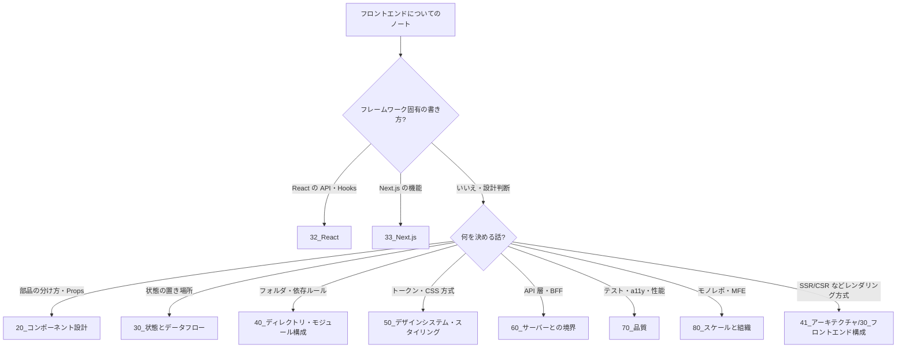

# MOC_フロントエンド設計体系

47_フロントエンド設計 の入口ノート。**ブラウザ上の UI を「どう部品に分け、状態とデータをどう流し、コードをどこに置くか」**——フレームワークに依存しないフロントエンドの設計判断を扱う。骨格は、2025 年時点で論点とされる 4 本柱（**コンポーネントの境界 / 状態の置き場所 / ディレクトリ・モジュール構成 / デザインシステム**、Feature-Sliced Design の解説より）。そこに Godbolt『Frontend Architecture for Design Systems』の Code / Process / Testing / Documentation と、bulletproof-react の機能別構成を加えた。演習は GreatFrontEnd の RADIO（要件 → 全体構成 → データモデル → インターフェース → 最適化）で組み立てる。

フォルダは **設計の関心事ごと**。各フォルダ内は読む順に連番で、章末の「次の章」リンクで 10 → 85 を通読できる。

## フォルダ構成と運用ルール

| フォルダ | 役割 | 問い |
|---|---|---|
| 00_全体像 | 本MOC・年表（[[00_フロントエンド設計の変遷]]） | — |
| 10_基礎 | フロントエンドの責務 / UI = f(state) / 単方向データフロー | フロントは何を設計するのか |
| 20_コンポーネント設計 | 分割の粒度 / Props＝部品の API / Container-Presentational / Compound・Headless / Atomic Design | 画面をどう部品に分けるか |
| 30_状態とデータフロー | 状態の分類と置き場所 / SSOT / 派生状態 / サーバー状態との分担 | 状態をどこに持ち、どう流すか |
| 40_ディレクトリ・モジュール構成 | Layer型 / Feature型 / FSD / bulletproof-react / 依存ルール / barrel ファイル | コードをどこに置くか |
| 50_デザインシステム・スタイリング | デザイントークン / CSS 設計方式の比較 / コンポーネントライブラリ | 見た目をどう一貫させるか |
| 60_サーバーとの境界 | API レイヤ / BFF / 型共有 / エラーの受け渡し | サーバーとどうつなぐか |
| 70_品質 | テスト設計 / アクセシビリティ / パフォーマンス設計 / エラー境界 | 品質をどう作り込むか |
| 80_スケールと組織 | モノレポ / マイクロフロントエンド / 規約・ADR | 大きくなったらどうするか |
| 85_ケーススタディ | RADIO で組み立てる設計演習 | — |
| 90_付録 | 用語集・チェックリスト・推奨図書 | — |

- ファイル名は各フォルダ内で **読む順に `01_` から連番**（42〜46 と同じ）
- 47 は **判断（どれを選ぶか・なぜか）** を書く場所。フレームワーク固有の書き方や実装は下の本拠地に書き、ここからリンクする

### 新しいノートの置き場所

| テーマ | 本拠地 | 47 で書くこと |
|---|---|---|
| React でのコンポーネント実装（Hooks・Props の型） | 32_React/13_コンポーネント設計 | 部品の分け方の一般論 |
| 状態管理ライブラリ・状態の種類ごとの実装 | 36_状態管理 | どの種類の状態をどこに置くかの判断 |
| HTTP クライアント・API レイヤの実装 | 37_HTTPクライアント・ユーティリティ | フロントとサーバーの責務分担 |
| レンダリング方式（CSR/SSR/SSG/ISR/RSC）・BFF・MFE の構成 | 41_アーキテクチャ/30_フロントエンド構成 | コードの構成への影響 |
| モジュール分割の一般論（凝集・結合・パッケージ原則） | 43_モジュール設計 | フロントのディレクトリへの当てはめ |
| CSS の基礎・レイアウト | 22_CSS | CSS 設計方式の比較 |
| HTML・アクセシビリティの基礎 | 21_HTML | 部品設計に a11y を組み込む方法 |
| テスト戦略・ツール | 81_テスト戦略 / 83_テストツール | テストしやすい部品・構成 |
| パフォーマンス計測・最適化 | 66_パフォーマンス | 設計段階で効く判断 |

## 00_全体像
- [[00_フロントエンド設計の変遷]] — jQuery 時代 → コンポーネント指向 → State Driven UI → Atomic Design → 単方向データフロー → SSOT → FSD → サーバー状態（年表）

## 10_基礎
- [[01_フロントエンド設計とは]] — 責務と、何を決めるのか
- [[02_UIは状態の関数と単方向データフロー]] — UI = f(state) と単方向データフロー
- 関連: [[10-1-UIコンポーネントとロジックの分離]]（32_React）

## 20_コンポーネント設計
- [[01_コンポーネントの分割粒度と境界]]
- [[02_Propsはコンポーネントの公開API]] — 公開面の設計
- [[03_コンポーネントパターンの比較]] — Container-Presentational・Headless・Compound
- [[04_Atomic_Design]] — 使いどころと限界
- 関連（React での実装）:
  - [[10-2-Container-Presentational]]
  - [[10-4-Props設計]]
  - [[10-5-Compound-Components-RenderProps]]
  - [[疎結合なReactコンポーネントを構築する（Step1：Custom Hooksによる責務の分割）]] → Step2 → Step2.5 → [[疎結合なReactコンポーネントを構築する（Step3：階層型フロントエンドアプリケーション）|Step3]]

## 30_状態とデータフロー
- [[01_状態の分類と置き場所]] — local / shared / derived / server / URL
- [[02_Single_Source_of_Truthと派生状態]]
- 関連: [[MOC_状態管理体系]]（36・実装の本拠地）/ [[8-4-サーバー状態vsクライアント状態]]（32_React）

## 40_ディレクトリ・モジュール構成
- [[01_ディレクトリ構成の方式比較]] — Layer型 / Feature型 / Atomic / FSD
- [[02_Feature-Sliced_Design]] — layer・slice・segment と依存ルール
- [[03_bulletproof-reactの構成]]
- [[04_依存ルールの自動検査]] — eslint-plugin-boundaries・dependency-cruiser
- 関連:
  - [[10-6-ディレクトリ設計]]（32_React）
  - [[10-7-定数-型-スキーマ-設定の置き場所]]（32_React）
  - [[03_APIレイヤーのフォルダ構成]]（37）
  - [[MOC_モジュール設計体系]]（43）

## 50_デザインシステム・スタイリング
- [[01_デザインシステムの構成要素]] — トークン・コンポーネント・ドキュメント
- [[02_スタイリング方式の比較]] — BEM / CSS Modules / CSS-in-JS / Tailwind
- 関連: [[CSS設計（BEM-OOCSS）]]（22_CSS）

## 60_サーバーとの境界
- [[01_フロントとサーバーの責務分担]]
- [[02_APIレイヤと型の共有]] — OpenAPI・tRPC・Zod
- 関連:
  - [[MOC_HTTPクライアント体系]]（37）
  - [[00_解説_フロントエンド構成]]（41・BFF／レンダリング方式）
  - [[MOC_API設計体系]]（45）

## 70_品質
- [[01_テストしやすいコンポーネントと構成]]
- [[02_アクセシビリティを部品設計に組み込む]]
- [[03_パフォーマンスを設計で作り込む]] — バンドル分割・レンダリングコスト
- [[04_エラー境界とフォールバックUI]]
- 関連:
  - [[12-アクセシビリティ]]（21_HTML）
  - [[04_アクセシビリティ（axe-core）]]（86）
  - [[01_パフォーマンスとは何か|パフォーマンスとは何か]]（66）

## 80_スケールと組織
- [[01_モノレポとパッケージ分割]]
- [[02_マイクロフロントエンドの判断]] — 構成自体は [[00_解説_フロントエンド構成]]（41）
- [[03_フロントエンドの規約とADR]]

## 85_ケーススタディ
- [[01_RADIOテンプレート]] — 要件 / 全体構成 / データモデル / インターフェース / 最適化
- [[02_ケーススタディ_ニュースフィード]]
- [[03_ケーススタディ_オートコンプリート]]
- [[04_ケーススタディ_管理画面の一覧とフォーム]]

## 90_付録
- [[付録A_フロントエンド設計用語集]]
- [[付録B_フロントエンド設計チェックリスト]]
- [[付録C_フロントエンド設計の推奨図書]]
