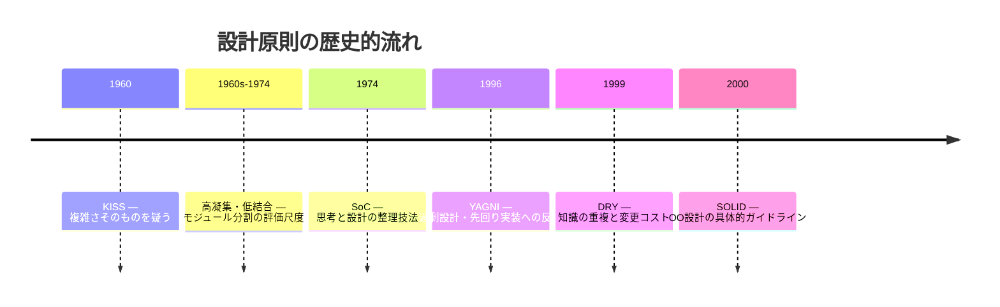

# 設計原則 — 西暦順の整理

ソフトウェア設計の原則は、**過去の現場で繰り返し起きた失敗**を教訓に、時代とともに積み重ねられてきました。ここでは代表的な6つを **提唱・体系化された西暦順** に並べ、それぞれ **何が課題だったのか** と **どう解決しようとしたのか** を整理します。

| 順 | 原則 | 略称 | 提唱・体系化 | 主な提唱者 |
|----|------|------|-------------|-----------|
| 1 | Keep It Simple, Stupid | **KISS** | 1960年頃 | Kelly Johnson（Lockheed Skunk Works） |
| 2 | 高凝集・低結合 | **Cohesion / Coupling** | 1960年代中盤（1974年に体系化） | Larry L. Constantine ほか |
| 3 | 関心の分離 | **SoC** | 1974年 | Edsger W. Dijkstra |
| 4 | You Aren't Gonna Need It | **YAGNI** | 1996年頃 | Kent Beck（XP / C3プロジェクト） |
| 5 | Don't Repeat Yourself | **DRY** | 1999年 | Andy Hunt, Dave Thomas |
| 6 | SOLID | **SOLID** | 2000年（略語は2004年頃） | Robert C. Martin（略語: Michael Feathers） |

---

## 1. KISS（1960年頃）

**Keep It Simple, Stupid** — 「シンプルに保て」

### 背景となった課題

- 高度な技術ほど複雑になりがちで、**現場で修理・運用できない**設計が増えていた
- 複雑さはバグ・故障・コスト増の温床になる
- ソフトウェアでも、1960〜70年代に **複雑さがプロジェクト失敗の主因** だと認識され始めた

### 何を解決しようとしたか

**「動くが複雑すぎて使えない・直せない」** という問題に対し、設計段階から **不要な複雑さを排除する** ことを目標にした。

- 平均的な技術者が、限られた道具で **現場で修理できる** レベルまで単純化する（航空機設計の文脈）
- ソフトウェアでは、**読みやすさ・保守性・信頼性** を優先し、賢さより分かりやすさを選ぶ

### 解決の考え方

- 必要以上の抽象化・最適化・機能追加を避ける
- 1つの関数・モジュールは **1つのこと** だけを行う
- 将来の拡張を理由にした **今の複雑化** を疑う

→ 詳細: [[01_DRY_KISS_YAGNI#KISS原則（Keep It Simple, Stupid）]]

---

## 2. 高凝集・低結合（1960年代中盤〜1974年）

**High Cohesion / Low Coupling** — モジュール内はまとまりよく、モジュール間はゆるやかにつなぐ

### 背景となった課題

- ソフトウェア規模が拡大し、**スパゲッティコード**（goto多用・全体が絡み合った構造）が保守不能に
- 1か所を直すと **どこまで影響するか分からない** 変更が日常化
- 「良いプログラム」と「壊れやすいプログラム」の違いを **客観的に語る尺度** がなかった

### 何を解決しようとしたか

**「変更しやすいモジュール分割の基準は何か」** という問題に対し、2つの尺度を提示した。

| 尺度 | 悪い状態 | 良い状態 |
|------|---------|---------|
| **凝集度** | 関係のない処理が1モジュールに混在（低凝集） | 同じ目的の処理だけが集まる（高凝集） |
| **結合度** | モジュール同士が内部まで知り合い（密結合） | 必要最小限のインターフェースだけで接続（疎結合） |

### 解決の考え方

- **高凝集**: 変更の理由が同じものは1モジュールにまとめ、影響を局所化する
- **低結合**: モジュール間は抽象（インターフェース）越しに接続し、差し替え・テスト・再利用を容易にする
- 1968年に初出、1974年の *Structured Design*（Stevens, Myers, Constantine）で広く知られるようになった

→ 詳細: [[03_疎結合と高凝集]]

---

## 3. 関心の分離 SoC（1974年）

**Separation of Concerns** — 異なる関心（目的・責任）は別の場所に分ける

### 背景となった課題

- プログラムの **正しさ・効率・望ましさ** など、評価軸が異なる性質を **同時に扱おうとすると思考が混乱** する
- 1つの関数・モジュールに **表示・検証・永続化・通知** など目的の異なる処理が混在する
- 構造化プログラミング以降、**複雑さをどう整理して考えるか** の方法論が求められていた

### 何を解決しようとしたか

**「複数の観点を一度に扱うと、どれも中途半端になる」** という認知的な問題に対し、**1つの観点に集中して考える** 技法を提唱した。

- 正しさだけを見る日、効率だけを見る日、と **関心ごとに分けて検討** する
- 設計では、**異なる目的・責任を別モジュール・別レイヤーに分離** する（後世のソフトウェア設計への展開）

### 解決の考え方

- 「ユーザー登録」という流れの中でも、**表示・検証・保存・通知** は別の関心として切り出す
- 1か所の変更が他の関心に波及しないよう、**境界** を設ける
- 高凝集・低結合と組み合わさり、レイヤードアーキテクチャやMVCの根底にある

→ 詳細: [[01_関心の分離]]

---

## 4. YAGNI（1996年頃）

**You Aren't Gonna Need It** — 今いらない機能は作らない

### 背景となった課題

- 1990年代、**綿密な事前設計** が主流で、「将来の拡張性」の名のもと **使われない機能を先回り実装** する傾向が強かった
- 作った機能の多くは **実際には使われず**、テスト・保守コストだけが残る
- 要件は開発中に変わるため、先回りした設計が **すぐ陳腐化** する

### 何を解決しようとしたか

**「将来必要になるかもしれない」という理由での過剰実装** を止め、**今の問題だけを今解く** ことを促した。

- Chrysler C3給与プロジェクト（1996年〜）で Kent Beck が Chet Hendrickson の先回り提案に繰り返し使ったフレーズが起源
- エクストリーム・プログラミング（XP）の **Simple Design（単純な設計）** の中核

### 解決の考え方

- 今のテストを通す最小の実装に集中する
- 「いつか必要になる」機能は、**本当に必要になったとき** に追加する
- ただし **変更しやすい構造** を作ることと、**未使用機能を作ること** は別（構造の柔軟性は残す）

→ 詳細: [[01_DRY_KISS_YAGNI#YAGNI原則（You Aren't Gonna Need It）]]、[[03_DRY・YAGNI原則の落とし穴と実践的判断]]

---

## 5. DRY（1999年）

**Don't Repeat Yourself** — 同じ知識を二重に持たない

### 背景となった課題

- 同じロジック・仕様・知識が **コード・コメント・DBスキーマ・テスト・ドキュメント** など複数箇所に散在する
- 1か所だけ直して **他を直し忘れる** と、システム内で矛盾が生じる（「いつ忘れるか」の問題）
- 「コピペを避ける」だけでは、**見た目は違うが意味は同じ** 重複を見逃す

### 何を解決しようとしたか

**「知識の重複」** そのものを排除し、**変更は1か所で済む** 状態を目指した。

- Andy Hunt と Dave Thomas が『達人プログラマー』（1999年）で体系化
- コピペ防止にとどまらず、**意図・仕様・データ定義** の単一の正（Single Source of Truth）を保つ

### 解決の考え方

- 「この仕様が変わったら、何か所直す必要があるか？」が acid test
- 定数化・関数化・コード生成・自動テスト生成など、**表現形式が違っても知識は1つ** にまとめる
- ただし **たまたま似ているだけ** のコードを無理に統合すると、かえって複雑になる（DRYの誤用に注意）

→ 詳細: [[01_DRY_KISS_YAGNI#DRY原則（Don't Repeat Yourself）]]、[[04_コードの重複とDRY原則違反]]

---

## 6. SOLID（2000年）

**S**ingle Responsibility / **O**pen-Closed / **L**iskov Substitution / **I**nterface Segregation / **D**ependency Inversion

### 背景となった課題

- オブジェクト指向（OO）普及後、**継承の乱用・巨大クラス・具体クラスへの直接依存** により、ソフトウェアが **変更に弱く腐敗（software rot）** していく
- モジュール分割の原則（SoC、高凝集・低結合）はあるが、**クラス設計レベルでどう実践するか** の指針が不足していた
- 小さな変更が **連鎖的に広がる** 依存関係の設計が問題だった

### 何を解決しようとしたか

**「変更に強いOO設計」** のための5原則を1つの枠組みにまとめた。

| 原則 | 解決する課題 | 解決の方向 |
|------|-------------|-----------|
| **SRP** | 1クラスに複数の変更理由が混在 | 1クラス1責任に分割 |
| **OCP** | 機能追加のたびに既存コードを書き換える | 拡張で対応し、修正は閉じる |
| **LSP** | サブタイプが親の契約を破る | 置換可能な継承関係を保つ |
| **ISP** | 使わないメソッドへの依存を強いられる | 小さく分割したインターフェース |
| **DIP** | 上位が下位の具体実装に依存 | 抽象に依存し、具体は注入する |

- Robert C. Martin が 2000年の論文 *Design Principles and Design Patterns* で整理
- 略語 **SOLID** は Michael Feathers が 2004年頃に提案（個々の原則はそれ以前から存在）

### 解決の考え方

- クラス単位で **関心の分離（SRP）** と **依存の向きの制御（DIP）** を実践する
- 高凝集・低結合を **OOの文法（クラス・インターフェース・継承）** で具体化したもの
- デザインパターンやクリーンアーキテクチャの土台になる

→ 詳細: [[01_SRP（単一責任の原則）]]、[[02_OCP (開放閉鎖の原則)]]、[[03_LSP (リスコフの置換原則)]]、[[04_ISP (インターフェース分離の原則)]]、[[05_DIP (依存性逆転の原則)]]

---

## 原則の関係 — 時代の流れ

原則同士は **置き換え関係ではなく、レイヤーが違う** ことが多い。

| レベル | 主な原則 |
|--------|---------|
| 思想・全般 | KISS |
| アーキテクチャ・モジュール | SoC、高凝集・低結合 |
| クラス設計（OO） | SOLID |
| 実装・日々の判断 | DRY、KISS、YAGNI |

**KISS** と **YAGNI** は「作らない・複雑にしない」方向、**DRY** と **SoC** と **SOLID** は「整理して変更しやすくする」方向。**高凝集・低結合** は後者の **良し悪しを測る物差し** として機能する。

---

## 関連ノート

- [[01_DRY_KISS_YAGNI]]
- [[01_関心の分離]]
- [[03_疎結合と高凝集]]
- [[03アーキテクチャに効く原則]]
- [[05_SOLIDとの関係]]
