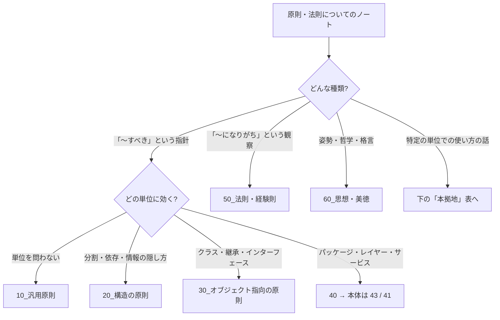

# MOC_原則体系

48_原則 の入口ノート。KISS・DRY・SOLID のような **設計・プログラミングの原則そのもの**（定義・背景・誤解・使いどころ）を扱う。41〜47 の各設計フォルダは「その単位での使い方」を書き、原則の一般論はここに集める。

フォルダは **原則が効く範囲** で分けた（汎用 → 構造 → オブジェクト指向 → パッケージ・アーキテクチャ）。そのあとに、設計原則とは性格が違う **法則・経験則** と **思想・美徳** を置いている。分類は英語圏の定番の並び（KISS/DRY/YAGNI → SoC/凝集・結合/デメテル → SOLID）と、上田勲『プリンシプル オブ プログラミング』の章立て（前提・原則・思想・視点・習慣・手法・法則）を参考にした。

## フォルダ構成と運用ルール

| フォルダ | 役割 | 問い |
|---|---|---|
| 00_全体像 | 本MOC・年表（[[00_設計原則の変遷]]） | — |
| 10_汎用原則 | どの単位のコードにも効く原則（KISS / DRY / YAGNI / 驚き最小） | 作りすぎていないか・重複していないか |
| 20_構造の原則 | 分け方・つなぎ方の原則（関心の分離 / 高凝集・低結合 / 情報隠蔽 / デメテル / CQS） | どう分けて、どうつなぐか |
| 30_オブジェクト指向の原則 | クラス・インターフェースの原則（SOLID / 継承より合成 / ハリウッド原則） | OOP の道具でどう実現するか |
| 40_パッケージ・アーキテクチャの原則 | パッケージ原則・依存ルールへの案内（本体は 43 / 41） | 大きな単位ではどうなるか |
| 50_法則・経験則 | 観察から得られた法則（コンウェイ / ブルックス / ハイラム / ポステル …） | 現場で何が起きがちか |
| 60_思想・美徳 | 考え方・哲学（UNIX 哲学 / 三大美徳 / 銀の弾丸 / Worse is Better） | どういう姿勢で作るか |
| 90_付録 | 用語集・原則同士の衝突表など | — |

- ファイル名は各フォルダ内で **読む順に `01_` から連番**。動画・記事のクリップ（`source` プロパティ付き）は元のタイトルのまま置く
- 動画シリーズ（プリンシプルオブライフ など）はフォルダにせず、内容で振り分ける。出典は `author` / `source` プロパティで持つ
- SOLID は 5 原則をまとめて読むことが多いので `30_オブジェクト指向の原則/SOLID/` にまとめる。入口は [[SOLID]]

### 新しいノートの置き場所

| テーマ | 本拠地 |
|---|---|
| 原則の定義・背景・誤解・衝突 | **48_原則（ここ）** |
| メソッド単位での使い方（KISS・DRY・CQS をメソッドでどう守るか） | 46_メソッド設計 |
| クラス単位での使い方（SOLID の適用・GRASP） | 44_クラス設計・デザインパターン（40_SOLIDの適用 / 20_責務の割り当て） |
| 凝集度・結合度の詳しい分類、パッケージ原則（REP/CCP/CRP/ADP/SDP/SAP） | 43_モジュール設計（20_凝集と結合 / 50_パッケージ原則） |
| アーキテクチャに効く原則・依存性逆転の実装・DI | 41_アーキテクチャ（10_基礎 / 24_依存性の管理） |
| パラダイム（手続き・OOP・関数型）との関係 | 42_ソフトウェア設計/20_パラダイム |
| チームのコーディング規約 | 59_AI開発ツール・コーディング規約/コーディング規約 |

## 00_全体像
- [[00_設計原則の変遷]] — KISS（1960）〜 SOLID（2000）を西暦順に、何の課題を解決したかで整理

## 10_汎用原則
- [[01_DRY_KISS_YAGNI]] — 3 原則の定義・関係・よくある誤解（入口）
- [[02_DRY原則・KISS原則]] — DRY / KISS / YAGNI の適用例と注意点（短いまとめ）
- [[03_DRY・YAGNI原則の落とし穴と実践的判断]] — DRY と SRP の衝突、「間違った抽象化より重複のほうが安い」
- [[04_コードの重複とDRY原則違反]] — AI 生成コードに出がちな重複のパターンとチェックリスト
- （未作成）驚き最小の原則（Principle of Least Astonishment）
- （未作成）ボーイスカウトの規則

## 20_構造の原則
- [[01_関心の分離]] — 「違うことは違う場所に書く」、分ける軸と分けすぎ
- [[02_デメテルの法則]] — 直接の友達とだけ話す、Tell, Don't Ask
- （未作成）高凝集・低結合 — 詳しい分類は [[010Programming/43_モジュール設計/20_凝集と結合/01_凝集度|43 凝集度]]・[[010Programming/43_モジュール設計/20_凝集と結合/02_結合度|43 結合度]]・[[03_疎結合と高凝集]]
- （未作成）情報隠蔽（Parnas 1972）
- （未作成）コマンド・クエリ分離（CQS） — メソッドでの使い方は [[01_CQS]]
- （未作成）機構と方針の分離

## 30_オブジェクト指向の原則
- [[SOLID]] — SOLID の入口
  - [[01_SRP（単一責任の原則）]]
  - [[02_OCP (開放閉鎖の原則)]]
  - [[03_LSP (リスコフの置換原則)]]
  - [[04_ISP (インターフェース分離の原則)]]
  - [[05_DIP (依存性逆転の原則)]]
- （未作成）継承より合成（Composition over Inheritance）
- （未作成）ハリウッド原則・制御の反転（IoC）
- （未作成）GRASP の原則としての位置づけ — クラス設計での使い方は [[02_GRASP]]

## 40_パッケージ・アーキテクチャの原則
- [[01_パッケージ・アーキテクチャの原則への案内]] — 43 / 41 にある本体へのリンク集

## 50_法則・経験則
- （未作成）コンウェイの法則
- （未作成）ブルックスの法則・銀の弾丸はない
- （未作成）ハイラムの法則
- （未作成）ポステルの法則（堅牢性原則）
- （未作成）90 対 90 の法則・ホフスタッターの法則

## 60_思想・美徳
- [[01進研ゼミのマンガに使える気の利いた感想「人生に、銀の弾丸はないよ」【プリンシプルオブライフ1】 26]] — 銀の弾丸はない（動画）
- [[02感情がない人はAPIとして優れているし、情報隠ぺいは正義【プリンシプルオブライフ2】27]] — 情報隠蔽を人生に当てはめる（動画）
- [[03プログラマの三大美徳に痺れる。「傲慢」が特に最高【プリンシプルオブライフ3】28]] — 怠惰・短気・傲慢（動画）
- （未作成）UNIX 哲学
- （未作成）Worse is Better
- （未作成）Zen of Python

## 90_付録
- （未作成）原則の用語集
- （未作成）原則同士の衝突と使い分け（DRY vs SRP、YAGNI vs OCP など）
