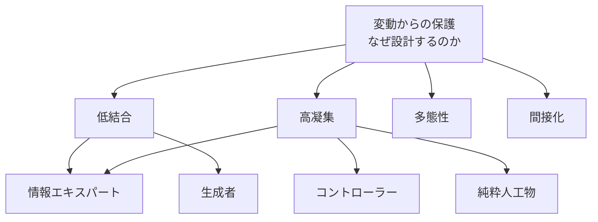

# GRASP の原則としての位置づけ

## はじめに

クラスを作るとき、いちばん迷うのは **「この処理はどのクラスに書けばいいのか」** です。SOLID は「できあがったクラスが良いかどうか」を判定するのは得意ですが、「どこに書くか」を直接は教えてくれません。

そこを埋めるのが **GRASP（General Responsibility Assignment Software Patterns）** です。名前には「パターン」と付いていますが、中身は **責務の割り当てを判断するための原則集** と考えると分かりやすくなります。

このノートでは GRASP を **原則の地図の中でどこに置くか** を整理します。具体的な使い方は [[02_GRASP]] を見てください。

---

## 一言でいうと

**「責務（やること）を、どのクラスに持たせるかを決めるための 9 つの判断基準」**

---

## 定義・背景

- Craig Larman が著書『Applying UML and Patterns』（初版 1997）で提唱
- "grasp" は英語で「理解する・つかむ」。**オブジェクト設計の基本をつかむ** という意味が掛けてある
- GoF のデザインパターンのような「決まった形の部品」ではなく、**どの設計にも使える考え方** をパターンの形式で書いたもの

### 9 つのパターン

| パターン | 一言でいうと | 性格 |
|---|---|---|
| 情報エキスパート（Information Expert） | その情報を持っているクラスに仕事をさせる | 割り当ての基本 |
| 生成者（Creator） | B を含む・記録する・よく使うクラス A に B を作らせる | 割り当ての基本 |
| コントローラー（Controller） | 画面からのイベントを受ける窓口クラスを決める | 層の境界 |
| 低結合（Low Coupling） | 依存を少なくする | **評価軸** |
| 高凝集（High Cohesion） | 関係の深い責務だけをまとめる | **評価軸** |
| 多態性（Polymorphism） | 型で分岐するなら多態で置き換える | 変化への対応 |
| 純粋人工物（Pure Fabrication） | 現実にない概念でも、設計のためにクラスを作ってよい | 例外の許可 |
| 間接化（Indirection） | 間に仲介役を置いて直接の結合を避ける | 変化への対応 |
| 変動からの保護（Protected Variations） | 変わりそうな所を安定したインターフェースで囲む | **上位の原則** |

---

## 原則として眺めると: 3 つの層

9 つは横並びではなく、役割で 3 層に分けると見通しがよくなります。



1. **目的**: 変動からの保護 — 変化の影響を閉じ込めたい
2. **評価軸**: 低結合・高凝集 — 割り当てが良いかを測るものさし
3. **具体的な手**: 情報エキスパート・生成者・コントローラー・多態性・純粋人工物・間接化

---

## 他の原則との対応

| GRASP | 近い原則 | 関係 |
|---|---|---|
| 情報エキスパート | [[02_デメテルの法則]]・Tell, Don't Ask | データを持つ者に「頼む」 |
| 低結合・高凝集 | 高凝集・低結合（Constantine） | ほぼそのまま取り込んだもの |
| 多態性 | [[02_OCP (開放閉鎖の原則)]] | 分岐を多態にして拡張に開く |
| 変動からの保護 | [[02_OCP (開放閉鎖の原則)]]・情報隠蔽（Parnas） | Larman 自身が「OCP や情報隠蔽と本質的に同じ」と述べている |
| 間接化 | [[05_DIP (依存性逆転の原則)]]・[[02_ハリウッド原則・制御の反転]] | 間に抽象・仲介を挟む |
| 純粋人工物 | [[01_SRP（単一責任の原則）]]・[[01_関心の分離]] | 技術的な関心を専用クラスに切り出す |
| コントローラー | [[01_関心の分離]] | UI と業務ロジックの境界 |

SOLID が **「できたクラスの良し悪しを測る」** のに対し、GRASP は **「どこに書くかを決める」** ための原則です。両方を組み合わせると、設計の **作る段階** と **見直す段階** の両方をカバーできます。

---

## 悪い例 / 良い例（情報エキスパート）

```javascript
// 悪い例: 合計の計算を、データを持たない外のクラスがやっている
class OrderService {
  total(order) {
    let sum = 0;
    for (const line of order.lines) {
      sum += line.product.price * line.quantity;
    }
    return sum;
  }
}
```

```javascript
// 良い例: 情報を持っているクラスに計算させる
class OrderLine {
  constructor(product, quantity) { this.product = product; this.quantity = quantity; }
  subtotal() { return this.product.price * this.quantity; }
}

class Order {
  constructor(lines) { this.lines = lines; }
  total() { return this.lines.reduce((sum, l) => sum + l.subtotal(), 0); }
}
```

`OrderLine` が単価と数量を持っているので小計は `OrderLine` に、明細の一覧を持っている `Order` に合計を、と **情報の持ち主に責務を割り当てて** います。結果としてデメテルの法則も守られ、結合も下がります。

---

## よくある誤解

### 誤解1: 「GRASP は GoF のようなパターン集」

GoF は **具体的なクラス構造の型**、GRASP は **割り当ての判断基準** です。GRASP の「多態性」「間接化」を具体的な形にしたものが Strategy や Adapter、と考えると関係がつかめます。

### 誤解2: 「9 つ全部を同時に満たす」

パターン同士はぶつかります。たとえば情報エキスパートに従うと、エンティティが DB 保存まで抱えて凝集が下がることがあります。そのときは **純粋人工物**（Repository など）を作って逃がします。判断の最終基準は **低結合・高凝集・変動からの保護** です。

### 誤解3: 「純粋人工物は何でも作ってよい許可」

業務の言葉に対応しないクラスを作りすぎると、ロジックがサービスクラスに集まり、ドメインのクラスがデータだけの入れ物になります（貧血モデル）。まずは情報エキスパートを優先します。

---

## まとめ

- GRASP は Larman（1997）による **責務の割り当ての原則集**
- 9 つは「目的（変動からの保護）→ 評価軸（低結合・高凝集）→ 具体的な手」の 3 層で読む
- SOLID は「良し悪しの判定」、GRASP は「どこに書くかの決定」
- 変動からの保護は OCP・情報隠蔽とほぼ同じ考え

---

## 関連ノート

- [[02_GRASP]] — クラス設計での使い方（44）
- [[05_Tell_Dont_Askと貧血モデルの回避]]
- [[SOLID]]
- [[03_疎結合と高凝集]]
- [[02_デメテルの法則]]

→ 入口: [[MOC_原則体系]]
