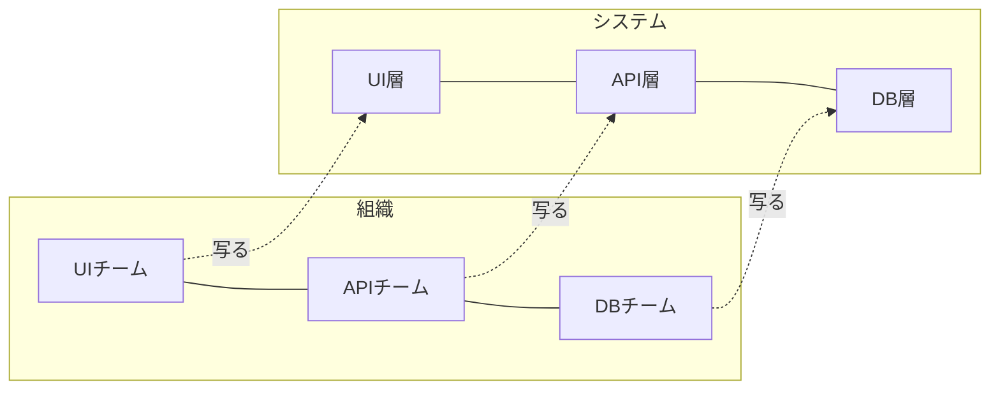

# コンウェイの法則（Conway's Law）

## はじめに

「フロントエンドチーム」と「バックエンドチーム」に分かれた会社では、なぜかシステムもきれいに「フロント」と「バック」に分かれ、その間の API がいつも揉めどころになります。これは偶然ではありません。

**組織の形が、そのままシステムの形に写る** という観察を、**コンウェイの法則（Conway's Law）** と呼びます。

---

## 一言でいうと

**「システムの構造は、それを作る組織のコミュニケーション構造をなぞる」**

原文はおおむね次のとおりです。

> システムを設計する組織は、その組織のコミュニケーション構造をそっくりまねた構造の設計を生み出してしまう。

「〜すべき」という指針ではなく、**「〜になりがち」という観察** です。

---

## 出典・背景

- **Melvin Conway** が 1967 年に書いた論文「How Do Committees Invent?」が出典。1968 年に雑誌 *Datamation* に掲載された
- 「コンウェイの法則」という名前を広めたのは **Fred Brooks** の『人月の神話』（1975）→ [[02_ブルックスの法則・銀の弾丸はない]]

なぜこうなるのかは単純です。**モジュールとモジュールの境界には、必ず「その両側の担当者が話し合うこと」が必要** になります。話しやすい相手（同じチーム）との間には細かくて密な連携が生まれ、話しにくい相手（別チーム・別部署）との間には、太くて固い「取り決め＝インターフェース」しか生まれません。

---

## 現場で起きる例

### 例1: チームの数だけレイヤーができる

技術ごとにチームを分けると、システムも技術レイヤーで分かれます。すると **「注文機能に項目を1つ足す」だけで 3 チームの調整が必要** になり、リリースが遅くなります。

### 例2: 3 社で作ると 3 つのサブシステムになる

複数のベンダーに分割発注すると、ベンダーの数だけサブシステムができ、その間は CSV ファイルやバッチ連携のような **疎すぎる・固すぎるつなぎ方** になりがちです。

### 例3: マイクロサービスがチームより多い

5 人のチームが 20 個のマイクロサービスを持つと、「サービス間の境界」に「チーム間の境界」が対応しません。結局全員が全サービスを触ることになり、**分散しているのに独立していない**（分散モノリス）状態になりやすいです。→ [[02モノリスと分散モノリスとマイクロサービスといつ分けるか]]

---

## どう付き合うか

### 逆コンウェイ戦略（Inverse Conway Maneuver）

法則に逆らうのではなく、**利用する** 考え方です。

> **欲しいシステムの形を先に決め、その形に合わせてチームを組む。**

- 「注文」「在庫」「配送」のように **ビジネスの区切りでサービスを分けたい** なら、チームもその区切りで作る（各チームに UI〜DB までの担当者をそろえる）
- 2010 年代に ThoughtWorks の人たちが広めた呼び名で、『チームトポロジー』（2019）などで詳しく扱われている

詳しくは [[04進化型アーキテクチャとリバースコンウェイの法則]]。

### 設計レビューで「誰と誰が話すか」を見る

- モジュール境界を引くときに、**その境界の両側を同じチームが持つのか、別チームが持つのか** を確認する
- 別チームにまたがる境界は、**変更頻度の低い、安定した場所** に置く（頻繁に変わる境界を組織の壁にまたがせると、調整コストが爆発する）

---

## よくある誤解

| 誤解 | 実際 |
|---|---|
| 「コンウェイの法則に従うべきだ」 | 法則は観察。良い悪いではなく **そうなりやすい** という話。望む形があるなら逆コンウェイで組織側を合わせる |
| 「組織図を変えればシステムもすぐ変わる」 | 既存システムの構造はすぐには変わらない。**組織とシステムがずれている期間** は調整コストが増える |
| 「小さい会社には関係ない」 | 人数が少なくても、「誰に聞けば分かるか」の構造はシステムに写る。1 人しか触れないモジュールはその人の頭の形になる |

---

## まとめ

- **システムは組織のコミュニケーション構造をなぞる**（Conway, 1968）
- 話しやすい相手とは密に、話しにくい相手とは固く結合する
- 欲しいアーキテクチャがあるなら、**チームの形から合わせる**（逆コンウェイ戦略）
- 組織の壁をまたぐ境界は、安定した場所に置く

---

## 関連ノート

- [[04進化型アーキテクチャとリバースコンウェイの法則]] — 41 での扱い（本体）
- [[03_境界づけられたコンテキストとコンテキストマップ]] — DDD でのチームと境界の関係
- [[02モノリスと分散モノリスとマイクロサービスといつ分けるか]]
- [[01_関心の分離]] — 分け方の原則側の話
- [[02_ブルックスの法則・銀の弾丸はない]] — 名付け親の Brooks

→ 入口: [[MOC_原則体系]]
