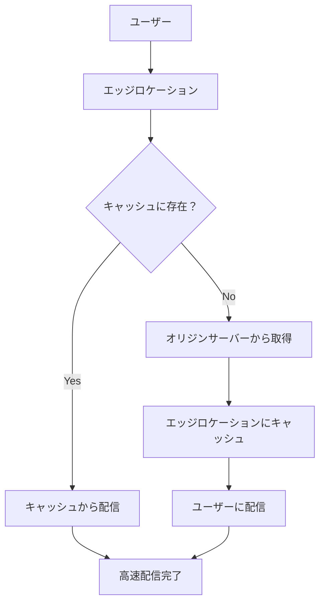

# AWS CloudFront 初心者向け解説

## 目次
1. [CloudFrontとは](#cloudfrontとは)
2. [CDN（Content Delivery Network）の基本概念](#cdncontent-delivery-networkの基本概念)
3. [CloudFrontの主要機能](#cloudfrontの主要機能)
4. [CloudFrontの仕組み](#cloudfrontの仕組み)
5. [CloudFrontの料金体系](#cloudfrontの料金体系)
6. [CloudFrontの設定手順](#cloudfrontの設定手順)
7. [実践例：静的Webサイトの配信](#実践例静的webサイトの配信)
8. [実践例：動的コンテンツの配信](#実践例動的コンテンツの配信)
9. [セキュリティ機能](#セキュリティ機能)
10. [パフォーマンス最適化](#パフォーマンス最適化)
11. [よくある質問](#よくある質問)

## CloudFrontとは

**Amazon CloudFront**は、AWSが提供する**CDN（Content Delivery Network）**サービスです。Webサイトやアプリケーションのコンテンツを世界中のユーザーに高速で配信するためのサービスです。

### 主な特徴
- **高速配信**: 世界中のエッジロケーションからコンテンツを配信
- **低レイテンシ**: ユーザーに最も近いサーバーからコンテンツを提供
- **高可用性**: AWSのインフラストラクチャを活用した信頼性
- **セキュリティ**: DDoS攻撃対策やSSL/TLS暗号化をサポート

## CDN（Content Delivery Network）の基本概念

### CDNとは
CDNは、Webサイトのコンテンツ（画像、動画、CSS、JavaScriptなど）を世界中の複数のサーバーにコピーして保存し、ユーザーに最も近いサーバーから配信する仕組みです。

### CDNのメリット
1. **高速化**: ユーザーに近いサーバーから配信することで読み込み速度が向上
2. **サーバー負荷軽減**: オリジンサーバーへのアクセスを分散
3. **可用性向上**: 複数のサーバーで冗長化
4. **コスト削減**: 帯域幅コストの削減

### 従来の配信方式との比較

```
従来の方式:
ユーザー → インターネット → オリジンサーバー（遠い）

CDN方式:
ユーザー → エッジロケーション（近い） → オリジンサーバー（必要時のみ）
```

## CloudFrontの主要機能

### 1. エッジロケーション
- **400以上のエッジロケーション**を世界中に展開
- 主要都市に配置されたキャッシュサーバー
- ユーザーに最も近いロケーションから配信

### 2. キャッシュ機能
- 静的コンテンツをエッジロケーションにキャッシュ
- 設定可能なキャッシュ期間（TTL）
- キャッシュ無効化機能

### 3. オリジンサーバー対応
- **S3バケット**: 静的Webサイトのホスティング
- **EC2インスタンス**: 動的コンテンツの配信
- **ELB**: ロードバランサー経由での配信
- **外部サーバー**: 自社サーバーとの連携

### 4. セキュリティ機能
- **AWS WAF**: Webアプリケーションファイアウォール
- **DDoS攻撃対策**: AWS Shieldとの連携
- **SSL/TLS暗号化**: HTTPS通信のサポート

## CloudFrontの仕組み

### 基本的な流れ

```
1. ユーザーがWebサイトにアクセス
2. DNSがユーザーに最も近いエッジロケーションを決定
3. エッジロケーションでコンテンツをチェック
4. キャッシュにない場合、オリジンサーバーから取得
5. エッジロケーションにキャッシュしてユーザーに配信
6. 次回のアクセス時はキャッシュから高速配信
```

### キャッシュの仕組み



## CloudFrontの料金体系

### 基本料金（2024年時点）
- **データ転送料金**: 転送量に応じた従量課金
- **リクエスト料金**: HTTP/HTTPSリクエスト数に応じた課金
- **無料利用枠**: 月間50GBのデータ転送、200万リクエスト

### 料金例
```
月間100GB転送、1000万リクエストの場合:
- データ転送: 約$8.50
- リクエスト: 約$0.85
- 合計: 約$9.35/月
```

## CloudFrontの設定手順

### 1. ディストリビューションの作成

```bash
# AWS CLIでの作成例
aws cloudfront create-distribution \
    --distribution-config '{
        "CallerReference": "my-distribution-2024",
        "Comment": "My CloudFront Distribution",
        "DefaultCacheBehavior": {
            "TargetOriginId": "S3-my-bucket",
            "ViewerProtocolPolicy": "redirect-to-https",
            "CachePolicyId": "4135ea2d-6df8-44a3-9df3-4b5a84be39ad"
        },
        "Origins": {
            "Quantity": 1,
            "Items": [
                {
                    "Id": "S3-my-bucket",
                    "DomainName": "my-bucket.s3.amazonaws.com",
                    "S3OriginConfig": {
                        "OriginAccessIdentity": ""
                    }
                }
            ]
        },
        "Enabled": true
    }'
```

### 2. 基本的な設定項目

| 設定項目 | 説明 | 推奨値 |
|---------|------|--------|
| **Origin Domain** | オリジンサーバーのドメイン | S3バケット名 |
| **Viewer Protocol Policy** | プロトコル設定 | Redirect HTTP to HTTPS |
| **Cache Policy** | キャッシュポリシー | CachingOptimized |
| **TTL** | キャッシュ期間 | 86400秒（1日） |

## 実践例：静的Webサイトの配信

### 1. S3バケットの準備

```bash
# S3バケットの作成
aws s3 mb s3://my-static-website-2024

# 静的ファイルのアップロード
aws s3 cp index.html s3://my-static-website-2024/
aws s3 cp style.css s3://my-static-website-2024/
aws s3 cp script.js s3://my-static-website-2024/
```

### 2. CloudFrontディストリビューションの設定

```yaml
# CloudFormationテンプレート例
Resources:
  CloudFrontDistribution:
    Type: AWS::CloudFront::Distribution
    Properties:
      DistributionConfig:
        Origins:
          - Id: S3Origin
            DomainName: !Sub "${S3Bucket}.s3.amazonaws.com"
            S3OriginConfig:
              OriginAccessIdentity: !Sub "origin-access-identity/cloudfront/${OriginAccessIdentity}"
        DefaultCacheBehavior:
          TargetOriginId: S3Origin
          ViewerProtocolPolicy: redirect-to-https
          CachePolicyId: 4135ea2d-6df8-44a3-9df3-4b5a84be39ad
        Enabled: true
        Comment: Static website distribution
```

### 3. パフォーマンスの確認

```bash
# 配信速度のテスト
curl -w "@curl-format.txt" -o /dev/null -s "https://d1234567890.cloudfront.net/index.html"

# curl-format.txtの内容
#      time_namelookup:  %{time_namelookup}\n
#         time_connect:  %{time_connect}\n
#      time_appconnect:  %{time_appconnect}\n
#     time_pretransfer:  %{time_pretransfer}\n
#        time_redirect:  %{time_redirect}\n
#   time_starttransfer:  %{time_starttransfer}\n
#                      ----------\n
#           time_total:  %{time_total}\n
```

## 実践例：動的コンテンツの配信

### 1. EC2インスタンスとの連携

```javascript
// Express.jsアプリケーション例
const express = require('express');
const app = express();

// CloudFrontからのリクエストを識別
app.use((req, res, next) => {
  const cloudfrontViewerCountry = req.headers['cloudfront-viewer-country'];
  const cloudfrontIsMobileViewer = req.headers['cloudfront-is-mobile-viewer'];
  
  console.log(`Country: ${cloudfrontViewerCountry}, Mobile: ${cloudfrontIsMobileViewer}`);
  next();
});

// 動的コンテンツの配信
app.get('/api/data', (req, res) => {
  res.json({
    timestamp: new Date().toISOString(),
    data: 'Dynamic content from EC2'
  });
});

app.listen(3000);
```

### 2. キャッシュポリシーの設定

```json
{
  "Name": "DynamicContentPolicy",
  "DefaultTTL": 0,
  "MaxTTL": 0,
  "MinTTL": 0,
  "ParametersInCacheKeyAndForwardedToOrigin": {
    "QueryStrings": {
      "Forward": "all"
    },
    "Headers": {
      "Forward": "whitelist",
      "WhitelistedNames": ["Authorization", "Content-Type"]
    }
  }
}
```

## セキュリティ機能

### 1. AWS WAFとの連携

```yaml
# WAF WebACLの設定例
Resources:
  WebACL:
    Type: AWS::WAFv2::WebACL
    Properties:
      Name: CloudFrontWebACL
      Scope: CLOUDFRONT
      DefaultAction:
        Allow: {}
      Rules:
        - Name: RateLimitRule
          Priority: 1
          Statement:
            RateBasedStatement:
              Limit: 2000
              AggregateKeyType: IP
          Action:
            Block: {}
```

### 2. SSL/TLS証明書の設定

```bash
# ACM証明書の作成（us-east-1リージョンで作成が必要）
aws acm request-certificate \
    --domain-name example.com \
    --validation-method DNS \
    --region us-east-1
```

### 3. オリジンアクセス制御

```json
{
  "Version": "2012-10-17",
  "Statement": [
    {
      "Effect": "Allow",
      "Principal": {
        "AWS": "arn:aws:iam::cloudfront:user/CloudFront Origin Access Identity E1234567890"
      },
      "Action": "s3:GetObject",
      "Resource": "arn:aws:s3:::my-bucket/*"
    }
  ]
}
```

## パフォーマンス最適化

### 1. キャッシュ設定の最適化

```yaml
# 異なるコンテンツタイプごとのキャッシュ設定
CacheBehaviors:
  - PathPattern: "*.css"
    TargetOriginId: S3Origin
    CachePolicyId: "4135ea2d-6df8-44a3-9df3-4b5a84be39ad"  # 長期キャッシュ
    TTL:
      DefaultTTL: 86400  # 1日
      MaxTTL: 31536000   # 1年
  
  - PathPattern: "*.js"
    TargetOriginId: S3Origin
    CachePolicyId: "4135ea2d-6df8-44a3-9df3-4b5a84be39ad"
    TTL:
      DefaultTTL: 86400
      MaxTTL: 31536000
  
  - PathPattern: "/api/*"
    TargetOriginId: APIOrigin
    CachePolicyId: "4135ea2d-6df8-44a3-9df3-4b5a84be39ad"
    TTL:
      DefaultTTL: 0      # キャッシュしない
      MaxTTL: 0
```

### 2. 圧縮設定

```json
{
  "Compress": true,
  "CompressionLevel": 6,
  "CompressionTypes": [
    "gzip",
    "brotli"
  ]
}
```

### 3. HTTP/2とHTTP/3の活用

```yaml
# CloudFrontは自動的にHTTP/2とHTTP/3をサポート
# 追加設定は不要
```

## よくある質問

### Q1: CloudFrontとS3の違いは何ですか？
**A:** S3はストレージサービス、CloudFrontはCDNサービスです。S3にファイルを保存し、CloudFrontで高速配信する組み合わせが一般的です。

### Q2: キャッシュを無効化する方法は？
```bash
# 特定のファイルのキャッシュ無効化
aws cloudfront create-invalidation \
    --distribution-id E1234567890 \
    --paths "/index.html" "/style.css"
```

### Q3: 料金を抑える方法は？
- **適切なキャッシュ設定**: 静的コンテンツは長期キャッシュ
- **圧縮の有効化**: 転送量の削減
- **無料利用枠の活用**: 月間50GBまで無料

### Q4: セキュリティを強化する方法は？
- **AWS WAF**: Webアプリケーションファイアウォール
- **HTTPS強制**: 全通信の暗号化
- **オリジンアクセス制御**: S3バケットへの直接アクセス防止

### Q5: パフォーマンスを測定する方法は？
```bash
# 配信速度の測定
curl -w "@curl-format.txt" -o /dev/null -s "https://your-domain.cloudfront.net/"

# キャッシュヒット率の確認
aws cloudfront get-distribution-config --id E1234567890
```

## まとめ

CloudFrontは、Webサイトやアプリケーションのパフォーマンス向上に欠かせないサービスです。適切な設定により、ユーザー体験の向上、サーバー負荷の軽減、セキュリティの強化を実現できます。

### 次のステップ
1. **S3 + CloudFront**: 静的Webサイトの構築
2. **EC2 + CloudFront**: 動的コンテンツの配信
3. **セキュリティ強化**: WAF、HTTPS設定
4. **パフォーマンス最適化**: キャッシュ設定、圧縮設定

CloudFrontを活用して、高速で安全なWebサイトを構築しましょう！
