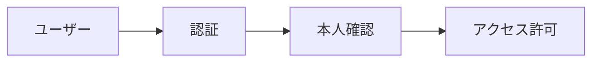
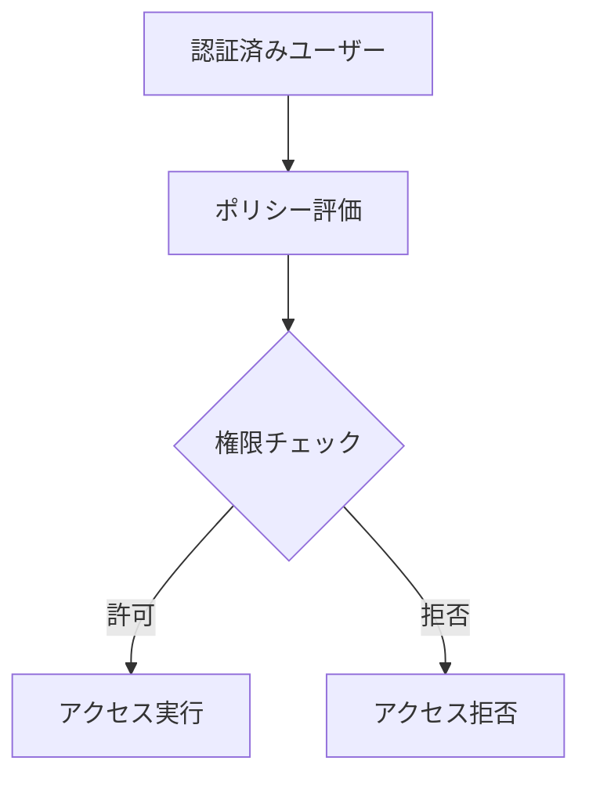
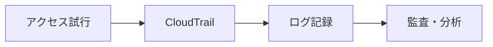

# IAMとは

## 概要

**IAM（Identity and Access Management）**は、AWSアカウント内のユーザーやリソースへのアクセスを管理するサービスです。誰が、どのリソースに、どのような操作を実行できるかを細かく制御できます。

## 主な機能

### 1. 認証（Authentication）
ユーザーが本人であることを確認する機能



**認証の要素:**
- ユーザー名とパスワード
- アクセスキーとシークレットキー
- 多要素認証（MFA）
- 一時的な認証情報

### 2. 認可（Authorization）
ユーザーが何をできるかを制御する機能



**認可の要素:**
- IAMポリシー
- リソースベースポリシー
- 権限境界
- セッションポリシー

### 3. 監査（Auditing）
誰が何をしたかを記録する機能



**監査の要素:**
- CloudTrailログ
- アクセスログ
- 設定変更ログ
- セキュリティイベント

## IAMの主要コンポーネント

### 1. プリンシパル（Principal）
アクセスを要求するエンティティ

| 種類 | 説明 | 例 |
|------|------|-----|
| **ルートユーザー** | AWSアカウントの所有者 | アカウント作成者 |
| **IAMユーザー** | 個別のユーザーアカウント | 開発者、管理者 |
| **IAMロール** | 一時的な権限 | EC2インスタンス、Lambda関数 |
| **フェデレーティッドユーザー** | 外部IDプロバイダー経由 | SAML、OIDC |

### 2. リソース（Resource）
アクセス対象となるAWSリソース

```json
{
  "Resource": [
    "arn:aws:s3:::my-bucket/*",
    "arn:aws:ec2:us-east-1:123456789012:instance/*",
    "arn:aws:iam::123456789012:user/john"
  ]
}
```

### 3. アクション（Action）
実行可能な操作

```json
{
  "Action": [
    "s3:GetObject",
    "s3:PutObject",
    "ec2:DescribeInstances",
    "iam:CreateUser"
  ]
}
```

### 4. 条件（Condition）
アクセスを制限する条件

```json
{
  "Condition": {
    "StringEquals": {
      "aws:SourceIp": "203.0.113.0/24"
    },
    "DateGreaterThan": {
      "aws:CurrentTime": "2024-01-01T00:00:00Z"
    }
  }
}
```

## ポリシーの種類

### 1. AWS管理ポリシー
- AWSが提供する事前定義されたポリシー
- 一般的な用途に使用
- 例：ReadOnlyAccess、PowerUserAccess

### 2. カスタマー管理ポリシー
- ユーザーが作成・管理するポリシー
- 特定の要件に合わせてカスタマイズ
- 再利用可能

### 3. インラインポリシー
- 特定のエンティティに直接付与
- そのエンティティでのみ使用
- 一時的な権限に適している

## JSONステートメント記法

### 基本的な構造

```json
{
  "Version": "2012-10-17",
  "Statement": [
    {
      "Effect": "Allow",
      "Action": "s3:GetObject",
      "Resource": "arn:aws:s3:::my-bucket/*"
    }
  ]
}
```

### 主要な要素

- **Effect**: Allow（許可）またはDeny（拒否）
- **Action**: 実行可能な操作
- **Resource**: 対象となるリソース
- **Condition**: 追加の条件

## リソースベースポリシー

- リソース側でアクセス権限を定義
- S3バケット、SNSトピックなどで使用
- クロスアカウントアクセスに有効

## 認証情報

### 1. アクセスキーID
- プログラムアクセス用の識別子
- 公開情報（機密ではない）

### 2. シークレットアクセスキー
- プログラムアクセス用の秘密鍵
- 絶対に公開してはいけない
- 定期的なローテーションが推奨

## IAMの利点

### 1. セキュリティの向上
- **最小権限の原則**: 必要最小限の権限のみ付与
- **多要素認証**: セキュリティの強化
- **一時的な認証情報**: リスクの軽減

### 2. 柔軟なアクセス制御
- **細かい権限制御**: リソースレベルでの制御
- **動的な権限**: 条件に基づく制御
- **属性ベースアクセス制御（ABAC）**: タグベースの制御

### 3. 監査とコンプライアンス
- **詳細なログ**: すべてのアクセスを記録
- **設定の追跡**: 変更履歴の管理
- **コンプライアンス対応**: 規制要件への対応

## 実際の使用例

### 1. 開発者向け権限
- EC2、S3の読み書き権限
- 特定のリソースのみアクセス可能

### 2. 管理者向け権限
- 全リソースの管理権限
- ユーザー作成・削除権限

### 3. アプリケーション用ロール
- EC2インスタンスからS3へのアクセス
- 一時的な認証情報の使用

## セキュリティのベストプラクティス

### 1. 強力なパスワードポリシー
- 複雑なパスワードの要求
- 定期的な変更の強制

### 2. MFAの有効化
- ルートユーザーは必須
- 特権ユーザーにも推奨

### 3. 定期的な権限見直し
- 不要な権限の削除
- アクセスログの監視

### 4. 一時的な認証情報の使用
- ロールベースのアクセス
- 長期のアクセスキーを避ける

## IAMの制限事項

### 1. アカウント制限
- **ユーザー数**: アカウントあたり5,000ユーザー
- **グループ数**: アカウントあたり300グループ
- **ロール数**: アカウントあたり1,000ロール
- **ポリシー数**: ユーザー/グループ/ロールあたり10ポリシー

### 2. ポリシー制限
- **ポリシーサイズ**: 最大2,048文字
- **バージョン数**: ポリシーあたり5バージョン
- **条件数**: ポリシーあたり10条件

### 3. セッション制限
- **セッション時間**: 最大12時間
- **一時的認証情報**: 最大36時間

## 注意点

### 1. 権限の継承
- グループの権限はメンバーに継承
- ロールの権限は引き受けた時に有効

### 2. ポリシーの優先順位
- DenyがAllowより優先
- 複数のポリシーが適用される場合の動作

### 3. リソースの制限
- アカウントあたりの制限数
- ポリシーのサイズ制限

## IAMの料金

### 基本料金
- **IAMユーザー**: 無料
- **IAMロール**: 無料
- **IAMポリシー**: 無料

### 関連サービス料金
- **CloudTrail**: イベントあたりの料金
- **AWS Config**: 設定項目あたりの料金
- **Access Analyzer**: 分析あたりの料金

## まとめ

IAMは、AWSのセキュリティの基盤となる重要なサービスです。適切に設定することで、セキュアで効率的なアクセス管理が可能になります。最小権限の原則に従い、定期的な見直しを行うことが重要です。

## 次のステップ

1. **[ルートユーザー](./02_ルートユーザー.md)** - ルートユーザーの理解
2. **[IAMユーザー](./03_IAMユーザー.md)** - IAMユーザーの作成
3. **[IAMポリシー](./05_IAMポリシー.md)** - ポリシーの作成
4. **[ベストプラクティス](./10_ベストプラクティス.md)** - セキュリティのベストプラクティス

---

**関連リンク:**
- [AWS IAM公式ドキュメント](https://docs.aws.amazon.com/iam/)
- [IAM ポリシーリファレンス](https://docs.aws.amazon.com/iam/latest/UserGuide/reference_policies.html)
- [IAM ベストプラクティス](https://docs.aws.amazon.com/iam/latest/UserGuide/best-practices.html)