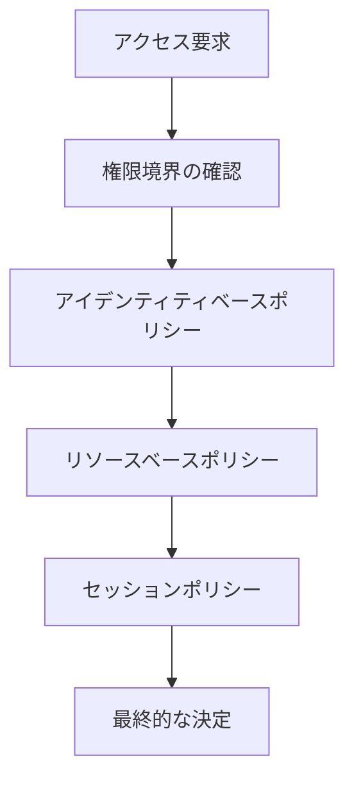

# IAMポリシー

## 概要

**IAMポリシー**は、ユーザーやロールに付与する権限を定義するJSONドキュメントです。AWSリソースへのアクセスを制御するための基本的な仕組みです。

## ポリシーの構造

### 1. 基本的な構造
```json
{
  "Version": "2012-10-17",
  "Statement": [
    {
      "Effect": "Allow",
      "Action": "s3:GetObject",
      "Resource": "arn:aws:s3:::my-bucket/*"
    }
  ]
}
```

### 2. 主要な要素

#### Version
```json
{
  "Version": "2012-10-17"
}
```
- ポリシー言語のバージョン
- 現在は「2012-10-17」が標準

#### Statement
```json
{
  "Statement": [
    {
      "Effect": "Allow",
      "Action": "s3:GetObject",
      "Resource": "arn:aws:s3:::my-bucket/*"
    }
  ]
}
```
- 権限の詳細を定義
- 複数のStatementを含むことが可能

#### Effect
```json
{
  "Effect": "Allow"  // または "Deny"
}
```
- **Allow**: アクセスを許可
- **Deny**: アクセスを拒否（Allowより優先）

#### Action
```json
{
  "Action": [
    "s3:GetObject",
    "s3:PutObject",
    "s3:DeleteObject"
  ]
}
```
- 実行可能な操作を指定
- ワイルドカード（*）も使用可能

#### Resource
```json
{
  "Resource": [
    "arn:aws:s3:::my-bucket",
    "arn:aws:s3:::my-bucket/*"
  ]
}
```
- 対象となるリソースを指定
- ARN（Amazon Resource Name）で指定

#### Condition
```json
{
  "Condition": {
    "StringEquals": {
      "aws:SourceIp": "203.0.113.0/24"
    }
  }
}
```
- アクセスを制限する条件
- 複数の条件を組み合わせ可能

## ポリシーの種類

### 1. アイデンティティベースポリシー

#### ユーザーポリシー
```json
{
  "Version": "2012-10-17",
  "Statement": [
    {
      "Effect": "Allow",
      "Action": "s3:GetObject",
      "Resource": "arn:aws:s3:::my-bucket/*"
    }
  ]
}
```

#### グループポリシー
```json
{
  "Version": "2012-10-17",
  "Statement": [
    {
      "Effect": "Allow",
      "Action": [
        "s3:GetObject",
        "s3:PutObject"
      ],
      "Resource": "arn:aws:s3:::my-bucket/*"
    }
  ]
}
```

#### ロールポリシー
```json
{
  "Version": "2012-10-17",
  "Statement": [
    {
      "Effect": "Allow",
      "Action": "s3:*",
      "Resource": "*"
    }
  ]
}
```

### 2. リソースベースポリシー

#### S3バケットポリシー
```json
{
  "Version": "2012-10-17",
  "Statement": [
    {
      "Effect": "Allow",
      "Principal": {
        "AWS": "arn:aws:iam::123456789012:user/john-doe"
      },
      "Action": "s3:GetObject",
      "Resource": "arn:aws:s3:::my-bucket/*"
    }
  ]
}
```

#### SNSトピックポリシー
```json
{
  "Version": "2012-10-17",
  "Statement": [
    {
      "Effect": "Allow",
      "Principal": {
        "AWS": "arn:aws:iam::123456789012:user/john-doe"
      },
      "Action": "SNS:Publish",
      "Resource": "arn:aws:sns:us-east-1:123456789012:my-topic"
    }
  ]
}
```

### 3. 権限境界

#### 権限境界ポリシー
```json
{
  "Version": "2012-10-17",
  "Statement": [
    {
      "Effect": "Allow",
      "Action": [
        "s3:GetObject",
        "s3:PutObject"
      ],
      "Resource": "arn:aws:s3:::my-bucket/*"
    }
  ]
}
```

### 4. セッションポリシー

#### 一時的な権限制限
```json
{
  "Version": "2012-10-17",
  "Statement": [
    {
      "Effect": "Allow",
      "Action": "s3:GetObject",
      "Resource": "arn:aws:s3:::my-bucket/*"
    }
  ]
}
```

## ポリシーの作成

### 1. AWS Management Consoleでの作成

#### ステップ1: ポリシー作成
```
1. AWS Management Consoleにログイン
2. IAMサービスに移動
3. 「ポリシー」→「ポリシーを作成」
4. 「JSON」タブを選択
5. ポリシードキュメントを入力
```

#### ステップ2: ポリシーの設定
```
1. ポリシー名を入力
2. 説明を入力
3. 「ポリシーの作成」
4. 必要に応じてユーザーやロールにアタッチ
```

### 2. AWS CLIでの作成

#### ポリシーファイルの作成
```bash
# ポリシーファイルの作成
cat > s3-read-policy.json << EOF
{
  "Version": "2012-10-17",
  "Statement": [
    {
      "Effect": "Allow",
      "Action": "s3:GetObject",
      "Resource": "arn:aws:s3:::my-bucket/*"
    }
  ]
}
EOF

# ポリシーの作成
aws iam create-policy \
    --policy-name S3ReadPolicy \
    --policy-document file://s3-read-policy.json
```

#### ポリシーのアタッチ
```bash
# ユーザーにポリシーをアタッチ
aws iam attach-user-policy \
    --user-name john-doe \
    --policy-arn arn:aws:iam::123456789012:policy/S3ReadPolicy

# グループにポリシーをアタッチ
aws iam attach-group-policy \
    --group-name developers \
    --policy-arn arn:aws:iam::123456789012:policy/S3ReadPolicy

# ロールにポリシーをアタッチ
aws iam attach-role-policy \
    --role-name MyRole \
    --policy-arn arn:aws:iam::123456789012:policy/S3ReadPolicy
```

### 3. CloudFormationでの作成

#### テンプレート例
```yaml
Resources:
  S3ReadPolicy:
    Type: AWS::IAM::Policy
    Properties:
      PolicyName: S3ReadPolicy
      PolicyDocument:
        Version: '2012-10-17'
        Statement:
          - Effect: Allow
            Action: s3:GetObject
            Resource: !Sub 'arn:aws:s3:::${S3Bucket}/*'
      Users:
        - !Ref MyUser

  MyUser:
    Type: AWS::IAM::User
    Properties:
      UserName: MyUser
      Tags:
        - Key: Environment
          Value: Production
```

## 条件の活用

### 1. 基本的な条件

#### IP制限
```json
{
  "Condition": {
    "IpAddress": {
      "aws:SourceIp": "203.0.113.0/24"
    }
  }
}
```

#### 時間制限
```json
{
  "Condition": {
    "DateGreaterThan": {
      "aws:CurrentTime": "2024-01-01T00:00:00Z"
    },
    "DateLessThan": {
      "aws:CurrentTime": "2024-12-31T23:59:59Z"
    }
  }
}
```

#### MFA要求
```json
{
  "Condition": {
    "Bool": {
      "aws:MultiFactorAuthPresent": "true"
    }
  }
}
```

### 2. 高度な条件

#### タグベースの条件
```json
{
  "Condition": {
    "StringEquals": {
      "aws:PrincipalTag/Department": "Engineering"
    }
  }
}
```

#### リソースタグの条件
```json
{
  "Condition": {
    "StringEquals": {
      "s3:ExistingObjectTag/Environment": "Production"
    }
  }
}
```

#### 複数条件の組み合わせ
```json
{
  "Condition": {
    "IpAddress": {
      "aws:SourceIp": "203.0.113.0/24"
    },
    "DateGreaterThan": {
      "aws:CurrentTime": "2024-01-01T00:00:00Z"
    },
    "Bool": {
      "aws:MultiFactorAuthPresent": "true"
    }
  }
}
```

## ポリシーの評価

### 1. 評価の順序



### 2. 評価のルール

#### 1. 明示的なDeny
```json
{
  "Effect": "Deny",
  "Action": "*",
  "Resource": "*"
}
```
- 明示的なDenyは常に優先
- 他のすべての許可を上書き

#### 2. 明示的なAllow
```json
{
  "Effect": "Allow",
  "Action": "s3:GetObject",
  "Resource": "arn:aws:s3:::my-bucket/*"
}
```
- 明示的なAllowが必要
- デフォルトは拒否

#### 3. 条件の評価
```json
{
  "Condition": {
    "StringEquals": {
      "aws:SourceIp": "203.0.113.0/24"
    }
  }
}
```
- すべての条件が満たされる必要がある
- 1つでも条件が満たされない場合は拒否

## ポリシーの管理

### 1. ポリシー情報の確認

#### ポリシー一覧の取得
```bash
# ポリシー一覧の取得
aws iam list-policies

# 特定ポリシーの情報取得
aws iam get-policy --policy-arn arn:aws:iam::123456789012:policy/S3ReadPolicy
```

#### ポリシーのバージョン確認
```bash
# ポリシーのバージョン一覧
aws iam list-policy-versions \
    --policy-arn arn:aws:iam::123456789012:policy/S3ReadPolicy

# 特定バージョンの取得
aws iam get-policy-version \
    --policy-arn arn:aws:iam::123456789012:policy/S3ReadPolicy \
    --version-id v1
```

### 2. ポリシーの更新

#### 新しいバージョンの作成
```bash
# 新しいバージョンの作成
aws iam create-policy-version \
    --policy-arn arn:aws:iam::123456789012:policy/S3ReadPolicy \
    --policy-document file://updated-policy.json \
    --set-as-default
```

#### 古いバージョンの削除
```bash
# 古いバージョンの削除
aws iam delete-policy-version \
    --policy-arn arn:aws:iam::123456789012:policy/S3ReadPolicy \
    --version-id v1
```

### 3. ポリシーの削除

```bash
# ポリシーのデタッチ
aws iam detach-user-policy \
    --user-name john-doe \
    --policy-arn arn:aws:iam::123456789012:policy/S3ReadPolicy

# ポリシーの削除
aws iam delete-policy \
    --policy-arn arn:aws:iam::123456789012:policy/S3ReadPolicy
```

## 実践的なポリシー例

### 1. 開発者用ポリシー

#### 基本的な開発者ポリシー
```json
{
  "Version": "2012-10-17",
  "Statement": [
    {
      "Effect": "Allow",
      "Action": [
        "s3:GetObject",
        "s3:PutObject",
        "s3:DeleteObject",
        "s3:ListBucket"
      ],
      "Resource": [
        "arn:aws:s3:::dev-bucket",
        "arn:aws:s3:::dev-bucket/*"
      ]
    },
    {
      "Effect": "Allow",
      "Action": [
        "ec2:Describe*",
        "ec2:StartInstances",
        "ec2:StopInstances"
      ],
      "Resource": "*"
    },
    {
      "Effect": "Deny",
      "Action": [
        "iam:*",
        "organizations:*"
      ],
      "Resource": "*"
    }
  ]
}
```

### 2. 管理者用ポリシー

#### 条件付き管理者ポリシー
```json
{
  "Version": "2012-10-17",
  "Statement": [
    {
      "Effect": "Allow",
      "Action": "*",
      "Resource": "*",
      "Condition": {
        "IpAddress": {
          "aws:SourceIp": "203.0.113.0/24"
        },
        "Bool": {
          "aws:MultiFactorAuthPresent": "true"
        }
      }
    }
  ]
}
```

### 3. 読み取り専用ポリシー

#### 監査用ポリシー
```json
{
  "Version": "2012-10-17",
  "Statement": [
    {
      "Effect": "Allow",
      "Action": [
        "s3:GetObject",
        "ec2:Describe*",
        "rds:Describe*",
        "cloudwatch:Get*",
        "cloudwatch:List*",
        "logs:Describe*",
        "logs:Get*"
      ],
      "Resource": "*"
    }
  ]
}
```

### 4. 特定サービス専用ポリシー

#### Lambda関数用ポリシー
```json
{
  "Version": "2012-10-17",
  "Statement": [
    {
      "Effect": "Allow",
      "Action": [
        "logs:CreateLogGroup",
        "logs:CreateLogStream",
        "logs:PutLogEvents"
      ],
      "Resource": "arn:aws:logs:*:*:*"
    },
    {
      "Effect": "Allow",
      "Action": [
        "s3:GetObject",
        "s3:PutObject"
      ],
      "Resource": "arn:aws:s3:::my-bucket/*"
    }
  ]
}
```

## ポリシーのテスト

### 1. IAM Policy Simulator

#### 基本的なテスト
```bash
# ポリシーのシミュレーション
aws iam simulate-principal-policy \
    --policy-source-arn arn:aws:iam::123456789012:user/john-doe \
    --action-names s3:GetObject \
    --resource-arns arn:aws:s3:::my-bucket/object.txt
```

#### 複数アクションのテスト
```bash
# 複数アクションのシミュレーション
aws iam simulate-principal-policy \
    --policy-source-arn arn:aws:iam::123456789012:user/john-doe \
    --action-names s3:GetObject s3:PutObject s3:DeleteObject \
    --resource-arns arn:aws:s3:::my-bucket/*
```

### 2. 条件のテスト

#### IP制限のテスト
```bash
# IP制限のシミュレーション
aws iam simulate-principal-policy \
    --policy-source-arn arn:aws:iam::123456789012:user/john-doe \
    --action-names s3:GetObject \
    --resource-arns arn:aws:s3:::my-bucket/* \
    --context-entries ContextKeyName=aws:SourceIp,ContextKeyValues=203.0.113.12,ContextKeyType=string
```

## トラブルシューティング

### 1. アクセス拒否エラー

#### 権限不足
```
エラー: Access Denied
原因: 必要な権限が不足
解決策: 適切なポリシーをアタッチ
```

#### 条件の不適合
```
エラー: Access Denied
原因: 条件が満たされていない
解決策: 条件を確認・修正
```

#### リソースの指定ミス
```
エラー: Access Denied
原因: リソースARNが正しくない
解決策: 正しいARNを指定
```

### 2. ポリシーの構文エラー

#### JSON構文エラー
```
エラー: Invalid JSON
原因: JSON構文が正しくない
解決策: JSON構文を確認・修正
```

#### ポリシー要素の不足
```
エラー: Missing required element
原因: 必須要素が不足
解決策: 必須要素を追加
```

## ベストプラクティス

### 1. セキュリティ
- **最小権限の原則**: 必要最小限の権限のみ付与
- **明示的なDeny**: 必要に応じて明示的なDenyを使用
- **条件の活用**: 適切な条件を設定

### 2. 管理
- **命名規則**: 一貫性のあるポリシー名
- **ドキュメント化**: ポリシーの目的と使用方法を記録
- **バージョン管理**: ポリシーの変更履歴を管理

### 3. 運用
- **テスト**: 本番環境に適用前にテスト
- **監視**: ポリシーの使用状況を監視
- **定期的な見直し**: 権限の必要性を定期的に確認

## 次のステップ

1. **[ABAC](./06-ABAC.md)** - 属性ベースアクセス制御
2. **[条件キーとセッションポリシー](./09-条件キーとセッションポリシー.md)** - 詳細なアクセス制御
3. **[ベストプラクティス](./10-ベストプラクティス.md)** - セキュリティの強化

---

**重要**: IAMポリシーはAWSのセキュリティの基盤です。適切な権限設定と定期的な見直しを実施してください。
