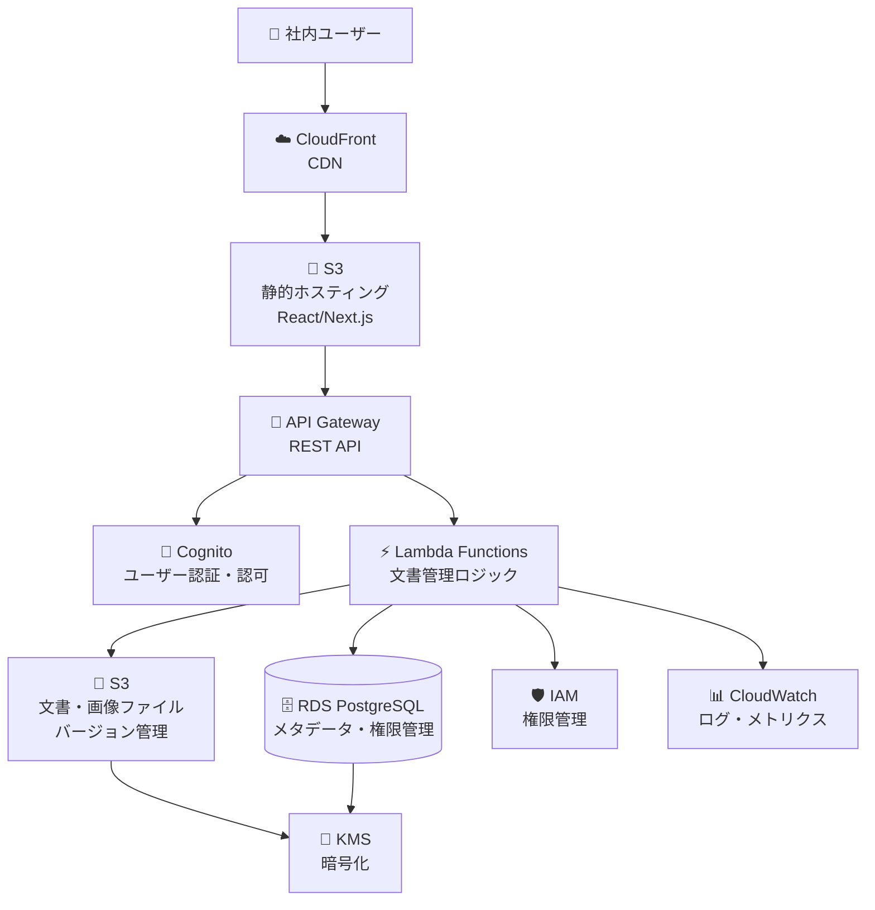

# 社内文書管理システム Phase 1: 基本構築

## 概要

RAGシステム実装を前提とした、段階的な文書管理システムの構築計画です。
Phase 1では基本機能を実装し、Phase 2でRAG機能を追加します。

## Phase 1 アーキテクチャ図



## Phase 1 機能要件

### 基本機能
1. **ユーザー管理**
   - ユーザー登録・ログイン
   - 部門・役職管理
   - 権限レベル設定

2. **文書管理**
   - 文書アップロード（PDF, Word, Excel, PowerPoint, 画像）
   - 文書一覧表示
   - 文書検索・フィルタリング
   - 文書ダウンロード
   - 文書削除

3. **権限管理**
   - 文書レベル権限設定
   - 部門別アクセス制御
   - 閲覧・編集権限の分離

4. **メタデータ管理**
   - 文書情報（タイトル、説明、タグ）
   - 作成者・更新者情報
   - 作成日・更新日
   - ファイルサイズ・種類

## データベース設計（Phase 1）

### テーブル設計
```sql
-- ユーザーテーブル
CREATE TABLE users (
    id UUID PRIMARY KEY DEFAULT gen_random_uuid(),
    email VARCHAR(255) UNIQUE NOT NULL,
    name VARCHAR(255) NOT NULL,
    department VARCHAR(100) NOT NULL,
    position VARCHAR(100),
    role VARCHAR(50) NOT NULL DEFAULT 'viewer', -- admin, editor, viewer
    is_active BOOLEAN DEFAULT true,
    created_at TIMESTAMP DEFAULT CURRENT_TIMESTAMP,
    updated_at TIMESTAMP DEFAULT CURRENT_TIMESTAMP
);

-- 文書テーブル
CREATE TABLE documents (
    id UUID PRIMARY KEY DEFAULT gen_random_uuid(),
    title VARCHAR(500) NOT NULL,
    description TEXT,
    file_name VARCHAR(255) NOT NULL,
    file_path VARCHAR(1000) NOT NULL,
    file_type VARCHAR(50) NOT NULL,
    file_size BIGINT NOT NULL,
    mime_type VARCHAR(100),
    author_id UUID REFERENCES users(id) NOT NULL,
    department VARCHAR(100) NOT NULL,
    visibility VARCHAR(50) NOT NULL DEFAULT 'department', -- public, department, private
    status VARCHAR(50) NOT NULL DEFAULT 'active', -- active, archived, deleted
    version INTEGER DEFAULT 1,
    created_at TIMESTAMP DEFAULT CURRENT_TIMESTAMP,
    updated_at TIMESTAMP DEFAULT CURRENT_TIMESTAMP
);

-- 文書権限テーブル
CREATE TABLE document_permissions (
    id UUID PRIMARY KEY DEFAULT gen_random_uuid(),
    document_id UUID REFERENCES documents(id) ON DELETE CASCADE NOT NULL,
    user_id UUID REFERENCES users(id) ON DELETE CASCADE,
    department VARCHAR(100),
    permission_type VARCHAR(50) NOT NULL, -- read, write, admin
    granted_by UUID REFERENCES users(id),
    granted_at TIMESTAMP DEFAULT CURRENT_TIMESTAMP,
    expires_at TIMESTAMP,
    UNIQUE(document_id, user_id, department)
);

-- 文書タグテーブル
CREATE TABLE document_tags (
    id UUID PRIMARY KEY DEFAULT gen_random_uuid(),
    document_id UUID REFERENCES documents(id) ON DELETE CASCADE NOT NULL,
    tag_name VARCHAR(100) NOT NULL,
    created_at TIMESTAMP DEFAULT CURRENT_TIMESTAMP,
    UNIQUE(document_id, tag_name)
);

-- 文書バージョンテーブル（将来のRAG用）
CREATE TABLE document_versions (
    id UUID PRIMARY KEY DEFAULT gen_random_uuid(),
    document_id UUID REFERENCES documents(id) ON DELETE CASCADE NOT NULL,
    version_number INTEGER NOT NULL,
    file_path VARCHAR(1000) NOT NULL,
    file_size BIGINT NOT NULL,
    created_by UUID REFERENCES users(id) NOT NULL,
    created_at TIMESTAMP DEFAULT CURRENT_TIMESTAMP,
    UNIQUE(document_id, version_number)
);

-- アクセスログテーブル
CREATE TABLE access_logs (
    id UUID PRIMARY KEY DEFAULT gen_random_uuid(),
    document_id UUID REFERENCES documents(id) ON DELETE CASCADE,
    user_id UUID REFERENCES users(id) NOT NULL,
    action VARCHAR(50) NOT NULL, -- view, download, edit, delete
    ip_address INET,
    user_agent TEXT,
    created_at TIMESTAMP DEFAULT CURRENT_TIMESTAMP
);

-- インデックス
CREATE INDEX idx_documents_author ON documents(author_id);
CREATE INDEX idx_documents_department ON documents(department);
CREATE INDEX idx_documents_visibility ON documents(visibility);
CREATE INDEX idx_documents_created_at ON documents(created_at);
CREATE INDEX idx_documents_title ON documents USING gin(to_tsvector('japanese', title));
CREATE INDEX idx_documents_description ON documents USING gin(to_tsvector('japanese', description));
CREATE INDEX idx_document_permissions_document ON document_permissions(document_id);
CREATE INDEX idx_document_permissions_user ON document_permissions(user_id);
CREATE INDEX idx_access_logs_document ON access_logs(document_id);
CREATE INDEX idx_access_logs_user ON access_logs(user_id);
CREATE INDEX idx_access_logs_created_at ON access_logs(created_at);
```

## Phase 1 実装アーキテクチャ

### 1. インフラストラクチャ（Terraform）

```hcl
# variables.tf
variable "environment" {
  description = "Environment name"
  type        = string
  default     = "dev"
}

variable "region" {
  description = "AWS region"
  type        = string
  default     = "ap-northeast-1"
}

# main.tf
terraform {
  required_providers {
    aws = {
      source  = "hashicorp/aws"
      version = "~> 5.0"
    }
  }
}

provider "aws" {
  region = var.region
}

# S3バケット（文書保存用）
resource "aws_s3_bucket" "documents" {
  bucket = "company-documents-${var.environment}-${random_id.bucket_suffix.hex}"
  
  tags = {
    Name        = "Company Documents"
    Environment = var.environment
  }
}

resource "random_id" "bucket_suffix" {
  byte_length = 4
}

# S3バケット（静的ホスティング用）
resource "aws_s3_bucket" "frontend" {
  bucket = "company-docs-frontend-${var.environment}-${random_id.bucket_suffix.hex}"
  
  tags = {
    Name        = "Company Docs Frontend"
    Environment = var.environment
  }
}

# S3バケット設定
resource "aws_s3_bucket_versioning" "documents" {
  bucket = aws_s3_bucket.documents.id
  versioning_configuration {
    status = "Enabled"
  }
}

resource "aws_s3_bucket_encryption" "documents" {
  bucket = aws_s3_bucket.documents.id
  server_side_encryption_configuration {
    rule {
      apply_server_side_encryption_by_default {
        sse_algorithm = "AES256"
      }
    }
  }
}

# RDS PostgreSQL
resource "aws_db_instance" "main" {
  identifier = "company-docs-db-${var.environment}"
  engine     = "postgres"
  engine_version = "15.4"
  instance_class = "db.t3.micro"
  allocated_storage = 20
  max_allocated_storage = 100
  storage_type = "gp2"
  storage_encrypted = true
  
  db_name = "companydocs"
  username = "admin"
  password = var.db_password
  
  vpc_security_group_ids = [aws_security_group.rds.id]
  db_subnet_group_name = aws_db_subnet_group.main.name
  
  backup_retention_period = 7
  backup_window = "03:00-04:00"
  maintenance_window = "sun:04:00-sun:05:00"
  
  skip_final_snapshot = var.environment == "dev"
  deletion_protection = var.environment == "prod"
  
  tags = {
    Name        = "Company Docs Database"
    Environment = var.environment
  }
}

# VPC設定
resource "aws_vpc" "main" {
  cidr_block = "10.0.0.0/16"
  
  tags = {
    Name = "company-docs-vpc"
  }
}

resource "aws_subnet" "private" {
  count = 2
  vpc_id = aws_vpc.main.id
  cidr_block = "10.0.${count.index + 1}.0/24"
  availability_zone = data.aws_availability_zones.available.names[count.index]
  
  tags = {
    Name = "company-docs-private-${count.index + 1}"
  }
}

resource "aws_subnet" "public" {
  count = 2
  vpc_id = aws_vpc.main.id
  cidr_block = "10.0.${count.index + 10}.0/24"
  availability_zone = data.aws_availability_zones.available.names[count.index]
  map_public_ip_on_launch = true
  
  tags = {
    Name = "company-docs-public-${count.index + 1}"
  }
}

# Cognito User Pool
resource "aws_cognito_user_pool" "main" {
  name = "company-docs-users-${var.environment}"
  
  password_policy {
    minimum_length = 8
    require_lowercase = true
    require_numbers = true
    require_symbols = true
    require_uppercase = true
  }
  
  admin_create_user_config {
    allow_admin_create_user_only = true
  }
  
  schema {
    name = "email"
    attribute_data_type = "String"
    required = true
    mutable = true
  }
  
  schema {
    name = "name"
    attribute_data_type = "String"
    required = true
    mutable = true
  }
  
  schema {
    name = "department"
    attribute_data_type = "String"
    required = true
    mutable = true
  }
  
  tags = {
    Name        = "Company Docs Users"
    Environment = var.environment
  }
}

resource "aws_cognito_user_pool_client" "main" {
  name = "company-docs-client"
  user_pool_id = aws_cognito_user_pool.main.id
  
  generate_secret = false
  
  explicit_auth_flows = [
    "ALLOW_USER_SRP_AUTH",
    "ALLOW_REFRESH_TOKEN_AUTH"
  ]
}

# Lambda Functions
resource "aws_lambda_function" "document_handler" {
  filename = "lambda/document_handler.zip"
  function_name = "document-handler-${var.environment}"
  role = aws_iam_role.lambda_role.arn
  handler = "index.handler"
  runtime = "python3.9"
  timeout = 30
  
  environment {
    variables = {
      DB_HOST = aws_db_instance.main.endpoint
      DB_NAME = aws_db_instance.main.db_name
      S3_BUCKET = aws_s3_bucket.documents.bucket
    }
  }
  
  tags = {
    Name        = "Document Handler"
    Environment = var.environment
  }
}

# API Gateway
resource "aws_api_gateway_rest_api" "main" {
  name = "company-docs-api-${var.environment}"
  
  endpoint_configuration {
    types = ["REGIONAL"]
  }
}

# CloudFront
resource "aws_cloudfront_distribution" "main" {
  origin {
    domain_name = aws_s3_bucket.frontend.bucket_regional_domain_name
    origin_id = "S3-${aws_s3_bucket.frontend.bucket}"
    
    s3_origin_config {
      origin_access_identity = aws_cloudfront_origin_access_identity.main.cloudfront_access_identity_path
    }
  }
  
  enabled = true
  is_ipv6_enabled = true
  default_root_object = "index.html"
  
  default_cache_behavior {
    allowed_methods = ["DELETE", "GET", "HEAD", "OPTIONS", "PATCH", "POST", "PUT"]
    cached_methods = ["GET", "HEAD"]
    target_origin_id = "S3-${aws_s3_bucket.frontend.bucket}"
    
    forwarded_values {
      query_string = false
      cookies {
        forward = "none"
      }
    }
    
    viewer_protocol_policy = "redirect-to-https"
    min_ttl = 0
    default_ttl = 3600
    max_ttl = 86400
  }
  
  restrictions {
    geo_restriction {
      restriction_type = "none"
    }
  }
  
  viewer_certificate {
    cloudfront_default_certificate = true
  }
}
```

### 2. Lambda関数実装

#### 文書アップロード処理
```python
# lambda/document_handler.py
import json
import boto3
import uuid
import os
from datetime import datetime
from typing import Dict, Any

# クライアント初期化
s3_client = boto3.client('s3')
rds_client = boto3.client('rds-data')

def lambda_handler(event: Dict[str, Any], context) -> Dict[str, Any]:
    """
    文書管理APIのメインハンドラー
    """
    try:
        # リクエスト解析
        http_method = event['httpMethod']
        path = event['path']
        user_id = event['requestContext']['authorizer']['user_id']
        
        # ルーティング
        if http_method == 'POST' and path == '/documents':
            return upload_document(event, user_id)
        elif http_method == 'GET' and path == '/documents':
            return get_documents(event, user_id)
        elif http_method == 'GET' and path.startswith('/documents/'):
            return get_document(event, user_id)
        elif http_method == 'PUT' and path.startswith('/documents/'):
            return update_document(event, user_id)
        elif http_method == 'DELETE' and path.startswith('/documents/'):
            return delete_document(event, user_id)
        elif http_method == 'GET' and path.startswith('/documents/') and '/download' in path:
            return download_document(event, user_id)
        else:
            return {
                'statusCode': 404,
                'headers': {'Content-Type': 'application/json'},
                'body': json.dumps({'error': 'Not Found'})
            }
            
    except Exception as e:
        print(f"Error: {str(e)}")
        return {
            'statusCode': 500,
            'headers': {'Content-Type': 'application/json'},
            'body': json.dumps({'error': 'Internal Server Error'})
        }

def upload_document(event: Dict[str, Any], user_id: str) -> Dict[str, Any]:
    """
    文書アップロード処理
    """
    try:
        # リクエストボディ解析
        body = json.loads(event['body'])
        
        # 権限チェック
        if not check_user_permission(user_id, 'write'):
            return create_response(403, {'error': '権限がありません'})
        
        # ファイル情報取得
        file_content = body['file_content']  # Base64エンコードされたファイル
        file_name = body['file_name']
        file_type = body['file_type']
        title = body['title']
        description = body.get('description', '')
        department = body.get('department', '')
        visibility = body.get('visibility', 'department')
        tags = body.get('tags', [])
        
        # ファイルサイズチェック（10MB制限）
        file_size = len(file_content.encode('utf-8'))
        if file_size > 10 * 1024 * 1024:
            return create_response(400, {'error': 'ファイルサイズが大きすぎます（10MB以下）'})
        
        # S3にファイルアップロード
        file_key = f"documents/{user_id}/{uuid.uuid4()}/{file_name}"
        s3_client.put_object(
            Bucket=os.environ['S3_BUCKET'],
            Key=file_key,
            Body=file_content,
            ContentType=file_type,
            ServerSideEncryption='AES256'
        )
        
        # データベースにメタデータ保存
        document_id = str(uuid.uuid4())
        query = """
        INSERT INTO documents (id, title, description, file_name, file_path, 
                             file_type, file_size, mime_type, author_id, 
                             department, visibility, status)
        VALUES (:id, :title, :description, :file_name, :file_path, 
                :file_type, :file_size, :mime_type, :author_id, 
                :department, :visibility, :status)
        """
        
        rds_client.execute_statement(
            resourceArn=os.environ['DB_CLUSTER_ARN'],
            secretArn=os.environ['DB_SECRET_ARN'],
            database=os.environ['DB_NAME'],
            sql=query,
            parameters=[
                {'name': 'id', 'value': {'stringValue': document_id}},
                {'name': 'title', 'value': {'stringValue': title}},
                {'name': 'description', 'value': {'stringValue': description}},
                {'name': 'file_name', 'value': {'stringValue': file_name}},
                {'name': 'file_path', 'value': {'stringValue': file_key}},
                {'name': 'file_type', 'value': {'stringValue': file_type}},
                {'name': 'file_size', 'value': {'longValue': file_size}},
                {'name': 'mime_type', 'value': {'stringValue': file_type}},
                {'name': 'author_id', 'value': {'stringValue': user_id}},
                {'name': 'department', 'value': {'stringValue': department}},
                {'name': 'visibility', 'value': {'stringValue': visibility}},
                {'name': 'status', 'value': {'stringValue': 'active'}}
            ]
        )
        
        # タグ保存
        if tags:
            for tag in tags:
                tag_query = """
                INSERT INTO document_tags (document_id, tag_name)
                VALUES (:document_id, :tag_name)
                """
                rds_client.execute_statement(
                    resourceArn=os.environ['DB_CLUSTER_ARN'],
                    secretArn=os.environ['DB_SECRET_ARN'],
                    database=os.environ['DB_NAME'],
                    sql=tag_query,
                    parameters=[
                        {'name': 'document_id', 'value': {'stringValue': document_id}},
                        {'name': 'tag_name', 'value': {'stringValue': tag}}
                    ]
                )
        
        # アクセスログ記録
        log_access(user_id, document_id, 'upload')
        
        return create_response(200, {
            'message': '文書がアップロードされました',
            'document_id': document_id
        })
        
    except Exception as e:
        print(f"Upload error: {str(e)}")
        return create_response(500, {'error': 'アップロードに失敗しました'})

def get_documents(event: Dict[str, Any], user_id: str) -> Dict[str, Any]:
    """
    文書一覧取得
    """
    try:
        # クエリパラメータ取得
        query_params = event.get('queryStringParameters', {}) or {}
        page = int(query_params.get('page', 1))
        limit = int(query_params.get('limit', 20))
        search = query_params.get('search', '')
        department = query_params.get('department', '')
        tag = query_params.get('tag', '')
        
        offset = (page - 1) * limit
        
        # 検索クエリ構築
        where_conditions = ["d.status = 'active'"]
        parameters = []
        
        # 権限フィルタ
        where_conditions.append("""
            (d.visibility = 'public' OR 
             d.department = (SELECT department FROM users WHERE id = :user_id) OR
             d.author_id = :user_id OR
             EXISTS (SELECT 1 FROM document_permissions dp WHERE dp.document_id = d.id AND dp.user_id = :user_id))
        """)
        parameters.extend([
            {'name': 'user_id', 'value': {'stringValue': user_id}},
            {'name': 'user_id', 'value': {'stringValue': user_id}}
        ])
        
        # 検索条件
        if search:
            where_conditions.append("(d.title ILIKE :search OR d.description ILIKE :search)")
            parameters.append({'name': 'search', 'value': {'stringValue': f'%{search}%'}})
        
        if department:
            where_conditions.append("d.department = :department")
            parameters.append({'name': 'department', 'value': {'stringValue': department}})
        
        if tag:
            where_conditions.append("EXISTS (SELECT 1 FROM document_tags dt WHERE dt.document_id = d.id AND dt.tag_name = :tag)")
            parameters.append({'name': 'tag', 'value': {'stringValue': tag}})
        
        # メインクエリ
        query = f"""
        SELECT d.id, d.title, d.description, d.file_name, d.file_type, 
               d.file_size, d.author_id, d.department, d.visibility, 
               d.created_at, d.updated_at, u.name as author_name,
               (SELECT array_agg(tag_name) FROM document_tags dt WHERE dt.document_id = d.id) as tags
        FROM documents d
        JOIN users u ON d.author_id = u.id
        WHERE {' AND '.join(where_conditions)}
        ORDER BY d.created_at DESC
        LIMIT :limit OFFSET :offset
        """
        
        parameters.extend([
            {'name': 'limit', 'value': {'longValue': limit}},
            {'name': 'offset', 'value': {'longValue': offset}}
        ])
        
        result = rds_client.execute_statement(
            resourceArn=os.environ['DB_CLUSTER_ARN'],
            secretArn=os.environ['DB_SECRET_ARN'],
            database=os.environ['DB_NAME'],
            sql=query,
            parameters=parameters
        )
        
        # 結果変換
        documents = []
        for record in result['records']:
            doc = {
                'id': record[0]['stringValue'],
                'title': record[1]['stringValue'],
                'description': record[2]['stringValue'],
                'file_name': record[3]['stringValue'],
                'file_type': record[4]['stringValue'],
                'file_size': record[5]['longValue'],
                'author_id': record[6]['stringValue'],
                'department': record[7]['stringValue'],
                'visibility': record[8]['stringValue'],
                'created_at': record[9]['stringValue'],
                'updated_at': record[10]['stringValue'],
                'author_name': record[11]['stringValue'],
                'tags': record[12]['arrayValue']['stringValues'] if record[12].get('arrayValue') else []
            }
            documents.append(doc)
        
        # 総件数取得
        count_query = f"""
        SELECT COUNT(*)
        FROM documents d
        WHERE {' AND '.join(where_conditions)}
        """
        
        count_result = rds_client.execute_statement(
            resourceArn=os.environ['DB_CLUSTER_ARN'],
            secretArn=os.environ['DB_SECRET_ARN'],
            database=os.environ['DB_NAME'],
            sql=count_query,
            parameters=parameters[:-2]  # limit, offsetを除外
        )
        
        total_count = count_result['records'][0][0]['longValue']
        
        return create_response(200, {
            'documents': documents,
            'pagination': {
                'page': page,
                'limit': limit,
                'total': total_count,
                'pages': (total_count + limit - 1) // limit
            }
        })
        
    except Exception as e:
        print(f"Get documents error: {str(e)}")
        return create_response(500, {'error': '文書一覧の取得に失敗しました'})

def get_document(event: Dict[str, Any], user_id: str) -> Dict[str, Any]:
    """
    個別文書取得
    """
    try:
        # 文書ID取得
        document_id = event['pathParameters']['id']
        
        # 権限チェック
        if not check_document_permission(user_id, document_id, 'read'):
            return create_response(403, {'error': 'この文書へのアクセス権限がありません'})
        
        # 文書情報取得
        query = """
        SELECT d.id, d.title, d.description, d.file_name, d.file_path, 
               d.file_type, d.file_size, d.mime_type, d.author_id, 
               d.department, d.visibility, d.created_at, d.updated_at,
               u.name as author_name,
               (SELECT array_agg(tag_name) FROM document_tags dt WHERE dt.document_id = d.id) as tags
        FROM documents d
        JOIN users u ON d.author_id = u.id
        WHERE d.id = :document_id AND d.status = 'active'
        """
        
        result = rds_client.execute_statement(
            resourceArn=os.environ['DB_CLUSTER_ARN'],
            secretArn=os.environ['DB_SECRET_ARN'],
            database=os.environ['DB_NAME'],
            sql=query,
            parameters=[
                {'name': 'document_id', 'value': {'stringValue': document_id}}
            ]
        )
        
        if not result['records']:
            return create_response(404, {'error': '文書が見つかりません'})
        
        record = result['records'][0]
        document = {
            'id': record[0]['stringValue'],
            'title': record[1]['stringValue'],
            'description': record[2]['stringValue'],
            'file_name': record[3]['stringValue'],
            'file_path': record[4]['stringValue'],
            'file_type': record[5]['stringValue'],
            'file_size': record[6]['longValue'],
            'mime_type': record[7]['stringValue'],
            'author_id': record[8]['stringValue'],
            'department': record[9]['stringValue'],
            'visibility': record[10]['stringValue'],
            'created_at': record[11]['stringValue'],
            'updated_at': record[12]['stringValue'],
            'author_name': record[13]['stringValue'],
            'tags': record[14]['arrayValue']['stringValues'] if record[14].get('arrayValue') else []
        }
        
        # アクセスログ記録
        log_access(user_id, document_id, 'view')
        
        return create_response(200, document)
        
    except Exception as e:
        print(f"Get document error: {str(e)}")
        return create_response(500, {'error': '文書の取得に失敗しました'})

def download_document(event: Dict[str, Any], user_id: str) -> Dict[str, Any]:
    """
    文書ダウンロード
    """
    try:
        # 文書ID取得
        document_id = event['pathParameters']['id']
        
        # 権限チェック
        if not check_document_permission(user_id, document_id, 'read'):
            return create_response(403, {'error': 'この文書へのアクセス権限がありません'})
        
        # 文書情報取得
        query = """
        SELECT file_path, file_name, mime_type
        FROM documents
        WHERE id = :document_id AND status = 'active'
        """
        
        result = rds_client.execute_statement(
            resourceArn=os.environ['DB_CLUSTER_ARN'],
            secretArn=os.environ['DB_SECRET_ARN'],
            database=os.environ['DB_NAME'],
            sql=query,
            parameters=[
                {'name': 'document_id', 'value': {'stringValue': document_id}}
            ]
        )
        
        if not result['records']:
            return create_response(404, {'error': '文書が見つかりません'})
        
        record = result['records'][0]
        file_path = record[0]['stringValue']
        file_name = record[1]['stringValue']
        mime_type = record[2]['stringValue']
        
        # S3からファイル取得
        response = s3_client.get_object(
            Bucket=os.environ['S3_BUCKET'],
            Key=file_path
        )
        
        file_content = response['Body'].read()
        
        # アクセスログ記録
        log_access(user_id, document_id, 'download')
        
        return {
            'statusCode': 200,
            'headers': {
                'Content-Type': mime_type,
                'Content-Disposition': f'attachment; filename="{file_name}"',
                'Content-Length': str(len(file_content))
            },
            'body': file_content,
            'isBase64Encoded': True
        }
        
    except Exception as e:
        print(f"Download error: {str(e)}")
        return create_response(500, {'error': 'ダウンロードに失敗しました'})

def update_document(event: Dict[str, Any], user_id: str) -> Dict[str, Any]:
    """
    文書更新
    """
    try:
        # 文書ID取得
        document_id = event['pathParameters']['id']
        
        # 権限チェック
        if not check_document_permission(user_id, document_id, 'write'):
            return create_response(403, {'error': 'この文書の編集権限がありません'})
        
        # リクエストボディ解析
        body = json.loads(event['body'])
        
        # 更新フィールド構築
        update_fields = []
        parameters = [{'name': 'document_id', 'value': {'stringValue': document_id}}]
        
        if 'title' in body:
            update_fields.append("title = :title")
            parameters.append({'name': 'title', 'value': {'stringValue': body['title']}})
        
        if 'description' in body:
            update_fields.append("description = :description")
            parameters.append({'name': 'description', 'value': {'stringValue': body['description']}})
        
        if 'visibility' in body:
            update_fields.append("visibility = :visibility")
            parameters.append({'name': 'visibility', 'value': {'stringValue': body['visibility']}})
        
        if not update_fields:
            return create_response(400, {'error': '更新するフィールドが指定されていません'})
        
        # 更新クエリ実行
        query = f"""
        UPDATE documents 
        SET {', '.join(update_fields)}, updated_at = CURRENT_TIMESTAMP
        WHERE id = :document_id
        """
        
        rds_client.execute_statement(
            resourceArn=os.environ['DB_CLUSTER_ARN'],
            secretArn=os.environ['DB_SECRET_ARN'],
            database=os.environ['DB_NAME'],
            sql=query,
            parameters=parameters
        )
        
        # タグ更新
        if 'tags' in body:
            # 既存タグ削除
            delete_query = "DELETE FROM document_tags WHERE document_id = :document_id"
            rds_client.execute_statement(
                resourceArn=os.environ['DB_CLUSTER_ARN'],
                secretArn=os.environ['DB_SECRET_ARN'],
                database=os.environ['DB_NAME'],
                sql=delete_query,
                parameters=[{'name': 'document_id', 'value': {'stringValue': document_id}}]
            )
            
            # 新しいタグ追加
            for tag in body['tags']:
                tag_query = """
                INSERT INTO document_tags (document_id, tag_name)
                VALUES (:document_id, :tag_name)
                """
                rds_client.execute_statement(
                    resourceArn=os.environ['DB_CLUSTER_ARN'],
                    secretArn=os.environ['DB_SECRET_ARN'],
                    database=os.environ['DB_NAME'],
                    sql=tag_query,
                    parameters=[
                        {'name': 'document_id', 'value': {'stringValue': document_id}},
                        {'name': 'tag_name', 'value': {'stringValue': tag}}
                    ]
                )
        
        # アクセスログ記録
        log_access(user_id, document_id, 'edit')
        
        return create_response(200, {'message': '文書が更新されました'})
        
    except Exception as e:
        print(f"Update error: {str(e)}")
        return create_response(500, {'error': '更新に失敗しました'})

def delete_document(event: Dict[str, Any], user_id: str) -> Dict[str, Any]:
    """
    文書削除（論理削除）
    """
    try:
        # 文書ID取得
        document_id = event['pathParameters']['id']
        
        # 権限チェック
        if not check_document_permission(user_id, document_id, 'admin'):
            return create_response(403, {'error': 'この文書の削除権限がありません'})
        
        # 論理削除実行
        query = """
        UPDATE documents 
        SET status = 'deleted', updated_at = CURRENT_TIMESTAMP
        WHERE id = :document_id
        """
        
        rds_client.execute_statement(
            resourceArn=os.environ['DB_CLUSTER_ARN'],
            secretArn=os.environ['DB_SECRET_ARN'],
            database=os.environ['DB_NAME'],
            sql=query,
            parameters=[{'name': 'document_id', 'value': {'stringValue': document_id}}]
        )
        
        # アクセスログ記録
        log_access(user_id, document_id, 'delete')
        
        return create_response(200, {'message': '文書が削除されました'})
        
    except Exception as e:
        print(f"Delete error: {str(e)}")
        return create_response(500, {'error': '削除に失敗しました'})

def check_user_permission(user_id: str, permission_type: str) -> bool:
    """
    ユーザー権限チェック
    """
    try:
        query = """
        SELECT role FROM users WHERE id = :user_id AND is_active = true
        """
        
        result = rds_client.execute_statement(
            resourceArn=os.environ['DB_CLUSTER_ARN'],
            secretArn=os.environ['DB_SECRET_ARN'],
            database=os.environ['DB_NAME'],
            sql=query,
            parameters=[{'name': 'user_id', 'value': {'stringValue': user_id}}]
        )
        
        if not result['records']:
            return False
        
        user_role = result['records'][0][0]['stringValue']
        
        # 権限レベルチェック
        if permission_type == 'read':
            return user_role in ['admin', 'editor', 'viewer']
        elif permission_type == 'write':
            return user_role in ['admin', 'editor']
        elif permission_type == 'admin':
            return user_role == 'admin'
        
        return False
        
    except Exception as e:
        print(f"Permission check error: {str(e)}")
        return False

def check_document_permission(user_id: str, document_id: str, permission_type: str) -> bool:
    """
    文書レベル権限チェック
    """
    try:
        query = """
        SELECT d.visibility, d.author_id, d.department, u.department as user_department, u.role,
               dp.permission_type
        FROM documents d
        JOIN users u ON u.id = :user_id
        LEFT JOIN document_permissions dp ON dp.document_id = d.id AND dp.user_id = :user_id
        WHERE d.id = :document_id AND d.status = 'active'
        """
        
        result = rds_client.execute_statement(
            resourceArn=os.environ['DB_CLUSTER_ARN'],
            secretArn=os.environ['DB_SECRET_ARN'],
            database=os.environ['DB_NAME'],
            sql=query,
            parameters=[
                {'name': 'user_id', 'value': {'stringValue': user_id}},
                {'name': 'document_id', 'value': {'stringValue': document_id}}
            ]
        )
        
        if not result['records']:
            return False
        
        record = result['records'][0]
        visibility = record[0]['stringValue']
        author_id = record[1]['stringValue']
        doc_department = record[2]['stringValue']
        user_department = record[3]['stringValue']
        user_role = record[4]['stringValue']
        doc_permission = record[5]['stringValue'] if record[5] else None
        
        # 権限チェック
        if user_role == 'admin':
            return True
        
        if author_id == user_id:
            return True
        
        if visibility == 'public':
            return permission_type == 'read'
        
        if visibility == 'department' and doc_department == user_department:
            return permission_type == 'read'
        
        if doc_permission:
            if permission_type == 'read':
                return doc_permission in ['read', 'write', 'admin']
            elif permission_type == 'write':
                return doc_permission in ['write', 'admin']
            elif permission_type == 'admin':
                return doc_permission == 'admin'
        
        return False
        
    except Exception as e:
        print(f"Document permission check error: {str(e)}")
        return False

def log_access(user_id: str, document_id: str, action: str) -> None:
    """
    アクセスログ記録
    """
    try:
        query = """
        INSERT INTO access_logs (document_id, user_id, action, created_at)
        VALUES (:document_id, :user_id, :action, CURRENT_TIMESTAMP)
        """
        
        rds_client.execute_statement(
            resourceArn=os.environ['DB_CLUSTER_ARN'],
            secretArn=os.environ['DB_SECRET_ARN'],
            database=os.environ['DB_NAME'],
            sql=query,
            parameters=[
                {'name': 'document_id', 'value': {'stringValue': document_id}},
                {'name': 'user_id', 'value': {'stringValue': user_id}},
                {'name': 'action', 'value': {'stringValue': action}}
            ]
        )
    except Exception as e:
        print(f"Log access error: {str(e)}")

def create_response(status_code: int, body: Dict[str, Any]) -> Dict[str, Any]:
    """
    レスポンス作成
    """
    return {
        'statusCode': status_code,
        'headers': {
            'Content-Type': 'application/json',
            'Access-Control-Allow-Origin': '*',
            'Access-Control-Allow-Headers': 'Content-Type,X-Amz-Date,Authorization,X-Api-Key,X-Amz-Security-Token',
            'Access-Control-Allow-Methods': 'GET,POST,PUT,DELETE,OPTIONS'
        },
        'body': json.dumps(body, ensure_ascii=False)
    }
```

## Phase 1 から Phase 2（RAG）への移行計画

### 移行準備
1. **OpenSearch追加**: 文書検索・ベクトル検索用
2. **Bedrock統合**: AI機能用
3. **文書処理パイプライン**: テキスト抽出・要約生成

### 移行手順
1. OpenSearchクラスター追加
2. 文書処理Lambda関数追加
3. RAG機能Lambda関数追加
4. フロントエンドにAIチャット機能追加

このPhase 1の実装により、基本的な文書管理システムが構築でき、将来的なRAG機能追加の基盤が整います。
