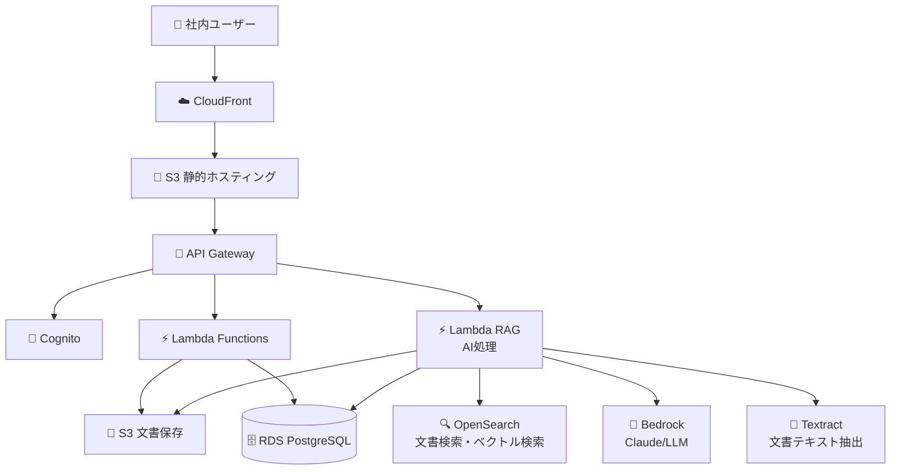

# 社内文書管理システム RAG移行計画

## Phase 1 → Phase 2 移行概要

Phase 1の基本文書管理システムから、AI機能を追加したRAGシステムへの段階的移行計画です。

## 移行アーキテクチャ図



## Phase 2 追加機能

### 1. AI機能
- **文書要約**: アップロード時に自動要約生成
- **質問応答**: 文書内容に関する質問にAI回答
- **関連文書検索**: 質問に関連する文書を自動検索
- **文書分類**: 自動タグ付け・分類

### 2. 検索機能強化
- **全文検索**: OpenSearchによる高速検索
- **ベクトル検索**: 意味的類似性による検索
- **ファセット検索**: 部門・タグ・日付での絞り込み

## 移行手順

### Step 1: インフラストラクチャ追加

#### 1.1 OpenSearch クラスター追加
```hcl
# terraform/opensearch.tf
resource "aws_opensearch_domain" "main" {
  domain_name = "company-docs-search-${var.environment}"
  
  cluster_config {
    instance_type = "t3.small.search"
    instance_count = 1
  }
  
  ebs_options {
    ebs_enabled = true
    volume_type = "gp2"
    volume_size = 20
  }
  
  encrypt_at_rest {
    enabled = true
  }
  
  node_to_node_encryption {
    enabled = true
  }
  
  domain_endpoint_options {
    enforce_https = true
    tls_security_policy = "Policy-Min-TLS-1-2-2019-07"
  }
  
  advanced_security_options {
    enabled = true
    internal_user_database_enabled = true
    master_user_options {
      master_user_name = "admin"
      master_user_password = var.opensearch_password
    }
  }
  
  tags = {
    Name        = "Company Docs Search"
    Environment = var.environment
  }
}

# OpenSearch アクセスポリシー
resource "aws_opensearch_domain_policy" "main" {
  domain_name = aws_opensearch_domain.main.domain_name
  
  access_policies = jsonencode({
    Version = "2012-10-17"
    Statement = [
      {
        Effect = "Allow"
        Principal = {
          AWS = aws_iam_role.lambda_role.arn
        }
        Action = "es:*"
        Resource = "${aws_opensearch_domain.main.arn}/*"
      }
    ]
  })
}
```

#### 1.2 Bedrock アクセス設定
```hcl
# terraform/bedrock.tf
resource "aws_iam_role_policy" "bedrock_access" {
  name = "bedrock-access-policy"
  role = aws_iam_role.lambda_role.id
  
  policy = jsonencode({
    Version = "2012-10-17"
    Statement = [
      {
        Effect = "Allow"
        Action = [
          "bedrock:InvokeModel",
          "bedrock:InvokeModelWithResponseStream"
        ]
        Resource = [
          "arn:aws:bedrock:*::foundation-model/anthropic.claude-3-5-sonnet-20241022-v2:0",
          "arn:aws:bedrock:*::foundation-model/anthropic.claude-3-haiku-20240307-v1:0"
        ]
      }
    ]
  })
}
```

#### 1.3 Textract アクセス設定
```hcl
# terraform/textract.tf
resource "aws_iam_role_policy" "textract_access" {
  name = "textract-access-policy"
  role = aws_iam_role.lambda_role.id
  
  policy = jsonencode({
    Version = "2012-10-17"
    Statement = [
      {
        Effect = "Allow"
        Action = [
          "textract:DetectDocumentText",
          "textract:AnalyzeDocument",
          "textract:StartDocumentAnalysis",
          "textract:GetDocumentAnalysis"
        ]
        Resource = "*"
      }
    ]
  })
}
```

### Step 2: データベース拡張

#### 2.1 新規テーブル追加
```sql
-- 文書テキストテーブル（Textract結果保存）
CREATE TABLE document_texts (
    id UUID PRIMARY KEY DEFAULT gen_random_uuid(),
    document_id UUID REFERENCES documents(id) ON DELETE CASCADE NOT NULL,
    text_content TEXT NOT NULL,
    confidence_score DECIMAL(3,2), -- Textract信頼度スコア
    page_number INTEGER,
    created_at TIMESTAMP DEFAULT CURRENT_TIMESTAMP
);

-- 文書要約テーブル
CREATE TABLE document_summaries (
    id UUID PRIMARY KEY DEFAULT gen_random_uuid(),
    document_id UUID REFERENCES documents(id) ON DELETE CASCADE NOT NULL,
    summary_text TEXT NOT NULL,
    summary_type VARCHAR(50) NOT NULL, -- 'auto', 'manual'
    created_by UUID REFERENCES users(id),
    created_at TIMESTAMP DEFAULT CURRENT_TIMESTAMP
);

-- 検索インデックステーブル
CREATE TABLE search_index (
    id UUID PRIMARY KEY DEFAULT gen_random_uuid(),
    document_id UUID REFERENCES documents(id) ON DELETE CASCADE NOT NULL,
    search_vector tsvector,
    embedding_vector FLOAT[], -- ベクトル埋め込み
    last_updated TIMESTAMP DEFAULT CURRENT_TIMESTAMP
);

-- 質問履歴テーブル
CREATE TABLE question_history (
    id UUID PRIMARY KEY DEFAULT gen_random_uuid(),
    user_id UUID REFERENCES users(id) NOT NULL,
    question TEXT NOT NULL,
    answer TEXT,
    source_documents UUID[], -- 参考文書ID配列
    created_at TIMESTAMP DEFAULT CURRENT_TIMESTAMP
);

-- インデックス
CREATE INDEX idx_document_texts_document ON document_texts(document_id);
CREATE INDEX idx_document_summaries_document ON document_summaries(document_id);
CREATE INDEX idx_search_index_document ON search_index(document_id);
CREATE INDEX idx_search_index_vector ON search_index USING gin(search_vector);
CREATE INDEX idx_question_history_user ON question_history(user_id);
CREATE INDEX idx_question_history_created ON question_history(created_at);
```

### Step 3: Lambda関数追加

#### 3.1 文書処理Lambda関数
```python
# lambda/document_processor.py
import json
import boto3
import base64
from typing import Dict, Any, List

textract = boto3.client('textract')
bedrock = boto3.client('bedrock-runtime')
opensearch = boto3.client('opensearchserverless')

def lambda_handler(event: Dict[str, Any], context) -> Dict[str, Any]:
    """
    文書処理パイプライン
    """
    try:
        # イベント解析
        document_id = event['document_id']
        file_path = event['file_path']
        file_type = event['file_type']
        
        # 1. テキスト抽出
        text_content = extract_text_from_document(file_path, file_type)
        
        # 2. 要約生成
        summary = generate_summary(text_content)
        
        # 3. 検索インデックス作成
        create_search_index(document_id, text_content)
        
        # 4. ベクトル埋め込み生成
        embedding = generate_embedding(text_content)
        
        # 5. データベース保存
        save_processing_results(document_id, text_content, summary, embedding)
        
        return {
            'statusCode': 200,
            'body': json.dumps({
                'message': '文書処理が完了しました',
                'document_id': document_id
            })
        }
        
    except Exception as e:
        print(f"Document processing error: {str(e)}")
        return {
            'statusCode': 500,
            'body': json.dumps({'error': str(e)})
        }

def extract_text_from_document(file_path: str, file_type: str) -> str:
    """
    Textractを使用して文書からテキストを抽出
    """
    try:
        # S3から文書を取得
        s3 = boto3.client('s3')
        response = s3.get_object(
            Bucket=os.environ['S3_BUCKET'],
            Key=file_path
        )
        
        # Textractでテキスト抽出
        if file_type in ['application/pdf']:
            response = textract.detect_document_text(
                Document={
                    'S3Object': {
                        'Bucket': os.environ['S3_BUCKET'],
                        'Name': file_path
                    }
                }
            )
        else:
            # 画像ファイルの場合
            response = textract.detect_document_text(
                Document={
                    'S3Object': {
                        'Bucket': os.environ['S3_BUCKET'],
                        'Name': file_path
                    }
                }
            )
        
        # テキスト結合
        text_content = ""
        for block in response['Blocks']:
            if block['BlockType'] == 'LINE':
                text_content += block['Text'] + "\n"
        
        return text_content
        
    except Exception as e:
        print(f"Text extraction error: {str(e)}")
        return ""

def generate_summary(text_content: str) -> str:
    """
    Bedrockを使用して文書要約を生成
    """
    try:
        prompt = f"""
        以下の文書の内容を要約してください。重要なポイントを3-5個の箇条書きで整理してください。
        
        文書内容:
        {text_content[:4000]}  # トークン制限を考慮
        
        要約:
        """
        
        response = bedrock.invoke_model(
            modelId='anthropic.claude-3-5-sonnet-20241022-v2:0',
            body=json.dumps({
                'prompt': prompt,
                'max_tokens_to_sample': 500,
                'temperature': 0.3
            })
        )
        
        result = json.loads(response['body'].read())
        return result['completion']
        
    except Exception as e:
        print(f"Summary generation error: {str(e)}")
        return ""

def generate_embedding(text_content: str) -> List[float]:
    """
    文書のベクトル埋め込みを生成
    """
    try:
        # Bedrockの埋め込みモデルを使用
        response = bedrock.invoke_model(
            modelId='amazon.titan-embed-text-v1',
            body=json.dumps({
                'inputText': text_content[:8000]  # トークン制限
            })
        )
        
        result = json.loads(response['body'].read())
        return result['embedding']
        
    except Exception as e:
        print(f"Embedding generation error: {str(e)}")
        return []

def create_search_index(document_id: str, text_content: str) -> None:
    """
    OpenSearchに検索インデックスを作成
    """
    try:
        # OpenSearchに文書をインデックス
        opensearch.index(
            index='documents',
            id=document_id,
            body={
                'document_id': document_id,
                'content': text_content,
                'timestamp': datetime.utcnow().isoformat()
            }
        )
        
    except Exception as e:
        print(f"Search index creation error: {str(e)}")

def save_processing_results(
    document_id: str, 
    text_content: str, 
    summary: str, 
    embedding: List[float]
) -> None:
    """
    処理結果をデータベースに保存
    """
    try:
        rds = boto3.client('rds-data')
        
        # テキスト内容保存
        text_query = """
        INSERT INTO document_texts (document_id, text_content, confidence_score)
        VALUES (:document_id, :text_content, :confidence_score)
        """
        
        rds.execute_statement(
            resourceArn=os.environ['DB_CLUSTER_ARN'],
            secretArn=os.environ['DB_SECRET_ARN'],
            database=os.environ['DB_NAME'],
            sql=text_query,
            parameters=[
                {'name': 'document_id', 'value': {'stringValue': document_id}},
                {'name': 'text_content', 'value': {'stringValue': text_content}},
                {'name': 'confidence_score', 'value': {'doubleValue': 0.95}}
            ]
        )
        
        # 要約保存
        summary_query = """
        INSERT INTO document_summaries (document_id, summary_text, summary_type)
        VALUES (:document_id, :summary_text, :summary_type)
        """
        
        rds.execute_statement(
            resourceArn=os.environ['DB_CLUSTER_ARN'],
            secretArn=os.environ['DB_SECRET_ARN'],
            database=os.environ['DB_NAME'],
            sql=summary_query,
            parameters=[
                {'name': 'document_id', 'value': {'stringValue': document_id}},
                {'name': 'summary_text', 'value': {'stringValue': summary}},
                {'name': 'summary_type', 'value': {'stringValue': 'auto'}}
            ]
        )
        
        # 検索インデックス保存
        search_query = """
        INSERT INTO search_index (document_id, search_vector, embedding_vector)
        VALUES (:document_id, to_tsvector('japanese', :text_content), :embedding_vector)
        """
        
        rds.execute_statement(
            resourceArn=os.environ['DB_CLUSTER_ARN'],
            secretArn=os.environ['DB_SECRET_ARN'],
            database=os.environ['DB_NAME'],
            sql=search_query,
            parameters=[
                {'name': 'document_id', 'value': {'stringValue': document_id}},
                {'name': 'text_content', 'value': {'stringValue': text_content}},
                {'name': 'embedding_vector', 'value': {'arrayValue': {'doubleValues': embedding}}}
            ]
        )
        
    except Exception as e:
        print(f"Database save error: {str(e)}")
```

#### 3.2 RAG機能Lambda関数
```python
# lambda/rag_handler.py
import json
import boto3
from typing import Dict, Any, List

bedrock = boto3.client('bedrock-runtime')
opensearch = boto3.client('opensearchserverless')

def lambda_handler(event: Dict[str, Any], context) -> Dict[str, Any]:
    """
    RAG機能：質問に対する回答生成
    """
    try:
        # リクエスト解析
        body = json.loads(event['body'])
        question = body['question']
        user_id = event['requestContext']['authorizer']['user_id']
        
        # 1. 関連文書を検索
        relevant_docs = search_relevant_documents(question, user_id)
        
        # 2. コンテキストを構築
        context = build_context(relevant_docs)
        
        # 3. AI回答生成
        answer = generate_answer(question, context)
        
        # 4. 質問履歴保存
        save_question_history(user_id, question, answer, [doc['id'] for doc in relevant_docs])
        
        return {
            'statusCode': 200,
            'headers': {'Content-Type': 'application/json'},
            'body': json.dumps({
                'answer': answer,
                'sources': [doc['title'] for doc in relevant_docs],
                'confidence': calculate_confidence(relevant_docs)
            })
        }
        
    except Exception as e:
        print(f"RAG error: {str(e)}")
        return {
            'statusCode': 500,
            'headers': {'Content-Type': 'application/json'},
            'body': json.dumps({'error': str(e)})
        }

def search_relevant_documents(question: str, user_id: str) -> List[Dict[str, Any]]:
    """
    質問に関連する文書を検索
    """
    try:
        # 1. 全文検索
        text_results = search_by_text(question, user_id)
        
        # 2. ベクトル検索
        vector_results = search_by_vector(question, user_id)
        
        # 3. 結果をマージ・重複除去
        all_results = text_results + vector_results
        unique_results = remove_duplicates(all_results)
        
        # 4. 関連度でソート
        sorted_results = sorted(unique_results, key=lambda x: x['score'], reverse=True)
        
        return sorted_results[:5]  # 上位5件
        
    except Exception as e:
        print(f"Document search error: {str(e)}")
        return []

def search_by_text(question: str, user_id: str) -> List[Dict[str, Any]]:
    """
    全文検索による文書検索
    """
    try:
        # PostgreSQL全文検索
        rds = boto3.client('rds-data')
        
        query = """
        SELECT d.id, d.title, d.description, d.author_name, d.department,
               ts_rank(si.search_vector, plainto_tsquery('japanese', :question)) as rank
        FROM search_index si
        JOIN documents d ON si.document_id = d.id
        WHERE si.search_vector @@ plainto_tsquery('japanese', :question)
        AND d.status = 'active'
        AND (d.visibility = 'public' OR 
             d.department = (SELECT department FROM users WHERE id = :user_id) OR
             d.author_id = :user_id OR
             EXISTS (SELECT 1 FROM document_permissions dp WHERE dp.document_id = d.id AND dp.user_id = :user_id))
        ORDER BY rank DESC
        LIMIT 10
        """
        
        result = rds.execute_statement(
            resourceArn=os.environ['DB_CLUSTER_ARN'],
            secretArn=os.environ['DB_SECRET_ARN'],
            database=os.environ['DB_NAME'],
            sql=query,
            parameters=[
                {'name': 'question', 'value': {'stringValue': question}},
                {'name': 'user_id', 'value': {'stringValue': user_id}}
            ]
        )
        
        documents = []
        for record in result['records']:
            doc = {
                'id': record[0]['stringValue'],
                'title': record[1]['stringValue'],
                'description': record[2]['stringValue'],
                'author_name': record[3]['stringValue'],
                'department': record[4]['stringValue'],
                'score': float(record[5]['doubleValue']),
                'search_type': 'text'
            }
            documents.append(doc)
        
        return documents
        
    except Exception as e:
        print(f"Text search error: {str(e)}")
        return []

def search_by_vector(question: str, user_id: str) -> List[Dict[str, Any]]:
    """
    ベクトル検索による文書検索
    """
    try:
        # 質問のベクトル埋め込み生成
        question_embedding = generate_embedding(question)
        
        # ベクトル類似度検索
        rds = boto3.client('rds-data')
        
        query = """
        SELECT d.id, d.title, d.description, d.author_name, d.department,
               (si.embedding_vector <-> :question_embedding) as distance
        FROM search_index si
        JOIN documents d ON si.document_id = d.id
        WHERE d.status = 'active'
        AND (d.visibility = 'public' OR 
             d.department = (SELECT department FROM users WHERE id = :user_id) OR
             d.author_id = :user_id OR
             EXISTS (SELECT 1 FROM document_permissions dp WHERE dp.document_id = d.id AND dp.user_id = :user_id))
        ORDER BY distance ASC
        LIMIT 10
        """
        
        result = rds.execute_statement(
            resourceArn=os.environ['DB_CLUSTER_ARN'],
            secretArn=os.environ['DB_SECRET_ARN'],
            database=os.environ['DB_NAME'],
            sql=query,
            parameters=[
                {'name': 'question_embedding', 'value': {'arrayValue': {'doubleValues': question_embedding}}},
                {'name': 'user_id', 'value': {'stringValue': user_id}}
            ]
        )
        
        documents = []
        for record in result['records']:
            doc = {
                'id': record[0]['stringValue'],
                'title': record[1]['stringValue'],
                'description': record[2]['stringValue'],
                'author_name': record[3]['stringValue'],
                'department': record[4]['stringValue'],
                'score': 1.0 - float(record[5]['doubleValue']),  # 距離を類似度に変換
                'search_type': 'vector'
            }
            documents.append(doc)
        
        return documents
        
    except Exception as e:
        print(f"Vector search error: {str(e)}")
        return []

def build_context(documents: List[Dict[str, Any]]) -> str:
    """
    検索された文書からコンテキストを構築
    """
    context = ""
    for i, doc in enumerate(documents[:3], 1):  # 上位3件
        context += f"【文書{i}】{doc['title']}\n"
        context += f"部門: {doc['department']}\n"
        context += f"説明: {doc['description']}\n\n"
    
    return context

def generate_answer(question: str, context: str) -> str:
    """
    Bedrockを使用してAI回答を生成
    """
    try:
        prompt = f"""
        以下の社内資料を参考に、質問に回答してください。
        
        参考資料:
        {context}
        
        質問: {question}
        
        回答の際は以下の点に注意してください:
        1. 参考資料の内容に基づいて回答してください
        2. 不明な点は「資料に記載がありません」と明記してください
        3. 参考資料の出典を明記してください
        4. 日本語で回答してください
        
        回答:
        """
        
        response = bedrock.invoke_model(
            modelId='anthropic.claude-3-5-sonnet-20241022-v2:0',
            body=json.dumps({
                'prompt': prompt,
                'max_tokens_to_sample': 1000,
                'temperature': 0.3
            })
        )
        
        result = json.loads(response['body'].read())
        return result['completion']
        
    except Exception as e:
        print(f"Answer generation error: {str(e)}")
        return "回答の生成に失敗しました。"

def save_question_history(
    user_id: str, 
    question: str, 
    answer: str, 
    source_documents: List[str]
) -> None:
    """
    質問履歴を保存
    """
    try:
        rds = boto3.client('rds-data')
        
        query = """
        INSERT INTO question_history (user_id, question, answer, source_documents)
        VALUES (:user_id, :question, :answer, :source_documents)
        """
        
        rds.execute_statement(
            resourceArn=os.environ['DB_CLUSTER_ARN'],
            secretArn=os.environ['DB_SECRET_ARN'],
            database=os.environ['DB_NAME'],
            sql=query,
            parameters=[
                {'name': 'user_id', 'value': {'stringValue': user_id}},
                {'name': 'question', 'value': {'stringValue': question}},
                {'name': 'answer', 'value': {'stringValue': answer}},
                {'name': 'source_documents', 'value': {'arrayValue': {'stringValues': source_documents}}}
            ]
        )
        
    except Exception as e:
        print(f"Question history save error: {str(e)}")

def calculate_confidence(documents: List[Dict[str, Any]]) -> float:
    """
    回答の信頼度を計算
    """
    if not documents:
        return 0.0
    
    # 関連文書のスコアの平均
    avg_score = sum(doc['score'] for doc in documents) / len(documents)
    return min(avg_score, 1.0)
```

### Step 4: フロントエンド拡張

#### 4.1 AIチャット機能追加
```typescript
// src/components/AIChat.tsx
import React, { useState } from 'react';
import { useAuth } from '../hooks/useAuth';

interface ChatMessage {
  id: string;
  type: 'user' | 'ai';
  content: string;
  sources?: string[];
  timestamp: Date;
}

export const AIChat: React.FC = () => {
  const [messages, setMessages] = useState<ChatMessage[]>([]);
  const [input, setInput] = useState('');
  const [loading, setLoading] = useState(false);
  const { user } = useAuth();

  const sendMessage = async () => {
    if (!input.trim() || loading) return;

    const userMessage: ChatMessage = {
      id: Date.now().toString(),
      type: 'user',
      content: input,
      timestamp: new Date(),
    };

    setMessages(prev => [...prev, userMessage]);
    setInput('');
    setLoading(true);

    try {
      const response = await fetch('/api/rag', {
        method: 'POST',
        headers: {
          'Content-Type': 'application/json',
          'Authorization': `Bearer ${localStorage.getItem('authToken')}`,
        },
        body: JSON.stringify({ question: input }),
      });

      const data = await response.json();

      const aiMessage: ChatMessage = {
        id: (Date.now() + 1).toString(),
        type: 'ai',
        content: data.answer,
        sources: data.sources,
        timestamp: new Date(),
      };

      setMessages(prev => [...prev, aiMessage]);
    } catch (error) {
      console.error('AI chat error:', error);
    } finally {
      setLoading(false);
    }
  };

  return (
    <div className="max-w-4xl mx-auto h-[600px] flex flex-col">
      <div className="bg-white rounded-lg shadow-md flex-1 flex flex-col">
        <div className="p-4 border-b">
          <h2 className="text-xl font-semibold">AI アシスタント</h2>
          <p className="text-sm text-gray-600">社内資料について質問してください</p>
        </div>
        
        <div className="flex-1 overflow-y-auto p-4 space-y-4">
          {messages.map((message) => (
            <div
              key={message.id}
              className={`flex ${message.type === 'user' ? 'justify-end' : 'justify-start'}`}
            >
              <div
                className={`max-w-[80%] p-3 rounded-lg ${
                  message.type === 'user'
                    ? 'bg-blue-500 text-white'
                    : 'bg-gray-100 text-gray-900'
                }`}
              >
                <p className="whitespace-pre-wrap">{message.content}</p>
                {message.sources && message.sources.length > 0 && (
                  <div className="mt-2 pt-2 border-t border-gray-300">
                    <p className="text-xs font-semibold mb-1">参考資料:</p>
                    <ul className="text-xs space-y-1">
                      {message.sources.map((source, index) => (
                        <li key={index}>• {source}</li>
                      ))}
                    </ul>
                  </div>
                )}
              </div>
            </div>
          ))}
          {loading && (
            <div className="flex justify-start">
              <div className="bg-gray-100 p-3 rounded-lg">
                <div className="flex space-x-1">
                  <div className="w-2 h-2 bg-gray-400 rounded-full animate-bounce"></div>
                  <div className="w-2 h-2 bg-gray-400 rounded-full animate-bounce" style={{animationDelay: '0.1s'}}></div>
                  <div className="w-2 h-2 bg-gray-400 rounded-full animate-bounce" style={{animationDelay: '0.2s'}}></div>
                </div>
              </div>
            </div>
          )}
        </div>
        
        <div className="p-4 border-t">
          <div className="flex space-x-2">
            <input
              type="text"
              value={input}
              onChange={(e) => setInput(e.target.value)}
              onKeyPress={(e) => e.key === 'Enter' && sendMessage()}
              placeholder="質問を入力してください..."
              className="flex-1 px-3 py-2 border border-gray-300 rounded-md focus:outline-none focus:ring-2 focus:ring-blue-500"
              disabled={loading}
            />
            <button
              onClick={sendMessage}
              disabled={loading || !input.trim()}
              className="px-4 py-2 bg-blue-500 text-white rounded-md hover:bg-blue-600 disabled:opacity-50 disabled:cursor-not-allowed"
            >
              送信
            </button>
          </div>
        </div>
      </div>
    </div>
  );
};
```

## 移行スケジュール

### Week 1-2: インフラストラクチャ準備
- OpenSearch クラスター構築
- Bedrock アクセス設定
- データベース拡張

### Week 3-4: バックエンド実装
- 文書処理Lambda関数開発
- RAG機能Lambda関数開発
- API Gateway設定

### Week 5-6: フロントエンド実装
- AIチャット機能追加
- 検索機能強化
- UI/UX改善

### Week 7-8: テスト・デプロイ
- 統合テスト
- パフォーマンステスト
- 本番デプロイ

## 移行時の注意点

1. **データ移行**: 既存文書の処理
2. **ダウンタイム最小化**: 段階的移行
3. **ロールバック計画**: 問題発生時の復旧手順
4. **ユーザートレーニング**: 新機能の説明・教育

この移行計画により、Phase 1の基本機能を維持しながら、段階的にRAG機能を追加できます。
