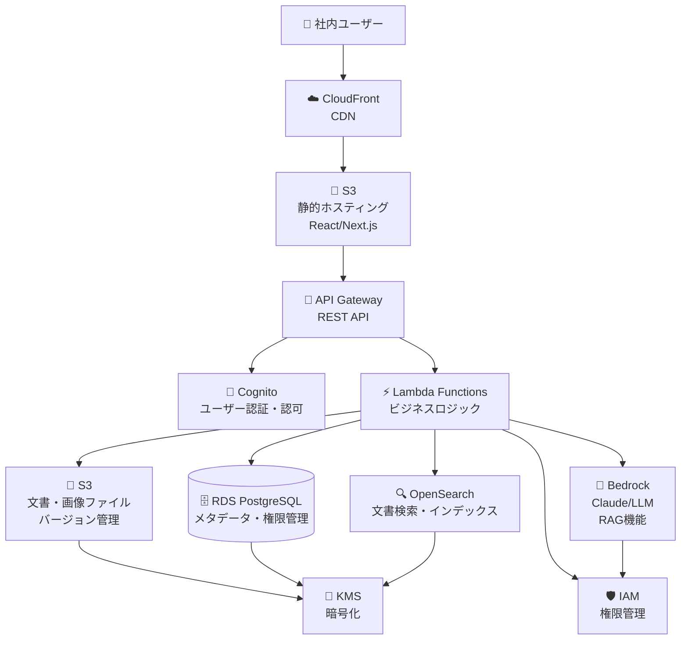

# 社内資料管理システム AWSアーキテクチャ

## システム概要

社内資料を安全に管理し、AIチャット機能でRAG（Retrieval-Augmented Generation）を実現するシステムです。

## アーキテクチャ図

## 主要コンポーネント

### 1. フロントエンド層
- **CloudFront**: グローバルCDN、キャッシュ配信
- **S3 (静的ホスティング)**: React/Next.jsアプリケーション

### 2. API層
- **API Gateway**: RESTful API、認証、レート制限
- **Cognito**: ユーザー認証、セッション管理、権限管理

### 3. アプリケーション層
- **Lambda Functions**: 
  - 文書アップロード処理
  - 権限チェック
  - 検索処理
  - RAG機能

### 4. データ層
- **S3 (文書ストレージ)**: 
  - 文書・画像ファイル保存
  - バージョン管理
  - ライフサイクル管理
- **RDS PostgreSQL**: 
  - ユーザー情報
  - 文書メタデータ
  - 権限情報
  - アクセスログ
- **OpenSearch**: 
  - 文書の全文検索
  - ベクトル検索（RAG用）

### 5. AI層
- **Bedrock**: 
  - Claude 3.5 Sonnet
  - 文書要約
  - RAG機能
  - 質問応答

### 6. セキュリティ層
- **IAM**: 細かい権限管理
- **KMS**: データ暗号化

## データフロー

### 文書アップロードフロー
1. ユーザーが文書をアップロード
2. Lambdaが権限チェック
3. S3に文書保存
4. RDSにメタデータ保存
5. OpenSearchにインデックス作成
6. Bedrockで文書要約生成

### RAG質問フロー
1. ユーザーが質問を入力
2. OpenSearchで関連文書を検索
3. Bedrockにコンテキストと質問を送信
4. AIが回答を生成
5. ユーザーに回答を返却

## 権限管理

### ユーザー権限レベル
- **管理者**: 全権限
- **編集者**: 文書の作成・編集・削除
- **閲覧者**: 文書の閲覧のみ

### 文書権限
- **公開**: 全社員が閲覧可能
- **部門限定**: 特定部門のみ
- **個人限定**: 作成者のみ

## セキュリティ対策

1. **暗号化**
   - 転送時: TLS 1.3
   - 保存時: KMS暗号化

2. **アクセス制御**
   - IAMロールベース
   - リソースレベル権限

3. **監査**
   - CloudTrailでAPI呼び出しログ
   - アクセスログの保存

## コスト最適化

1. **S3**: ライフサイクルポリシーで古い文書をIA/Glacierに移動
2. **Lambda**: プロビジョンドコンテナでコールドスタート削減
3. **RDS**: 自動スケーリング
4. **OpenSearch**: 必要時のみ起動

## 拡張性

1. **水平スケーリング**: Lambda、RDS、OpenSearch
2. **マルチリージョン**: 災害復旧対応
3. **マイクロサービス**: 機能別Lambda分離

## 運用監視

1. **CloudWatch**: メトリクス・ログ監視
2. **X-Ray**: 分散トレーシング
3. **アラート**: 異常検知・通知

## 実装フェーズ

### Phase 1: 基本機能
- ユーザー認証
- 文書アップロード・閲覧
- 基本検索

### Phase 2: AI機能
- RAG機能実装
- 文書要約
- 質問応答

### Phase 3: 高度機能
- 高度な権限管理
- ワークフロー
- 分析・レポート

## 技術スタック

- **フロントエンド**: React/Next.js, TypeScript
- **バックエンド**: Node.js, Python
- **データベース**: PostgreSQL
- **AI**: AWS Bedrock (Claude)
- **検索**: OpenSearch
- **認証**: Cognito
- **ストレージ**: S3
- **API**: API Gateway, Lambda
