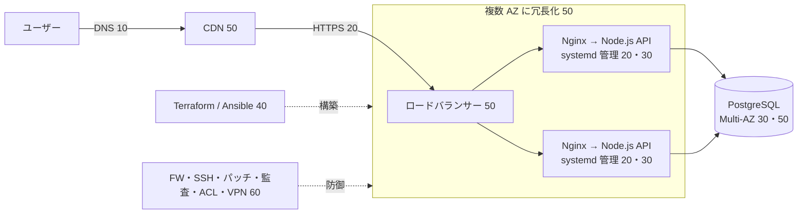

# MOC_サーバー・インフラ体系

61_サーバー・インフラ の入口ノート。**アプリを動かす器（サーバー・Web サーバー・実行環境）と、それを用意・拡張・防御する方法**を扱う。61〜69 全体の地図は [[MOC_運用領域マップ]]。

10〜60 の全 32 回は、**初心者が頭から順に読めば、1 台のサーバーに自分でアプリを公開し、本番構成まで育てられるようになる 1 本の教材**として書いている。各回は「前へ / 次へ」で章をまたいでつながり、共通の題材（EC サイト「Shop」：Ubuntu 24.04 ＋ Nginx ＋ Node.js API ＋ PostgreSQL）を 1 台構成から冗長構成まで育てていく。各回の末尾に確認クイズがある。

軸にしている資料：[roadmap.sh DevOps](https://roadmap.sh/devops)（OS → ネットワーク → Web サーバー → IaC → スケーリング → セキュリティの流れ）、[The Twelve-Factor App](https://12factor.net/ja/)、各製品の公式ドキュメント（nginx.org、Ubuntu Server docs、systemd、Terraform、Ansible、AWS）。

---

## この領域で答えたい問い

| 問い | 章 |
|---|---|
| サーバーとは何で、どこで（物理・VM・クラウド）動いているか | 10 |
| リクエストを受けて HTTPS で返す「玄関」をどう作るか | 20 |
| アプリと DB を本番で**落ちずに**動かし続けるには | 30 |
| サーバーを**手作業ではなくコードで**用意するには | 40 |
| アクセスが増えても、1 台壊れても**止まらない**ようにするには | 50 |
| 公開した瞬間から来る**攻撃から守る**には | 60 |

## 全体図（Shop の最終構成）

---

## 読み方

**通読（おすすめ）**：[[01_サーバーとは何か]] から「次へ →」をたどる。1 回 20〜40 分程度。

**とにかく 1 台に公開したいなら**：[[04_Linuxサーバーの基本]] → [[05_ネットワークの基本（IP・ポート・DNS）]] → [[02_Nginx入門]] → [[03_リバースプロキシ]] → [[04_HTTPSとTLS証明書]] → [[04_プロセス管理とsystemd]] → [[02_SSHの安全な運用]] → [[03_ファイアウォールとネットワーク制御]]（全体の手順地図は [[01_サーバー構築の流れ]]）

**困ったときの逆引き**

| 症状 | まず読む |
|---|---|
| ドメインでアクセスできない / 名前解決できない | [[05_ネットワークの基本（IP・ポート・DNS）]] |
| 502 Bad Gateway / 504 Gateway Timeout | [[03_リバースプロキシ]] → [[04_プロセス管理とsystemd]] |
| 証明書エラー・HTTPS にならない | [[04_HTTPSとTLS証明書]] |
| サーバー再起動後にアプリが起動しない | [[04_プロセス管理とsystemd]] |
| Node.js が CPU 1 コアしか使わない / メモリで落ちる | [[02_Node.jsアプリを本番で動かす]] |
| FastAPI / Django をどう本番起動するか | [[03_Pythonアプリを本番で動かす]] |
| `.env` やパスワードの置き場所 | [[05_設定と環境変数・シークレット]] |
| DB の接続数が足りない（too many connections） | [[06_データベースサーバーの運用]] → [[01_アプリケーションサーバーとは]] |
| サーバーごとに設定が微妙に違う | [[01_サーバー構築の流れ]] → [[02_IaCとは]] |
| アクセス増で遅い・落ちる | [[01_スケーリングの基本]] → [[02_ロードバランサーの仕組み]] → [[03_オートスケーリング]] |
| 画像や JS の配信が重い | [[06_HTTPキャッシュと圧縮]] → [[04_CDNによる負荷軽減]] |
| 1 台壊れたら全部止まる | [[05_高可用性と冗長化]] |
| SSH に大量のログイン試行が来ている | [[02_SSHの安全な運用]] → [[04_OSのハードニングとパッチ管理]] |
| 乗っ取られたかもしれない | [[05_ログ監査と侵入の検知]] |

---

## 10_サーバーの基礎
1. [[01_サーバーとは何か]] — クライアント / サーバー、サーバーの中身、物理〜サーバーレスの「形」
2. [[02_サーバーの種類と役割]] — Web / AP / DB / キャッシュ等、3 層構成、Shop の成長
3. [[03_仮想化とクラウド]] — ハイパーバイザ、VM とコンテナ、IaaS〜SaaS、責任共有モデル
4. [[04_Linuxサーバーの基本]] — ディストリ、FHS、権限と sudo、apt、ログ、初期設定
5. [[05_ネットワークの基本（IP・ポート・DNS）]] — IP / CIDR / NAT、ポート、DNS、疎通確認
6. [[06_DHCPとNTP（インフラを支えるネットワークサービス）]] — DHCP の DORA とリレー、NTP の階層と時刻同期
7. [[07_非機能要件を支えるサーバー（DHCP・DNS・NTP・ログ・監視ほか）]] — 業務を支える裏方のサーバー（DHCP・DNS・NTP・ログ・監視・バックアップ・認証・プロキシ・メール・ファイル）
- 関連：ポート番号・DNS・NAT・QoS の詳細は 11_コンピューターサイエンス/60（[[06ポート番号とファイアウォール基礎]]、[[07DNSとドメイン名前解決とレコード]]、[[16ルーターとスイッチとハブとNAT]]、[[23QoS（帯域制御と優先制御）]]）、SNMP・Syslog は 66_可観測性（[[05_SNMP（ネットワーク機器のメトリクス収集）]]、[[05_Syslog（ログ転送の標準プロトコル）]]）

クリップ：[[クラウド vs オンプレ。何で動いている？AWS・GCP・Azureの裏側の技術を徹底解説]] ／ [[仮想化の仕組み]]

## 20_Webサーバー・リバースプロキシ
1. [[01_Webサーバーとは]] — 静的 / 動的、Web サーバーの役割、処理モデル、製品比較
2. [[02_Nginx入門]] — 設定ファイルの構造、server / location、root と alias
3. [[03_リバースプロキシ]] — proxy_pass、X-Forwarded-*、WebSocket、Shop API の公開設定
4. [[04_HTTPSとTLS証明書]] — TLS の役割、Let's Encrypt、推奨 TLS 設定、HSTS
5. [[05_Apache入門]] — MPM、VirtualHost、.htaccess、Nginx との使い分け
6. [[06_HTTPキャッシュと圧縮]] — Cache-Control、ETag、gzip / brotli、proxy_cache

## 30_アプリ実行環境
1. [[01_アプリケーションサーバーとは]] — Web サーバーとの違い、言語別アプリサーバー、コネクションプール
2. [[02_Node.jsアプリを本番で動かす]] — イベントループ、PM2 / cluster、グレースフルシャットダウン
3. [[03_Pythonアプリを本番で動かす]] — WSGI / ASGI、Gunicorn / Uvicorn、uv
4. [[04_プロセス管理とsystemd]] — unit ファイル、自動再起動、journalctl、サンドボックス設定
5. [[05_設定と環境変数・シークレット]] — Twelve-Factor、.env、Secrets Manager / sops、起動時検証
6. [[06_データベースサーバーの運用]] — PostgreSQL の初期設定、権限、PgBouncer、バックアップ、マネージド DB

## 40_構築・IaC
1. [[01_サーバー構築の流れ]] — 手作業での 11 ステップ、スノーフレーク、Pets vs Cattle
2. [[02_IaCとは]] — 宣言型と冪等性、ツールの役割分担、OpenTofu
3. [[03_Terraform入門]] — HCL、plan / apply、state とリモート state、モジュール
4. [[04_構成管理とAnsible]] — インベントリ、プレイブック、ロール、ansible-vault
5. [[05_CloudFormationとCDK]] — スタック、変更セット、CDK（TypeScript）
6. [[06_ネットワーク自動化とSDN]] — 3 つのプレーン、SDN とコントローラ、YANG / NETCONF / RESTCONF

## 50_スケーリング・負荷分散
1. [[01_スケーリングの基本]] — スケールアップ / アウト、ボトルネック、ステートレス化
2. [[02_ロードバランサーの仕組み]] — L4 / L7、アルゴリズム、ヘルスチェック、ALB
3. [[03_オートスケーリング]] — 指標とポリシー、ウォームアップ、ASG と HPA
4. [[04_CDNによる負荷軽減]] — エッジとオリジン、キャッシュキー、オリジン保護
5. [[05_高可用性と冗長化]] — 可用性の数字、SPOF、マルチ AZ、RTO / RPO

クリップ：[[ロードバランサの裏側 — 振り分けと切り離し｜ねる前エンジニアリング]]

## 60_サーバー・ネットワークセキュリティ
1. [[01_サーバーセキュリティの基本]] — 攻撃面の縮小、多層防御、最小権限、脅威マップ
2. [[02_SSHの安全な運用]] — 鍵認証、sshd_config、ProxyJump、Session Manager
3. [[03_ファイアウォールとネットワーク制御]] — ufw、セキュリティグループ、Docker と ufw の罠
4. [[04_OSのハードニングとパッチ管理]] — 自動アップデート、fail2ban、CIS、Lynis
5. [[05_ログ監査と侵入の検知]] — auth.log、auditd、AIDE、初動対応、Shop のチェックリスト
6. [[06_ネットワーク機器への管理アクセス（パスワード・SSH・ファイル転送）]] — 特権モードとパスワード、VTY と SSH、TFTP / FTP / SCP
7. [[07_AAA（RADIUS・TACACS+・802.1X）]] — 認証・認可・アカウンティング、RADIUS と TACACS+ の違い
8. [[08_ACL（アクセスコントロールリスト）]] — 標準 / 拡張 ACL、ワイルドカードマスク、適用方向
9. [[09_L2セキュリティ（ポートセキュリティ・DHCPスヌーピング・DAI）]] — ポートセキュリティ、DHCP スヌーピング、DAI、L2 攻撃
10. [[10_VPN（サイト間・リモートアクセス・IPsec・GRE）]] — サイト間 / リモートアクセス VPN、IPsec、GRE

クリップ：[[SSHの仕組み]] ／ [[MySQLはセキュリティが弱いのか]]

---

## 隣接領域（ここでは扱わない）

| テーマ | 本拠地 |
|---|---|
| Docker・Kubernetes | 53_コンテナ（[[Dockerとは]]、[[09-Docker]]、[[10-Kubernetes]]） |
| Linux コマンド・シェルの使い方 | 52_シェルCLI |
| OS・ネットワークの理論（カーネル、TCP/IP、DNS の仕組み、ルーティング、L2 スイッチング） | [[MOC_コンピューターサイエンス体系\|11_コンピューターサイエンス]]/50・60 |
| AWS の個別製品（EC2・ELB・VPC・Route 53 など） | 63_AWS |
| デプロイ戦略・リリース手順 | [[MOC_リリース・デプロイ体系\|65_リリース・デプロイ]] |
| 監視・ログ収集・アラート | [[MOC_可観測性体系\|66_可観測性]]（[[04_サーバー監視とログ管理の基本]]） |
| 性能計測・キャパシティ計画 | [[MOC_パフォーマンス体系\|67_パフォーマンス]] |
| DB の設計・SQL・トランザクション | [[MOC_データアーキテクチャ体系\|62_データアーキテクチャ]] |
| レプリケーション・シャーディング | [[MOC_分散システム体系\|68_分散システム]] |
| アプリの脆弱性対策・認証・セッション | [[MOC_Web脆弱性対策]]、[[MOC_認証認可]]、[[05_クッキーとセッション管理（旧サーバー教材）]] |
| アプリ側のスケーラビリティ設計 | [[MOC_バックエンド体系\|34_Backend]]/80 |
