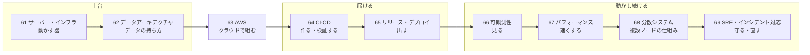
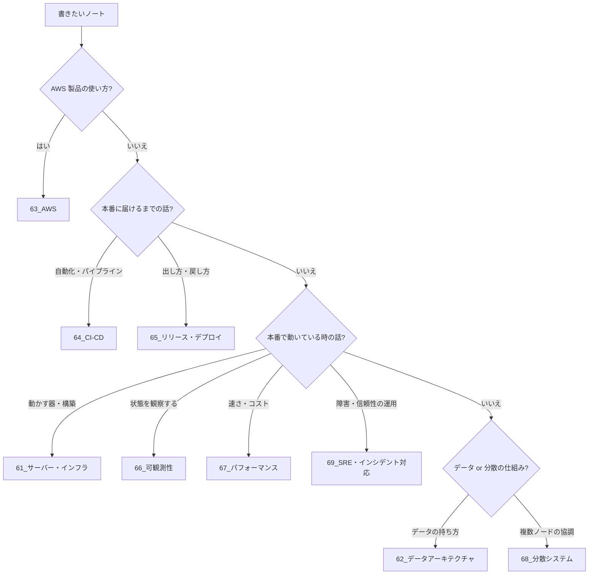

# MOC_運用領域マップ

61〜69 全体の入口ノート。**書いたコードを動かす土台を理解し、本番に届け、動かし続け、観察して直す**ための領域を、学ぶ順に 9 分野へ並べている。roadmap.sh DevOps の学習順（OS・ネットワーク・サーバー → クラウド → CI/CD → 監視）と、Google SRE 本の「原則 → 実践」の流れ、DDIA（Designing Data-Intensive Applications 第2版）の構成を参考にした。

## 学ぶ順番と理由

| 順 | フォルダ | 扱うこと | なぜこの位置か | 入口 |
|---|---|---|---|---|
| 1 | 61_サーバー・インフラ | サーバーの種類・Webサーバー・実行環境・構築/IaC・スケーリング・サーバーセキュリティ | EC2・VPC・ELB はサーバーとネットワークの知識が前提（ネットワークの理論は 11_コンピューターサイエンス/60 で先に学ぶ） | [[MOC_サーバー・インフラ体系]] |
| 2 | 62_データアーキテクチャ | DB基礎・データモデル・スキーマ・インデックス・トランザクション・マイグレーション | RDS・DynamoDB・Aurora を選ぶ前に DB の基礎が要る | [[MOC_データアーキテクチャ体系]] |
| 3 | 63_AWS | AWS の各サービスとアプリ開発手順 | 61・62 の概念をクラウドの製品に当てはめる | [[00_AWS学習ロードマップ]] |
| 4 | 64_CI-CD | ビルド・テスト・パイプライン・DevSecOps・GitOps | 動かす場所が分かってから、そこへ届ける自動化を作る | [[MOC_CI-CD体系]] |
| 5 | 65_リリース・デプロイ | デプロイ戦略・バージョニング・リリース判定・ロールバック | パイプラインの先で本番に出す・戻す | [[MOC_リリース・デプロイ体系]] |
| 6 | 66_可観測性 | ログ・メトリクス・トレース・OpenTelemetry・SLO/アラート | 本番に出したものの状態を見る | [[MOC_可観測性体系]] |
| 7 | 67_パフォーマンス | 計測・分析・フロント/バックエンド最適化・キャパシティ | 可観測性で計測できて初めて改善できる | [[MOC_パフォーマンス体系]] |
| 8 | 68_分散システム | 分散の難しさ・複製/分割・一貫性・キュー・分散キャッシュ・障害耐性 | スケールの先で出てくる応用理論。62 の続き | [[MOC_分散システム体系]] |
| 9 | 69_SRE・インシデント対応 | SRE原則・オンコール・障害対応・ポストモーテム・カオス/DR | 61〜68 をすべて使う総仕上げ | [[MOC_SRE・インシデント対応体系]] |

## 迷ったときの置き場所

## 他領域との分担

| テーマ | 本拠地 | 61〜69 との関係 |
|---|---|---|
| AWS 製品の使い方 | 63_AWS | 63 以外は製品に依存しない概念。AWS での実装は 63 へリンク |
| Docker・Kubernetes | 53_コンテナ | 61 はサーバーとしての位置づけだけ |
| Git・GitHub Actions 入門 | 51_Git | 64 はパイプライン設計、操作手順は 51 |
| バックエンドへの組み込み方（キャッシュ・キュー・ORM） | 34_Backend | 68/62 は仕組み・理論 |
| アーキテクチャスタイル・横断的関心事の設計 | 41_アーキテクチャ | 66/68 はツールと運用 |
| テストの書き方・テストツール | 81〜83 | 64/40 は CI への組み込み方 |
| 実際に起きた事故の記録 | 91_トラブルシューティング事例集 | 69 は対応の型 |
| セキュリティ全般 | 71〜75 | 64/50・61/60 は運用での適用 |

## 経緯
- 2026-09-26 再編。旧 67_リリース・サーバー を 63（リリース）と 64（サーバー）に分割、旧 69_分散システム可観測性 を 65（可観測性）と 69（分散システム）に分割、67 を SRE・インシデント対応として新設
- 2026-10-18 学習順に並べ替え。AWS の前にサーバー・インフラと DB の基礎を学べるよう、64→61 サーバー・インフラ、68→62 データアーキテクチャ、61→63 AWS、62→64 CI-CD、63→65 リリース・デプロイ、65→66 可観測性、66→67 パフォーマンス、69→68 分散システム、67→69 SRE・インシデント対応 に変更。このノートも 62 から 61 へ移動
- 旧構想は [[目次_旧10_Operations]]（CI-CD / Release / Incident / Performance の未作成ノート一覧の出典）
