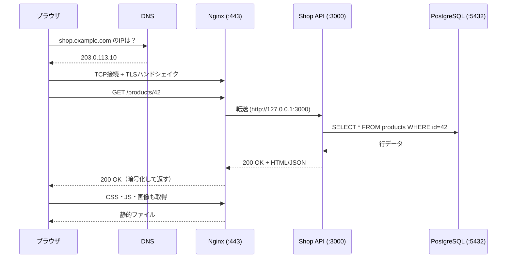

# サーバーとは何か

[[MOC_サーバー・インフラ体系|📚 目次]] ｜ [[02_サーバーの種類と役割|次へ →]]

> [!abstract] この記事で分かること
> - 「サーバー」は特別な機械の名前ではなく「サービスを提供する役割」のこと
> - クライアント/サーバーモデルと、リクエスト・レスポンスの流れ
> - サーバー用ハードウェアと普通の PC の違い（常時稼働・冗長電源・ECC メモリ・ラック）
> - 物理サーバー / VPS / クラウド VM / コンテナ / サーバーレスという「サーバーの形」
> - ブラウザで `https://shop.example.com` を開いてから画面が出るまでの全体の流れ
>
> **前提**：Web アプリを手元（localhost）で動かしたことがあれば十分です。

## 1. ひとことで言うと

サーバーは **「頼まれたら応える係」** です。レストランで例えると、お客さん（クライアント）が注文（リクエスト）を出し、厨房（サーバー）が料理（レスポンス）を返します。厨房は「料理を作る専用の建物」である必要はなく、**注文を受けて応える役割を担っていればサーバー** です。

- サーバー（server）＝「serve（仕える・提供する）するもの」。**役割の名前**であって機械の種類ではない
- あなたのノート PC でも `npm run dev` すれば、その瞬間それは「サーバー」
- ただし本番のサーバーには「24 時間止まらない」「大勢を同時にさばく」「壊れてもデータを失わない」ことが求められる。だから専用のハードウェアや運用の工夫が必要になる

## 2. クライアント/サーバーモデル

### 2-1. 役割の分担

**クライアント/サーバーモデル（client-server model）** は、「お願いする側」と「応える側」を分ける考え方です。

| | クライアント（client） | サーバー（server） |
|---|---|---|
| 例 | ブラウザ、スマホアプリ、`curl` | Nginx、Shop API（Node.js）、PostgreSQL |
| 動き方 | 必要なときに **自分から** 接続する | 常に起動して **接続を待ち受ける（listen）** |
| 数 | 多数（数千〜数百万） | 少数（1 台〜数十台） |
| 寿命 | ユーザーが閉じたら終わり | 基本的に止まらない |

ポイントは「サーバーは待つ側」だということです。サーバーは **ポート（port）** という窓口番号を開けて待ち続け、そこにクライアントが接続してきます（ポートは [[05_ネットワークの基本（IP・ポート・DNS）]] で詳しく扱います）。

### 2-2. リクエストとレスポンス

Web の世界では、クライアントとサーバーは **HTTP（HyperText Transfer Protocol）** という決まりごとで会話します。

```
クライアント → サーバー（リクエスト）
  GET /api/products/42 HTTP/1.1
  Host: shop.example.com
  Accept: application/json

サーバー → クライアント（レスポンス）
  HTTP/1.1 200 OK
  Content-Type: application/json

  {"id":42,"name":"マグカップ","price":1200}
```

- **リクエスト（request）**：「何を（パス）」「どうしたいか（メソッド：GET/POST など）」を伝える
- **レスポンス（response）**：「結果どうだったか（ステータスコード：200/404/500 など）」と中身を返す
- 1 往復で完結するのが基本。サーバーは前回の会話を覚えていない（**ステートレス**）ので、ログイン状態などは Cookie やトークンで毎回伝える（→ [[05_クッキーとセッション管理（旧サーバー教材）]]）

> [!note] サーバー同士もクライアント/サーバー
> Shop API が PostgreSQL にクエリを投げるとき、Shop API は「DB のクライアント」です。1 つのプログラムが、ブラウザに対してはサーバー、DB に対してはクライアント、という二役を担うのはごく普通のことです。

## 3. サーバーの中身と、PC との違い

### 3-1. 中身は PC と同じ 4 つの部品

サーバーも中身はコンピューターです。主な部品は PC と同じです。

| 部品 | 役割 | 例え | 足りないと起きること |
|---|---|---|---|
| **CPU** | 計算・処理をする | 料理人 | リクエスト処理が遅くなる、応答待ちの行列ができる |
| **メモリ（RAM）** | 作業中のデータを置く短期記憶 | 調理台 | スワップ（ディスクで代用）が起きて激遅になる、OOM でプロセスが強制終了 |
| **ストレージ（SSD/HDD）** | 電源を切っても消えない長期記憶 | 冷蔵庫・倉庫 | ディスクフルでログや DB が書けなくなり停止 |
| **NIC（Network Interface Card）** | ネットワークにつなぐ口 | 店の出入口 | 帯域不足で通信が詰まる |

実務でサーバーの性能を語るときは「**vCPU 2 / メモリ 4GB / SSD 80GB / 帯域 〇Gbps**」のようにこの 4 つで表します。

### 3-2. サーバー用ハードウェアならではの工夫

本番用の物理サーバーは「止まらない・壊れてもすぐ直せる」ために、PC にはない工夫がされています。

| 工夫 | 内容 | なぜ必要か |
|---|---|---|
| **常時稼働前提の設計** | 24 時間 365 日動かす前提の部品・冷却 | PC は「使うときだけ」動かす前提 |
| **冗長電源（redundant PSU）** | 電源ユニットを 2 つ載せ、片方が壊れても動き続ける | 電源は壊れやすい部品の代表 |
| **ECC メモリ（Error-Correcting Code）** | メモリのビット化けを検出・訂正する | 長時間・大量データでは宇宙線などによるビット反転が無視できない。DB の値が化けたら大事故 |
| **RAID** | 複数ディスクに分散・複製して 1 本壊れても大丈夫にする | ディスクも消耗品 |
| **ホットスワップ** | 電源を入れたままディスク・電源を交換できる | 交換のために止めなくて済む |
| **ラックマウント** | 19 インチラックに薄い板状（1U ≒ 4.45cm）で積む | データセンターに高密度に並べ、配線・冷却を効率化 |
| **リモート管理（BMC/IPMI）** | OS が固まっていても別回線で電源操作・画面確認 | データセンターまで行かずに復旧できる |

> [!tip] クラウドを使うならハードは意識しなくていい？
> クラウドや VPS では、こうしたハードウェアの面倒は事業者が見てくれます。ただし「物理サーバーは壊れる」という事実は変わりません。クラウドの VM も、裏の物理マシンが壊れれば止まります。だから後の章で **冗長化**（[[05_高可用性と冗長化]]）を学びます。

## 4. サーバーの「形」：物理・VPS・クラウド VM・コンテナ・サーバーレス

「サーバーを用意する」といっても、今は色々な形があります。下に行くほど **自分で管理する範囲が狭く**、手軽になりますが、自由度は下がります。

| 形 | ざっくり言うと | 自分で管理するもの | 例 |
|---|---|---|---|
| **物理サーバー（ベアメタル）** | 本物の機械を 1 台まるごと | ハード・OS・アプリ全部 | 自社データセンター、さくらの専用サーバ |
| **VPS（Virtual Private Server）** | 物理サーバーを仮想的に分けた 1 区画を月額で借りる | OS・アプリ | さくらの VPS、ConoHa VPS、DigitalOcean、Amazon Lightsail |
| **クラウド VM** | VPS に近いが、API で秒単位に作成・削除・増減できる | OS・アプリ | Amazon EC2、Compute Engine、Azure Virtual Machines |
| **コンテナ** | OS の上で、アプリと依存物を箱詰めして動かす | アプリ＋コンテナイメージ | Docker、Kubernetes、Amazon ECS |
| **サーバーレス（FaaS）** | 関数を置くだけ。呼ばれたときだけ動く | コード（関数）だけ | AWS Lambda、Cloud Run functions、Azure Functions |

```
自分で管理する範囲（■）
            ハード  仮想化  OS   ランタイム  アプリ
物理         ■      ■      ■      ■        ■
VPS/VM       □      □      ■      ■        ■
コンテナ     □      □      △      ■        ■   ※ホストOSはサービス次第
サーバーレス □      □      □      □        ■
```

「サーバーレス」でもサーバーが無いわけではなく、**サーバーの存在を意識しなくていい** という意味です。仕組みと選び方は [[03_仮想化とクラウド]] で、コンテナは [[Dockerとは]] で詳しく扱います。

このシリーズでは、仕組みを理解しやすい **Ubuntu の VPS / EC2 1 台** からスタートします。一番「サーバーらしい」形で基礎を押さえておくと、コンテナやサーバーレスに進んだときも「裏で何が起きているか」が分かるからです。

## 5. Shop が 1 台で動く全体図

このシリーズの題材である EC サイト「Shop」は、最初は 1 台のサーバーで動かします。

```
                 インターネット
                       │  https://shop.example.com
                       ▼
┌──────────── Ubuntu Server 24.04（VPS / EC2 1台）─────────────┐
│                                                               │
│   :443 / :80  ┌───────────┐  http://127.0.0.1:3000           │
│  ───────────▶ │   Nginx    │ ─────────────────┐               │
│               │ HTTPS終端   │                  ▼               │
│               │ 静的ファイル │          ┌──────────────┐        │
│               └───────────┘          │  Shop API     │        │
│                                       │ (Node.js/TS)  │        │
│                                       └──────┬───────┘        │
│                                              │ :5432 (localhost)│
│                                              ▼                │
│                                       ┌──────────────┐        │
│                                       │ PostgreSQL    │        │
│                                       └──────────────┘        │
│  外に開けるのは 22(SSH)・80・443 だけ。3000 と 5432 は内側専用   │
└───────────────────────────────────────────────────────────────┘
```

- **Nginx**：玄関係。HTTPS の暗号を解き、画像などの静的ファイルは自分で返し、API へのリクエストは Shop API に渡す（→ [[03_リバースプロキシ]]）
- **Shop API**：店員。注文や商品検索などの処理（ビジネスロジック）を行う（→ [[01_アプリケーションサーバーとは]]）
- **PostgreSQL**：倉庫番。商品・注文・会員データを保存する（→ [[06_データベースサーバーの運用]]）

1 台に全部載っていても、**役割は 3 つに分かれている** ことが大事です。この役割分担が、後で台数を増やすときの「切れ目」になります（→ [[02_サーバーの種類と役割]]）。

## 6. URL を開いてから表示されるまで

ブラウザで `https://shop.example.com/products/42` を開いたとき、裏では次のことが起きています。



1. **名前解決（DNS）**：`shop.example.com` という名前を `203.0.113.10` のような IP アドレスに変換する（→ [[05_ネットワークの基本（IP・ポート・DNS）]]）
2. **TCP 接続**：その IP の 443 番ポートに接続する
3. **TLS ハンドシェイク**：証明書でサーバーが本物か確認し、暗号化の鍵を決める（→ [[04_HTTPSとTLS証明書]]）
4. **HTTP リクエスト**：`GET /products/42` を送る
5. **サーバー内の処理**：Nginx → Shop API → PostgreSQL と順に処理が流れ、結果が戻ってくる
6. **HTTP レスポンス**：HTML や JSON が返る
7. **追加のリクエスト**：HTML に書かれた CSS・JS・画像を、ブラウザがさらに取りに行く
8. **描画**：ブラウザが画面を組み立てて表示する

「サイトが遅い」「繋がらない」というトラブルは、この **どの段階で詰まっているか** を切り分けるのが基本です。DNS が引けないのか、ポートが開いていないのか、API が遅いのか、DB が遅いのか。この流れを頭に入れておくと、後の章の内容がすべてこの地図のどこかに収まります。

## よくある誤解・つまずき

- ❌ サーバーは特別な高い機械のこと
  ✅ サーバーは「役割」。ノート PC でも Raspberry Pi でもサーバーになれる。本番用は「止まらない工夫」がされているだけ
- ❌ サーバーレスならサーバーは存在しない
  ✅ サーバーはある。管理を事業者に任せられるので「意識しなくていい」という意味
- ❌ 1 台のサーバーにはアプリが 1 つだけ動いている
  ✅ Shop の例のように、1 台の中で Nginx・API・DB など複数の「サーバーソフト」が同時に動くのが普通
- ❌ localhost で動いたら本番でも同じように動く
  ✅ 本番では DNS・ファイアウォール・HTTPS・プロセスの常駐化など、手元にはなかった層が加わる。このシリーズはその層を一つずつ学ぶためのもの
- ❌ クラウドなら壊れない
  ✅ 裏は物理サーバーなので壊れる。壊れても困らない構成（冗長化・バックアップ）は利用者側の仕事

## まとめ

- サーバーは「リクエストを待ち受けてレスポンスを返す」**役割**の名前
- 中身は CPU・メモリ・ストレージ・NIC。本番用ハードは冗長電源・ECC・RAID・ラックなどで「止まらない」ようにできている
- サーバーの形は物理 → VPS → クラウド VM → コンテナ → サーバーレスと、管理範囲がだんだん狭くなる
- Shop は最初、1 台の Ubuntu サーバーに Nginx・Shop API・PostgreSQL を載せて動かす
- URL を開くと DNS → TCP → TLS → HTTP → サーバー内処理 → 描画の順に進む。トラブル時はどこで詰まったかを切り分ける

## 確認クイズ

1. Shop API が PostgreSQL にデータを問い合わせるとき、Shop API はクライアントとサーバーのどちらですか？
> [!tip]- 答え
> **クライアント** です。ブラウザに対してはサーバーですが、DB に対しては「お願いする側」なのでクライアントになります。クライアント/サーバーは機械ではなく役割で決まります。

2. 本番用サーバーで ECC メモリが使われる理由を説明してください。
> [!tip]- 答え
> 長時間・大量のデータを扱うと、メモリ上のビットが偶発的に反転する確率が無視できなくなるからです。ECC はそれを検出・訂正し、DB の値が気づかないうちに化けるといった事故を防ぎます。

3. 「サイトが表示されない」と言われました。URL を開いてから表示までの流れのうち、最初に確認すべき段階は何ですか？
> [!tip]- 答え
> 最初は **DNS（名前解決）** です。名前が正しい IP に解決されていなければ、その後の段階には一切進めません。次に TCP 接続（ポートが開いているか）、TLS、HTTP 応答…と順に切り分けます。

## 関連ノート
- [[02_サーバーの種類と役割]] — Web/AP/DB などサーバーの役割と構成の育て方
- [[03_仮想化とクラウド]] — VPS・クラウド VM・コンテナ・サーバーレスの仕組み
- [[05_ネットワークの基本（IP・ポート・DNS）]] — IP・ポート・DNS の基礎
- [[01_Webサーバーとは]] — 玄関係の Nginx を詳しく
- [[Dockerとは]] — コンテナの基本
- [[MOC_コンピューターサイエンス体系]] — OS・ネットワークの理論

## 参考
- [MDN: An overview of HTTP](https://developer.mozilla.org/en-US/docs/Web/HTTP/Guides/Overview)
- [MDN: How the web works](https://developer.mozilla.org/en-US/docs/Learn_web_development/Getting_started/Web_standards/How_the_web_works)
- [AWS: What is serverless computing?](https://aws.amazon.com/what-is/serverless-computing/)
