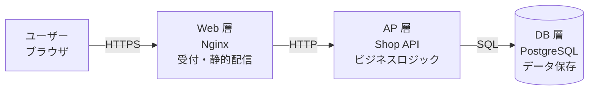
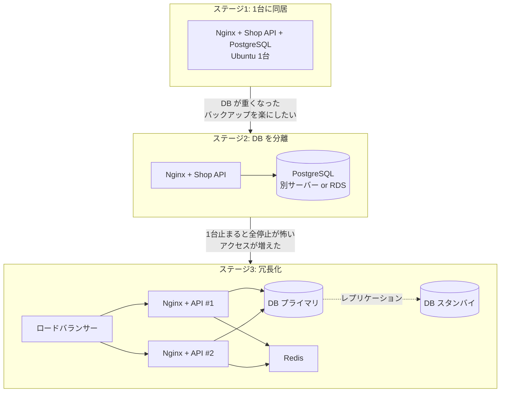

# サーバーの種類と役割

[[MOC_サーバー・インフラ体系|📚 目次]] ｜ [[01_サーバーとは何か|← 前へ]] ｜ [[03_仮想化とクラウド|次へ →]]

> [!abstract] この記事で分かること
> - Web / AP / DB / キャッシュ / メール / DNS / ファイル / プロキシ / ジョブ（ワーカー）サーバーの役割
> - 定番の 3 層アーキテクチャ（Web - AP - DB）と、なぜ層に分けるのか
> - 1 台に同居させる構成と、役割ごとに分ける構成のメリット・デメリット
> - Shop の構成が「1 台 → 分離 → 冗長化」と育っていく道筋
>
> **前提**：[[01_サーバーとは何か]] を読んでいると理解しやすいです。

## 1. ひとことで言うと

サーバーの種類は **お店の「係」** のようなものです。小さな個人店では店主が 1 人で受付も調理も在庫管理もこなしますが、繁盛してくると受付係・料理人・倉庫番と分業します。サーバーも同じで、

- 「〇〇サーバー」は **そのソフトウェアが担う役割** の名前（Web サーバー＝Nginx が担う係、など）
- 最初は 1 台に全部の係を同居させ、負荷や信頼性の要求が上がったら **係ごとに別マシンへ分ける**
- 分ける「切れ目」は役割の境界。だから最初から役割を意識しておくことが大事

## 2. 主なサーバーの種類

### 2-1. 一覧

| 種類 | 役割 | 代表的なソフト / サービス | 主なポート |
|---|---|---|---|
| **Web サーバー** | HTTP(S) を受ける玄関。静的ファイル配信、HTTPS 終端、AP への転送 | Nginx、Apache、Caddy | 80, 443 |
| **AP サーバー（アプリケーションサーバー）** | ビジネスロジックを実行し動的な結果を作る | Node.js、Gunicorn/Uvicorn（Python）、Tomcat（Java）、PHP-FPM | 3000, 8000, 8080 など |
| **DB サーバー（データベースサーバー）** | データを永続化し、検索・更新・トランザクションを担う | PostgreSQL、MySQL、Amazon RDS | 5432, 3306 |
| **キャッシュサーバー** | よく使うデータをメモリに置いて高速に返す。セッション保存にも使う | Redis、Memcached、Valkey | 6379, 11211 |
| **メールサーバー** | メールの送信（SMTP）・受信（IMAP/POP3） | Postfix、Amazon SES、SendGrid | 25, 587, 993 |
| **DNS サーバー** | ドメイン名を IP アドレスに変換する | BIND、Route 53、Cloudflare DNS | 53 |
| **ファイルサーバー / ストレージ** | ファイルの保存・共有 | NFS、Samba(SMB)、Amazon S3 | 2049, 445 |
| **プロキシサーバー** | 通信を仲介する。外向き（フォワード）と内向き（リバース）がある | Nginx、HAProxy、Squid | 80, 443, 3128 |
| **ジョブ（ワーカー）サーバー** | 時間のかかる処理を裏で非同期に実行 | BullMQ、Celery、Sidekiq、cron | （待ち受けない） |

### 2-2. それぞれのポイント

**Web サーバー** は「何でも受け付ける玄関」です。重い処理は自分でせず、画像や CSS のような **ファイルをそのまま返す仕事** と、残りを AP サーバーへ **取り次ぐ仕事** に徹します。Nginx が軽量で大量の同時接続に強いのはこのためです。詳しくは [[01_Webサーバーとは]]・[[02_Nginx入門]]。

**AP サーバー** は「注文を受けて料理を作る」係です。在庫を確認し、価格を計算し、注文を DB に書き込む。Shop API（Node.js、ポート 3000）がこれにあたります。詳しくは [[01_アプリケーションサーバーとは]]。

**DB サーバー** は「倉庫番」です。データを失わないこと（永続化）と、同時に注文が来ても在庫数が狂わないこと（トランザクション）が使命です。一番「壊れたら困る」サーバーなので、バックアップや冗長化の優先度が最も高くなります。詳しくは [[06_データベースサーバーの運用]]。

**キャッシュサーバー** は「よく出る料理を作り置きしておくカウンター」です。DB に毎回聞くと遅い商品一覧やランキングをメモリに置いておき、ミリ秒以下で返します。データは消えても良い（DB から作り直せる）前提で使うのが基本です。

**メールサーバー** は自前運用がとても難しい部類です。迷惑メール判定を避けるための SPF/DKIM/DMARC 設定、IP の評判管理などが必要なため、Shop のような EC サイトでは注文確認メールの送信に **Amazon SES や SendGrid などの送信サービスを使う** のが一般的です（クラウドでは 25 番ポートの外向き通信が既定で制限されていることも多いです）。

**DNS サーバー** は「電話帳」です。自分で BIND を立てることは減り、Route 53 や Cloudflare、レジストラ付属の DNS を使うのが一般的です（→ [[05_ネットワークの基本（IP・ポート・DNS）]]）。

**ファイルサーバー** は社内のファイル共有（SMB/NFS）が古典的な用途ですが、Web サービスでは **商品画像やユーザーのアップロードファイルを S3 のようなオブジェクトストレージに置く** のが定番です。サーバーのローカルディスクに置くと、サーバーを 2 台にしたとき片方にしかファイルがない、という問題が起きるからです。

**プロキシサーバー** には 2 種類あります。

```
フォワードプロキシ（社内 → 外のサイト）       リバースプロキシ（外のユーザー → 社内のサーバー）
[社員PC]─┐                                   ┌─[AP サーバー1]
[社員PC]─┼─▶[プロキシ]─▶ インターネット     ユーザー ─▶[Nginx]─┼─[AP サーバー2]
[社員PC]─┘  （利用者側の代理）                └─[AP サーバー3]
                                               （サーバー側の代理）
```

Web サービスで主に使うのは **リバースプロキシ** です。Shop では Nginx が Web サーバー兼リバースプロキシとして働きます（→ [[03_リバースプロキシ]]）。

**ジョブ（ワーカー）サーバー** は「裏方」です。注文確定メールの送信、画像のサムネイル生成、売上集計など、ユーザーを待たせたくない処理を **キュー（queue）** に積み、別プロセスが順番に処理します。HTTP を待ち受けないのでポートは開けません。

```
ユーザー ─▶ Shop API ─(1) 注文を DB に保存
                    └(2) 「メール送って」をキュー(Redis)に積む ─▶ すぐ 201 を返す
                                    │
                         ワーカー ◀──┘ 取り出して SES でメール送信（数秒かかってもOK）
```

## 3. 3 層アーキテクチャ（Web - AP - DB）

Web システムの最も基本的な形が **3 層アーキテクチャ（3-tier architecture）** です。



| 層 | 別名 | 担当 | 特徴 |
|---|---|---|---|
| Web 層 | プレゼンテーション層 | 受付・HTTPS・静的ファイル | 状態を持たないので増やしやすい |
| AP 層 | アプリケーション層、ビジネスロジック層 | 処理・計算 | 状態を DB に預ければ増やしやすい |
| DB 層 | データ層 | 保存・整合性 | 状態を持つので増やしにくい |

**なぜ層に分けるのか？**

1. **役割ごとに得意なソフトを使える**：大量接続は Nginx、計算は Node.js、整合性は PostgreSQL
2. **セキュリティの壁を作れる**：インターネットから直接触れるのは Web 層だけ。DB は内側に隠す
3. **層ごとに増やせる**：アクセスが増えたら AP 層だけ台数を増やす、といった調整ができる（→ [[01_スケーリングの基本]]）
4. **障害の影響範囲を絞れる**：どの層の問題かを切り分けやすい

> [!note] 3 層はマイクロサービスの「前段階」
> サービスごとに API と DB を分ける **マイクロサービス** も、1 つ 1 つのサービスの中身はたいてい 3 層です。まずは 3 層を確実に理解するのが近道です。設計論は [[MOC_バックエンド体系]] / [[MOC_分散システム体系]] を参照してください。

## 4. 同居構成と分離構成の比較

3 層は「論理的な」分け方です。物理的に **1 台に全部載せる（同居）** か **層ごとに別マシンにする（分離）** かは別の判断です。

| 観点 | 1 台に同居 | 層ごとに分離 |
|---|---|---|
| コスト | 安い（月数千円から） | 台数分かかる。マネージド DB はさらに割高 |
| 構築・運用の手間 | 少ない。1 台に SSH すれば全部見られる | 台数分の更新・監視・ネットワーク設定が必要 |
| 通信 | localhost で速い・安全 | ネットワーク越しになり、遅延と通信制御（ファイアウォール）が必要 |
| リソースの奪い合い | DB の重いクエリで API も遅くなる | 互いに影響しない |
| 障害の影響 | 1 台死ぬと全部止まる（単一障害点） | 層ごとに冗長化できる |
| スケール | 1 台を大きくする（スケールアップ）しかない | 必要な層だけ台数を増やせる |
| 向いている段階 | 開発初期・検証・小規模サイト | 本番でユーザーが増えてきた段階 |

**結論**：最初は同居で始めてよい。ただし「API が DB に `localhost` 決め打ちで接続している」「アップロード画像をローカルディスクに保存している」のような **同居を前提にした作り** にしないことが重要です。接続先は環境変数で切り替えられるようにしておけば（→ [[05_設定と環境変数・シークレット]]）、分離は設定変更だけで済みます。

## 5. Shop の構成の成長

Shop がどう育っていくかを先に見ておきましょう。このシリーズ全体の地図です。



| ステージ | きっかけ | やること | 詳しい章 |
|---|---|---|---|
| 1. 1 台 | まず公開したい | Ubuntu に Nginx・Node.js・PostgreSQL を入れる | [[04_Linuxサーバーの基本]]、[[02_Nginx入門]]、[[02_Node.jsアプリを本番で動かす]] |
| 2. DB 分離 | DB と API がリソースを奪い合う、バックアップを確実にしたい | DB を別サーバーまたはマネージド RDS へ。API からの接続先を変える | [[06_データベースサーバーの運用]] |
| 3. 冗長化 | 1 台止まると売上ゼロ、セール時のアクセス増 | API を 2 台以上にしてロードバランサーの後ろへ。セッションは Redis、画像は S3 へ | [[02_ロードバランサーの仕組み]]、[[05_高可用性と冗長化]] |
| 4. 自動化 | 台数が増えて手作業がつらい | 構築を Terraform / Ansible でコード化 | [[02_IaCとは]] |

ステージ 3 で API を 2 台にしたとき、「ログイン状態が API #1 のメモリにしかない」「画像が API #1 のディスクにしかない」と困ります。だから **状態（セッション・ファイル）は AP サーバーの外に置く** のが鉄則です。これを守った AP サーバーを **ステートレス** と呼び、台数を自由に増減できるようになります。

## よくある誤解・つまずき

- ❌ Web サーバーと AP サーバーは別の機械でなければならない
  ✅ 「〇〇サーバー」は役割の名前。1 台に同居しても、それぞれ Web サーバー・AP サーバーと呼ぶ
- ❌ Node.js は自分で HTTP を受けられるから Nginx は不要
  ✅ 受けることはできるが、HTTPS 終端・静的ファイル配信・遅いクライアントの吸収・複数台への振り分けは Nginx の方が得意で安全。本番では前に置くのが定番（→ [[03_リバースプロキシ]]）
- ❌ 最初から分離構成・マイクロサービスにした方がプロっぽい
  ✅ 小さいうちは同居の方が安く、障害点も少ない。分けるのは「分けないと困る」理由が出てから
- ❌ キャッシュサーバーにデータを入れておけば安心
  ✅ キャッシュは消えても困らないデータ用。正しいデータの置き場所（正本）は DB
- ❌ 注文確認メールのために自前でメールサーバーを立てる
  ✅ 迷惑メール判定対策が難しいため、送信サービス（SES など）を使うのが現実的

## まとめ

- 「〇〇サーバー」はソフトウェアが担う **役割** の名前。Web / AP / DB を中心に、キャッシュ・メール・DNS・ファイル・プロキシ・ワーカーがある
- 基本形は **3 層アーキテクチャ（Web - AP - DB）**。外に出すのは Web 層だけで、DB は内側に隠す
- 最初は 1 台に同居で始めてよいが、接続先やファイル保存先を差し替え可能にしておく
- Shop は 1 台 → DB 分離 → 冗長化 → コード化 と育っていく
- 台数を増やすには、セッションやファイルなどの **状態を AP サーバーの外に出す**

## 確認クイズ

1. 3 層アーキテクチャで、台数を増やすのが最も難しいのはどの層ですか？理由も答えてください。
> [!tip]- 答え
> **DB 層** です。データという「状態」を持っており、複数台に分けると「どれが正しいデータか」の整合性を保つ必要があるからです。Web 層・AP 層は状態を持たないように作れば、同じものを並べるだけで増やせます。

2. Shop で「注文後の確認メール送信が遅く、注文ボタンを押してから画面が返るまで 5 秒かかる」という問題が出ました。どの種類のサーバーを使って解決しますか？
> [!tip]- 答え
> **ジョブ（ワーカー）サーバー** です。API は注文を DB に保存したら「メール送信」をキューに積んですぐ応答し、ワーカーが裏でメールを送ります。ユーザーはメール送信を待たなくて済みます。

3. Shop の API を 2 台に増やしたら、「ログインしたのに次の画面でログアウト状態になる」ことがありました。原因と対策は？
> [!tip]- 答え
> セッション情報を各 API サーバーのメモリに保存しているため、リクエストが別の台に振り分けられるとセッションが見つからないのが原因です。セッションを Redis などの共有キャッシュサーバー（または DB）に置き、API サーバーをステートレスにします。

## 関連ノート
- [[01_サーバーとは何か]] — サーバーの基本と Shop の 1 台構成
- [[03_仮想化とクラウド]] — 分けたサーバーをどこで動かすか
- [[01_Webサーバーとは]] — Web サーバーの詳細（20 章）
- [[01_アプリケーションサーバーとは]] — AP サーバーの詳細（30 章）
- [[06_データベースサーバーの運用]] — DB サーバーの詳細（30 章）
- [[05_高可用性と冗長化]] — ステージ 3 の冗長化
- [[MOC_バックエンド体系]] / [[MOC_分散システム体系]] — アーキテクチャ設計

## 参考
- [IBM: What is three-tier architecture?](https://www.ibm.com/think/topics/three-tier-architecture)
- [AWS Whitepaper: Three-tier architecture overview](https://docs.aws.amazon.com/whitepapers/latest/serverless-multi-tier-architectures-api-gateway-lambda/three-tier-architecture-overview.html)
- [nginx documentation](https://nginx.org/en/docs/)
- [Amazon EC2 service quotas（port 25 の送信制限）](https://docs.aws.amazon.com/AWSEC2/latest/UserGuide/ec2-resource-limits.html)
- [The Twelve-Factor App: VI. Processes](https://12factor.net/processes)
