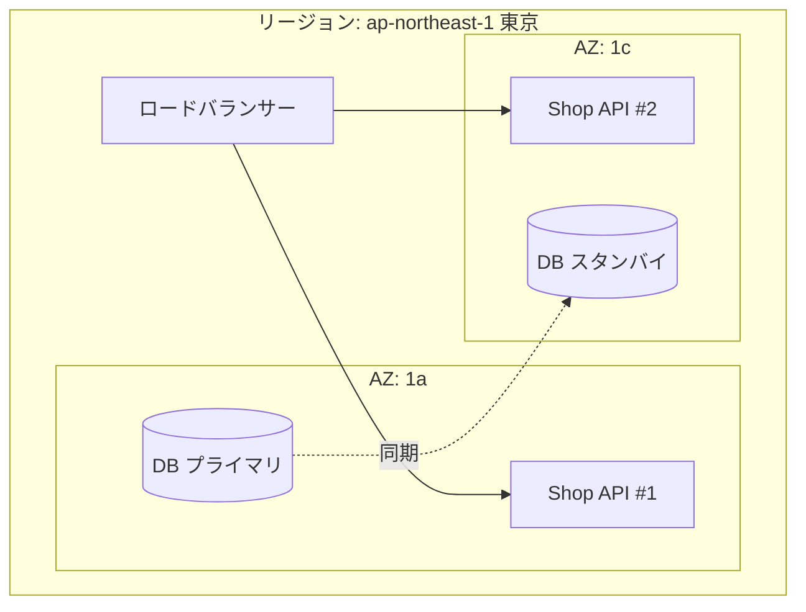

# 仮想化とクラウド

[[MOC_サーバー・インフラ体系|📚 目次]] ｜ [[02_サーバーの種類と役割|← 前へ]] ｜ [[04_Linuxサーバーの基本|次へ →]]

> [!abstract] この記事で分かること
> - 仮想化とハイパーバイザ（Type 1 / Type 2）の仕組み
> - VM とコンテナの違い（カーネルを共有するかどうか）
> - IaaS / PaaS / SaaS / FaaS と、責任共有モデル（どこまでが自分の責任か）
> - オンプレミスとクラウドの比較、主要クラウドの対応サービス、リージョンと AZ
> - VPS という手軽な選択肢と、Shop をどこで動かすかの考え方
>
> **前提**：[[01_サーバーとは何か]]・[[02_サーバーの種類と役割]] を読んでいると理解しやすいです。

## 1. ひとことで言うと

仮想化は **「1 軒の大きな家をシェアハウスに区切る」** 技術です。物理サーバー 1 台は性能が高すぎて、アプリ 1 つでは 10% くらいしか使い切れないことがよくあります。そこで 1 台を複数の「仮想的なコンピューター」に区切って貸し出すのが仮想化で、それを巨大な規模でインターネット越しに貸すビジネスが **クラウド** です。

- **仮想マシン（VM: Virtual Machine）**：ソフトウェアで作られた「部屋」。中で別々の OS が動き、互いに干渉しない
- **ハイパーバイザ（hypervisor）**：物理の CPU・メモリ・ディスクを切り分けて各 VM に配る「大家さん」
- **クラウド**：その大家さんを API で操作でき、使った分だけ払える仕組み

## 2. 仮想化とハイパーバイザ

### 2-1. なぜ仮想化するのか

かつては「メールは Windows、Web は Linux、DB は UNIX」と 1 アプリ 1 台で、どの機械もほとんど遊んでいました。仮想化すると次の利点があります。

- **集約**：3 台分を 1 台にまとめ、電気代・設置スペース・購入費を削減
- **可搬性**：VM の実体は **ファイル（ディスクイメージ）** なので、コピー・バックアップ・別マシンへの移動ができる
- **速さ**：機械を買って届くのを待たずに、数分で新しいサーバーを作れる
- **隔離**：ある VM がクラッシュしても他の VM には影響しない

### 2-2. Type 1 と Type 2

| | Type 1（ベアメタル型） | Type 2（ホスト型） |
|---|---|---|
| 置き場所 | ハードウェアの上に **直接** | Windows / macOS などの OS の上にアプリとして |
| 速さ | 間に OS がないので速い | ホスト OS を経由する分、オーバーヘッドがある |
| 用途 | データセンター・クラウド | 手元の PC で別 OS を試す |
| 例 | VMware ESXi、Microsoft Hyper-V、Xen、AWS Nitro Hypervisor | VirtualBox、VMware Workstation、Parallels |

```
  Type 1                         Type 2
┌─────┬─────┬─────┐          ┌─────┬─────┐
│ VM1 │ VM2 │ VM3 │          │ VM1 │ VM2 │
├─────┴─────┴─────┤          ├─────┴─────┤  ┌────────┐
│  ハイパーバイザ   │          │ハイパーバイザ │  │普通のアプリ│
├─────────────────┤          ├───────────┴──┴────────┤
│  ハードウェア     │          │     ホストOS(Windows等)  │
└─────────────────┘          ├────────────────────────┤
                             │      ハードウェア         │
                             └────────────────────────┘
```

> [!note] KVM はどっち？
> Linux カーネルに組み込まれた **KVM（Kernel-based Virtual Machine）** は、「Linux 自体がハイパーバイザになる」ので Type 1 とも Type 2 とも説明されます。境界は曖昧になってきており、実務では「クラウドの VM は Type 1 系のハイパーバイザで動いている」と押さえれば十分です。AWS の Nitro も KVM をベースにした軽量ハイパーバイザです。

CPU コア数より VM の vCPU 合計が多くても動くのは、ハイパーバイザが時間を細かく区切って順番に実行しているからです。逆に言えば、混み合った物理マシン上の VM は **他人の VM の負荷の影響を受けることがある**（noisy neighbor 問題）、というのが VPS や安いクラウドインスタンスの性能がブレる理由です。

## 3. VM とコンテナの違い

コンテナ（container）も「区切って動かす」技術ですが、区切り方が違います。

```
     仮想マシン（VM）                         コンテナ
┌────────┬────────┬────────┐       ┌────────┬────────┬────────┐
│ アプリA │ アプリB │ アプリC │       │ アプリA │ アプリB │ アプリC │
│ ライブラリ│ライブラリ│ライブラリ│       │ライブラリ│ライブラリ│ライブラリ│
│ ゲストOS │ゲストOS │ゲストOS │       ├────────┴────────┴────────┤
│(カーネル)│(カーネル)│(カーネル)│       │   コンテナランタイム(Docker等) │
├────────┴────────┴────────┤       ├──────────────────────────┤
│       ハイパーバイザ          │       │  ホストOS（カーネルは 1 つを共有） │
├──────────────────────────┤       ├──────────────────────────┤
│        ハードウェア           │       │        ハードウェア           │
└──────────────────────────┘       └──────────────────────────┘
```

| 観点 | VM | コンテナ |
|---|---|---|
| 区切る単位 | ハードウェアを仮想化。OS ごと丸ごと | OS の中でプロセスを隔離 |
| カーネル | VM ごとに別々 | **ホストのカーネルを共有** |
| 起動時間 | 数十秒〜数分（OS が起動する） | 数秒以下（プロセスが起動するだけ） |
| サイズ | GB 単位 | MB〜数百 MB |
| 隔離の強さ | 強い（別カーネル） | VM より弱い（カーネルの脆弱性は全コンテナに影響） |
| 別 OS | Linux の上で Windows も動く | Linux カーネル上では Linux コンテナのみ |

コンテナは Linux カーネルの **namespace（見える範囲を分ける）** と **cgroups（使えるリソース量を制限する）** という機能で実現されています。実務では「VM の上でコンテナを動かす」組み合わせが普通で、クラウドの Kubernetes もノードは VM です。詳しくは [[Dockerとは]]・[[09-Docker]]・[[10-Kubernetes]]。

## 4. IaaS / PaaS / SaaS / FaaS と責任共有モデル

クラウドのサービスは「どこまで事業者が面倒を見てくれるか」で分類されます。ピザで例えると、IaaS は「キッチンを借りて自分で作る」、PaaS は「生地と窯は用意されていて具を載せるだけ」、SaaS は「出来上がったピザを食べるだけ」です。

| 分類 | 正式名 | 借りるもの | 自分がやること | 例 |
|---|---|---|---|---|
| **IaaS** | Infrastructure as a Service | 仮想マシン・ネットワーク・ディスク | OS の更新、ミドルウェア、アプリ、データ | EC2、Compute Engine、Azure VM |
| **PaaS** | Platform as a Service | アプリ実行環境 | アプリのコードと設定、データ | Elastic Beanstalk、App Engine、Azure App Service、Heroku |
| **FaaS** | Function as a Service | 関数の実行環境 | 関数のコード | Lambda、Cloud Run functions、Azure Functions |
| **SaaS** | Software as a Service | 完成したソフト | 使い方・アカウント・データの管理 | Gmail、Slack、Salesforce |

### 責任共有モデル

クラウドでは「セキュリティの責任」を事業者と利用者で分担します。AWS はこれを 「**クラウドの**セキュリティ（事業者）」と「**クラウドにおける**セキュリティ（利用者）」と表現しています。

```
                  IaaS(EC2)   マネージドDB(RDS)   FaaS(Lambda)   SaaS
データ・アクセス権    利用者        利用者             利用者        利用者
アプリケーション      利用者        ―                 利用者        事業者
ミドルウェア・DB      利用者        事業者             事業者        事業者
OS のパッチ          利用者 ★      事業者             事業者        事業者
仮想化・物理・施設     事業者        事業者             事業者        事業者
```

★ が重要です。**EC2 や VPS を選んだら、OS のセキュリティ更新は自分の仕事** です。「クラウドだから安全」ではありません。一方で、どの形態でも **データとアクセス権（誰が何を触れるか）は常に利用者の責任** です。S3 を公開設定にして情報漏えい、という事故はこの部分です。

## 5. オンプレミス vs クラウド

**オンプレミス（on-premises、略してオンプレ）** は、自社でサーバーを買ってデータセンターや社内に置く方式です。

| 観点 | オンプレミス | クラウド |
|---|---|---|
| 初期費用 | 大きい（機器購入、設置） | ほぼゼロ |
| 継続費用 | 減価償却・保守・電気・人件費。長く使うほど割安になりやすい | 従量課金。大規模・長期だと高くつくことも |
| 調達速度 | 数週間〜数か月 | 数分 |
| 増減 | 難しい（ピークに合わせて買う必要） | API で即座に増減 |
| コントロール | ハード・ネットワークまで自由 | 抽象化されており裏側には触れない |
| 運用負担 | ハード故障対応・電源・冷却まで自前 | 物理層は事業者任せ |
| 向いている例 | 低遅延必須（工場・金融の一部）、規制で外に出せないデータ、負荷が一定で大規模 | スタートアップ、負荷の変動が大きいサービス、まず試したいとき |

クリップ「[[クラウド vs オンプレ。何で動いている？AWS・GCP・Azureの裏側の技術を徹底解説]]」では、この違いを **「クラウド＝抽象化、オンプレ＝制御」** とまとめています。どちらが新しい・古いではなく、目的に応じた選択です。両方を組み合わせる **ハイブリッドクラウド** も一般的です。

## 6. 主要クラウドの対応サービスとリージョン・AZ

### 6-1. 対応サービス表（2026 年時点）

| 用途 | AWS | Google Cloud | Microsoft Azure |
|---|---|---|---|
| 仮想マシン（IaaS） | Amazon EC2 | Compute Engine | Azure Virtual Machines |
| 手軽な VPS 的サービス | Amazon Lightsail | — | — |
| コンテナ実行（サーバー管理なし） | Amazon ECS + AWS Fargate | Cloud Run | Azure Container Apps |
| Kubernetes | Amazon EKS | Google Kubernetes Engine (GKE) | Azure Kubernetes Service (AKS) |
| サーバーレス関数（FaaS） | AWS Lambda | Cloud Run functions | Azure Functions |
| PaaS | AWS Elastic Beanstalk | App Engine | Azure App Service |
| マネージド RDB | Amazon RDS / Aurora | Cloud SQL / AlloyDB | Azure Database for PostgreSQL / MySQL |
| オブジェクトストレージ | Amazon S3 | Cloud Storage | Azure Blob Storage |
| 仮想ネットワーク | Amazon VPC | VPC | Azure Virtual Network |
| ロードバランサー | Elastic Load Balancing (ALB/NLB) | Cloud Load Balancing | Azure Load Balancer / Application Gateway |
| DNS | Amazon Route 53 | Cloud DNS | Azure DNS |
| CDN | Amazon CloudFront | Cloud CDN | Azure Front Door |

名前は違っても中身の考え方はほぼ同じです。1 つのクラウドで覚えた概念は他でも通用します。このシリーズの例は主に AWS で書きます。

### 6-2. リージョンとアベイラビリティゾーン（AZ）

- **リージョン（Region）**：地理的に離れた拠点。例：東京 `ap-northeast-1`、大阪 `ap-northeast-3`。リージョン同士は独立しており、リソースは自動ではコピーされない
- **アベイラビリティゾーン（AZ: Availability Zone）**：1 つのリージョンの中にある、互いに隔離された複数の拠点（1 つ以上のデータセンター群）。例：`ap-northeast-1a`。電源・ネットワークが独立しているので、1 つの AZ が停電しても他は動き続ける



**選び方の基本**：

- リージョンは **ユーザーに近い場所**（日本向けなら東京）、加えて法規制（データの国外持ち出し）や料金で選ぶ
- 本番で止められないなら、サーバーを **複数 AZ に分散** する（マルチ AZ）。1 AZ に全部置くと、その AZ の障害で全停止する
- 地震などの広域災害まで考えるなら、別リージョンにバックアップを置く（→ [[04_DR訓練とRTO・RPO]]）

## 7. VPS という選択肢

**VPS（Virtual Private Server）** は、仮想化された 1 台を **月額固定料金** で借りるサービスです。

| | VPS | クラウド VM（EC2 等） |
|---|---|---|
| 料金 | 月額固定（数百円〜）、通信量込みが多い | 従量課金。通信量（特に外向き）にも課金 |
| 機能 | サーバー 1 台＋簡単なファイアウォール | ロードバランサー・マネージド DB・IAM など周辺サービスが豊富 |
| 増減 | プラン変更（再起動が必要なことも） | API で数分、オートスケールも可能 |
| 向いている | 個人開発、学習、小規模サイト | 本番サービスで成長が見込まれるもの |
| 例 | さくらの VPS、ConoHa VPS、Xserver VPS、DigitalOcean、Linode(Akamai)、Amazon Lightsail | EC2、Compute Engine、Azure VM |

**Shop をどこで動かすか**：学習や最初の公開なら、VPS または EC2 の小さなインスタンス 1 台で十分です。料金が読みやすい VPS は「請求額が怖い」初心者に向いています。DB 分離やロードバランサー、オートスケールまで進むなら、周辺サービスが揃ったクラウドに乗っておくと後が楽です。どちらを選んでも **中身は Ubuntu の Linux サーバー** なので、次の [[04_Linuxサーバーの基本]] の内容はそのまま使えます。

> [!warning] クラウドの課金事故に注意
> クラウドは「作ったまま忘れた」リソースにも課金されます。学習用アカウントでは **予算アラート（AWS Budgets など）を最初に設定** し、使い終わったインスタンス・ディスク・Elastic IP は削除しましょう。

## よくある誤解・つまずき

- ❌ コンテナは軽量な VM
  ✅ コンテナは「隔離されたプロセス」で、ホストのカーネルを共有する。VM とは隔離の仕組みも強さも違う
- ❌ クラウドに載せればセキュリティは事業者が守ってくれる
  ✅ IaaS では OS のパッチ・ファイアウォール設定・アクセス権は利用者の責任（責任共有モデル）
- ❌ クラウドは常にオンプレより安い
  ✅ 負荷が一定で大規模・長期なら、オンプレやVPSの方が安いことも多い。クラウドの価値は「速さ」と「増減の柔軟さ」
- ❌ 1 つのリージョンに置けば冗長化されている
  ✅ 1 つの AZ に全部置くと、その AZ の障害で止まる。冗長化はマルチ AZ にして初めて意味がある
- ❌ サーバーレスにすれば運用はゼロ
  ✅ OS 管理は不要になるが、権限設定・タイムアウト・コールドスタート・コスト監視などの運用は残る

## まとめ

- 仮想化は 1 台の物理マシンをハイパーバイザで区切り、複数の VM を動かす技術。クラウドの土台
- ハイパーバイザには Type 1（ハード直上、データセンター向け）と Type 2（OS 上、手元 PC 向け）がある
- コンテナはホストのカーネルを共有するので軽くて速いが、隔離は VM より弱い
- IaaS → PaaS → FaaS → SaaS の順に事業者の担当が広がる。IaaS では OS パッチは自分の責任
- リージョンは場所、AZ はリージョン内の独立した拠点。本番はマルチ AZ が基本
- 学習・小規模なら VPS、成長と周辺サービスを見込むならクラウド VM

## 確認クイズ

1. VM とコンテナの最も本質的な違いは何ですか？
> [!tip]- 答え
> **カーネルを共有するかどうか** です。VM はそれぞれが自分の OS（カーネル）を持ちますが、コンテナはホスト OS のカーネルを共有し、namespace と cgroups でプロセスを隔離しているだけです。そのため起動が速く軽量な反面、隔離の強さは VM に劣ります。

2. Shop を EC2 で動かしていたところ、OS の脆弱性を突かれて侵入されました。責任共有モデルでは、これは誰の責任ですか？
> [!tip]- 答え
> **利用者（自分）の責任** です。EC2（IaaS）ではゲスト OS の更新・パッチ適用は利用者の担当です。AWS が責任を持つのはハイパーバイザ・物理サーバー・データセンターなど「クラウドそのもの」のセキュリティです。

3. Shop の API サーバー 2 台を同じ AZ に置いています。何が問題で、どう直すべきですか？
> [!tip]- 答え
> その AZ で停電やネットワーク障害が起きると 2 台とも同時に止まり、冗長化の意味がありません。API サーバーを **別々の AZ（例：1a と 1c）に配置** し、ロードバランサーで振り分けます。

## 関連ノート
- [[仮想化の仕組み]] — （クリップ）ハイパーバイザと VM の解説動画
- [[クラウド vs オンプレ。何で動いている？AWS・GCP・Azureの裏側の技術を徹底解説]] — （クリップ）クラウドの裏側とオンプレの価値
- [[01_サーバーとは何か]] — サーバーの形（物理〜サーバーレス）
- [[04_Linuxサーバーの基本]] — 借りたサーバーの中身を操作する
- [[Dockerとは]] / [[10-Kubernetes]] — コンテナとオーケストレーション
- [[05_高可用性と冗長化]] — マルチ AZ 構成の詳細
- [[03_Terraform入門]] — クラウドのリソースをコードで作る

## 参考
- [AWS Shared Responsibility Model](https://aws.amazon.com/compliance/shared-responsibility-model/)
- [Amazon EC2: Regions and Zones](https://docs.aws.amazon.com/AWSEC2/latest/UserGuide/using-regions-availability-zones.html)
- [AWS Nitro System](https://aws.amazon.com/ec2/nitro/)
- [Docker docs: What is a container?](https://docs.docker.com/get-started/docker-concepts/the-basics/what-is-a-container/)
- [NIST SP 800-145: The NIST Definition of Cloud Computing](https://csrc.nist.gov/pubs/sp/800/145/final)
- [Google Cloud: Compare AWS and Azure services to Google Cloud](https://cloud.google.com/docs/get-started/aws-azure-gcp-service-comparison)
