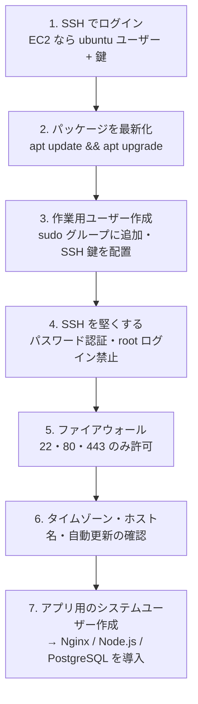

# Linuxサーバーの基本

[[MOC_サーバー・インフラ体系|📚 目次]] ｜ [[03_仮想化とクラウド|← 前へ]] ｜ [[05_ネットワークの基本（IP・ポート・DNS）|次へ →]]

> [!abstract] この記事で分かること
> - なぜサーバーの OS は Linux が主流なのか、どのディストリビューションを選ぶか
> - ディレクトリ構成（`/etc` `/var/log` `/home` `/opt` `/srv`）と「どこに何があるか」
> - ユーザー・グループ・パーミッション・sudo の基本
> - apt によるパッケージ管理、プロセスとサービス（systemctl）、ログ（journalctl）、リソース確認
> - 新しいサーバーを借りた初日にやることの流れ
> - 補足：Linux の特徴・構造・主要ディストリビューション・用途の一覧
>
> **前提**：[[03_仮想化とクラウド]] を読んでいると理解しやすいです。ターミナルで `cd` や `ls` を使ったことがあれば十分です。

## 1. ひとことで言うと

Linux サーバーは **「画面のない、ひたすら働き続けるパソコン」** です。マウスもデスクトップもなく、SSH で遠隔からコマンドを打って操作します。最初は不安ですが、覚えることは「どこに何があるか（ディレクトリ）」「誰が何をできるか（権限）」「何が動いているか（プロセス・サービス）」「何が起きたか（ログ）」の 4 つに集約されます。

- サーバー OS は Linux が圧倒的多数派。このシリーズでは **Ubuntu Server 24.04 LTS** を基準にする
- 設定は `/etc`、ログは `/var/log` と journald、サービスは `systemctl` で管理する
- root で直接作業せず、一般ユーザー＋`sudo` で必要なときだけ管理者権限を使う

## 2. なぜ Linux か、どれを選ぶか

### 2-1. Linux が選ばれる理由

- **無料・オープンソース**：台数を増やしてもライセンス費用がかからない
- **GUI が不要で軽い**：メモリや CPU をアプリに回せる
- **自動化しやすい**：すべてがコマンドと テキストの設定ファイルなので、スクリプトや Ansible で再現できる（→ [[04_構成管理とAnsible]]）
- **エコシステム**：Nginx・PostgreSQL・Docker など、サーバーソフトの多くは Linux を第一の動作環境としている
- **コンテナの土台**：Docker のコンテナは Linux カーネルの機能で動く

Windows Server も .NET Framework や Active Directory を使う社内システムでは現役ですが、Web サービスでは Linux が標準です。

### 2-2. ディストリビューション

Linux は「カーネル＋ソフト一式」を組み合わせた **ディストリビューション（distribution、略してディストロ）** として配布されます。

| 系統 | 代表 | パッケージ管理 | 特徴 |
|---|---|---|---|
| Debian 系 | **Ubuntu Server LTS**、Debian | `apt`（.deb） | 情報が多く初心者向き。クラウドのイメージも豊富 |
| RHEL 系 | Red Hat Enterprise Linux、Rocky Linux、AlmaLinux | `dnf`（.rpm） | 企業システムで定番。RHEL は有償サポート付き |
| Amazon Linux | Amazon Linux 2023 | `dnf` | AWS 向けに最適化。Fedora ベース |

**LTS（Long Term Support）** は長期サポート版のことです。Ubuntu の LTS は 2 年ごとに出て、**標準で 5 年間のセキュリティ更新**、Ubuntu Pro（個人は 5 台まで無料）でさらに延長されます。Ubuntu 24.04 LTS の標準サポートは 2029 年 5 月までです（2026 年時点）。本番サーバーには必ず LTS を選びます。

> [!note] 他ディストリでの読み替え
> 以降のコマンドは Ubuntu 基準です。RHEL 系・Amazon Linux では `apt` → `dnf`、`ufw` → `firewalld`、管理者グループ `sudo` → `wheel`、`/var/log/syslog` → `/var/log/messages` と読み替えてください。`systemctl` と `journalctl` は共通です。

## 3. ディレクトリ構成（FHS）

Linux のディレクトリ配置は **FHS（Filesystem Hierarchy Standard）** という規約でおおむね決まっています。「設定ファイルどこ？」で迷わないために、主要な場所を覚えましょう。

| パス | 中身 | Shop での例 |
|---|---|---|
| `/etc` | **設定ファイル** | `/etc/nginx/nginx.conf`、`/etc/systemd/system/shop-api.service` |
| `/var/log` | **ログファイル** | `/var/log/nginx/access.log`、`/var/log/nginx/error.log` |
| `/var/lib` | アプリが管理するデータ | `/var/lib/postgresql/16/main`（DB の実データ） |
| `/var/www` | Web コンテンツ（慣習） | 静的ファイルを置く場所の候補 |
| `/home` | 一般ユーザーのホーム | `/home/deploy` |
| `/root` | root ユーザーのホーム | 普段は使わない |
| `/opt` | パッケージ外の追加ソフト | `/opt/shop-api`（自作アプリの配置先の候補） |
| `/srv` | そのサーバーが提供するデータ | `/srv/shop`（配置先の別候補） |
| `/usr/bin`, `/usr/sbin` | コマンド本体 | `node`、`nginx` |
| `/tmp` | 一時ファイル。再起動で消える | 大事なものは置かない |

自作アプリを `/opt` と `/srv` のどちらに置くかは流派がありますが、**チーム内で 1 つに決めて揃える** ことが大切です。本シリーズでは `/opt/shop-api` に置きます。

## 4. ユーザー・グループ・パーミッション・sudo

### 4-1. ユーザーとグループ

Linux は複数人・複数プログラムで使う前提の OS で、**誰がやったか** を常に管理しています。

- **root**：何でもできる管理者。うっかり `rm -rf /` も実行できてしまう
- **一般ユーザー**：人間の作業用（例：`deploy`）
- **システムユーザー**：サービス専用でログインできないユーザー（例：Nginx の `www-data`、DB の `postgres`、Shop API 用の `shop`）

サービスごとに専用ユーザーを作るのは、**乗っ取られても被害をそのユーザーの権限内に閉じ込める** ためです。

### 4-2. パーミッション

```bash
$ ls -l /opt/shop-api/.env
-rw-r----- 1 shop shop 512 Oct 12 10:00 /opt/shop-api/.env
 │└┬┘└┬┘└┬┘   │    │
 │ │  │  │    │    └ 所有グループ
 │ │  │  │    └ 所有ユーザー
 │ │  │  └ その他(other): ---  何もできない
 │ │  └ グループ(group): r--  読むだけ
 │ └ 所有者(user):  rw-  読み書き
 └ 種類（- はファイル、d はディレクトリ）
```

| 記号 | 数字 | ファイルでは | ディレクトリでは |
|---|---|---|---|
| r | 4 | 読める | 中身の一覧を見られる |
| w | 2 | 書ける | 中にファイルを作成・削除できる |
| x | 1 | 実行できる | 中に入れる（`cd`） |

```bash
sudo chown shop:shop /opt/shop-api/.env   # 所有者を shop に
sudo chmod 640 /opt/shop-api/.env         # rw-r----- （6=4+2, 4, 0）
```

DB のパスワードを含む `.env` を `644`（誰でも読める）にしない、`chmod 777` で「とりあえず動かす」をしない、が鉄則です。

### 4-3. sudo

`sudo`（superuser do）は、許可された一般ユーザーが **そのコマンドだけ root 権限で実行する** 仕組みです。Ubuntu では `sudo` グループのメンバーが使えます。

```bash
sudo adduser deploy              # ユーザー作成（対話式）
sudo usermod -aG sudo deploy     # sudo グループに追加（-a を忘れると他のグループから外れる）
sudo -u shop whoami              # shop ユーザーとして実行 → shop
```

root で直接ログインせずに sudo を使う理由は、**誰がいつ何をしたかがログに残る**（`/var/log/auth.log`）ことと、**うっかり事故を減らす** ことです。

## 5. パッケージ管理（apt）

ソフトのインストール・更新は **パッケージマネージャー** で行います。Ubuntu では `apt` です。

```bash
sudo apt update                  # パッケージ一覧（カタログ）を最新化する。インストールはしない
sudo apt upgrade                 # インストール済みのソフトを更新する
sudo apt install nginx           # インストール
apt list --installed | grep nginx  # インストール済みか確認
sudo apt remove nginx            # 削除（設定ファイルは残る）
sudo apt purge nginx             # 設定ファイルごと削除
sudo apt autoremove              # 不要になった依存パッケージを削除
```

- `update` と `upgrade` の違いはよく混同されます。**update はカタログ更新、upgrade は実際の更新** です
- Ubuntu Server では **unattended-upgrades** が既定で有効になっており、セキュリティ更新は自動で適用されます。カーネル更新後は再起動が必要なことがあり、`/var/run/reboot-required` ファイルの有無で分かります
- Ubuntu 標準リポジトリの Node.js や PostgreSQL は版が古いことがあるため、公式リポジトリ（NodeSource、PostgreSQL の apt リポジトリ）を追加して入れることが多いです（→ [[02_Node.jsアプリを本番で動かす]]）

## 6. プロセスとサービス

### 6-1. プロセスを見る

**プロセス（process）** は「実行中のプログラム」です。

```bash
ps aux | grep node          # 全プロセスから node を探す
ps aux --sort=-%mem | head  # メモリ使用量の多い順
top                         # リアルタイム表示（q で終了）
htop                        # top の見やすい版（sudo apt install htop）
```

`top` の見どころは、上部の **load average**（直近 1・5・15 分の平均的な実行待ちの数。vCPU 数を大きく超えると混雑）と、各プロセスの **%CPU・%MEM** です。

### 6-2. サービスを管理する（systemd）

サーバーで常駐するプログラム（Nginx、PostgreSQL、Shop API）は **サービス（service）** として **systemd** に管理させます。systemd は起動時の自動起動、落ちたときの自動再起動、ログの収集を引き受けてくれます。

```bash
systemctl status nginx         # 状態確認（active (running) なら稼働中）
sudo systemctl start nginx     # 起動
sudo systemctl stop nginx      # 停止
sudo systemctl restart nginx   # 再起動
sudo systemctl reload nginx    # 設定だけ読み直す（接続を切らない）
sudo systemctl enable nginx    # OS 起動時に自動起動する
systemctl is-enabled nginx     # 自動起動が有効か
systemctl --failed             # 失敗しているサービス一覧
```

`start` は「今起動」、`enable` は「次回起動時から自動起動」で、**別物** です（`enable --now` で両方）。Shop API 用のサービスファイルの書き方は [[04_プロセス管理とsystemd]] で扱います。

## 7. ログとリソース確認

### 7-1. ログを見る

```bash
journalctl -u nginx                 # nginx サービスのログ
journalctl -u shop-api -f           # Shop API のログを追いかけ表示（tail -f 相当）
journalctl -u shop-api --since "1 hour ago"
journalctl -p err -b                # 今回の起動以降のエラー以上のログ
sudo tail -f /var/log/nginx/error.log   # ファイルに書くタイプのログ
sudo less /var/log/auth.log         # ログイン・sudo の記録
```

ログには 2 系統あります。systemd 管理下のサービスの標準出力は **journald**（`journalctl` で読む）に、Nginx などが独自に書くログは **`/var/log` 配下のファイル** に残ります。「動かない」ときは、まず `systemctl status` → `journalctl -u` → アプリ固有のログの順に見ましょう。ログの集約や監視は [[04_サーバー監視とログ管理の基本]]・[[04_ログ集約基盤]] へ。

### 7-2. リソースを確認する

```bash
df -h          # ディスク使用量（Use% が 90% 超えは要注意）
du -sh /var/log/*  # どのディレクトリが容量を食っているか
free -h        # メモリ。見るべきは used ではなく available
uptime         # 稼働時間と load average
nproc          # CPU コア数
ss -tlnp       # 待ち受け中の TCP ポートと、どのプロセスか（要 sudo で全表示）
```

`free` で `free` 列が小さくても慌てないでください。Linux は空きメモリをディスクキャッシュに使うので、**実際に使える量は `available` 列** です。`ss` の読み方は [[05_ネットワークの基本（IP・ポート・DNS）]] で詳しく扱います。

## 8. 初日にやるサーバー初期設定の流れ

新しい Ubuntu サーバー（VPS / EC2）を借りたら、アプリを入れる前に次の流れで整えます。各項目のセキュリティ的な詳細は 60 章で扱います。



```bash
# 2. 最新化
sudo apt update && sudo apt upgrade -y

# 3. 作業用ユーザー
sudo adduser deploy
sudo usermod -aG sudo deploy
sudo mkdir -p /home/deploy/.ssh
sudo cp ~/.ssh/authorized_keys /home/deploy/.ssh/
sudo chown -R deploy:deploy /home/deploy/.ssh
sudo chmod 700 /home/deploy/.ssh && sudo chmod 600 /home/deploy/.ssh/authorized_keys
# → 別ターミナルで deploy として SSH ログインできることを必ず確認してから次へ

# 4. SSH（詳細は 60 章）
#   /etc/ssh/sshd_config.d/ に PasswordAuthentication no / PermitRootLogin no を設定し
sudo systemctl reload ssh

# 5. ファイアウォール（クラウドではセキュリティグループも設定）
sudo ufw allow OpenSSH
sudo ufw allow 80/tcp
sudo ufw allow 443/tcp
sudo ufw enable
sudo ufw status verbose

# 6. 基本設定
sudo timedatectl set-timezone Asia/Tokyo
sudo hostnamectl set-hostname shop-web-01
systemctl status unattended-upgrades

# 7. アプリ用のシステムユーザー（ログイン不可）
sudo useradd --system --create-home --home-dir /opt/shop-api --shell /usr/sbin/nologin shop
```

> [!warning] 締め出しに注意
> SSH の設定変更やファイアウォール有効化の前に、**今の SSH セッションを閉じずに、別ターミナルで新しくログインできることを確認** してください。`ufw enable` の前に `ufw allow OpenSSH` を忘れると、自分自身が締め出されます。VPS ならコンソール機能、EC2 ならシリアルコンソールや EC2 Instance Connect が最後の救済手段です。

SSH・ファイアウォール・ハードニングの詳細は [[02_SSHの安全な運用]]・[[03_ファイアウォールとネットワーク制御]]・[[04_OSのハードニングとパッチ管理]] を、構築全体の流れは [[01_サーバー構築の流れ]] を参照してください。

## よくある誤解・つまずき

- ❌ 権限エラーが出たら `chmod 777` で解決
  ✅ 誰でも書き換え可能になり、侵入の足がかりになる。所有者（`chown`）と必要最小限の権限を設定する
- ❌ `apt update` でソフトが更新される
  ✅ update はカタログの更新だけ。実際の更新は `apt upgrade`
- ❌ `systemctl start` したから再起動後も動く
  ✅ 自動起動には `systemctl enable` が必要
- ❌ `free` の free 列が少ない＝メモリ不足
  ✅ Linux は空きをキャッシュに使う。見るべきは `available` 列
- ❌ 作業は root でやった方が楽
  ✅ 一度のタイプミスでシステムを壊せるうえ、誰が何をしたか追えない。一般ユーザー＋sudo が基本

## まとめ

- サーバー OS は Linux が主流。本番には LTS 版（このシリーズでは Ubuntu Server 24.04 LTS）を選ぶ
- 設定は `/etc`、ログは `/var/log` と journald、アプリは `/opt` か `/srv` に置く
- サービスごとに専用ユーザーを作り、パーミッションは最小限に。管理作業は sudo で
- ソフトは `apt`、常駐プログラムは `systemctl`、ログは `journalctl`、リソースは `df` `free` `ss` で確認
- 初日は「最新化 → 作業ユーザー → SSH 強化 → ファイアウォール → 基本設定」の順に整え、締め出しに注意する

## 確認クイズ

1. Shop API の設定ファイル `.env` に DB パスワードが入っています。所有者 `shop`、パーミッション `600` と `644` のどちらにすべきですか？
> [!tip]- 答え
> **`600`（rw-------）** です（グループで読む必要があれば `640`）。`644` は「その他」のユーザーも読めるため、サーバー上の別のプロセスが乗っ取られた場合にパスワードが漏れます。

2. `sudo systemctl start shop-api` で起動できたのに、サーバー再起動後に Shop API が動いていませんでした。何が足りなかったでしょう？
> [!tip]- 答え
> `sudo systemctl enable shop-api` です。`start` は今起動するだけで、OS 起動時の自動起動は `enable` で設定します。`sudo systemctl enable --now shop-api` で両方を一度に行えます。

3. 「サイトが急に 500 エラーを返すようになった」とき、Linux サーバー上で最初に確認するコマンドを 3 つ挙げてください。
> [!tip]- 答え
> 例：`systemctl status shop-api`（サービスが落ちていないか）、`journalctl -u shop-api --since "10 min ago"`（エラーログ）、`df -h`（ディスクフルでログや DB が書けなくなっていないか）。他に `free -h`（メモリ不足）、`sudo tail /var/log/nginx/error.log` も有効です。

## 補足：Linux の特徴・アーキテクチャ・ディストリビューション

Linux そのものの特徴、カーネルからアプリケーションまでの構造、主要ディストリビューション、用途とセキュリティ機能を一覧で整理します。

### 概要

Linux（リナックス）とは、1991 年にリーナス・トーバルズ（Linus Torvalds）によって開発されたオープンソースの Unix 系オペレーティングシステムです。現在、サーバー、デスクトップ、組み込みシステム、スーパーコンピュータなど、様々な環境で広く使用されています。

### Linux の特徴

#### 1. オープンソース

- **ソースコード公開**: 誰でもソースコードを閲覧・改変可能
- **無料**: 基本的に無料で使用可能
- **コミュニティ開発**: 世界中の開発者が協力して開発
- **透明性**: 開発プロセスが公開されている

#### 2. 高い安定性

- **長時間稼働**: サーバーとして 24 時間 365 日の稼働
- **クラッシュ耐性**: システムの異常終了が少ない
- **メモリ管理**: 効率的なメモリ使用と管理
- **プロセス管理**: 堅牢なプロセス制御

#### 3. 高いセキュリティ

- **権限管理**: 細かいアクセス権限の設定
- **ユーザー分離**: ユーザー間の適切な分離
- **セキュリティパッチ**: 迅速な脆弱性修正
- **監査機能**: 詳細なログ記録

#### 4. 高いカスタマイズ性

- **設定の柔軟性**: 詳細な設定変更が可能
- **モジュール設計**: 必要な機能のみを組み込み
- **ディストリビューション**: 多様な Linux 版の選択
- **ソースコード改変**: 必要に応じた機能追加・修正

### Linux のアーキテクチャ

#### 1. カーネル

- **役割**: Linux の中核部分
- **機能**: ハードウェア管理、プロセス管理、メモリ管理
- **特徴**: モノリシックカーネル、モジュール化
- **バージョン**: 定期的な更新・改良

#### 2. シェル

- **役割**: ユーザーとカーネルのインターフェース
- **種類**: Bash、Zsh、Fish、PowerShell
- **機能**: コマンド実行、スクリプト処理、環境設定
- **特徴**: 強力なコマンドライン環境

#### 3. システムライブラリ

- **役割**: アプリケーションとカーネルの仲介
- **機能**: システムコールの提供、共通機能の実装
- **例**: glibc、musl、uClibc
- **特徴**: 標準化された API

#### 4. アプリケーション

- **役割**: 具体的な機能の実現
- **種類**: デスクトップアプリ、サーバーアプリ、開発ツール
- **例**: Firefox、LibreOffice、Apache、MySQL
- **特徴**: 豊富なソフトウェア選択肢

### Linux ディストリビューション

#### 1. 主要ディストリビューション

##### Ubuntu

- **特徴**: 初心者向け、使いやすい
- **用途**: デスクトップ、サーバー、クラウド
- **サポート**: 長期サポート版（LTS）
- **派生版**: Kubuntu、Xubuntu、Lubuntu

##### CentOS/RHEL

- **特徴**: 企業向け、高信頼性
- **用途**: サーバー、エンタープライズ
- **サポート**: 商用サポート、長期サポート
- **派生版**: Rocky Linux、AlmaLinux

##### Debian

- **特徴**: 安定性重視、コミュニティ開発
- **用途**: サーバー、組み込みシステム
- **特徴**: 厳格な品質管理
- **派生版**: Ubuntu、Linux Mint

##### Fedora

- **特徴**: 最新技術、実験的機能
- **用途**: デスクトップ、開発環境
- **特徴**: Red Hat の技術検証版
- **更新**: 6 ヶ月ごとのリリース

##### openSUSE

- **特徴**: ヨーロッパ発、YaST 設定ツール
- **用途**: デスクトップ、サーバー
- **特徴**: 優れたパッケージ管理
- **派生版**: SUSE Linux Enterprise

#### 2. 特殊用途ディストリビューション

##### サーバー向け

- **Ubuntu Server**: クラウド・サーバー最適化
- **CentOS**: エンタープライズサーバー
- **Debian**: 安定したサーバー環境

##### セキュリティ向け

- **Kali Linux**: ペネトレーションテスト
- **Parrot Security**: セキュリティ分析
- **BlackArch**: セキュリティ研究

##### 組み込み向け

- **Yocto Project**: 組み込み Linux 構築
- **Buildroot**: 軽量組み込みシステム
- **OpenWrt**: ルーター・ネットワーク機器

### Linux の基本操作

#### 1. ファイルシステム

- **階層構造**: ルート（/）を起点とした階層
- **主要ディレクトリ**: /bin、/etc、/home、/var、/tmp
- **権限**: 読み取り（r）、書き込み（w）、実行（x）
- **所有者**: ユーザー、グループ、その他

#### 2. 基本コマンド

- **ファイル操作**: ls、cd、cp、mv、rm、mkdir
- **テキスト処理**: cat、grep、sed、awk、sort
- **プロセス管理**: ps、top、kill、jobs
- **ネットワーク**: ping、ssh、scp、wget、curl

#### 3. パッケージ管理

- **APT**: Debian/Ubuntu 系のパッケージ管理
- **YUM/DNF**: Red Hat 系のパッケージ管理
- **Zypper**: openSUSE 系のパッケージ管理
- **Pacman**: Arch Linux 系のパッケージ管理

#### 4. システム管理

- **ユーザー管理**: useradd、usermod、userdel
- **権限管理**: chmod、chown、chgrp
- **サービス管理**: systemctl、service
- **ログ管理**: journalctl、tail、grep

### Linux の用途

#### 1. サーバー

- **Web サーバー**: Apache、Nginx
- **データベースサーバー**: MySQL、PostgreSQL
- **メールサーバー**: Postfix、Sendmail
- **ファイルサーバー**: Samba、NFS

#### 2. クラウド・コンテナ

- **クラウドプラットフォーム**: AWS、Azure、GCP
- **コンテナ**: Docker、Podman
- **オーケストレーション**: Kubernetes、Docker Swarm
- **サーバーレス**: AWS Lambda、Azure Functions

#### 3. 開発環境

- **プログラミング**: 多様な言語の開発環境
- **バージョン管理**: Git、SVN
- **CI/CD**: Jenkins、GitLab CI、GitHub Actions
- **テスト環境**: 自動テスト、品質管理

#### 4. 組み込みシステム

- **IoT デバイス**: センサー、アクチュエーター
- **ルーター**: ネットワーク機器
- **スマートフォン**: Android（Linux ベース）
- **自動車**: 車載システム

#### 5. スーパーコンピュータ

- **HPC**: 高性能計算
- **科学計算**: シミュレーション、データ分析
- **AI/ML**: 機械学習、深層学習
- **研究開発**: 学術研究、企業研究

### Linux のセキュリティ

#### 1. ユーザー管理

- **権限分離**: root ユーザーと一般ユーザーの分離
- **sudo**: 管理者権限の一時的な取得
- **グループ管理**: ユーザーグループによる権限管理
- **パスワードポリシー**: 強固なパスワード設定

#### 2. ファイアウォール

- **iptables**: パケットフィルタリング
- **ufw**: 簡易ファイアウォール設定
- **firewalld**: 動的ファイアウォール管理
- **ネットワークセキュリティ**: ポート制御、アクセス制限

#### 3. 暗号化

- **ファイル暗号化**: LUKS、eCryptfs
- **通信暗号化**: SSH、TLS/SSL
- **ディスク暗号化**: フルディスク暗号化
- **鍵管理**: GPG、SSH 鍵

#### 4. 監視・ログ

- **システム監視**: top、htop、iotop
- **ログ管理**: syslog、journald
- **セキュリティ監査**: auditd、AIDE
- **侵入検知**: fail2ban、OSSEC

### Linux の学習方法

#### 1. 基礎学習

- **コマンドライン**: 基本的なコマンドの習得
- **ファイルシステム**: ディレクトリ構造の理解
- **権限管理**: ファイル・ディレクトリの権限設定
- **プロセス管理**: プロセスの監視・制御

#### 2. 実践学習

- **仮想環境**: VirtualBox、VMware での学習
- **クラウド環境**: AWS、Azure での実践
- **プロジェクト**: 実際のシステム構築
- **コミュニティ**: フォーラム、勉強会への参加

#### 3. 資格取得

- **LPIC**: Linux Professional Institute Certification
- **RHCE**: Red Hat Certified Engineer
- **CompTIA Linux+**: 業界標準の Linux 資格
- **Ubuntu 認定**: Ubuntu の専門知識

### まとめ

Linux は、オープンソースの Unix 系オペレーティングシステムとして、高い安定性、セキュリティ、カスタマイズ性を提供しています。サーバー、クラウド、組み込みシステム、スーパーコンピュータなど、様々な環境で広く使用されており、現代の IT インフラを支える重要な技術です。Linux の習得により、効率的で安全なシステム構築・運用が可能になります。

## 関連ノート
- [[03_仮想化とクラウド]] — サーバーをどこで借りるか
- [[05_ネットワークの基本（IP・ポート・DNS）]] — `ss` や `ufw` の前提になるネットワーク知識
- [[04_プロセス管理とsystemd]] — Shop API をサービスとして登録する
- [[01_サーバーセキュリティの基本]] / [[02_SSHの安全な運用]] — 初期設定のセキュリティ詳細
- [[01_サーバー構築の流れ]] — 構築作業の全体像
- [[04_サーバー監視とログ管理の基本]] — ログと監視
- [[MOC_コンピューターサイエンス体系]] — プロセス・メモリなど OS の理論

## 参考
- [Ubuntu release cycle](https://ubuntu.com/about/release-cycle)
- [Ubuntu Server documentation](https://documentation.ubuntu.com/server/)
- [Ubuntu Server docs: Automatic updates](https://documentation.ubuntu.com/server/how-to/software/automatic-updates/)
- [Filesystem Hierarchy Standard 3.0 (Linux Foundation)](https://refspecs.linuxfoundation.org/FHS_3.0/fhs/index.html)
- [systemctl(1) — systemd man page](https://www.freedesktop.org/software/systemd/man/latest/systemctl.html)
- [journalctl(1) — systemd man page](https://www.freedesktop.org/software/systemd/man/latest/journalctl.html)
