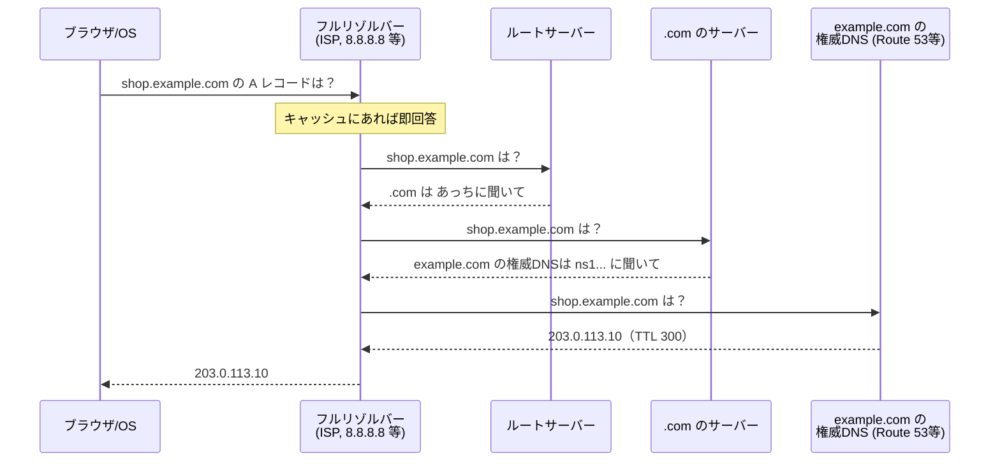

# ネットワークの基本（IP・ポート・DNS）

[[MOC_サーバー・インフラ体系|📚 目次]] ｜ [[04_Linuxサーバーの基本|← 前へ]] ｜ [[01_Webサーバーとは|次へ →]]

> [!abstract] この記事で分かること
> - IP アドレス（IPv4/IPv6、グローバル/プライベート、CIDR）と NAT
> - ポート番号・TCP と UDP の違い、`0.0.0.0` と `127.0.0.1` で listen する違い
> - DNS の仕組み（A レコード・CNAME・TTL、名前解決の流れ）
> - `shop.example.com` を自分のサーバーに向ける手順
> - 疎通確認コマンド（`ping` `curl -v` `dig` `ss -tlnp` `traceroute`）
>
> **前提**：[[01_サーバーとは何か]]・[[04_Linuxサーバーの基本]] を読んでいると理解しやすいです。

## 1. ひとことで言うと

ネットワークは **「郵便」** です。

- **IP アドレス** ＝ 建物の住所（どのサーバーか）
- **ポート番号** ＝ 部屋番号（そのサーバーのどのプログラムか）
- **DNS** ＝ 住所録（`shop.example.com` という名前から住所を調べる）

`https://shop.example.com` を開くと、ブラウザは DNS で住所（IP）を調べ、その建物の 443 号室（HTTPS の Nginx）に手紙（リクエスト）を届けます。サーバー運用で起きる「繋がらない」トラブルの大半は、この 3 つのどれかの設定ミスです。理論の深掘り（OSI 参照モデル、ルーティングの仕組みなど）は [[MOC_コンピューターサイエンス体系]] に譲り、ここでは **サーバーを公開するのに必要な最低限** に絞ります。

## 2. IP アドレス

### 2-1. IPv4 と IPv6

| | IPv4 | IPv6 |
|---|---|---|
| 書き方 | `203.0.113.10`（0〜255 を 4 つ） | `2001:db8::10`（16 進数を `:` 区切り、連続する 0 は `::` で省略） |
| 数 | 約 43 億個（枯渇している） | 事実上無限 |
| 現状 | まだ主流。クラウドのパブリック IPv4 は有料化が進んでいる | 普及中。モバイル回線では多数派 |

> [!note] 例に出てくるアドレス
> `203.0.113.0/24` や `2001:db8::/32` は **ドキュメント用に予約された** アドレスで、実在のサーバーには割り当てられません。このシリーズでは Shop サーバーの IP を `203.0.113.10` とします。

### 2-2. グローバル IP とプライベート IP

- **グローバル IP（パブリック IP）**：インターネット上で一意な住所。外から直接届く
- **プライベート IP**：家庭や社内、クラウドの VPC の中だけで使う住所。インターネットからは直接届かない

プライベート IP として使える範囲は RFC 1918 で決まっています。

| 範囲 | CIDR | よく見る場所 |
|---|---|---|
| 10.0.0.0 〜 10.255.255.255 | `10.0.0.0/8` | AWS の VPC、社内ネットワーク |
| 172.16.0.0 〜 172.31.255.255 | `172.16.0.0/12` | Docker の既定ネットワーク（172.17.0.0/16）、AWS のデフォルト VPC（172.31.0.0/16） |
| 192.168.0.0 〜 192.168.255.255 | `192.168.0.0/16` | 家庭のルーター |

特別なアドレスとして、**`127.0.0.1`（ループバック、localhost）** は「自分自身」を指し、外には一切出ていきません。

### 2-3. CIDR 表記

**CIDR（Classless Inter-Domain Routing、サイダー）** は、IP アドレスの範囲を `アドレス/数字` で表す書き方です。`/` の後ろの数字は「先頭から何ビットが固定か（ネットワーク部）」を表し、残りのビットで個々のホストを表します。

| CIDR | 固定ビット | アドレス数 | 意味 |
|---|---|---|---|
| `203.0.113.10/32` | 32 | 1 | その 1 つだけ（ファイアウォールで「自宅 IP だけ許可」など） |
| `10.0.1.0/24` | 24 | 256 | `10.0.1.0`〜`10.0.1.255`（サブネットの典型） |
| `10.0.0.0/16` | 16 | 65,536 | `10.0.0.0`〜`10.0.255.255`（VPC 全体の典型） |
| `0.0.0.0/0` | 0 | すべて | 「どこからでも」 |

計算のコツ：アドレス数は `2^(32 - 数字)`。/24 なら 2^8 = 256 です（AWS のサブネットでは、そのうち 5 個が予約されて使えません）。セキュリティグループで `0.0.0.0/0` を SSH（22 番）に許可するのは「全世界から SSH を受け付ける」という意味なので避けます（→ [[03_ファイアウォールとネットワーク制御]]）。

### 2-4. NAT

**NAT（Network Address Translation）** は、プライベート IP とグローバル IP を変換する仕組みです。

```
 家庭/VPC の中                      ルーター / NAT GW                 インターネット
[PC 192.168.1.5] ─┐                ┌──────────────┐
[スマホ 192.168.1.6]─┼─▶ 送信元を書き換え │ 198.51.100.7 │ ─▶ [Webサイト]
[PC 192.168.1.7] ─┘   (誰の通信か記憶)  └──────────────┘ ◀─ 返事は 198.51.100.7 宛て
```

- 中から外へ出る通信は、送信元を NAT のグローバル IP に書き換えて出ていく。返事は NAT が覚えている対応表で元の端末に戻す
- 逆に、**外から中の端末へ、いきなり通信を始めることはできない**。これが「プライベート IP のサーバーには外から直接届かない」理由
- AWS では、パブリック IP を持つ EC2 も OS 上ではプライベート IP（例：`10.0.1.23`）しか見えず、インターネットゲートウェイが 1 対 1 で変換している。`ip addr` にグローバル IP が出てこなくても正常

Shop をステージ 2 以降で分離するとき、DB サーバーは **プライベート IP だけ** を持たせ、インターネットから直接届かないようにするのが定石です。

## 3. ポートと TCP / UDP

### 3-1. ポート番号

1 台のサーバーでは複数のプログラムが同時に通信します。どのプログラム宛てかを区別するのが **ポート番号（0〜65535）** です。

| 範囲 | 名前 | 説明 |
|---|---|---|
| 0〜1023 | **well-known ポート** | 定番サービス用。Linux では使うのに root 権限（または特別な権限）が必要 |
| 1024〜49151 | registered ポート | アプリ用（3000、5432、8080 など） |
| 49152〜65535 | dynamic / ephemeral ポート | クライアント側の送信元ポートとして OS が自動で割り当てる |

| ポート | プロトコル | 用途 |
|---|---|---|
| 22 | TCP | SSH |
| 25 / 587 | TCP | SMTP（メール送信） |
| 53 | UDP/TCP | DNS |
| 80 | TCP | HTTP |
| 443 | TCP（HTTP/3 は UDP） | HTTPS |
| 3000 | TCP | Node.js アプリの慣習（Shop API） |
| 3306 | TCP | MySQL |
| 5432 | TCP | PostgreSQL |
| 6379 | TCP | Redis |

Shop API が 80 番ではなく 3000 番で待つのは、1024 未満のポートを使うには特権が必要で、**アプリを root で動かしたくない** からです。80/443 は Nginx が受け、内側の 3000 番へ転送します。

### 3-2. TCP と UDP

| | TCP（Transmission Control Protocol） | UDP（User Datagram Protocol） |
|---|---|---|
| 例え | 書留郵便（届いたか確認、順番保証） | 普通のハガキ（送りっぱなし） |
| 接続 | 最初に 3-way ハンドシェイクで接続を確立 | 接続なしでいきなり送る |
| 信頼性 | 再送・順序保証あり | なし（アプリ側で対処） |
| 速さ | オーバーヘッドがある | 軽くて速い |
| 用途 | HTTP/1.1・HTTP/2、SSH、DB 接続 | DNS 問い合わせ、動画通話、ゲーム、HTTP/3（QUIC） |

ファイアウォールでポートを開けるときは「443/**tcp**」のように TCP か UDP かも指定します。

### 3-3. `0.0.0.0` と `127.0.0.1` で listen する違い

サーバープログラムは「どのアドレスの、どのポートで待つか」を指定して **listen（待ち受け）** します。ここは本番で頻出のつまずきポイントです。

| listen アドレス | 意味 | 誰が接続できるか |
|---|---|---|
| `127.0.0.1:3000` | ループバックだけで待つ | **同じサーバー内のプログラムだけ**（Nginx から OK、外からは不可） |
| `0.0.0.0:3000` | すべての IPv4 アドレスで待つ | 外部からも（ファイアウォールが許せば）接続できる |
| `[::]:3000` | すべての IPv6（設定により IPv4 も） | 同上 |
| `10.0.1.23:5432` | 特定のプライベート IP で待つ | 同じネットワーク内から |

```ts
// Shop API（Node.js）: Nginx の内側にいるので localhost だけで待つ
app.listen(3000, "127.0.0.1");
```

- **Shop API は `127.0.0.1:3000`** で待つ。外から 3000 番に直接来られると、Nginx の HTTPS や制限をすり抜けてしまうから
- **PostgreSQL も同居中は `localhost` のみ**（`listen_addresses = 'localhost'` は既定値）。DB を分離したら、プライベート IP で待つよう変更し、`pg_hba.conf` とファイアウォールで API サーバーからだけ許可する
- 逆に **Docker コンテナの中では `0.0.0.0` で listen しないと、外（ホスト）から届かない**。「手元では動くのにコンテナだと繋がらない」原因の定番

## 4. DNS

### 4-1. DNS レコード

**DNS（Domain Name System）** は、ドメイン名と IP アドレスなどを対応付ける、世界規模の分散データベースです。登録する 1 行 1 行を **レコード（record）** と呼びます。

| レコード | 意味 | 例 |
|---|---|---|
| **A** | 名前 → IPv4 アドレス | `shop.example.com. A 203.0.113.10` |
| **AAAA** | 名前 → IPv6 アドレス | `shop.example.com. AAAA 2001:db8::10` |
| **CNAME** | 名前 → 別の名前（別名） | `www.shop.example.com. CNAME shop.example.com.` |
| **MX** | メールの配送先 | `example.com. MX 10 mail.example.com.` |
| **TXT** | 任意の文字列（ドメイン所有確認、SPF など） | `example.com. TXT "v=spf1 include:amazonses.com ~all"` |
| **NS** | このドメインを管理する DNS サーバー | `example.com. NS ns1.example-dns.net.` |

- **CNAME はゾーンの頂点（`example.com` そのもの）には置けず**、同じ名前に他のレコードと共存もできません。ロードバランサーのように IP が変わる相手を頂点で指したいときは、Route 53 の **エイリアスレコード** や Cloudflare の CNAME フラットニングを使います
- **TTL（Time To Live）**：その回答を何秒キャッシュしてよいか。`300` なら 5 分。TTL が長いと、IP を変えても古い IP を見続ける人が TTL の間残る

> [!tip] 引っ越し前に TTL を下げる
> サーバーの IP を変える予定があるなら、**数日前に TTL を 300 秒程度に下げておき**、切り替え後に元に戻します。これで切り替えが数分で全体に行き渡ります。

### 4-2. 名前解決の流れ



- **フルリゾルバー（キャッシュ DNS）**：利用者の代わりに走り回って答えを探し、TTL の間キャッシュする
- **権威 DNS サーバー（authoritative）**：そのドメインの「正解」を持っているサーバー。Route 53 や Cloudflare、お名前.com の DNS など、**あなたがレコードを登録する場所** がこれ
- ブラウザ・OS・リゾルバーの各段にキャッシュがあるので、変更がすぐ反映されないのは TTL のせい

## 5. shop.example.com をサーバーに向ける手順

1. **ドメインを取得する**：レジストラ（お名前.com、Route 53、Cloudflare Registrar など）で `example.com` を購入
2. **権威 DNS を決める**：レジストラ付属の DNS をそのまま使うか、Route 53 などにホストゾーンを作り、レジストラ側で **NS レコード（ネームサーバー）** をそちらに向ける
3. **サーバーの固定 IP を確認する**：EC2 なら **Elastic IP** を割り当てる（停止・起動でパブリック IP が変わるため）。VPS は通常固定
4. **レコードを登録する**：
   ```
   shop.example.com.      300  IN  A      203.0.113.10
   api.shop.example.com.  300  IN  A      203.0.113.10
   ```
5. **反映を確認する**：
   ```bash
   dig +short shop.example.com          # 203.0.113.10 が返れば OK
   dig shop.example.com @8.8.8.8        # 特定のリゾルバーで確認
   ```
6. **ファイアウォールで 80/443 を開け、Nginx で `server_name shop.example.com` を設定**（→ [[02_Nginx入門]]）
7. **HTTPS 証明書を取得**（Let's Encrypt は DNS が正しく向いていないと発行できない → [[04_HTTPSとTLS証明書]]）

## 6. 疎通確認コマンド

「繋がらない」ときは、**外側から順に** 切り分けます。

```bash
# ① 名前は正しく引けるか（DNS）
dig shop.example.com +short
dig shop.example.com            # ANSWER SECTION と TTL を確認

# ② その IP に届くか（ネットワーク）
ping -c 4 203.0.113.10          # ※ICMP を遮断しているサーバーも多いので、失敗＝停止とは限らない
traceroute 203.0.113.10         # 途中のどこで止まるか（sudo apt install traceroute）

# ③ ポートが開いていて HTTP が返るか（アプリ）
curl -v https://shop.example.com/
#   * Connected to shop.example.com (203.0.113.10) port 443   ← TCP 接続成功
#   * SSL connection using TLSv1.3 ...                       ← TLS 成功
#   < HTTP/2 200                                             ← HTTP 応答
curl -I http://127.0.0.1:3000/health   # サーバー内から API に直接（Nginx を介さず）

# ④ サーバー側で、誰がどのアドレス:ポートで待っているか
sudo ss -tlnp
#   State  Local Address:Port  Process
#   LISTEN 0.0.0.0:443         users:(("nginx",pid=812,...))
#   LISTEN 127.0.0.1:3000      users:(("node",pid=1033,...))
#   LISTEN 127.0.0.1:5432      users:(("postgres",pid=640,...))
```

`ss` のオプションは `-t`（TCP）`-l`（listen 中のみ）`-n`（名前解決せず数字で表示）`-p`（プロセス表示）です。

| 症状 | よくある原因 | 確認 |
|---|---|---|
| `dig` で IP が返らない / 古い IP | レコード未登録、NS の向き先違い、TTL キャッシュ | `dig @権威DNS`、`dig NS example.com` |
| `curl` がタイムアウト | ファイアウォール / セキュリティグループで閉じている | `sudo ufw status`、クラウドのコンソール |
| `curl` が `Connection refused` | そのポートで誰も listen していない | `sudo ss -tlnp`、`systemctl status nginx` |
| `502 Bad Gateway` | Nginx は動いているが裏の API が落ちている | `curl 127.0.0.1:3000`、`journalctl -u shop-api` |
| サーバー内からは繋がるが外から繋がらない | アプリが `127.0.0.1` で listen している（意図通りか確認） | `ss -tlnp` の Local Address |

「タイムアウト」と「Connection refused」の違いは重要です。**タイムアウトは途中で捨てられている（ファイアウォール）**、**refused はサーバーまで届いたが待ち受けがいない（プロセス未起動・ポート違い）** というヒントになります。

## よくある誤解・つまずき

- ❌ DNS を変更したらすぐ全員に反映される
  ✅ TTL の間は各地のキャッシュが古い値を返す。変更前に TTL を短くしておく
- ❌ `ping` が通らない＝サーバーが落ちている
  ✅ ICMP を遮断しているだけのことも多い（AWS のセキュリティグループは既定で ICMP を許可しない）。`curl` で実際のポートを確認する
- ❌ アプリは `0.0.0.0` で listen しておけば安心
  ✅ 外部に公開されてしまう。Nginx の裏にいる API や同居の DB は `127.0.0.1` で待つ。逆にコンテナ内では `0.0.0.0` が必要
- ❌ EC2 の `ip addr` にグローバル IP が出ないのは設定ミス
  ✅ AWS は NAT で 1 対 1 変換しているので、OS にはプライベート IP しか見えないのが正常
- ❌ CNAME で `example.com`（頂点）をロードバランサーに向ければいい
  ✅ 頂点には CNAME を置けない。エイリアスレコードなどを使う

## まとめ

- IP アドレスは住所、ポートは部屋番号、DNS は住所録
- プライベート IP（10/8・172.16/12・192.168/16）は外から直接届かない。NAT で外に出る。CIDR の `/` 後の数字が大きいほど範囲は狭い
- 1024 未満のポートは特権が必要。だから Nginx が 80/443 を受け、API は `127.0.0.1:3000` で内側に隠す
- DNS は A / AAAA / CNAME / TTL を押さえる。ドメインを向けるのは「権威 DNS に A レコードを登録」すること
- 疎通確認は DNS（`dig`）→ 経路（`ping` `traceroute`）→ ポートとアプリ（`curl -v`）→ サーバー内（`ss -tlnp`）の順に切り分ける

## 確認クイズ

1. `10.0.1.0/24` には何個のアドレスが含まれますか？ また `0.0.0.0/0` は何を意味しますか？
> [!tip]- 答え
> `2^(32-24) = 256` 個（`10.0.1.0`〜`10.0.1.255`）です。`0.0.0.0/0` は固定ビットが 0 なので「すべての IPv4 アドレス」、つまり「どこからでも」を意味します。

2. 新しく立てたサーバーで `curl https://shop.example.com` が `Connection refused` になりました。タイムアウトの場合と比べて、まず何を疑いますか？
> [!tip]- 答え
> パケットはサーバーまで届いているが、443 番で待ち受けているプロセスがいない可能性が高いです。`sudo ss -tlnp` で 443 の listen を確認し、`systemctl status nginx` で Nginx が起動しているか、HTTPS の設定が読み込まれているかを確認します。タイムアウトなら、まずファイアウォールやセキュリティグループを疑います。

3. Shop API を `0.0.0.0:3000` で listen させ、ファイアウォールでも 3000 番を開けていました。何が問題ですか？
> [!tip]- 答え
> インターネットから Nginx を経由せずに API へ直接アクセスできてしまいます。HTTPS（暗号化）や Nginx 側のアクセス制限・レート制限をすり抜けられるため危険です。API は `127.0.0.1:3000` で listen させ、3000 番は外に開けないようにします。

## 関連ノート
- [[04_Linuxサーバーの基本]] — `ss` や `ufw` を使う前提の Linux 操作
- [[01_Webサーバーとは]] — 次章：80/443 で待ち受ける Web サーバー
- [[03_リバースプロキシ]] — Nginx から `127.0.0.1:3000` への転送
- [[04_HTTPSとTLS証明書]] — DNS を向けた後の証明書取得
- [[03_ファイアウォールとネットワーク制御]] — ポートを開け閉めする実践
- [[Dockerとは]] — コンテナ内の listen とポート公開
- [[MOC_コンピューターサイエンス体系]] — TCP/IP・ルーティングなどネットワーク理論の深掘り

## 参考
- [RFC 1918: Address Allocation for Private Internets](https://www.rfc-editor.org/rfc/rfc1918)
- [RFC 5737: IPv4 Address Blocks Reserved for Documentation](https://www.rfc-editor.org/rfc/rfc5737)
- [IANA: Service Name and Transport Protocol Port Number Registry](https://www.iana.org/assignments/service-names-port-numbers/service-names-port-numbers.xhtml)
- [Amazon VPC: Subnet CIDR blocks](https://docs.aws.amazon.com/vpc/latest/userguide/subnet-sizing.html)
- [Amazon Route 53: Choosing between alias and non-alias records](https://docs.aws.amazon.com/Route53/latest/DeveloperGuide/resource-record-sets-choosing-alias-non-alias.html)
- [PostgreSQL docs: Connections and Authentication (listen_addresses)](https://www.postgresql.org/docs/current/runtime-config-connection.html)
- [ss(8) — Linux manual page](https://man7.org/linux/man-pages/man8/ss.8.html)
