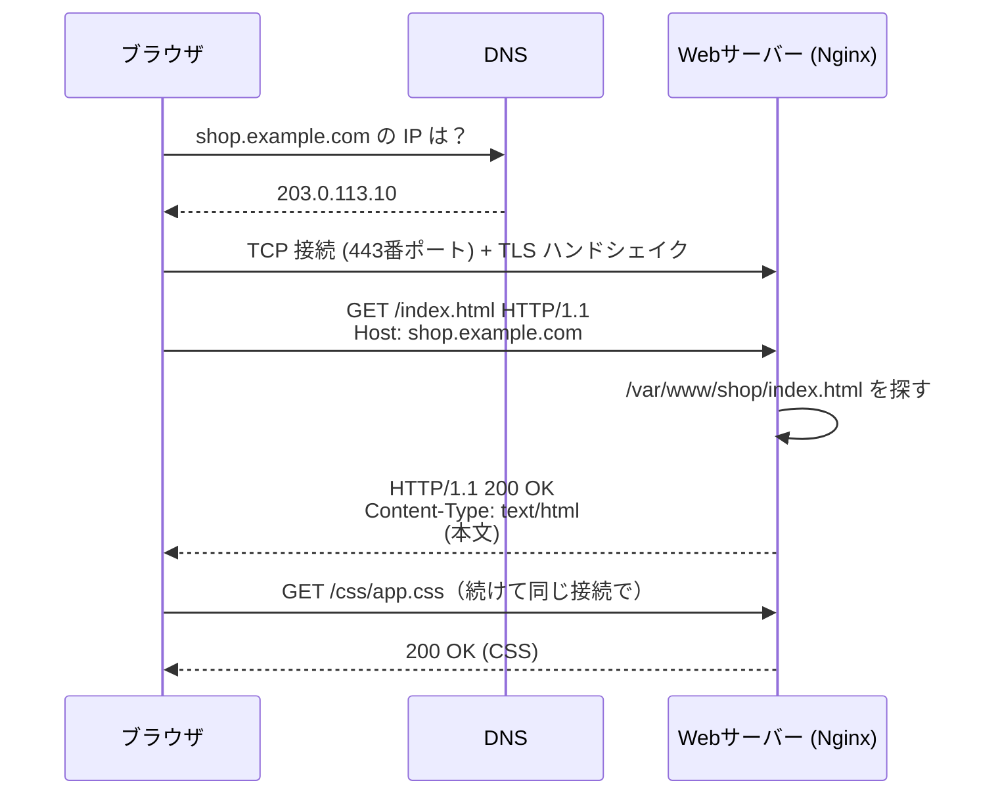

# Webサーバーとは

[[MOC_サーバー・インフラ体系|📚 目次]] ｜ [[05_ネットワークの基本（IP・ポート・DNS）|← 前へ]] ｜ [[02_Nginx入門|次へ →]]

> [!abstract] この記事で分かること
> - Web サーバーが HTTP リクエストを受け取ってレスポンスを返すまでの流れ
> - 「静的ファイル配信」と「動的処理」の違いと、それぞれを誰が担当するか
> - Web サーバーが本番環境で担う 6 つの役割（静的配信・リバースプロキシ・TLS 終端・負荷分散・圧縮・アクセスログ）
> - プロセス / スレッド / イベント駆動という処理モデルの違いと C10K 問題
> - Nginx・Apache・Caddy など主要製品の特徴と、`curl -v` で HTTP のやり取りを観察する方法
>
> **前提**：[[05_ネットワークの基本（IP・ポート・DNS）]] を読んでいると理解しやすいです。

## 1. ひとことで言うと

Web サーバーは **「お店の受付カウンター」** です。お客さん（ブラウザ）が「このページください」と注文（HTTP リクエスト）すると、受付は棚にある商品（HTML・画像などのファイル）ならその場で手渡し、料理が必要な注文（ログインや注文処理）なら厨房（アプリケーション）に回して、できあがったものを返します。受付は「暗号化された注文の解読」「混雑時に厨房を振り分ける」「来客記録をつける」といった雑務も引き受けるので、厨房は料理に集中できます。

- Web サーバー ＝ **HTTP（HyperText Transfer Protocol）を話すソフトウェア**。物理マシンのことではない
- ファイルを返すだけなら Web サーバー単体で完結する（静的配信）
- 本番では「アプリの前に立つ受付」として使うのが主流（リバースプロキシ）

## 2. HTTP リクエストとレスポンスの仕組み

### 2.1 1 回のやり取りの流れ

ブラウザで `https://shop.example.com/index.html` を開いたとき、裏では次のことが起きています。



1. DNS で名前を IP アドレスに変換（[[05_ネットワークの基本（IP・ポート・DNS）]]）
2. その IP の 80 番（HTTP）か 443 番（HTTPS）ポートに TCP 接続
3. HTTPS なら TLS で暗号化の準備（[[04_HTTPSとTLS証明書]]）
4. **リクエスト**（メソッド・パス・ヘッダー）を送る
5. Web サーバーが中身を用意して **レスポンス**（ステータスコード・ヘッダー・本文）を返す

### 2.2 リクエストとレスポンスの中身

HTTP/1.1 はテキストのプロトコルなので、中身はそのまま読めます。

```http
GET /index.html HTTP/1.1
Host: shop.example.com
User-Agent: Mozilla/5.0
Accept: text/html
```

```http
HTTP/1.1 200 OK
Content-Type: text/html; charset=utf-8
Content-Length: 1234
Last-Modified: Mon, 12 Oct 2026 01:00:00 GMT

<!DOCTYPE html>
<html>...
```

| 要素 | 意味 | 例 |
|---|---|---|
| メソッド | 何をしたいか | `GET`（取得）、`POST`（送信・作成）、`PUT`/`PATCH`（更新）、`DELETE`（削除） |
| パス | どのリソースか | `/index.html`、`/api/products/42` |
| `Host` ヘッダー | どのサイト宛てか（1 台で複数サイトを持てる理由） | `shop.example.com` |
| ステータスコード | 結果 | 2xx 成功 / 3xx リダイレクト / 4xx クライアント側の誤り / 5xx サーバー側の失敗 |

> [!note] `Host` ヘッダーが大事な理由
> 1 つの IP アドレスで `shop.example.com` と `api.shop.example.com` の両方を受けられるのは、Web サーバーが `Host` ヘッダーを見て「どのサイトの設定を使うか」を決めているからです。これを **バーチャルホスト（Virtual Host）** と呼び、Nginx では `server_name`、Apache では `<VirtualHost>` で設定します。

運用でよく見るステータスコードも押さえておきましょう。

| コード | 意味 | インフラ視点でよくある原因 |
|---|---|---|
| 301 / 308 | 恒久的なリダイレクト | HTTP→HTTPS 転送 |
| 304 | 変更なし（キャッシュを使って） | [[06_HTTPキャッシュと圧縮]] |
| 403 | 禁止 | ファイルのパーミッション、`deny` 設定 |
| 404 | 見つからない | `root` のパス間違い |
| 502 Bad Gateway | 上流（アプリ）から正常な応答がない | アプリが落ちている・ポート違い |
| 504 Gateway Timeout | 上流が時間内に応答しない | アプリが遅い・タイムアウト短すぎ |

## 3. 静的ファイル配信と動的処理

### 3.1 2 種類のコンテンツ

| | 静的コンテンツ（Static） | 動的コンテンツ（Dynamic） |
|---|---|---|
| 中身 | 誰に対しても同じファイル | リクエストごとに計算して作る |
| 例 | HTML、CSS、JS、画像、フォント | 商品検索結果、カート、ログイン後のマイページ、API の JSON |
| 担当 | Web サーバーがディスクから読んで返す | アプリケーション（Node.js、Python、PHP など）が DB を見て生成 |
| 速さ | 非常に速い（OS の `sendfile` で直接送れる） | DB 問い合わせなどで遅くなりがち |

### 3.2 Shop での分担

Shop では次のように役割を分けます。

```
                      ┌──────────── Ubuntu サーバー 1 台 ─────────────┐
 ブラウザ ──HTTPS──▶ │  Nginx (80/443)                                │
                      │    ├─ shop.example.com/assets/* → /var/www/shop│ ← 静的配信
                      │    └─ api.shop.example.com/*  → 127.0.0.1:3000│ ← リバースプロキシ
                      │                                   │            │
                      │                         Shop API (Node.js)     │ ← 動的処理
                      │                                   │            │
                      │                              PostgreSQL        │
                      └────────────────────────────────────────────────┘
```

Node.js の Express にも `express.static()` があり、アプリ自身で静的ファイルを返すこともできます。開発中はそれで十分ですが、本番では Web サーバーに任せるのが定石です。理由は次のとおりです。

- アプリのプロセス（特に Node.js のシングルスレッド）を、画像の転送のような「頭を使わない仕事」で塞がないため
- Web サーバーはファイル配信に特化した最適化（`sendfile`、キャッシュヘッダー、圧縮）を持っているため
- アプリを再起動している間も静的ファイルは配信し続けられるため

## 4. Web サーバーの 6 つの役割

本番環境の Web サーバーは「ファイルを返す」以外にも多くの仕事をしています。

| 役割 | 何をするか | 詳しくは |
|---|---|---|
| ① 静的配信 | HTML・画像などをディスクから返す | [[02_Nginx入門]] |
| ② リバースプロキシ | 受けたリクエストを裏のアプリに中継する | [[03_リバースプロキシ]] |
| ③ TLS 終端 | HTTPS の暗号を解いて、裏には平文 HTTP で渡す | [[04_HTTPSとTLS証明書]] |
| ④ 負荷分散 | 複数のアプリサーバーへ振り分ける | [[02_ロードバランサーの仕組み]] |
| ⑤ 圧縮・キャッシュ | gzip / brotli で転送量を減らし、キャッシュ用ヘッダーを付ける | [[06_HTTPキャッシュと圧縮]] |
| ⑥ アクセスログ | 誰がいつ何にアクセスし、何秒かかったかを記録 | [[02_Nginx入門]]、[[13-監視・ログ]] |

その他にも、リクエストサイズ制限（巨大アップロードの拒否）、レート制限、IP 制限、Basic 認証、セキュリティヘッダーの付与なども Web サーバー層でよく行います。**アプリに届く前に門前払いできるものは門前払いする**、というのが基本的な考え方です。

## 5. 処理モデル：プロセス・スレッド・イベント駆動

### 5.1 同時にたくさんのお客さんをどうさばくか

Web サーバーは同時に数百〜数万の接続を相手にします。その「さばき方」が製品ごとに違います。

| モデル | 仕組み | 例え | 代表例 |
|---|---|---|---|
| プロセス型 | 1 接続ごとに 1 プロセスが担当 | 客 1 人に店員 1 人が付きっきり | Apache の prefork MPM |
| スレッド型 | 1 接続ごとに 1 スレッド（プロセスより軽い） | 店員が分身して対応 | Apache の worker MPM、IIS |
| イベント駆動型 | 少数のプロセスが多数の接続を「準備ができたものから」順に処理 | 1 人の店員が呼び鈴の鳴った席だけ回る | Nginx、Caddy、Envoy、Node.js |

```
プロセス/スレッド型              イベント駆動型
 接続1 ── 担当A（待機中…）        接続1 ┐
 接続2 ── 担当B（待機中…）        接続2 ┤     ┌──────────────┐
 接続3 ── 担当C（処理中）         接続3 ┼──▶ │ worker 1 つ  │ epoll で「今読める/書ける」
 接続4 ── 担当D（待機中…）        接続4 ┤     │ (ループ)     │ 接続だけを順に処理
  …1万接続で1万の担当が必要        …   ┘     └──────────────┘
```

### 5.2 C10K 問題

**C10K 問題（Client 10,000 problem）** とは、1999 年ごろに提起された「1 台のサーバーで 1 万の同時接続をさばけるか」という課題です。プロセス/スレッド型では接続 1 つにつき数 MB のメモリとコンテキストスイッチ（CPU が担当を切り替えるコスト）がかかるため、1 万接続でメモリも CPU も足りなくなりました。

この問題への答えが、OS の **epoll（Linux）/ kqueue（BSD）** といった「多数のソケットのうち準備ができたものだけを通知してもらう」仕組みと、それを使った **イベント駆動型サーバー** です。Nginx（2004 年公開）はまさにこの問題を解くために作られ、少ないメモリで大量の接続を保持できます。

> [!tip] 実務での意味
> 遅いクライアント（スマホの弱い回線など）は接続を長時間つかみっぱなしにします。イベント駆動型の Nginx を前に置くと、遅いクライアントの相手は Nginx が引き受け、アプリには「完成したリクエスト」だけが速く渡ります。これがアプリの前に Nginx を置く大きな理由の 1 つです（[[03_リバースプロキシ]]）。

## 6. 主要な Web サーバー製品

| 製品 | 処理モデル | 強み | 弱み・注意 | よく使われる場面 |
|---|---|---|---|---|
| **Nginx**（エンジンエックス） | イベント駆動 | 軽量・高速、リバースプロキシとして定番、情報が豊富 | 設定のリロードが必要、`.htaccess` 相当はない | 迷ったらこれ。本シリーズの基準 |
| **Apache HTTP Server** | MPM で選択（prefork / worker / event） | 歴史が長くモジュール豊富、`.htaccess` でディレクトリ単位の設定 | 設定次第で重くなる | レンタルサーバー、PHP / WordPress の既存環境（[[05_Apache入門]]） |
| **Caddy** | イベント駆動（Go 製） | **HTTPS 証明書の取得・更新が自動**、設定が短い | 日本語情報は Nginx より少ない | 小規模サービス、個人開発 |
| **LiteSpeed** | イベント駆動 | Apache 設定（`.htaccess`）と互換で高速、WordPress 向けキャッシュ | 商用版が中心（OSS 版は OpenLiteSpeed） | WordPress ホスティング |
| **IIS** | スレッド型（Windows） | Windows Server / ASP.NET と統合 | Windows 専用 | .NET Framework の社内システム |
| **Envoy** | イベント駆動（C++） | 動的設定 API、gRPC・可観測性が強い | 設定が冗長で、単体の Web サーバー用途には過剰 | Kubernetes のサービスメッシュ（Istio）、API ゲートウェイ |

> [!note] 選び方の目安（2026 年時点）
> - 普通の Web アプリをサーバーに載せる → **Nginx**
> - 証明書管理を極力したくない小規模サイト → **Caddy**
> - 既存の PHP / WordPress 資産、`.htaccess` 前提の環境 → **Apache**（または LiteSpeed）
> - コンテナ基盤でサービス間通信を制御したい → **Envoy**（多くはサービスメッシュ経由で間接的に使う）
>
> AWS の ALB や CloudFront のようなマネージドサービスが Web サーバーの役割の一部（TLS 終端・負荷分散・キャッシュ）を肩代わりする構成も一般的です。

## 7. `curl -v` で HTTP のやり取りを見る

**curl** はコマンドラインから HTTP リクエストを送るツールで、`-v`（verbose）を付けると送受信したヘッダーがすべて表示されます。Web サーバーのトラブルシュートで最初に使う道具です。

```bash
curl -v http://example.com/
```

```
*   Trying 93.184.215.14:80...
* Connected to example.com (93.184.215.14) port 80        ← TCP 接続できた
> GET / HTTP/1.1                                          ← ここから自分が送ったリクエスト
> Host: example.com
> User-Agent: curl/8.5.0
> Accept: */*
>
< HTTP/1.1 200 OK                                         ← ここからサーバーの応答
< Content-Type: text/html; charset=UTF-8
< Content-Length: 1256
< Cache-Control: max-age=604800
< Server: ...
<
<!doctype html>                                           ← 本文
...
```

- `*` で始まる行：curl 自身の動き（DNS 解決、接続、TLS）
- `>` で始まる行：送ったリクエスト
- `<` で始まる行：受け取ったレスポンス

よく使うオプションをまとめます。

```bash
# ヘッダーだけ見る（HEAD リクエスト）
curl -I https://shop.example.com/

# リダイレクトを追いかける（HTTP→HTTPS 転送の確認）
curl -IL http://shop.example.com/

# DNS を変えずに、特定の IP のサーバーへ Host を指定して送る（切り替え前の新サーバー確認に便利）
curl -v --resolve api.shop.example.com:443:203.0.113.10 https://api.shop.example.com/health

# サーバー上でアプリに直接（Nginx を通さずに）話しかける
curl -v http://127.0.0.1:3000/health

# 圧縮されるか確認
curl -sI -H 'Accept-Encoding: gzip' https://shop.example.com/assets/app.js | grep -i content-encoding
```

> [!tip] 切り分けの基本
> 「サイトが見られない」ときは、外側から内側へ順に `curl` していきます。
> 1. 手元から `curl -v https://shop.example.com/` → DNS・ファイアウォール・TLS の問題か？
> 2. サーバー上で `curl -v http://127.0.0.1/` → Nginx の設定の問題か？
> 3. サーバー上で `curl -v http://127.0.0.1:3000/` → アプリ自体の問題か？
>
> どこで失敗するかで、原因の層がほぼ特定できます。

## よくある誤解・つまずき

- ❌ 「Web サーバー＝サーバーマシンのこと」
  ✅ ここでいう Web サーバーは Nginx や Apache などの **ソフトウェア** です。1 台のマシンで Web サーバー・アプリ・DB が同居していることもよくあります。
- ❌ 「Node.js（Express）で HTTP を返せるなら Nginx は不要」
  ✅ 動きはしますが、TLS 終端・静的配信・遅いクライアントの吸収・ログ・複数アプリの振り分けを Nginx に任せたほうが、安全で速く、アプリはビジネスロジックに集中できます。
- ❌ 「502 が出たら Nginx が壊れている」
  ✅ 502 / 504 は「Nginx は動いているが、**裏のアプリ**から正常な返事がない」という意味です。まずアプリのプロセスとポートを確認します。
- ❌ 「イベント駆動ならどんな処理も速い」
  ✅ イベント駆動が得意なのは「待ち時間の多い I/O」をたくさんさばくことです。重い計算をイベントループの中でやると、全接続が止まります（Node.js でも同じ）。

## まとめ

- Web サーバーは HTTP リクエストを受けてレスポンスを返すソフトウェアで、`Host` ヘッダーで複数サイトを使い分ける
- 静的ファイルは Web サーバー、動的処理はアプリケーションが担当するのが本番の定石
- 本番の Web サーバーは静的配信・リバースプロキシ・TLS 終端・負荷分散・圧縮・ログを引き受ける「受付」
- C10K 問題をきっかけに、少数のプロセスで大量接続をさばくイベント駆動型（Nginx など）が主流になった
- 迷ったら Nginx。自動 HTTPS なら Caddy、既存 PHP 資産なら Apache
- トラブル時は `curl -v` で外側から内側へ順に確認する

## 確認クイズ

1. Shop の画像ファイル（`/assets/logo.png`）とカート内容の API（`/api/cart`）は、それぞれ誰が返すのが望ましいでしょうか。理由も答えてください。
> [!tip]- 答え
> 画像は誰に対しても同じ静的コンテンツなので Nginx がディスクから直接返します。カートはユーザーごとに DB を見て作る動的コンテンツなので Shop API（Node.js）が返し、Nginx はそれを中継（リバースプロキシ）します。アプリのプロセスを静的ファイル転送で塞がず、Nginx の配信最適化を活かせるためです。

2. ブラウザで 502 Bad Gateway が表示されました。最初にサーバー上で実行すべき確認コマンドの例を挙げてください。
> [!tip]- 答え
> `curl -v http://127.0.0.1:3000/health` のように、Nginx を通さずアプリへ直接リクエストします。応答がなければアプリが落ちているかポートが違う、応答があれば Nginx の `proxy_pass` 設定を疑います。

3. C10K 問題とは何で、Nginx はどうやってそれを解決したのでしょうか。
> [!tip]- 答え
> 1 台で 1 万の同時接続をさばけるかという問題です。接続ごとにプロセス/スレッドを割り当てるとメモリとコンテキストスイッチのコストが膨らみます。Nginx は epoll などの OS 機能を使い、少数の worker プロセスが「準備ができた接続だけ」を順に処理するイベント駆動型でこれを解決しました。

## 関連ノート

- [[02_Nginx入門]] — 次回。Nginx をインストールして静的サイトを配信する
- [[03_リバースプロキシ]] — アプリの前に Nginx を置く理由と設定
- [[05_Apache入門]] — Apache の MPM と `.htaccess`
- [[01_アプリケーションサーバーとは]] — 動的処理を担う側の話
- [[05_ネットワークの基本（IP・ポート・DNS）]] — HTTP の下で動く TCP/IP と DNS
- [[MOC_コンピューターサイエンス体系]] — プロセス・スレッド・I/O 多重化の理論
- [[MOC_パフォーマンス体系]] — Web サーバーの性能チューニング

## 参考

- [nginx documentation](https://nginx.org/en/docs/)
- [Inside NGINX: How We Designed for Performance & Scale](https://blog.nginx.org/blog/inside-nginx-how-we-designed-for-performance-scale)
- [The C10K problem (Dan Kegel)](http://www.kegel.com/c10k.html)
- [Apache HTTP Server: Multi-Processing Modules (MPMs)](https://httpd.apache.org/docs/2.4/mpm.html)
- [Caddy: Automatic HTTPS](https://caddyserver.com/docs/automatic-https)
- [MDN: HTTP の概要](https://developer.mozilla.org/ja/docs/Web/HTTP/Overview)
- [curl man page](https://curl.se/docs/manpage.html)
