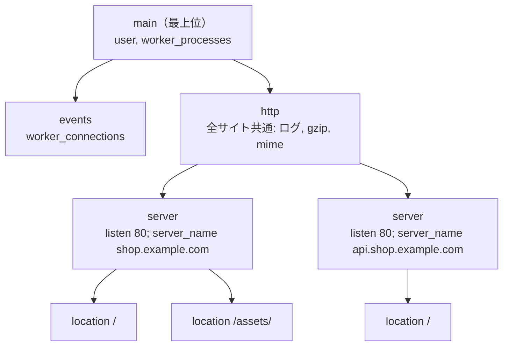
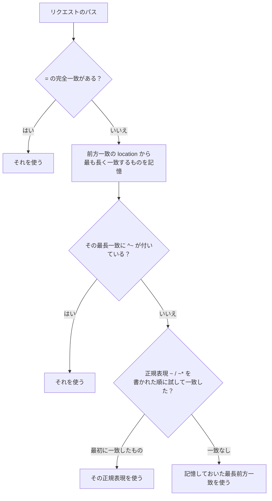

# Nginx入門

[[MOC_サーバー・インフラ体系|📚 目次]] ｜ [[01_Webサーバーとは|← 前へ]] ｜ [[03_リバースプロキシ|次へ →]]

> [!abstract] この記事で分かること
> - Ubuntu に Nginx を入れて動かす手順と、master / worker プロセスの役割
> - `/etc/nginx` 以下の設定ファイルの構成と、`http` / `server` / `location` ブロックの関係
> - `location` がどの順番でマッチするか（`=`、`^~`、正規表現、前方一致）
> - `nginx -t` → `reload` という安全な反映手順と、アクセスログ / エラーログの読み方
> - `root` / `alias` / `try_files` / `index` の使い方と、`root` と `alias` の取り違えの罠
>
> **前提**：[[01_Webサーバーとは]]、[[04_Linuxサーバーの基本]] を読んでいると理解しやすいです。

## 1. ひとことで言うと

Nginx の設定ファイルは **「ビルの案内板」** です。まず建物全体のルール（`http`）があり、その中に「どの会社（ドメイン）宛てか」で分かれたフロア（`server`）があり、各フロアに「この部署（URL パス）宛ての荷物はこの棚へ」という仕分けルール（`location`）が並んでいます。荷物（リクエスト）が届くと、Nginx は案内板を上から順に見て、行き先を 1 つに決めます。

- Nginx は **設定ファイルを書いて、文法チェックして、リロードする** の繰り返しで運用する
- 迷いどころは「どの `server` に入るか」と「どの `location` に入るか」の 2 点だけ
- 設定を変えても `reload` するまで反映されない。`reload` 前には必ず `nginx -t`

## 2. インストールとプロセス構成

### 2.1 apt でインストール

```bash
sudo apt update
sudo apt install -y nginx

# 自動起動が有効で、起動していることを確認
systemctl status nginx
nginx -v              # 例: nginx version: nginx/1.24.0 (Ubuntu)

# 動作確認（Welcome to nginx! の HTML が返る）
curl -I http://localhost/
```

Ubuntu の `nginx` パッケージは、インストールと同時に systemd サービスとして起動・自動起動設定まで行います（systemd の詳細は [[04_プロセス管理とsystemd]]）。外部から見られない場合は、ファイアウォールで 80/443 番が開いているか確認します（[[03_ファイアウォールとネットワーク制御]]）。

> [!note] バージョンについて（2026 年時点）
> Ubuntu 24.04 の公式リポジトリの Nginx は **1.24 系**（セキュリティ修正のみバックポート）です。HTTP/3 や新しいディレクティブが必要なら、nginx.org が提供する公式 apt リポジトリ（stable / mainline）を使います。ただし公式リポジトリ版は `sites-available` を使わず `conf.d` だけの構成で、実行ユーザーも `nginx` になるなど、Ubuntu 版とレイアウトが少し異なります。本シリーズは Ubuntu 版を基準にします。

### 2.2 master プロセスと worker プロセス

```bash
ps -ef --forest | grep [n]ginx
```

```
root       1201     1  nginx: master process /usr/sbin/nginx -g daemon on; master_process on;
www-data   1202  1201  nginx: worker process
www-data   1203  1201  nginx: worker process
```

| プロセス | 実行ユーザー | 役割 |
|---|---|---|
| master | root | 設定ファイルを読む、80/443 番ポートを開く（1024 未満のポートは root 権限が必要）、worker の起動・監視・入れ替え |
| worker | www-data | 実際にリクエストを処理する。各 worker がイベント駆動で数千の接続を同時に扱う |

`worker_processes auto;` にすると CPU コア数と同じ数の worker が起動します。権限の強い master は通信を直接扱わず、リクエスト処理は権限の弱い `www-data` が行うので、仮に worker が乗っ取られても被害を限定できます。

**reload の仕組み**：`systemctl reload nginx` を実行すると、master が新しい設定を読み込み、新しい worker を起動し、古い worker には「今処理中のリクエストを終えたら終了して」と伝えます。そのため **接続を切らずに設定を入れ替えられます**。

## 3. 設定ファイルの構成

### 3.1 ディレクトリ構成（Ubuntu）

```
/etc/nginx/
├── nginx.conf              ← 大元の設定。ここから他のファイルを include する
├── mime.types              ← 拡張子 → Content-Type の対応表
├── conf.d/                 ← *.conf が自動で読み込まれる（共通設定向き）
├── sites-available/        ← サイト設定の「置き場」（ここに置いただけでは無効）
│   ├── default
│   └── shop                ← 自分で作る
├── sites-enabled/          ← ここにあるものだけ読み込まれる（実体はシンボリックリンク）
│   ├── default -> /etc/nginx/sites-available/default
│   └── shop    -> /etc/nginx/sites-available/shop
├── snippets/               ← 使い回す設定の断片（例: TLS 設定）
└── modules-enabled/        ← 動的モジュールの読み込み設定
/var/log/nginx/             ← access.log / error.log
/var/www/html/              ← デフォルトサイトの公開ディレクトリ
```

`sites-available` と `sites-enabled` に分かれているのは、**設定を消さずに有効 / 無効を切り替えるため** です。有効化はシンボリックリンクを作るだけ、無効化はリンクを消すだけです。

> [!tip] sites-enabled と conf.d、どちらを使う？
> どちらも `nginx.conf` の `http` ブロックから include されるので、動作上の違いはありません。Ubuntu では「サイトごとの `server` ブロックは `sites-available` → `sites-enabled`、全サイト共通の設定（ログ形式、gzip など）は `conf.d`」と使い分けるのが分かりやすいです。チームで 1 つに統一することが一番大切です。

### 3.2 nginx.conf の中身（Ubuntu 24.04 の既定を抜粋）

```nginx
user www-data;                    # worker の実行ユーザー
worker_processes auto;            # worker 数 = CPU コア数
pid /run/nginx.pid;
error_log /var/log/nginx/error.log;
include /etc/nginx/modules-enabled/*.conf;

events {
    worker_connections 768;       # 1 worker あたりの最大同時接続数
}

http {
    sendfile on;                  # カーネル内でファイルを直接ソケットへ送る
    tcp_nopush on;
    types_hash_max_size 2048;

    include /etc/nginx/mime.types;
    default_type application/octet-stream;

    access_log /var/log/nginx/access.log;
    gzip on;

    include /etc/nginx/conf.d/*.conf;
    include /etc/nginx/sites-enabled/*;
}
```

### 3.3 ブロックの入れ子と継承



- **ディレクティブ**（`root /var/www;` のような 1 行の命令）は、外側のブロックで書くと内側に **継承** されます
- 内側で同じディレクティブを書くと上書きされます
- ⚠️ `add_header` や `proxy_set_header` のような **複数書ける系のディレクティブは、内側で 1 つでも書くと外側の分がすべて消えます**（継承されなくなる）。セキュリティヘッダーが一部の location で消える典型的な原因です

### 3.4 どの server ブロックが選ばれるか

リクエストが来ると、Nginx はまず `listen`（IP:ポート）で候補を絞り、次に `Host` ヘッダーと `server_name` を照合します。どれにも一致しなければ、そのポートの **default_server**（指定がなければ最初に読み込まれた server）が使われます。

```nginx
# どのドメインにも一致しないアクセス（IP 直打ちなど）は接続を閉じる
server {
    listen 80 default_server;
    server_name _;
    return 444;    # Nginx 独自: 何も返さず接続を切る
}
```

## 4. location のマッチ優先順位

`location` は URL のパス部分（クエリ文字列 `?q=...` は含まない）と照合されます。書いた順番ではなく、次の規則で 1 つに決まります。

| 修飾子 | 意味 | 例 |
|---|---|---|
| `=` | 完全一致。一致したら即決定 | `location = /favicon.ico` |
| `^~` | 前方一致。最長一致がこれなら正規表現を調べない | `location ^~ /assets/` |
| `~` | 正規表現（大文字小文字を区別） | `location ~ \.php$` |
| `~*` | 正規表現（区別しない） | `location ~* \.(png|jpg)$` |
| なし | 前方一致 | `location /api/` |



具体例で確認しましょう。

```nginx
location = / { ... }                       # A
location / { ... }                         # B
location /assets/ { ... }                  # C
location ^~ /images/ { ... }               # D
location ~* \.(gif|jpg|png)$ { ... }       # E
```

| リクエスト | 選ばれる | 理由 |
|---|---|---|
| `/` | A | 完全一致 |
| `/about.html` | B | 前方一致 `/` のみ。正規表現にも当たらない |
| `/assets/app.js` | C | 最長前方一致 C、正規表現に当たらない |
| `/assets/logo.png` | **E** | 最長前方一致は C だが `^~` がないので正規表現を試し、E が当たる |
| `/images/logo.png` | D | 最長前方一致 D に `^~` があるので正規表現を調べない |

> [!warning] つまずきポイント
> 「`/assets/` の location にキャッシュ設定を書いたのに、画像だけ効かない」というとき、たいてい別の正規表現 location が画像を横取りしています。静的ファイル用ディレクトリには `^~` を付けておくと予想どおりに動きます。

## 5. 静的サイト配信の最小設定と反映手順

### 5.1 Shop のフロントエンドを配信する

ビルド済みの Shop フロントエンド（SPA）を `/var/www/shop` に置き、`shop.example.com` で公開します。

```bash
sudo mkdir -p /var/www/shop
sudo cp -r ./dist/* /var/www/shop/
sudo chown -R www-data:www-data /var/www/shop   # worker が読めるように
```

```nginx
# /etc/nginx/sites-available/shop
server {
    listen 80;
    listen [::]:80;
    server_name shop.example.com;

    root  /var/www/shop;          # 公開ディレクトリ
    index index.html;             # ディレクトリにアクセスされたときに返すファイル

    access_log /var/log/nginx/shop.access.log;
    error_log  /var/log/nginx/shop.error.log;

    # ① ビルド成果物（ファイル名にハッシュ付き）
    location ^~ /assets/ {
        try_files $uri =404;
    }

    # ② それ以外は SPA のルーティングに任せる
    location / {
        try_files $uri $uri/ /index.html;
    }

    # ③ .git や .env などの隠しファイルは返さない
    location ~ /\. {
        deny all;
    }
}
```

`try_files $uri $uri/ /index.html;` は「パスに対応するファイルがあればそれ、ディレクトリがあればその中の index、どちらもなければ `/index.html` を返す」という意味です。SPA では `/products/42` のような URL も実ファイルがないので、`index.html` を返してフロントエンドの JavaScript にルーティングを任せます。

### 5.2 有効化して反映する

```bash
# 有効化（シンボリックリンク）。不要ならデフォルトサイトを無効化
sudo ln -s /etc/nginx/sites-available/shop /etc/nginx/sites-enabled/
sudo rm /etc/nginx/sites-enabled/default

# ① 文法チェック（必須）
sudo nginx -t
# nginx: the configuration file /etc/nginx/nginx.conf syntax is ok
# nginx: configuration file /etc/nginx/nginx.conf test is successful

# ② 接続を切らずに反映
sudo systemctl reload nginx

# ③ 確認
curl -I -H 'Host: shop.example.com' http://127.0.0.1/
```

| 操作 | コマンド | 使いどころ |
|---|---|---|
| 文法チェック | `sudo nginx -t` | 設定変更のたびに必ず |
| 反映（無停止） | `sudo systemctl reload nginx` | 通常の設定変更 |
| 再起動 | `sudo systemctl restart nginx` | バイナリ更新・モジュール追加時など（接続が切れる） |
| 全設定の展開表示 | `sudo nginx -T` | include 先も含めて実際に読まれている設定を確認 |

> [!tip] `nginx -t && systemctl reload nginx` を習慣に
> `nginx -t` を飛ばして `restart` すると、文法エラーがあった場合に Nginx が起動できず **全サイトが停止** します。`reload` なら失敗しても古い設定のまま動き続けますが、エラーに気付きにくくなります。`sudo nginx -t && sudo systemctl reload nginx` と 1 行で打つ癖をつけましょう。

## 6. アクセスログとエラーログ

### 6.1 アクセスログ

既定の `combined` 形式では 1 リクエスト 1 行で次のように記録されます。

```
203.0.113.50 - - [12/Oct/2026:10:15:32 +0900] "GET /assets/app.3f9a1c.js HTTP/1.1" 200 48213 "https://shop.example.com/" "Mozilla/5.0 ..."
  クライアントIP        日時                       リクエスト行                    ステータス サイズ  リファラ                   User-Agent
```

実務では処理時間を追加したログ形式を定義しておくと、遅いリクエストの調査に役立ちます。

```nginx
# /etc/nginx/conf.d/log_format.conf
log_format timed '$remote_addr - $remote_user [$time_local] "$request" '
                 '$status $body_bytes_sent "$http_referer" "$http_user_agent" '
                 'rt=$request_time urt=$upstream_response_time';
```

```nginx
# サイト側で使う
access_log /var/log/nginx/shop.access.log timed;
```

`$request_time` は Nginx がリクエストを受けてから返し終えるまでの時間、`$upstream_response_time` は裏のアプリが応答するまでの時間です。両者の差が大きければ「クライアントへの転送が遅い」、`upstream` 側が大きければ「アプリが遅い」と切り分けられます。

### 6.2 よく使うログ調査コマンド

```bash
# リアルタイムで流れを見る
sudo tail -f /var/log/nginx/shop.access.log

# ステータスコード別の件数
sudo awk '{print $9}' /var/log/nginx/shop.access.log | sort | uniq -c | sort -rn

# 5xx だけ抜き出す
sudo awk '$9 ~ /^5/' /var/log/nginx/shop.access.log | tail -20

# エラーログ（403/404 の原因やアプリ接続失敗が書かれる）
sudo tail -50 /var/log/nginx/shop.error.log
```

エラーログには「なぜ失敗したか」が書かれます。例えば `open() "/var/www/shop/foo" failed (2: No such file or directory)` なら Nginx が探したパスがそのまま分かるので、`root` の設定ミスにすぐ気付けます。ログは `logrotate` で日次ローテーションされます（`/etc/logrotate.d/nginx`）。ログの集約や監視は [[13-監視・ログ]]、[[04_ログ集約基盤]] を参照してください。

## 7. よく使うディレクティブと root / alias の罠

| ディレクティブ | 役割 | 書ける場所 |
|---|---|---|
| `root` | **URI をそのまま後ろに連結** してファイルパスを作る | http / server / location |
| `alias` | location に一致した部分を **置き換えて** ファイルパスを作る | location のみ |
| `index` | ディレクトリへのアクセス時に返すファイル名 | http / server / location |
| `try_files` | 候補を順に確認し、最初に存在したものを返す。最後の引数はフォールバック（URI か `=404` などのコード） | server / location |
| `client_max_body_size` | リクエスト本文の上限（既定 1m）。画像アップロードで 413 が出たらこれ | http / server / location |

### root と alias の違い

```nginx
location /images/ {
    root /var/www/shop;
}
# /images/logo.png → /var/www/shop + /images/logo.png = /var/www/shop/images/logo.png

location /images/ {
    alias /var/www/media/;
}
# /images/logo.png → /images/ を /var/www/media/ に置き換え = /var/www/media/logo.png
```

**罠 1：root にパスを重ねてしまう**

```nginx
location /images/ {
    root /var/www/shop/images;    # ❌ /var/www/shop/images/images/logo.png を探して 404
}
```

URL のパスとディレクトリ名が同じなら `root` は親ディレクトリを指定します。

**罠 2：alias の末尾スラッシュの不一致**

```nginx
location /images {                # 末尾スラッシュなし
    alias /var/www/media/;
}
# /images../secret.txt → /var/www/media/../secret.txt となり、上の階層が読めてしまう（パストラバーサル）
```

`alias` を使うときは **location と alias の末尾スラッシュを揃える**（両方 `/` で終える）のが鉄則です。そもそも公式ドキュメントも「location のパスが alias の末尾と一致するなら `root` を使うほうがよい」としています。迷ったら `root` を使い、ディレクトリ名を変えたいときだけ `alias` を使いましょう。

**罠 3：パーミッション**

403 Forbidden が出て設定が正しく見えるときは、`www-data` がファイルだけでなく **途中のすべてのディレクトリに実行（x）権限を持っているか** を確認します。

```bash
namei -l /var/www/shop/index.html   # 経路上の各ディレクトリの権限を一覧表示
```

## よくある誤解・つまずき

- ❌ 「設定ファイルを保存すれば反映される」
  ✅ `sudo nginx -t` で文法確認し、`sudo systemctl reload nginx` するまで反映されません。
- ❌ 「location は上に書いたものが優先される」
  ✅ 前方一致は **最長一致**、正規表現は **書いた順** で、`=` と `^~` が優先度を変えます。順番を入れ替えても前方一致の結果は変わりません。
- ❌ 「`sites-available` に置けば有効になる」
  ✅ `sites-enabled` にシンボリックリンクを作って初めて読み込まれます。逆にデフォルトサイトが残っていると、意図しない server が応答することがあります。
- ❌ 「子の location で `add_header` を 1 つ足しても、親の `add_header` は残る」
  ✅ 子で 1 つでも `add_header` を書くと親の分はすべて継承されなくなります。共通ヘッダーは snippet にして各所で include するのが安全です。

## まとめ

- Ubuntu では `apt install nginx` で導入でき、root の master と `www-data` の worker で動く
- 設定は `nginx.conf` → `conf.d` / `sites-enabled` の順に include され、`http` > `server` > `location` の入れ子で書く
- `server` は `listen` と `server_name`、`location` は `=` → 最長前方一致（`^~`）→ 正規表現 → 最長前方一致 の順で決まる
- 変更したら `nginx -t && systemctl reload nginx`。reload なら接続を切らずに反映できる
- 調査はアクセスログ（何が起きたか）とエラーログ（なぜ失敗したか）。`$request_time` を記録しておく
- `root` は URI を連結、`alias` は置き換え。迷ったら `root`、`alias` は末尾スラッシュを揃える

## 確認クイズ

1. 次の設定で `/static/css/app.css` にアクセスすると、Nginx はどのファイルを探しますか。
   ```nginx
   location /static/ { root /srv/shop/static; }
   ```
> [!tip]- 答え
> `root` は URI をそのまま連結するので `/srv/shop/static/static/css/app.css` を探し、おそらく 404 になります。`root /srv/shop;` にするか、`alias /srv/shop/static/;` にします。

2. `location /assets/ { ... }` と `location ~* \.(png|jpg)$ { ... }` があるとき、`/assets/logo.png` はどちらで処理されますか。`/assets/` 側で処理させるにはどうすればよいですか。
> [!tip]- 答え
> 正規表現のほうで処理されます（前方一致の最長一致を記憶したあと、正規表現が一致したため）。`location ^~ /assets/` とすれば、最長一致が `^~` 付きなので正規表現は調べられず、`/assets/` 側で処理されます。

3. 設定変更を反映するとき、`restart` ではなく `nginx -t` のあと `reload` を使うのはなぜですか。
> [!tip]- 答え
> `reload` は master が新しい worker を起動し、古い worker は処理中のリクエストを終えてから終了するので、接続を切らずに反映できます。また事前に `nginx -t` で文法を確認しておけば、エラーで Nginx が起動しなくなり全サイトが止まる事故を防げます。

## 関連ノート

- [[01_Webサーバーとは]] — Web サーバーの役割と処理モデル
- [[03_リバースプロキシ]] — 次回。Shop API を Nginx の後ろで公開する
- [[06_HTTPキャッシュと圧縮]] — 静的アセットのキャッシュヘッダーと gzip
- [[04_プロセス管理とsystemd]] — `systemctl` の仕組み
- [[03_ファイアウォールとネットワーク制御]] — 80/443 番の開放
- [[13-監視・ログ]] — ログの監視

## 参考

- [nginx: Beginner's Guide](https://nginx.org/en/docs/beginners_guide.html)
- [nginx: ngx_http_core_module（location / root / alias / try_files）](https://nginx.org/en/docs/http/ngx_http_core_module.html)
- [nginx: How nginx processes a request](https://nginx.org/en/docs/http/request_processing.html)
- [nginx: Controlling nginx（reload の仕組み）](https://nginx.org/en/docs/control.html)
- [nginx: ngx_http_log_module](https://nginx.org/en/docs/http/ngx_http_log_module.html)
- [Ubuntu Server docs: Nginx](https://documentation.ubuntu.com/server/how-to/web-services/)
- [Launchpad: nginx package in Ubuntu Noble](https://launchpad.net/ubuntu/noble/+source/nginx)
