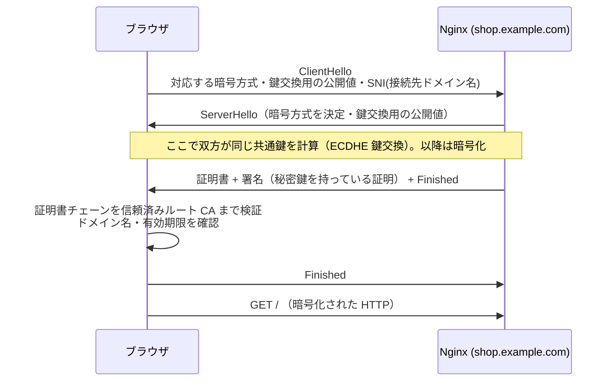
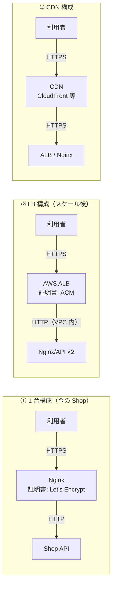

# HTTPSとTLS証明書

[[MOC_サーバー・インフラ体系|📚 目次]] ｜ [[03_リバースプロキシ|← 前へ]] ｜ [[05_Apache入門|次へ →]]

> [!abstract] この記事で分かること
> - TLS が守る 3 つのこと（暗号化・改ざん検知・なりすまし防止）とハンドシェイクの流れ
> - 証明書と認証局（CA）の関係、DV / OV / EV の違い
> - Let's Encrypt と certbot で証明書を取得・自動更新する方法と、有効期間短縮の動向（2026 年時点）
> - 推奨構成に沿った Nginx の TLS 設定、HTTP→HTTPS リダイレクト、HSTS、HTTP/2・HTTP/3
> - SSL Labs での確認方法と、TLS をどこで終端するか（Nginx / LB / CDN）
>
> **前提**：[[03_リバースプロキシ]] を読んでいると理解しやすいです。

## 1. ひとことで言うと

HTTPS は **「本人確認付きの書留郵便」** です。HTTP がハガキ（途中の誰でも読めて書き換えられる）だとすると、HTTPS は鍵付きの封筒に入れ、しかも受け取る前に「本当に shop.example.com 社の窓口か」を公的な身分証（証明書）で確認してから渡します。身分証を発行するのが **認証局（CA: Certificate Authority）**、封筒と確認手続きのルールが **TLS（Transport Layer Security）** です。

- HTTPS = HTTP over TLS。HTTP の中身はそのままで、下に TLS の層が入る
- 2026 年時点でブラウザは HTTP のページに「保護されていない通信」と表示する。本番サイトは HTTPS が前提
- 証明書は Let's Encrypt で無料・自動化できる。**人手で更新する運用はもう成り立たない**

## 2. TLS が守るもの

| 守るもの | 脅威 | TLS の仕組み |
|---|---|---|
| **機密性**（暗号化） | 公衆 Wi-Fi でパスワードやカード番号を盗み見られる | 共通鍵暗号（AES-GCM、ChaCha20-Poly1305）で中身を暗号化 |
| **完全性**（改ざん検知） | 通信経路で広告やマルウェアを差し込まれる | 認証付き暗号（AEAD）で 1 ビットでも変われば検知 |
| **真正性**（なりすまし防止） | 偽の shop.example.com に誘導される（中間者攻撃） | 証明書と CA の署名で「このドメインの正当な持ち主」を確認 |

> [!note] 「SSL」と「TLS」
> SSL は TLS の前身で、SSL 2.0 / 3.0 も TLS 1.0 / 1.1 もすでに危険として廃止されています。いまは **TLS 1.2 と TLS 1.3** だけを使います。「SSL 証明書」「SSL Labs」のように名前に SSL が残っているのは歴史的な呼び名です。

## 3. ハンドシェイクと証明書の仕組み

### 3.1 TLS 1.3 のハンドシェイク（概要）

通信を始める前に、ブラウザとサーバーは「どの暗号を使うか」「共通鍵をどう作るか」「相手は本物か」を決めます。これが **ハンドシェイク** です。



- TLS 1.3 は 1 往復（1-RTT）で暗号化通信を始められ、TLS 1.2（2 往復）より速い
- **SNI（Server Name Indication）** で接続先ドメインを最初に伝えるので、1 つの IP で複数ドメインの証明書を使い分けられる
- 鍵交換に ECDHE を使うので、仮に後でサーバーの秘密鍵が漏れても過去の通信は解読できない（**前方秘匿性**）

### 3.2 証明書と認証局

**証明書（サーバー証明書）** は「このドメインの公開鍵はこれです」という内容に CA が電子署名したものです。ブラウザや OS には信頼できるルート CA の一覧が最初から入っていて、次のように **信頼の連鎖（証明書チェーン）** をたどって検証します。

```
ルート CA（OS/ブラウザに組み込み済み・オフラインで厳重管理）
  └─ 署名 ─▶ 中間 CA 証明書（日常の発行に使う）
                └─ 署名 ─▶ サーバー証明書 (shop.example.com)
```

サーバーは **サーバー証明書と中間 CA 証明書をセット（fullchain）で送る** 必要があります。中間証明書を付け忘れると、PC のブラウザでは動くのにスマホアプリや `curl` でだけエラーになる、というトラブルが起きます。

| 種類 | 確認する内容 | 取得の手間 | 用途 |
|---|---|---|---|
| **DV**（Domain Validation） | そのドメインを管理していること | 自動・数分・無料もある | ほとんどの Web サイト・API |
| **OV**（Organization Validation） | ＋組織が実在すること | 書類審査・数日 | 企業サイト（社内規程で求められる場合） |
| **EV**（Extended Validation） | ＋厳格な組織審査 | 厳格・高額 | 金融など。ただし現在のブラウザはアドレスバーで EV を特別表示しない |

暗号の強さは DV でも EV でも同じです。現在は「DV 証明書を自動更新する」が標準的な選択です。

## 4. Let's Encrypt と certbot

### 4.1 仕組み：ACME プロトコル

**Let's Encrypt** は無料で DV 証明書を発行する非営利の CA で、**ACME（Automatic Certificate Management Environment）** というプロトコルで取得から更新まで自動化されています。ドメインの管理者であることは、次のどちらかの「チャレンジ」で証明します。

| チャレンジ | 方法 | 向いている場面 |
|---|---|---|
| HTTP-01 | `http://<ドメイン>/.well-known/acme-challenge/<トークン>` に指定の値を置く | 普通の Web サーバー（80 番が外から届く必要あり） |
| DNS-01 | DNS に `_acme-challenge.<ドメイン>` の TXT レコードを置く | ワイルドカード証明書（`*.shop.example.com`）、80 番を開けられない環境 |

### 4.2 certbot で取得する

**certbot** は EFF が開発する ACME クライアントです。公式手順は snap 版を推奨していますが、Ubuntu の apt 版でも動きます。

```bash
# 公式推奨: snap 版（apt 版の certbot が入っていたら先に削除）
sudo snap install --classic certbot
sudo ln -s /snap/bin/certbot /usr/local/bin/certbot

# （apt 版を使う場合）
# sudo apt install -y certbot python3-certbot-nginx
```

前提：DNS で `api.shop.example.com` の A / AAAA レコードがこのサーバーを向いていて、80 / 443 番が開いていること。

```bash
# 証明書を取得し、Nginx の設定も自動で書き換える
sudo certbot --nginx -d api.shop.example.com

# 証明書の取得だけ行い、Nginx の設定は自分で書く（設定をコード管理している場合はこちら）
sudo certbot certonly --nginx -d api.shop.example.com
```

取得したファイルは次の場所に置かれます。

```
/etc/letsencrypt/live/api.shop.example.com/
├── fullchain.pem   ← サーバー証明書 + 中間証明書 → ssl_certificate に指定
├── privkey.pem     ← 秘密鍵（絶対に外に出さない） → ssl_certificate_key に指定
├── cert.pem        ← サーバー証明書のみ（Nginx では使わない）
└── chain.pem       ← 中間証明書のみ
```

### 4.3 自動更新

certbot はインストール時に自動更新の仕組み（systemd タイマー）を登録します。1 日 2 回起動し、期限が近い証明書だけを更新します。`--nginx` で取得した場合は更新後に Nginx の reload まで行われます。

```bash
systemctl list-timers | grep certbot   # snap 版: snap.certbot.renew.timer / apt 版: certbot.timer
sudo certbot renew --dry-run           # 更新処理のリハーサル（本番の発行はしない）
sudo certbot certificates              # 管理している証明書と有効期限の一覧
```

> [!warning] 有効期間はどんどん短くなる（2026 年時点の動向）
> - 業界ルールを決める CA/Browser Forum の決定（Ballot SC-081）により、公開 TLS 証明書の最大有効期間は **2026 年 3 月 15 日以降 200 日 → 2027 年 3 月 100 日 → 2029 年 3 月 47 日** と段階的に短縮されます。
> - Let's Encrypt はもともと 90 日ですが、45 日への短縮を発表しています。2026 年 5 月からオプトイン（`tlsserver` プロファイル）で 45 日証明書の発行を始め、既定プロファイルは 2027 年 2 月に 64 日、2028 年 2 月に 45 日へ移行する計画です（日程は変更される可能性があるので公式発表を確認してください）。
>
> つまり「cron に固定日数で更新を書く」「手作業で年 1 回更新する」運用は破綻します。certbot のタイマーに任せ、期限切れを監視でアラートする（[[04_サーバー監視とログ管理の基本]]）のが現実的です。Let's Encrypt は更新時期をサーバー側から知らせる **ARI（ACME Renewal Information）** を推奨しており、新しい certbot は対応しています。

## 5. Nginx の TLS 設定

### 5.1 推奨設定をそのまま使う

暗号方式の選定は専門的で、自分で考えると必ず古い・弱い設定が混ざります。**Mozilla SSL Configuration Generator**（2026 年時点では後継の TLSRef Configurator `configurator.tlsref.org` に移行）の **Intermediate**（ほぼすべてのクライアントに対応する推奨プロファイル）を使いましょう。以下はガイドライン 6.0 の Intermediate を Ubuntu 24.04（OpenSSL 3.0）向けにしたものです。

```nginx
# /etc/nginx/snippets/tls-intermediate.conf
ssl_protocols TLSv1.2 TLSv1.3;
ssl_ecdh_curve X25519:prime256v1:secp384r1;
ssl_ciphers ECDHE-ECDSA-AES128-GCM-SHA256:ECDHE-RSA-AES128-GCM-SHA256:ECDHE-ECDSA-AES256-GCM-SHA384:ECDHE-RSA-AES256-GCM-SHA384:ECDHE-ECDSA-CHACHA20-POLY1305:ECDHE-RSA-CHACHA20-POLY1305;
ssl_prefer_server_ciphers off;   # 安全な暗号しか並べていないので、端末に合う方式をクライアントに選ばせる

ssl_session_timeout 1d;
ssl_session_cache shared:MozSSL:10m;   # 再接続時のハンドシェイクを省略（約 4 万セッション分）
ssl_session_tickets off;

# HSTS（後述。最初は短い max-age で試す）
add_header Strict-Transport-Security "max-age=63072000" always;
```

> [!note] 設定のポイント
> - `ssl_ciphers` は TLS 1.2 用の一覧です。TLS 1.3 の暗号は OpenSSL 側で安全なものに固定されています。
> - ガイドライン 6.0 では鍵交換に耐量子暗号を組み込んだ `X25519MLKEM768` も推奨されていますが、OpenSSL 3.5 以降が必要なため Ubuntu 24.04 標準では外しています。
> - OCSP Stapling（`ssl_stapling`）は以前の定番設定でしたが、Let's Encrypt は 2025 年に OCSP の提供を終了したため不要です。
> - `certbot --nginx` を使うと `include /etc/letsencrypt/options-ssl-nginx.conf;` が自動で追加されます。自前の snippet と両方 include すると `ssl_session_cache` などが重複してエラーになるので、どちらか一方にします。

### 5.2 HTTP→HTTPS リダイレクトと HSTS

```nginx
server {
    listen 80;
    listen [::]:80;
    server_name shop.example.com api.shop.example.com;
    return 301 https://$host$request_uri;    # 恒久リダイレクト
}

server {
    listen 443 ssl http2;
    listen [::]:443 ssl http2;
    server_name shop.example.com;

    ssl_certificate     /etc/letsencrypt/live/shop.example.com/fullchain.pem;
    ssl_certificate_key /etc/letsencrypt/live/shop.example.com/privkey.pem;
    include /etc/nginx/snippets/tls-intermediate.conf;

    root /var/www/shop;
    # ...（[[02_Nginx入門]] の静的配信設定）
}
```

リダイレクトだけでは、利用者が最初に `http://` で入力したときの 1 回目の通信は平文です。そこを狙って HTTPS への誘導を妨害する攻撃（SSL ストリッピング）を防ぐのが **HSTS（HTTP Strict Transport Security）** です。`Strict-Transport-Security` ヘッダーを受け取ったブラウザは、`max-age` 秒の間そのドメインに **最初から HTTPS でしか接続しなくなります**。

> [!danger] HSTS は「取り消しにくい」
> 一度ブラウザに記憶されると、`max-age` が切れるまでは HTTP に戻せません。`includeSubDomains` を付けると、HTTPS 化していない社内用サブドメインまで見られなくなります。最初は `max-age=300`（5 分）で試し、問題がなければ 1 週間 → 1 年以上と段階的に伸ばします。ブラウザ組み込みリストに登録する `preload` は、全サブドメインが恒久的に HTTPS 対応できると確信してから使います。

### 5.3 HTTP/2 と HTTP/3

| | HTTP/1.1 | HTTP/2 | HTTP/3 |
|---|---|---|---|
| 下の層 | TCP (+TLS) | TCP + TLS（ブラウザは HTTPS 必須） | **QUIC（UDP）** + TLS 1.3 |
| 同時リクエスト | 1 接続 1 つずつ（ブラウザは 6 接続ほど張る） | 1 接続で多重化 | 1 接続で多重化、パケット損失が他のストリームに波及しない |
| Nginx での有効化 | 既定 | `listen 443 ssl http2;`（1.25.1 以降は `http2 on;`） | 1.25.0 以降で `listen 443 quic reuseport;` など |

HTTP/2 は今すぐ有効にしてよい、ほぼ副作用のない改善です。HTTP/3 はモバイル回線で効果がありますが、Ubuntu 24.04 標準の nginx 1.24 では使えず、UDP 443 番の開放も必要です。HTTP/3 は CDN（[[04_CDNによる負荷軽減]]）側で有効にするのが手軽です。

```bash
curl -sI --http2 https://shop.example.com/ | head -1    # HTTP/2 200 と出れば OK
```

## 6. 確認と TLS 終端の位置

### 6.1 動作確認

```bash
# 証明書の発行者・有効期限・ドメインを確認
echo | openssl s_client -connect api.shop.example.com:443 -servername api.shop.example.com 2>/dev/null \
  | openssl x509 -noout -issuer -subject -dates

# 古いプロトコルが拒否されることを確認（handshake failure になれば OK）
openssl s_client -connect api.shop.example.com:443 -tls1_1 </dev/null
```

外部からの総合診断には **Qualys SSL Labs の SSL Server Test**（`https://www.ssllabs.com/ssltest/`）を使います。プロトコル・暗号・証明書チェーン・HSTS などを評価して A+〜F で採点してくれます。Intermediate 設定 + HSTS なら A+ を狙えます。公開前の環境やコマンドラインで確認したい場合は `testssl.sh` も便利です。

### 6.2 TLS をどこで終端するか

**TLS 終端（TLS termination）** とは、暗号を解いて平文の HTTP に戻す場所のことです。構成が大きくなると終端の位置が変わります。



| 終端位置 | 証明書管理 | 注意 |
|---|---|---|
| Nginx（1 台） | certbot で自動更新 | サーバーごとに証明書が必要。台数が増えると管理が散らばる |
| ロードバランサー | AWS ACM などで自動更新・無料 | LB→サーバー間は平文になるので、閉じたネットワーク（VPC）内に限る。要件次第で再暗号化 |
| CDN | CDN 側で自動 | CDN→オリジン間も HTTPS にする（「Flexible」のような CDN〜オリジン間を平文にする設定は避ける） |

LB や CDN で終端すると、アプリに届く接続は HTTP になります。だから [[03_リバースプロキシ]] で説明した `X-Forwarded-Proto` と trust proxy の設定がここでも必須です。LB の詳細は [[02_ロードバランサーの仕組み]] で扱います。

## よくある誤解・つまずき

- ❌ 「EV 証明書のほうが暗号が強い」
  ✅ 暗号強度は DV / OV / EV で同じです。違いは「誰が持ち主かをどこまで確認したか」だけです。
- ❌ 「ブラウザで鍵マークが出たから証明書の設定は完璧」
  ✅ 中間証明書が欠けていても、ブラウザはキャッシュで補って表示できることがあります。`ssl_certificate` には必ず `fullchain.pem` を指定し、SSL Labs や `curl` で確認します。
- ❌ 「証明書の更新は年に 1 回カレンダーに入れておけばよい」
  ✅ 有効期間は 200 日 → 100 日 → 47 日、Let's Encrypt は 45 日へと短くなります。自動更新と期限監視が前提です。
- ❌ 「HSTS は付ければ付けるほど安全」
  ✅ 長い `max-age` や `includeSubDomains` / `preload` は取り消しが難しく、HTTPS 化していないサブドメインを道連れにします。短い値から段階的に伸ばします。

## まとめ

- TLS は暗号化・改ざん検知・なりすまし防止の 3 つを提供し、使うのは TLS 1.2 / 1.3 だけ
- 証明書は CA の署名による「ドメインと公開鍵の対応表」。サーバーは fullchain を送る
- Let's Encrypt + certbot で DV 証明書を無料・自動で取得・更新。有効期間は短縮が続くので自動化が必須
- TLS 設定は Mozilla 系ガイドライン（TLSRef Configurator）の Intermediate を snippet にして使う
- HTTP は 301 で HTTPS へ、HSTS は短い `max-age` から。HTTP/2 は有効化、HTTP/3 は CDN で
- 終端位置が LB / CDN に移っても、`X-Forwarded-Proto` でアプリに元のプロトコルを伝える

## 確認クイズ

1. TLS が守る 3 つの性質と、それぞれが防ぐ脅威を答えてください。
> [!tip]- 答え
> 機密性（暗号化）は盗聴、完全性（改ざん検知）は通信経路での書き換え、真正性（証明書による認証）は偽サイトへのなりすまし・中間者攻撃を防ぎます。

2. `ssl_certificate` に `cert.pem` を指定したところ、PC のブラウザでは表示できるのにスマホアプリの API 通信が証明書エラーになりました。原因は？
> [!tip]- 答え
> 中間 CA 証明書が送られていないため、証明書チェーンをルート CA までたどれません。`fullchain.pem`（サーバー証明書 + 中間証明書）を指定します。PC ブラウザは中間証明書をキャッシュや自動取得で補えることがあるため、問題が見えにくくなります。

3. HSTS を導入するとき、最初から `max-age=63072000; includeSubDomains; preload` にしないほうがよいのはなぜですか。
> [!tip]- 答え
> ブラウザが記憶すると `max-age` の間は HTTP に戻せず、`includeSubDomains` で HTTPS 未対応のサブドメインまで見られなくなり、`preload` はブラウザ組み込みリストに載るため取り消しに長い時間がかかります。短い `max-age` で問題がないことを確認してから段階的に伸ばします。

## 関連ノート

- [[03_リバースプロキシ]] — `X-Forwarded-Proto` と trust proxy
- [[05_Apache入門]] — 次回。Apache での TLS 設定にも同じ考え方が使える
- [[02_ロードバランサーの仕組み]] — LB での TLS 終端
- [[04_CDNによる負荷軽減]] — CDN での TLS 終端と HTTP/3
- [[01_サーバーセキュリティの基本]] — サーバー全体のセキュリティ
- [[MOC_セキュリティ体系]] — 暗号・PKI の理論
- [[05_クッキーとセッション管理（旧サーバー教材）]] — `Secure` 属性と HTTPS

## 参考

- [Certbot Instructions（Nginx / snap）](https://certbot.eff.org/instructions?ws=nginx&os=snap)
- [Let's Encrypt: Profiles](https://letsencrypt.org/docs/profiles/)
- [Let's Encrypt: Decreasing Certificate Lifetimes to 45 Days](https://letsencrypt.org/2025/12/02/from-90-to-45/)
- [CA/Browser Forum Ballot SC-081v3](https://cabforum.org/2025/04/11/ballot-sc081v3-introduce-schedule-of-reducing-validity-and-data-reuse-periods/)
- [TLSRef Configurator（旧 Mozilla SSL Configuration Generator）](https://configurator.tlsref.org/)
- [TLSRef: Server Side TLS ガイドライン](https://docs.tlsref.org/server-side-tls.html)
- [nginx: Configuring HTTPS servers](https://nginx.org/en/docs/http/configuring_https_servers.html)
- [nginx: Support for QUIC and HTTP/3](https://nginx.org/en/docs/quic.html)
- [Qualys SSL Labs: SSL Server Test](https://www.ssllabs.com/ssltest/)
- [MDN: Strict-Transport-Security](https://developer.mozilla.org/ja/docs/Web/HTTP/Headers/Strict-Transport-Security)
