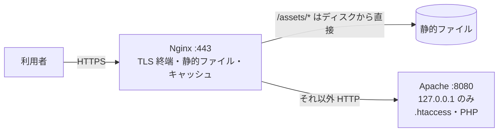

# Apache入門

[[MOC_サーバー・インフラ体系|📚 目次]] ｜ [[04_HTTPSとTLS証明書|← 前へ]] ｜ [[06_HTTPキャッシュと圧縮|次へ →]]

> [!abstract] この記事で分かること
> - Apache HTTP Server の歴史と、2026 年時点での位置づけ
> - MPM（prefork / worker / event）という処理方式の違いと選び方
> - Ubuntu での設定ファイル構成と `a2ensite` / `a2enmod` による有効化、VirtualHost の書き方
> - `.htaccess` の便利さと性能・安全面のコスト、mod_rewrite の基本
> - mod_proxy によるリバースプロキシと、Nginx との使い分け（Nginx + Apache 構成）
>
> **前提**：[[02_Nginx入門]]、[[03_リバースプロキシ]] を読んでいると理解しやすいです。

## 1. ひとことで言うと

Apache は **「何でも揃う老舗の総合デパート」**、Nginx は **「回転の速い専門店」** です。Apache はモジュール（売り場）を足せばほとんど何でもでき、テナント（ディレクトリ）ごとに独自ルール（`.htaccess`）を掲げることまで許してくれます。その柔軟さと引き換えに、設定次第では動きが重くなります。

- 正式名は **Apache HTTP Server**（コマンド名は `httpd`、Ubuntu のパッケージ名は `apache2`）
- 新規に作るアプリの前段なら Nginx が第一候補。ただし既存システム・PHP 環境・レンタルサーバーでは今も主役
- 「読める・直せる」ことがインフラ担当には求められる

## 2. 歴史と現在の位置づけ

| 年 | 出来事 |
|---|---|
| 1995 | NCSA httpd にパッチ（a patchy server）を当てる形で誕生。Apache Software Foundation の最初のプロジェクト |
| 1996 頃〜 | 世界で最も使われる Web サーバーに。LAMP（Linux + Apache + MySQL + PHP）構成が普及 |
| 2004 | Nginx 公開。C10K 問題を背景に、大量接続に強いイベント駆動型が台頭 |
| 2012 | Apache 2.4 リリース。event MPM が正式化し、大量接続にも対応できるように |
| 2026 年時点 | 2.4 系が現役（Ubuntu 24.04 は 2.4.58 ベース）。シェアは Nginx・Cloudflare などと並ぶ主要勢力の 1 つ |

現在よく見かける場面は次のとおりです。

- WordPress・PHP の既存サイト、共用レンタルサーバー（`.htaccess` 前提）
- 企業の社内システム、古くからある Java（Tomcat 連携）環境
- 認証モジュール（Kerberos・SAML など）を Web サーバーで処理したい環境

## 3. MPM：処理方式を選べる

**MPM（Multi-Processing Module）** は、Apache が接続をどのプロセス / スレッドに割り当てるかを決めるモジュールです。1 つだけ選んで使います。

| MPM | 仕組み | 長所 | 短所 | 使う場面 |
|---|---|---|---|---|
| **prefork** | 1 接続 = 1 プロセス（スレッドなし） | プロセスが独立していて安定。スレッド非対応ライブラリも安全 | メモリ消費大。同時接続数がプロセス数で頭打ち | `mod_php`（スレッド非対応）を使う旧環境 |
| **worker** | 複数プロセス × 各プロセス内の複数スレッド | prefork より省メモリ | Keep-Alive 中の待機接続もスレッドを占有 | 現在はあまり選ばない |
| **event** | worker を改良。待機中の Keep-Alive 接続は専用のリスナースレッドがまとめて見張る | 大量の Keep-Alive 接続に強い | スレッド安全でないモジュールは使えない | **Ubuntu の既定。基本はこれ** |

```
prefork:  [プロセス]─接続1   [プロセス]─接続2   [プロセス]─接続3 ...
worker :  [プロセス]─┬スレッド─接続1        （待機中の接続もスレッドを占有）
                      └スレッド─接続2
event  :  [プロセス]─┬スレッド─処理中の接続だけ
                      └リスナー─待機中の Keep-Alive 接続をまとめて監視
```

```bash
sudo apache2ctl -V | grep -i mpm        # Server MPM: event
sudo a2query -M                          # 有効な MPM 名を表示

# 切り替える場合（1 つだけ有効にする）
sudo a2dismod mpm_prefork && sudo a2enmod mpm_event && sudo systemctl restart apache2
```

> [!tip] PHP は PHP-FPM + event MPM が現代の定番
> `libapache2-mod-php` を入れると、PHP がスレッド非対応のため MPM が自動的に prefork に切り替わります。PHP を別プロセス（**PHP-FPM**）で動かし、Apache は `proxy_fcgi` で中継する形にすれば event MPM のまま使えます。Nginx + PHP-FPM と同じ考え方です。

## 4. 設定ファイル構成と VirtualHost

### 4.1 Ubuntu のディレクトリ構成

```
/etc/apache2/
├── apache2.conf          ← 大元の設定（下の各ディレクトリを Include）
├── ports.conf            ← Listen 80 / 443
├── envvars               ← 実行ユーザー（www-data）やログの場所などの環境変数
├── mods-available/       ← モジュールの読み込み設定（*.load）と設定（*.conf）
├── mods-enabled/         ← 有効なモジュール（シンボリックリンク）
├── conf-available/       ← 共通設定の断片（security.conf など）
├── conf-enabled/
├── sites-available/      ← VirtualHost の定義（000-default.conf など）
└── sites-enabled/
/var/log/apache2/         ← access.log / error.log
```

Nginx の `sites-available` / `sites-enabled` と同じ発想ですが、Apache は **モジュールと共通設定も同じ方式** で有効 / 無効を切り替えます。リンクを手で作らず専用コマンドを使います。

| コマンド | 意味 |
|---|---|
| `a2ensite <名前>` / `a2dissite <名前>` | サイトの有効化 / 無効化 |
| `a2enmod <名前>` / `a2dismod <名前>` | モジュールの有効化 / 無効化 |
| `a2enconf <名前>` / `a2disconf <名前>` | 共通設定の有効化 / 無効化 |
| `apache2ctl configtest` | 文法チェック（Nginx の `nginx -t`） |
| `systemctl reload apache2` | 無停止で設定を反映（graceful restart） |

> [!note] RHEL 系との違い
> RHEL / Amazon Linux ではパッケージ名が `httpd`、設定は `/etc/httpd/conf/httpd.conf` と `/etc/httpd/conf.d/*.conf` で、`a2ensite` 系のコマンドはありません。Ubuntu の構成は Debian 独自の整理です。

### 4.2 VirtualHost

```bash
sudo apt install -y apache2
```

```apache
# /etc/apache2/sites-available/shop.conf
<VirtualHost *:80>
    ServerName  shop.example.com
    ServerAlias www.shop.example.com
    DocumentRoot /var/www/shop

    <Directory /var/www/shop>
        # ディレクトリ一覧は表示しない
        Options -Indexes +FollowSymLinks
        # .htaccess を読まない（後述）
        AllowOverride None
        # アクセスを許可
        Require all granted
    </Directory>

    ErrorLog  ${APACHE_LOG_DIR}/shop_error.log
    CustomLog ${APACHE_LOG_DIR}/shop_access.log combined
</VirtualHost>
```

```bash
sudo a2ensite shop
sudo a2dissite 000-default
sudo apache2ctl configtest     # Syntax OK
sudo systemctl reload apache2
```

| Apache | Nginx での相当 |
|---|---|
| `<VirtualHost *:80>` | `server { listen 80; }` |
| `ServerName` / `ServerAlias` | `server_name` |
| `DocumentRoot` | `root` |
| `<Directory>`（ファイルシステムのパス単位） | （近いものなし。`location` で代用） |
| `<Location>`（URL 単位） | `location` |
| `Require all granted` / `Require ip 10.0.0.0/8` | `allow` / `deny` |

> [!warning] 古い書き方に注意
> ネット上の古い記事にある `Order Deny,Allow` / `Allow from ...` は Apache 2.2 の書き方です。2.4 では `Require` を使います（互換モジュールが必要で、混在させると意図しない許可・拒否が起きます）。

### 4.3 セキュリティの基本設定

Ubuntu では `/etc/apache2/conf-available/security.conf` にサーバー情報の露出を抑える設定があります。本番では次のように変えておきます。

```apache
# Server ヘッダーを "Apache" だけにする（バージョンを出さない）
ServerTokens Prod
# エラーページにバージョンを表示しない
ServerSignature Off
# TRACE メソッドを無効化
TraceEnable Off
```

> [!warning] Apache の設定ファイルは行末コメント不可
> `#` によるコメントは行頭にしか書けません。`ServerTokens Prod  # 説明` のように行末に書くと、`#` 以降も引数とみなされて `configtest` でエラーになります（Nginx は行末コメント可）。

## 5. .htaccess と mod_rewrite

### 5.1 .htaccess とは

**`.htaccess`** は、公開ディレクトリ内に置くと **そのディレクトリ以下の設定を上書きできるファイル** です。サーバー全体の設定ファイルを触れない共用レンタルサーバーの利用者が、自分でリダイレクトやアクセス制限を設定できるようにするための仕組みです。

```apache
# /var/www/shop/.htaccess の例
RewriteEngine On
RewriteCond %{REQUEST_FILENAME} !-f
RewriteCond %{REQUEST_FILENAME} !-d
RewriteRule ^ index.html [L]
```

| 利点 | コスト |
|---|---|
| root 権限なしで設定変更できる | **リクエストのたびに**、対象ファイルまでの全ディレクトリで `.htaccess` を探して読む（`/var/www/shop/a/b/c.png` なら 4〜5 か所） |
| reload 不要で即反映 | 設定が散らばり、全体像が把握しにくい |
| CMS（WordPress など）が自動で書き換えられる | Web アプリの脆弱性で `.htaccess` を書き込まれると、サーバーの挙動を乗っ取られる |

`.htaccess` を読むかどうかは `AllowOverride` で決まり、Apache 2.3.9 以降の既定は `None`（読まない）です。Ubuntu の `apache2.conf` も `/var/www/` に対して `AllowOverride None` になっています。

> [!tip] 公式ドキュメントの方針
> Apache 公式は「メイン設定ファイルを編集できるなら `.htaccess` は使うべきではない」としています。自分でサーバーを管理するなら、`.htaccess` の中身を `<Directory>` ブロックに移して `AllowOverride None` にするのが性能・安全の両面で正解です。WordPress のように必要な場合も、`AllowOverride FileInfo` のように許可する種類を絞ります。

### 5.2 mod_rewrite

**mod_rewrite** は、正規表現で URL を書き換えたりリダイレクトしたりするモジュールです。

```bash
sudo a2enmod rewrite && sudo systemctl restart apache2
```

```apache
<VirtualHost *:80>
    ServerName shop.example.com
    RewriteEngine On

    # 旧 URL /item.php?id=42 → 新 URL /products/42 へ恒久リダイレクト
    RewriteCond %{QUERY_STRING} ^id=(\d+)$
    RewriteRule ^/item\.php$ /products/%1? [R=301,L]

    # www なし → www あり、のような正規化
    # RewriteCond %{HTTP_HOST} ^example\.com$ [NC]
    # RewriteRule ^(.*)$ https://www.example.com$1 [R=301,L]
</VirtualHost>
```

| 記法 | 意味 |
|---|---|
| `RewriteCond` | 直後の `RewriteRule` を適用する条件（AND。`[OR]` で OR） |
| `$1` / `%1` | `RewriteRule` / `RewriteCond` の正規表現のキャプチャ |
| `[R=301]` | 外部リダイレクト（ブラウザの URL が変わる） |
| `[L]` | このルールで処理を終える |
| 末尾の `?` | 元のクエリ文字列を付けない |

単純なリダイレクトなら mod_rewrite より `Redirect permanent /old /new`（mod_alias）のほうが読みやすく間違いも少ないです。

## 6. mod_proxy でリバースプロキシ

Apache でも Shop API（127.0.0.1:3000）の前段になれます。

```bash
sudo a2enmod proxy proxy_http headers ssl
sudo systemctl restart apache2
```

```apache
# /etc/apache2/sites-available/api.conf
<VirtualHost *:443>
    ServerName api.shop.example.com

    SSLEngine on
    SSLCertificateFile    /etc/letsencrypt/live/api.shop.example.com/fullchain.pem
    SSLCertificateKeyFile /etc/letsencrypt/live/api.shop.example.com/privkey.pem

    # 元の Host ヘッダーを渡す（Nginx の proxy_set_header Host $host 相当）
    ProxyPreserveHost On
    RequestHeader set X-Forwarded-Proto "https"
    ProxyTimeout 60

    # WebSocket も同じパスで扱う（upgrade= は Apache 2.4.47 以降）
    ProxyPass        / http://127.0.0.1:3000/ upgrade=websocket
    # アプリが返す Location ヘッダーを外向けの URL に書き換える
    ProxyPassReverse / http://127.0.0.1:3000/

    ErrorLog  ${APACHE_LOG_DIR}/api_error.log
    CustomLog ${APACHE_LOG_DIR}/api_access.log combined
</VirtualHost>
```

- mod_proxy は `X-Forwarded-For` / `X-Forwarded-Host` / `X-Forwarded-Server` を **自動で付加** します（Nginx は自分で書く）
- `X-Forwarded-Proto` は自動では付かないので `RequestHeader` で付けます。アプリ側の trust proxy 設定は [[03_リバースプロキシ]] と同じです
- 複数台への振り分けは `mod_proxy_balancer` で `<Proxy balancer://...>` を定義します
- 証明書は `certbot --apache`（`python3-certbot-apache`）でも取得できます。TLS の考え方は [[04_HTTPSとTLS証明書]] と同じで、TLSRef Configurator は Apache 用の設定も出力できます

## 7. Nginx との比較と使い分け

| 観点 | Apache | Nginx |
|---|---|---|
| 処理モデル | MPM で選択（既定 event） | イベント駆動のみ |
| 静的配信・大量接続 | event MPM なら十分実用的 | より省メモリで得意 |
| ディレクトリ単位の設定 | `.htaccess` で可能 | 不可（すべてメイン設定） |
| 動的コンテンツ | モジュールで内蔵可能（mod_php など） | 必ず外部プロセスへ中継（FastCGI / proxy） |
| 設定の書き味 | XML 風のブロック、モジュールごとに文法がある | ブロックとディレクティブで統一的 |
| モジュール追加 | 動的モジュールが豊富（`a2enmod`） | 動的モジュールもあるが種類は少なめ |
| 向いている場面 | 既存 PHP / CMS、`.htaccess` 前提、認証モジュール | 新規アプリの前段、リバースプロキシ、静的配信 |

### Nginx + Apache 構成

既存の Apache アプリ（`.htaccess` を多用する WordPress など）を残したまま、前段に Nginx を置く構成もよく見られます。



- Nginx が TLS・静的ファイル・遅いクライアントを引き受け、Apache は動的処理に集中する
- Apache は `Listen 127.0.0.1:8080` にして外部から直接触れないようにする
- Apache 側のログやアプリに本当の利用者 IP を渡すため、`mod_remoteip` で `RemoteIPHeader X-Forwarded-For` と `RemoteIPInternalProxy 127.0.0.1` を設定する

ただし、2 種類の Web サーバーを運用するのはそれだけ設定・監視・脆弱性対応の手間が増えるということです。新規構築なら Nginx（+ PHP-FPM やアプリサーバー）に一本化するほうがシンプルです。

## よくある誤解・つまずき

- ❌ 「Apache は古くて遅いので使うべきでない」
  ✅ event MPM の Apache 2.4 は多くのサイトで十分な性能です。遅さの原因はたいてい prefork + mod_php や `.htaccess` の多用といった設定にあります。
- ❌ 「`.htaccess` を置いたのに効かない＝書き方が間違っている」
  ✅ まず `AllowOverride` を確認します。既定は `None` なので、`.htaccess` はそもそも読まれていません。必要なら `mod_rewrite` の有効化も確認します。
- ❌ 「`Order Deny,Allow` でアクセス制限できる」
  ✅ 2.2 の古い書き方です。2.4 では `Require ip 192.0.2.0/24` などの `Require` 系を使います。
- ❌ 「設定を変えたら `restart`」
  ✅ `apache2ctl configtest` のあと `systemctl reload apache2` で、接続を切らずに反映できます（モジュールや MPM の変更時は `restart`）。

## まとめ

- Apache は 1995 年からの老舗で、2.4 系の event MPM が現在の標準。既存 PHP / CMS 環境では今も主役
- MPM は prefork / worker / event。PHP は PHP-FPM と組み合わせて event のまま使うのが現代の定番
- Ubuntu では `sites-` / `mods-` / `conf-available` と `a2en*` コマンドで有効化し、`configtest` → `reload` で反映
- `.htaccess` は便利だが毎リクエストの探索コストと安全上のリスクがある。自分で管理するサーバーでは `AllowOverride None`
- mod_proxy でリバースプロキシも可能。新規なら Nginx、既存資産を活かすなら Nginx + Apache 構成も選択肢

## 確認クイズ

1. `libapache2-mod-php` をインストールしたら、同時接続が増えたときにメモリが急増するようになりました。何が起きていて、どう改善できますか。
> [!tip]- 答え
> mod_php はスレッド非対応のため MPM が prefork（1 接続 1 プロセス）に切り替わり、接続数に比例してプロセスとメモリが増えています。PHP-FPM を導入して `proxy_fcgi` で中継する構成にし、MPM を event に戻すと改善します。

2. 自分で管理している Ubuntu サーバーで、`.htaccess` に書いたリダイレクトが効きません。最初に確認すべき設定は何ですか。また、根本的にはどうするのが望ましいですか。
> [!tip]- 答え
> そのディレクトリの `AllowOverride` が `None`（既定）になっていないか確認します（mod_rewrite の有効化も確認）。メイン設定を編集できるなら、`.htaccess` は使わず内容を VirtualHost の `<Directory>` に移し、`AllowOverride None` のままにするのが性能・安全の面で望ましいです。

3. Nginx（前段）+ Apache（後段）の構成で、Apache のアクセスログのクライアント IP がすべて 127.0.0.1 になります。どう直しますか。
> [!tip]- 答え
> Nginx 側で `X-Forwarded-For` を付けたうえで、Apache 側で `mod_remoteip` を有効にし、`RemoteIPHeader X-Forwarded-For` と `RemoteIPInternalProxy 127.0.0.1` を設定します。信頼するプロキシを限定するのは偽装を防ぐためです。

## 関連ノート

- [[01_Webサーバーとは]] — 処理モデルと製品比較
- [[02_Nginx入門]] — Nginx の設定構成との比較
- [[03_リバースプロキシ]] — 転送ヘッダーと trust proxy
- [[04_HTTPSとTLS証明書]] — 証明書と TLS 設定の考え方
- [[06_HTTPキャッシュと圧縮]] — 次回。Apache でも同じ HTTP ヘッダーを扱う
- [[03_Pythonアプリを本番で動かす]] — アプリサーバー側の話

## 参考

- [Apache HTTP Server Documentation 2.4](https://httpd.apache.org/docs/2.4/)
- [Apache: Multi-Processing Modules (MPMs)](https://httpd.apache.org/docs/2.4/mpm.html)
- [Apache: event MPM](https://httpd.apache.org/docs/2.4/mod/event.html)
- [Apache: .htaccess files（When (not) to use .htaccess files）](https://httpd.apache.org/docs/2.4/howto/htaccess.html)
- [Apache: core — AllowOverride](https://httpd.apache.org/docs/2.4/mod/core.html#allowoverride)
- [Apache: mod_rewrite](https://httpd.apache.org/docs/2.4/mod/mod_rewrite.html)
- [Apache: mod_proxy](https://httpd.apache.org/docs/2.4/mod/mod_proxy.html)
- [Apache: mod_remoteip](https://httpd.apache.org/docs/2.4/mod/mod_remoteip.html)
- [Ubuntu Server docs: Web services](https://documentation.ubuntu.com/server/how-to/web-services/)
